## 01 Introduction

1. 001 Course content.en
=====================
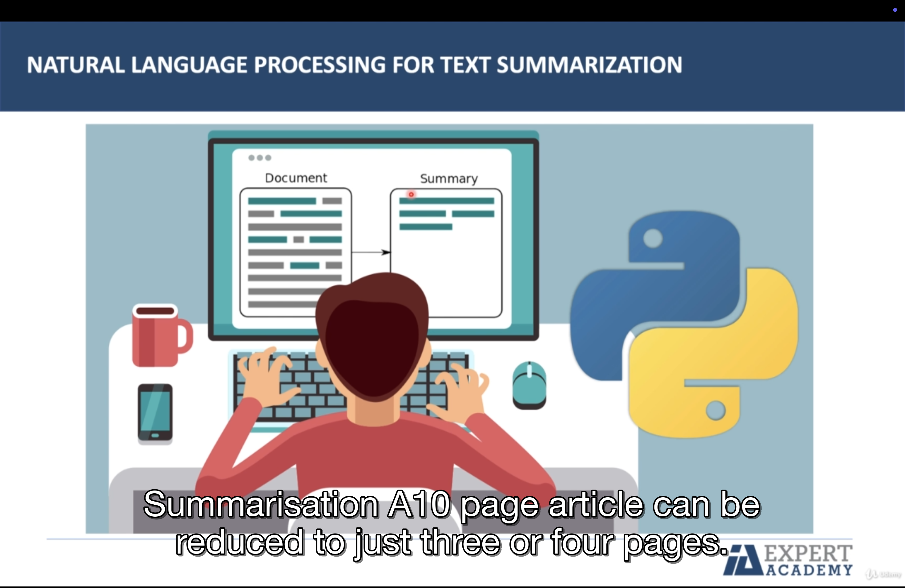
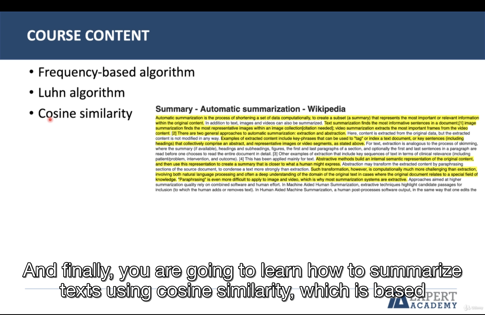
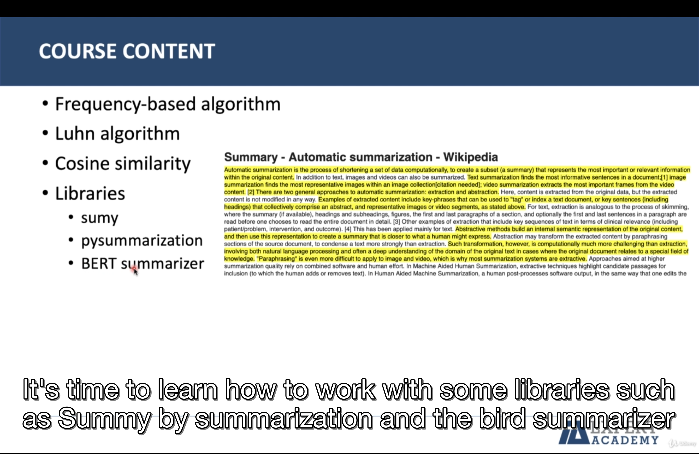
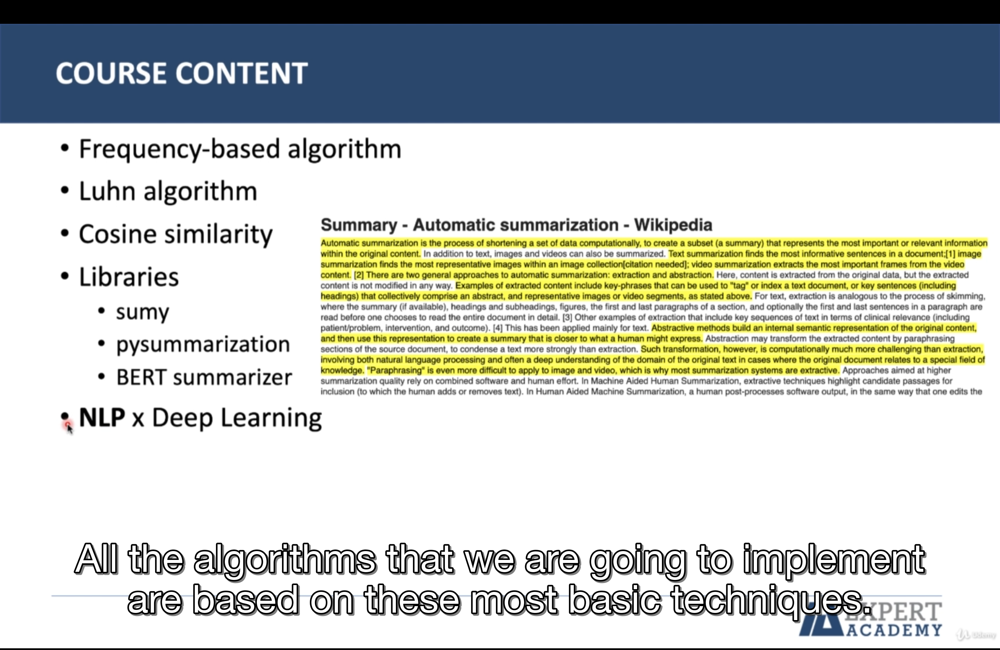
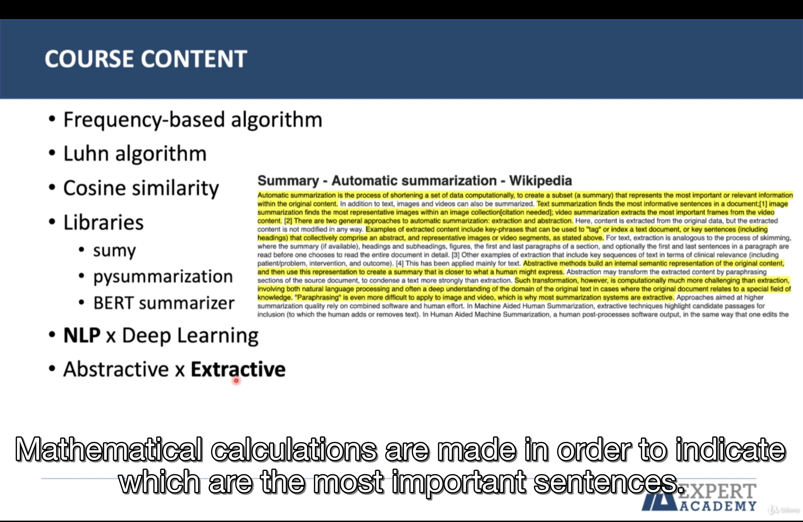
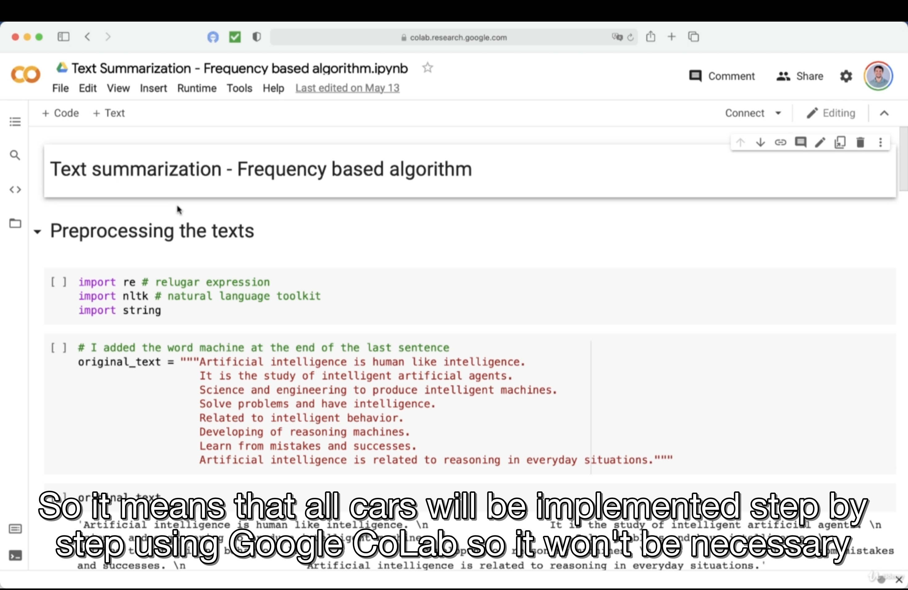
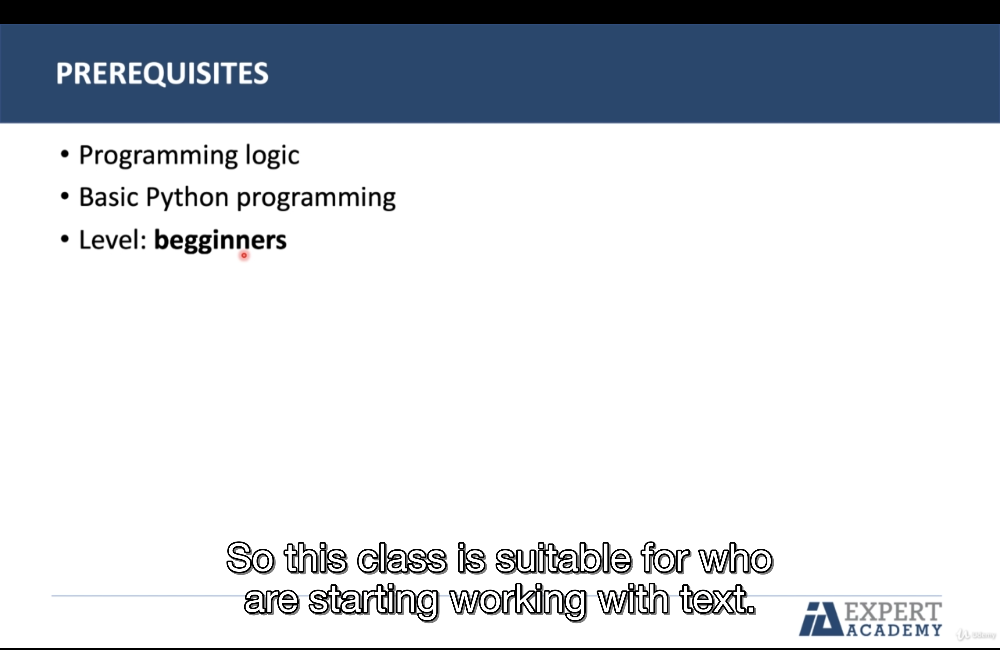

Hello and welcome to this course on text summarization in Python. My name is Jones Granatyr and I will teach all the classes in this course. Firstly, congratulations for your interest in natural language processing, which nowadays is considered one of the most important topics in artificial intelligence. This image shows one example where the goal is to develop algorithms to summarize texts. Here we have the original text or the original documents, and the idea is to reduce the size of the text so that we have only the main sentences, or the most important sentences.

This type of algorithm is very useful. when you have very long articles and it is impossible to read them, or, for example, you don't have enough time. When you apply text summarization, a 10-page article can be reduced to just three or four pages. That contains only the main ideas of the text. This image shows an example that we will implement step by step. It is an article extracted from Wikipedia where we can see the full text and the most important sentences are highlighted in yellow.

Instead of the person reading the whole text, he or she can read only the selected sentences because according to mathematical calculations, these are the most important, to understand the meaning of the article. What makes this course unique is that you will implement step by step from scratch three algorithms for text summarization, the frequency-based algorithm, the Luhn algorithm, which is very important because it was one of the first efforts in the area of text summarization.

And finally, you are going to learn how to summarize texts using cosine similarity, which is based on mathematical calculations. to find the sentences that are most similar. After implementing text summarization from scratch, it's time to learn how to work with some libraries, such as Sumy, pysummarization and the BERT summarizer. pysummarization is based on recurrent neural networks, And this last one has been developed with one of the most powerful architectures to solve many complex natural language processing problems.

Basically, there are two ways to implement the algorithms when working with this subject: the basic techniques of natural language processing, NLP, and more advanced techniques using deep learning, which are artificial neural networks. All the algorithms that we are going to implement are based on these most basic techniques. And these two libraries, pysummarization and BERT, are based on deep learning. It is important to emphasize that the focus of this course is on NLP techniques and we are not going to implement neural networks.

And there are two ways to generate the summaries: abstractive and extractive. The algorithms that we will use in this class are based on the extractive technique. Mathematical calculations are made in order to indicate which are the most important sentences. No changes are made to the original text. As you can see here, we have the full text and the sentences highlighted are considered the most importance, according to the algorithm. In other words, each sentence will have a score and the sentences with the highest score will be selected.

On the other hand, abstractive techniques will not select the most important sentences, but will create new texts based on existing texts. It is as if you were a person who reads the text and creates your own summary, however, it is also important to emphasize that in this course we will only work with extractive techniques. If you have never heard about text summarization at the end of the course, you will have the theoretical and mainly the practical background to develop your own projects.

Here you can see a Google Colab file. So it means that all codes will be implemented step by step using Google Colab so it won't be necessary to install libraries in your machine. So it will be easier to follow the course. And here you can see some of the code. This is the frequency-based algorithm. As you can see here, all lines will be implemented step by step. And here in this part, we have the generation of this summary. You will also learn how to extract texts from the Internet.

For example, we can specify a link and here at the end we can see the results. Now, let's quickly talk about prerequisites you need to know about programming logic and also some basic python programming. The level of the course is beginner. So this class is suitable for those who are starting to work with text summarization or natural language processing, and that's it for this lecture. In the next one, you will have some theoretical background about natural language processing, mainly some interesting applications.

And right after we will move on to the algorithms. I hope you have a great class and enjoy the content. See you next time.

2. 002 Introduction to natural language processing.en
==================================================

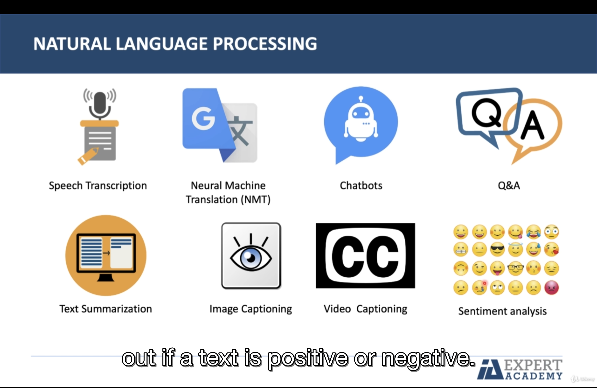
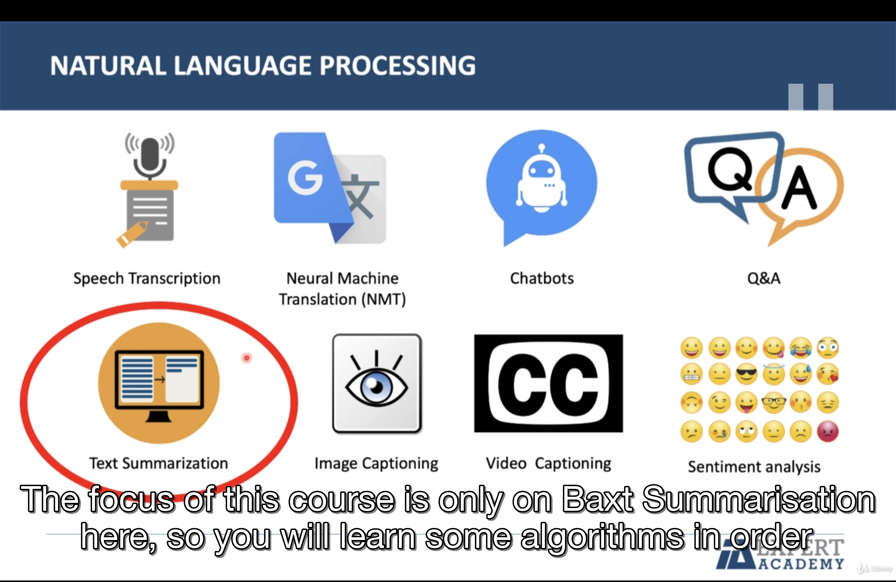

Hello and welcome to this lecture where you are going to learn a basic introduction to natural language processing, mainly we will see some interesting applications that can be developed. You can feel motivated to study this area if you know some of the applications. The first one is a speech transcription. You speak and the corresponding text is generated or you write and the algorithm reads the text for you. The area of natural language processing is related to both written and spoken language.

This second application is neural machine translation, which is translation between languages. For example, English text can be translated into Portuguese, Chinese, Spanish and many other languages. The next application is the chatbots that have been used on a large scale by companies to serve customers. Instead of talking to a human attendant, customers can solve some problems by talking to machines. The interesting point is that currently chatbots can interact both by spoken and written language.

The next application is Q and A systems that are very useful in question and answer forums. As the name suggests here, this type of application is useful for searching similar answers, so there is no need for a person to answer frequently asked questions. The next application is text summarization. As you can see in this image here we have the full text on the left side. Then we apply some specific algorithms. And on the right side we have this summary.

So the summary contains only the main parts of the text, this type of algorithm is very useful for those who are in the academic field. For example, studying in a master's or PhD class. In this scenario, the student needs to read a lot of papers, articles, and he or she does not have enough time to read all of them. So a summarization algorithm can be applied and the students will need to read only this summaries that contains what is most important in the texts.

For example, instead of reading ten pages, the student can read only five or four pages. This other image here shows image captioning, which is the generation of descriptions for images. For example, if there is an image of a black dog jumping over a fence, the algorithm will interpret the image and adds that description. This type of application is very useful to help people who have some difficulty seeing. We can see this other application, which is video captioning, which aims to generate captions for videos.

For example, while I'm talking now, some automatic captions are being generated. According to the words I'm speaking, the last application is sentiment analysis, which aims to find out if a text is positive or negative. It is very useful for companies to analyze what their customers have been saying about products and services. For example, the company can post something on a social network and check the feelings that this post is generating. The focus of this course is only on text summarization here, so you will learn some algorithms in order to generate the summaries.

And that's all for this lecture. See you next time.

## 02 Frequency-based algorithm

1. 001 Plan of attack.en
=====================

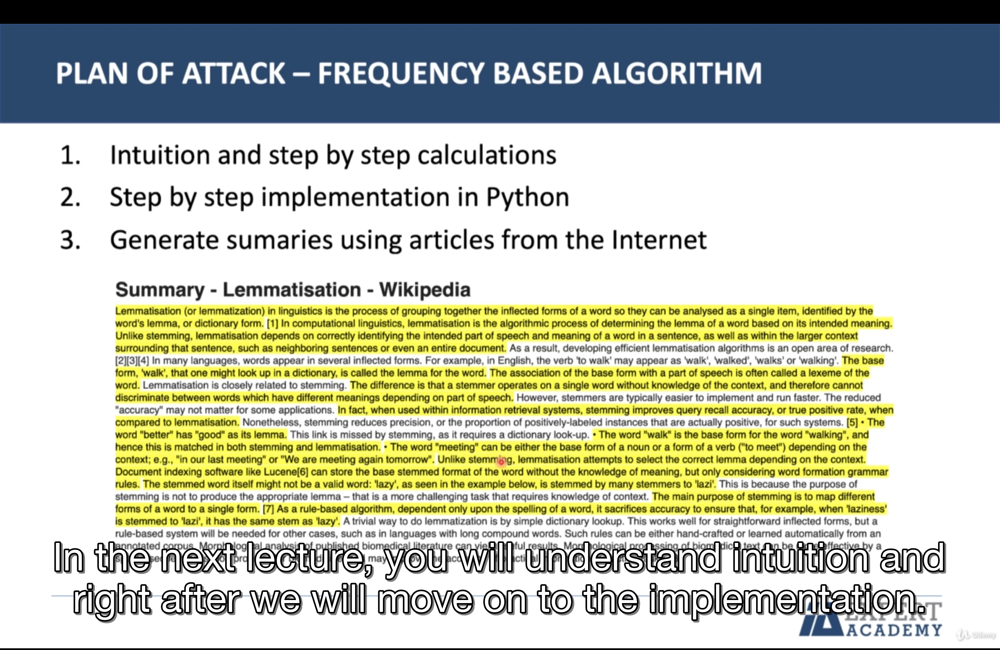

Hello and welcome to the first section of the course on text summarization in Python, in this lecture, I'm going to show you the plan of attack. As you can read right here, the goal of this section is to present to you the simplest algorithm in order to work with text summarization, which is the frequency-based algorithm. Now, let's see the main topics that will be covered in this section. In the first topic, you are going to learn the mathematical calculations.

And right after in topic number two, we will implement this together in Python. We will also compare the theoretical results with the practical results at the ends. You will be able to compare the original text and the summary and check if, in fact, the algorithm is returning good results. In topic number three, you are going to learn how to generate summaries using articles extracted from the Internet. You are going to learn how to extract some texts from Wikipedia pages, and then we will apply our algorithm.

This image shows the final result that we will implement: the full text. And in yellow, this summary with the selection of the most important sentences. In the next lecture, you will understand intuition and right after we will move on to the implementation. See you there.

2. 002 Algorithm - intuition.en
============================

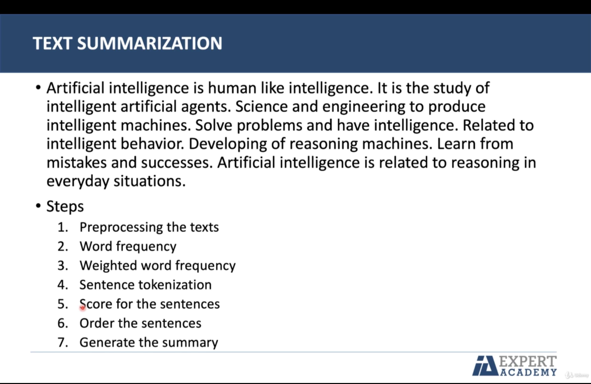
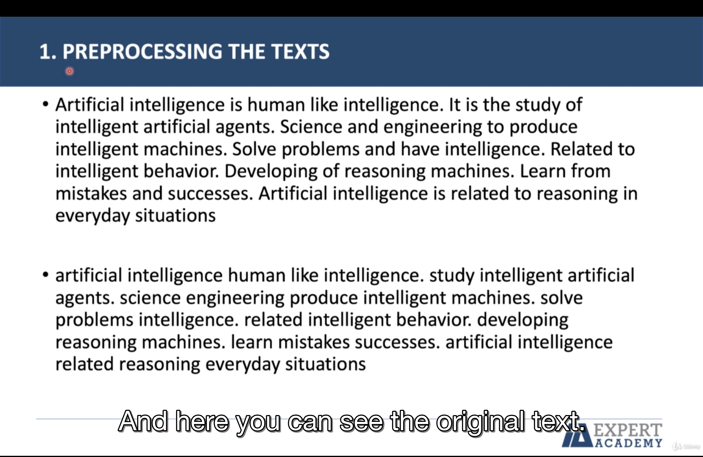
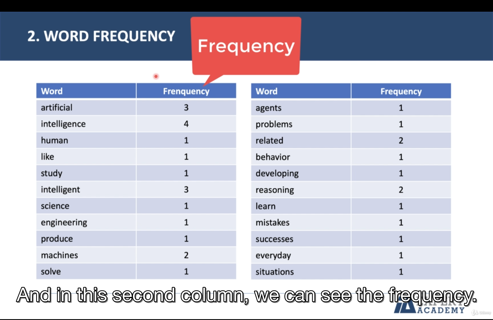
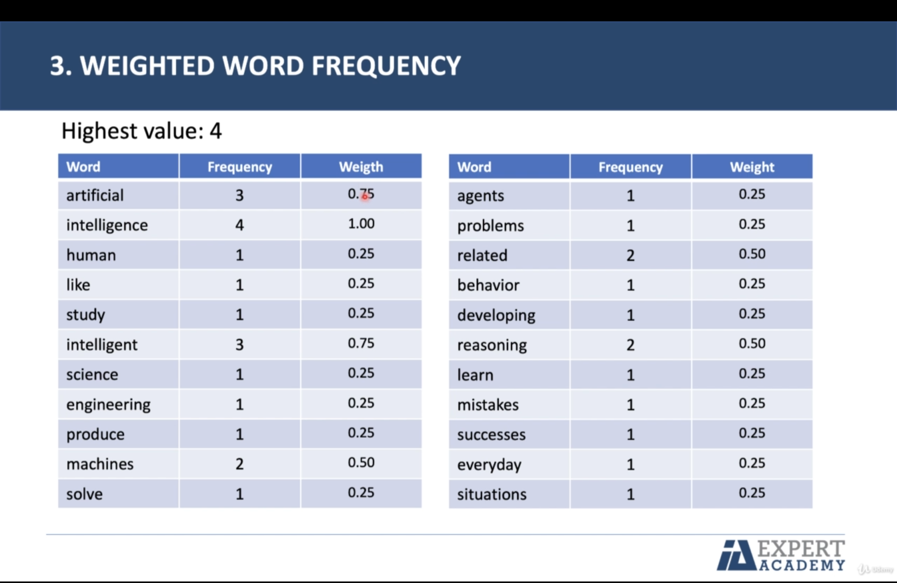
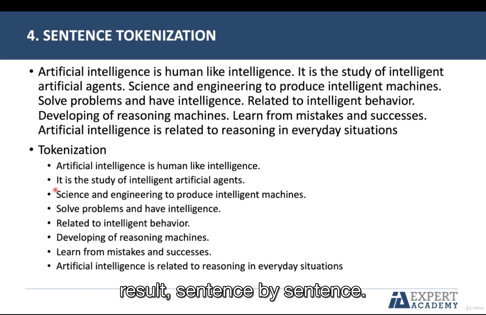
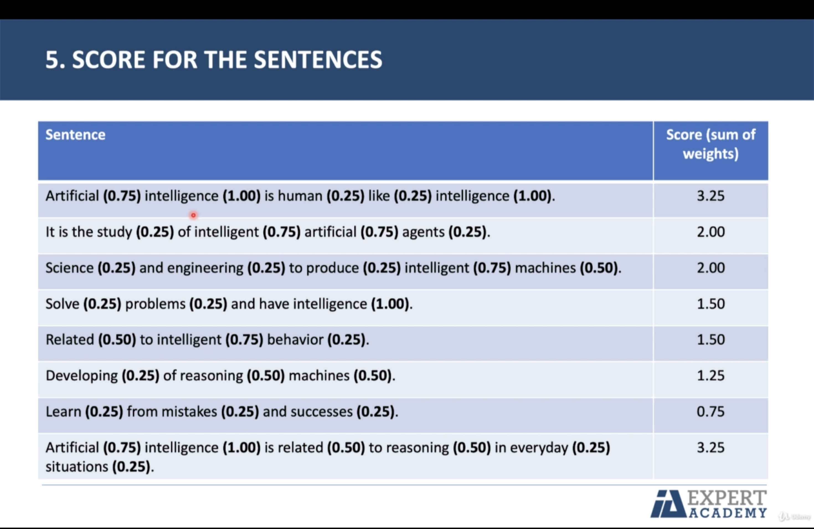
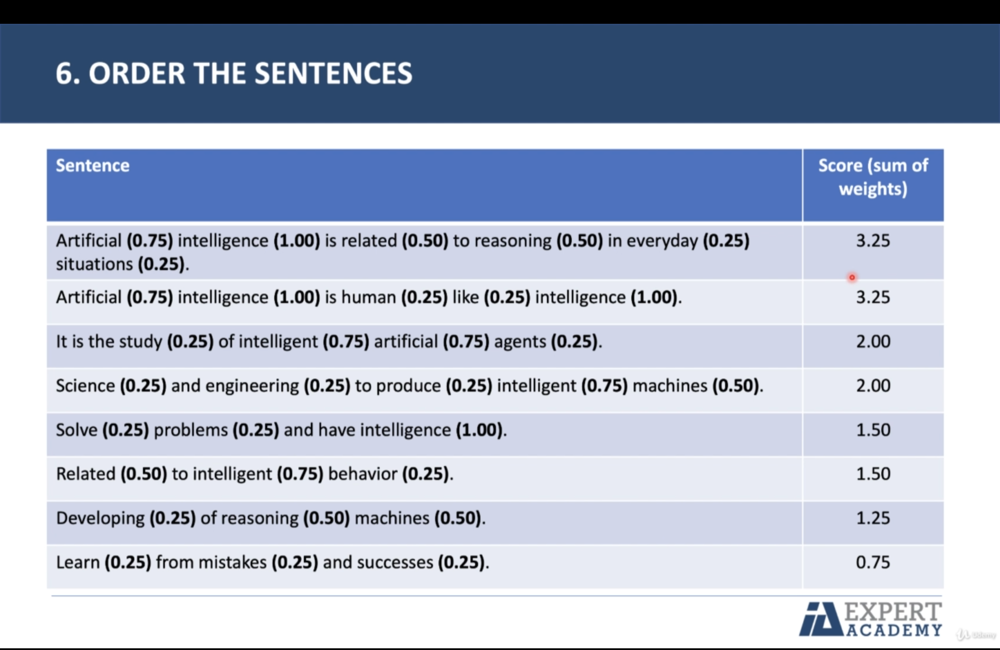
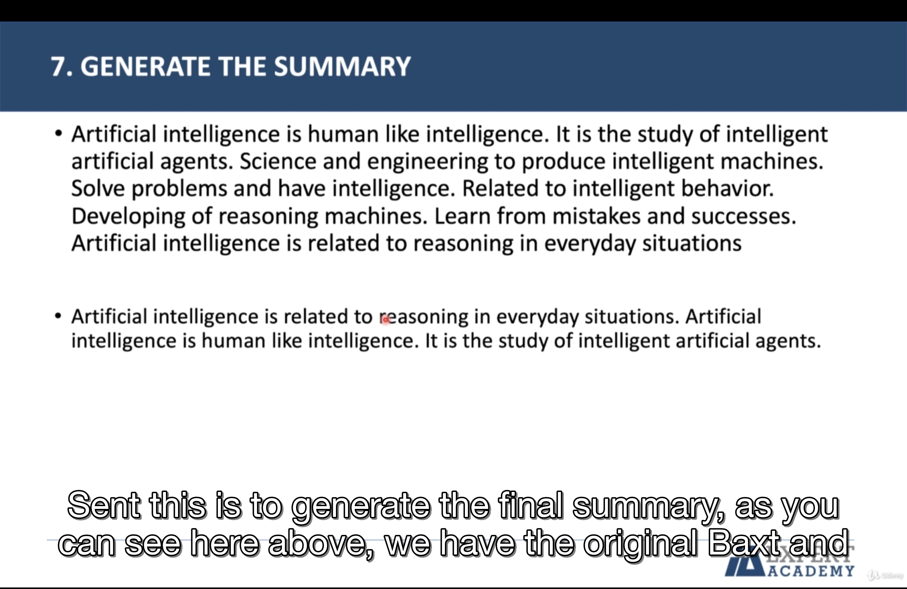

Hello and welcome to this lecture where you are going to learn the intuition about one of the most basic algorithms for Text summarization, which is based on the frequency of words, let's consider this initial text that has several sentences about artificial intelligence. For example, artificial intelligence is a human like intelligence. It is the study of intelligent artificial agents, science and engineering to produce intelligent machines, solve problems and have intelligence related to intelligent behavior.

Developing reasoning machines. Learn from mistakes and successes. And finally, artificial intelligence is related to reasoning in everyday situations. This will be the text that we will use as a case study in order to understand the mathematical calculations. Just a reminder that the goal is to select the most relevant sentences of this text here. To reach this goal, we need to follow a sequence of seven steps. As you can see here, the preprocessing of the texts, the calculation of the frequency of the words, and also the definition of the weights or the importance of each one of the words.

Then we move on to the next step, which is the tokenization of the sentences. After that, the sum of the scores for each sentence, the order of the best sentences, And finally, the generation of this summary, considering only the most important sentences. Now you are going to learn step by step each one of these steps here. Let's start by understanding step number one. And here you can see the original text. And just below the preprocessed text, we have the application of three types of processing.

The first one is the change to only lowercase letters. Above, We have uppercase and lowercase letters and here we have only lowercase letters. It is important to change the text because if we have these words here, intelligence with lowercase letters and again the word intelligence with capital letters, the algorithm will consider both as different words. So we need to keep them all in the same pattern. This second preprocessing was the removal of some stop words.

For example, this word is is not being used here. It, the, it's not being used in the processed text, the word of is not being used here. Also, the words and, have, to, again of, from, and is, the, and finally the word in. The words that were removed are called stop words. And they are removed because they are not so important for understanding the meaning of the sentence. Finally, the punctuation has also been removed from the texts, as you can see here, here and here at the end of each one of these sentences.

And this is the first step of the algorithm. This second step is to select each one of the words that are in the preprocessed text and count how many times each one of them appears in the text. In the left column of this table here, we can see the words. And in this second column, we can see the frequency. For example, artificial equals three. It means these words appears three times in the processed text. We can take a look here, one, two, and finally three times the word intelligence appears four times in the pre-process text.

We can take a look here, one, two, three, and finally four in this part of the text. And a lot of words appear only one time, for example, human, like, study and all those words here on the right part of the table, we can assume that the more a word appears, the more important it is. The frequency calculation is used in step number three, which is the association of weights. For each one of the words, we will use the word that appears more often in the text, which is intelligence.

And it appears four times according to this table here. You can see here a new table like the one we have been discussing with the addition of a new column. The weights for the words artificial is zero point seventy five. And you get this value. We simply divide the number of times the word appears by the highest value. Let's open the calculator in order to perform some tests. For example, artificial appears three times in the text. Three divided by four equals zero point seventy five.

Let's consider the word here machines. It appears two times in the text. Two, divided by four, the highest value. The result is zero point five. We can take a look at some other words, human, it appears, only one time in the text, one divided by four, which is the highest value. The result is zero point twenty five. And we can take a look. That's the weights for the words. Intelligence is one because we divide four, the number of times this word appears in the text, by four, which is the highest value.

The result is one. So it is considered the most important words. The purpose of this algorithm is to select sentences that contain words that appear more often. In short, sentences that contain the words intelligence, artificial and also intelligence are more important than sentences that contain these other words here that appear less often in the text. The next step is sentence tokenization, and the goal is only to separate sentence by sentence. See, here we are using the original text,

without the application of the preprocessing step. In this example, we can consider the dots here as the sentence delimiter, and here is the result, sentence by sentence. This is a very easy step. Now that we have the sentences, we can move on to step number five, which is the calculation of this score for each one of them. We use the values of the weights that were calculated before and we simply add the values. For example, for the first sentence, the value is three point twenty five.

We just add the weights, for example, zero point seventy five plus one, the weight for the words intelligence plus zero point twenty five, the weights for the words human plus zero point twenty five, the weights for the words like. And finally plus one, the weight for the word intelligence. See here that the result is three point twenty five and we perform exactly the same calculation for each one of the sentences. Please note that we do not consider stop words here.

For example, the word is is not consider the words. It is the are not considered for the calculations in this part of the table here you can see this sum and the scores for all other sentences. The higher the value, the more important this sentence is. On the other hand, the lower the value, the less important this sentence is. We can see that there is a tie between two sentences, the first and the last one. Both have the same score and this one here learn from mistakes and successes has the value zero point seventy five.

So it is considered the worst sentence after calculating the score. The next step is to order the sentences according to the score value as shown in this table here. In order to create this summary, we need to define how many sentences we will select. And it depends on the size of the text. The larger the text, the more sentences must be selected. As there are only eight sentences in this text, we can select the three most important ones. See here that we have three point twenty five three point twenty five.

Both sentences are considered the best one in the third and fourth place. We have again a tie. The value is two for each one of these sentences. And again, the worst sentence is this one here with the lowest value. And this is the last step of the algorithm in which we combine the main sentences to generate the final summary. As you can see here above, we have the original text and below the summary. In the next lecture we start the practical implementation of this frequency-based algorithm.

See you there.

3. 003 Preprocessing the texts 1.en
================================

See the code [here](./1.Text_Summarization_Frequency_based_algorithm.ipynb)

Hello and welcome to this lecture where we are going to start the implementation of the frequency-based algorithm in order to summarize the texts, we already have this Google Colab file. And if you are new to Google Colab, you will have access to this file here. And in order to run our to make changes to this notebook, you must click on file, save a copy drive. When you click this link, a copy of this notebook will be made on your own Google Drive, so you must have a Google account and be connected to it.

I will click this button here connect in order to connect this file to the Google servers. And initially we will use the same example as the theoretical lecture in order to compare the results of the slides. Right after, we extract a text from the Internet in order to apply our algorithm, the first step is the preprocessing. Let's open a new cell of codes and let's import some libraries. The first one, import re, it means regular expression. This is a Python library in order to find patterns in texts. Let's import

nltk, it means Natural Language Toolkit. This is one of the most famous libraries to work with natural language processing in Python. And finally, let's import string in order to have access to some features that we are going to use later. Let's run this cell of codes. No error was returned, so it means that all libraries work correctly. In part two, let's create the original text, and now I'll just paste the code here. You can see that this is exactly the same text that we have been using in the theoretical lecture.

See here that we have three quotation marks and we use them in order to skip the line after each one of the sentences. So it is easier to read the text if you don't use this quotation marks. You need to type the code like this, a sentence after another, so it will be difficult to read for this reason. We are using these quotation marks. Let's create this variable. We can take a look at the content. Let's type original_text. We have these spaces here after we skip the line.

And we also have this symbol here, \n, which means that we are skipping the lines. So we need to remove these characters in order to be easier to process this text. Let's recreate this variable. original_text equals re.sub, that we use for regular expressions. Let's type r in order to define our expression, and to find the empty spaces we can type this symbol here, \s. It means that this library will go through all this text and it will search for these empty spaces when it finds the empty spaces we will replace by only one empty space.

And here we put again the original text. As we have more than one space, we can put this symbol here. It means that we may have one or more empty spaces. Let's run this code. It's missing the word sub here. Run again. Let's take a look at the original text and see here that we don't have this symbol and also we don't have the empty space anymore. And in the next lecture, we are going to continue the implementation. See you there.

4. 004 Preprocessing the texts 2.en
================================

See the code [here](./1.Text_Summarization_Frequency_based_algorithm.ipynb)

Hello and welcome to this lecture where we are going to continue the implementation of the preprocessing step, as we can see in this slide, we have the original text and we need to apply some preprocessing. For example, we are going to change the letters to only lowercase. Also, we're going to remove the stop words and finally, we're going to remove the punctuation in this lecture. We are going to implement all these three preprocessing steps. Let's create the new function, preprocess, and it will receive as a parameter the text. Let's create another variable, formatted_text equals text.lower().

This code here will change the text, lower case. We can return the formatted text. Let's create this function and perform the first test. I will open a new cell of codes. Let's create a new variable formatted text equals and let's call our new pre-process function. And I will send the here our original text, which is this text here. Let's take a look at the variable formatted text. Run this cell. See here that all the words were changed to lowercase letters.

This is the first step of the preprocessing and the next step. we're going to remove the stop words. In order to do that, let's create a variable called tokens in the format of a list. When we open and close brackets, it means that we are defining a list in Python. So we are going to go through each one of the words and start each one of them in this list here. Let's implement a for loop for token in nltk, which is the Natural Language Toolkit, in order to work with natural language processing in Python.

And there is a function called word_tokenize. And we are going to send here the formatted text. So we are going through each one of these words and we are going to check if each one of them is considered a stop word. But first, let's add to this list, tokens.append(token). Let's run this code and try to run this function again. An error was returns because we need to execute this code nltk.download('punkt'). And in order to use this word_tokenize function, we need to download this package here.

So we'll create a new set of code. Let's paste this code here. And again, see, that's the download is complete. If you see this message True, it means that's the download and the installation was done successfully. Let's try to run this code. I can call the function. No error was returns. Now we can take a look at this list after the for loop. Let's print tokens. Run again. Call the function. See here that's there is a list and in each position of the list there is a

word, or in other words, there is a token. This function word_tokenize will go through each one of the words and it will separate them. So now we can access each one of them and check if they are or they aren't stop words. And in order to do that, we need to download another package, nltk.download('stopwords'). Let's run this code. If you see this message True here, it means that the download and the installation was done successfully. I will create a new variable, stopwords equals nltk.corpus.stopwords.words, and here we can set the language that we are using as we have an English text, we can type English here.

If you are developing a text summarizer for another language, you just type the name of the language here. Let's print the stop words. An error was returned because it's missing a dot after corpus.stopwords. Let's run again. See here that we have in the form of a list some words that we are going to remove. For example, i, me, my, myself and so on. Let's check how many stop words we have in this list len(stopwords). The result is one hundred and seventy nine.

So this is the total amount of words that we are going to remove from our text. And it is quite simple to do that. Talkings equals open and close brackets. In order to define that this variable in the format of a list, I will create a new variable called words and let's implement the for loop for words in tokens. This for loop here is going through each one of the tokens. The first time we execute this for loop, it will take the word artificial, in the second time, the word intelligence, in the third time the word is and so on.

And we are copying each one of these to this variable here. So now we need to verify if this word here is in this list here, in this stop words list, so we can implement an if statement: if word not in stopwords. So we are going to select the words which are not inside these lists here. Instead of returning the formatted text, let's return the tokens. Run again. There is a typo here. It's missing in: for word in tokens. let's create the function again.

And let's test. See here now that we have each one of the tokens and we don't have stop words anymore. For example, the word is was not returned. It, is were not returned by the function because actually they are considered stop words. And the last step we need to remove the punctuation. And in order to do that, we can type string.punctuation. In this list here, there are a lot of kinds of punctuations that we may remove from the texts. For example, exclamation mark, open and close brackets, open and close braces and so on.

See that the dot is here. Now we are going to add our new code here: and word not in string.punctuation. So we are selecting the words that are not in this stop word list and also are not in the punctuation list. Let's run the function again. Run this code here. See, that's now we don't have stop words and punctuation anymore. And the last step in order to finish the implementation of this function is to transform this list here in the format of a string because we need the same formats we have here.

In order to do that, we are going to use the codes to concatenate all these strings here. I will create a new variable. formatted_text equals, and let's join all these tokens with an empty space, and let's implement the for: element for element in tokens. This for here is exactly the same we implemented here in order to go through each one of the tokens and we are joining with an empty space. Let's return the formatted text, create the function again, let's perform the test.

And now we can see the final results. Just a reminder that we changed the letters to lowercase. After that, we removed the stop words and finally we remove the punctuation. And in the next lecture, we are going to start this second step of the algorithm, which is the word frequency. See you there.

5. 005 Word frequency.en
=====================

See the code [here](./1.Text_Summarization_Frequency_based_algorithm.ipynb)

Hello and welcome to this lecture where we are going to implement step two of the algorithm, which is the word frequency, last class we implemented the preprocess function. And now we have the preprocessed text, and the result is the preprocessed text, as you can see here. And the goal now is to find the unique words in this text and count how many times each one of them appears on the text. Let's open a new set of codes. I will create a new variable called word_frequency equals nltk.

And there is a function called FreqDist, which means the frequency distribution of the words. And now let's send here the formatted text, the text that was pre-process in the last lecture. Let's take a look at this variable word frequency and see that it is counting the characters and not the words. For example, letter a appears 19 times, letter b two times, letter c 14 times and so on. And in order to count the words, we need to tokenize them.

So we are going to type this code, nltk.word_tokenize. This is exactly the same code we implemented here in the pre-process function. Let's run this code again and you can see that we have how many times each word appears in the text, for example, artificial three times, intelligence four times, intelligent three times, reasoning two times and so on. And you can compare the results of the implementation with this table here. And you may see that we have exactly the same numbers See that we have open and close braces.

So it means this variable is a dictionary in Python. We have the keys and the values. The keys are the words and the values are the number of times each words appear in the text. We can access this dictionary typing word_frequency. And if we type the word artificial, the result is three. So it means this word appears three times in the text. We can also try other words, for example, intelligence. It will be returns number four, exactly the same as we have here.

We can also take a look at the keys. We can type word_frequency.keys(). We have a list of unique words. For example, artificial intelligence, human like. We can also take a look at the length, word_frequency.keys(). The result is twenty two. There are twenty two unique words in this text. And in the next lecture we are going to move on to the next step, which is the definition of the weights for each one of the words. See you there.

6. 006 Weighted word frequency.en
==============================

See the code [here](./1.Text_Summarization_Frequency_based_algorithm.ipynb)

Hello and welcome to this lecture where we are going to continue the implementation of our text summarization algorithm based on the frequency of the words. Last class, we implemented this part here, the word frequency. And now we're going to use these values here in order to give weights to each one of these words. Let's open a new cell of codes. And the first step is to get the highest frequency, exactly the same as we have here. We need to get the maximum number.

Let's create this variable. highest_frequency equals max(word_frequency.values()). When we type values, We are accessing only these numbers here and we need to get the highest one. Let's take a look at these variable highest frequency. Let's just correct here and also here. Run this code, see that the result is four. Now, we need to go through each one of these words here and divide the frequency by the highest value. I will open a new set of codes and let's implement a for loop: for word in word_frequency.keys().

Let's take a look at this variable words. See that we are going through each one of the words. Now we need to divide the numbers. word_frequency, we are accessing the dictionary in the position word. So we are going to change this variable here. Now we have only this simple frequency and we are going to change for the weighted frequency based on the weights: word_frequency in the position word, divided by the highest frequency. See, that's this code is quite simple.

After running this for loop, let's take a look at the word frequency. And finally, we have exactly the same results as the theoretical class. See here that the weights for the word intelligence is one for the word artificial is zero point seventy five and so on. And in the next lecture, we are going to implement this sentence tokenization. See you there.

7. 007 Sentence tokenization.en
============================

See the code [here](./1.Text_Summarization_Frequency_based_algorithm.ipynb)

Hello and welcome to this lecture where we are going to move on to the next step of our frequency-based algorithm, which is sentence tokenization, This step is quite easy and the goal is just to find the dots here and divide the sentences. So instead of having this text all together, we will separate them into sentences. let's open a new cell of code. And before we perform the tokenization or our sample text, we will use another text just to better understand how tokenization work.

Let's suppose we have the following text: "PhD John went home. He arrived early." As we saw before, we can separate the texts by the dots, and in this specific case here we can use this Python function, which is the split function. We can type here dot. And when we run this code, see that we have this sentence tokenization: "PhD John went home", "He arrived early", and this is a way in order to tokenized this sentence is when you find this token here, you split the text.

But there is a problem in this approach. I will copy and paste again. Let's suppose we have this symbol here, Ph.D., which is the abbreviation of this word. So we may find this word in this format rather than in this other format, with the dots, and if we use this split function, when we run this code, see that we have a sentence composed of Ph, another sentence, D, John went home. But there is this additional D, which belongs to the first sentence and not to this second sentence.

So this split function is not so good in order to perform sentence tokenization. On the other hand, we can take a look at the nltk.sent_tokenize function and let's type here exactly the same text. I will copy and paste it here when we run this code C here. That's now this sentence. Tokenization is correct. The first sentence and this second sentence. And in this first approach here, we also have this and this sentence. For this reason, we prefer to use this natural language processing libraries because they deal with these kinds of problems.

They can identify that this part of the word here is an abbreviation. Now let's create a new variable, sentence_list equals nltk.sent_tokenize, and let's put here the original text, let's take a look at this sentence list. Now we have one line for each one of the sentences and we use the original sentences here to show the results to the user because it makes no sense to show the results without stop words or without punctuation. The user would have difficulty reading the results.

In short, the original version of the text here is used to show the results to the user. while the preprocessed version is used to perform the mathematical calculations in order to find the best sentences? And in the next lecture we are going to continue the implementation and finally we will generate the score for each one of the sentences. See you there.

8. 008 Generating the summary.en
=============================

See the code [here](./1.Text_Summarization_Frequency_based_algorithm.ipynb)

Hello and welcome to this lecture where we are going to perform three final steps in order to have the final results. Step number five, in which we will go through each one of the words in order to get these values and have the score. After that, we will move on to step number six, where we are going to simply order the sentences by the score value. And finally, in step number seven, we are going to select only the best sentences in order to generate the final summary as these three steps are quite straightforward.

We are going to implement them in this same lecture. Let's open a new set of codes and we can take a look at the variable word frequency. So now we are going to go through each one of these words. Here we will check if these words are in this dictionary. And if they are, we're going to add these values in order to have the score for each one of these sentences. Let's open a new cell of codes. I will create a new variable called score_sentences. It will be a dictionary.

And now let's implement a for loop for a sentence in sentence list. Let's print this sentence just to check what this for is doing. We see that we are going through each one of the sentences now? We need to implement the words tokenization, gets each one of these words and check if they are in this other dictionary here. Now, let's implement another for loop: for word in nltk.word_tokenize. And let's send here our sentence and I will convert them to lowercase. See here that we have the original sentences that we are going to show the results to the user.

So we need to convert these letters to lowercase as we have here, all words in lowercase. We can also print each one of the words, let's run this code. There's a typo here. Tokenized run again. Now we can clearly see that in the first print we are showing the whole sentence and in this second for loop, we are accessing each one of the tokens. Now we are going to simply check if these tokens are in the list of the unique words. This dictionary here let's implement an if statement: if word in word_frequency.keys(), then we are going to access score_sentences.

And let's define here the key sentence, equals word_frequency of the word. So we are accessing we are checking if the words is equal to the key values. And if this condition is true, we are getting these values here in order to add them. Now let's implement an if statement: if sentence not in score_sentences.keys(). We are accessing this new variable here because the goal is to start in this variable here, this sentence as keys. So instead of having indexes, we will have the whole sentence and the score as values.

For this reason, we are checking if it's not in the score_sentences dictionary. So we are going to add score_sentences[sentence] equals word_frequency, and we are assigning the value. So we are accessing these values here. Else, score_sentences in the position sentence plus equals word_frequency[word]. In short, in this part, here we are initializing our dictionary. And in this else here, we are incrementing the words because all sentences are composed of more than one words, for example, artificial.

We get this value here. So if this sentence hasn't been yet defined in the dictionary, we just set this sentence with the value, or otherwise we will keep adding, for example, the words intelligence. So we are going to add zero point seventy five plus the word intelligence one plus the word human zero point twenty five. It will be easier to understand the structure of this dictionary when we run this code. Let's put this in comments run again and let's take a look at our new dictionary score_sentences.

Now, it will be easier to understand that we have the scores for each one of this sentence. The key of the dictionary is the whole sentence and the value is the score, the sum of the weights of each one of the words. We can also access each one of these positions. Let's type score_sentences, and we need to copy all this code here. This is the key copy and paste and the result will be one point five at the same way we can take a look at score_sentences

.keys(), and we will have as results a list with all this sentences. Now that our score is already done, we need to order the sentences considering the score value. In order to do that, we will import heapq, that we can use to order dictionaries. let's create another variable. best_sentences equals, let's call heapq.nlargest. The first parameter is the number of sentences that we want to return. So let's keep this number three, send here score_sentences, and let's define it.

The last parameter, key = score_sentences.get. This code here will get only these numbers, the values of the dictionary, and will order the dictionary based on this number. Let's run this code here. And finally, we can take a look at the best sentences, run this code, see that we have the best sentences. Artificial intelligence is human like intelligence. We can take a look at these scores here. So as we are selecting only three sentences, the algorithm will get this first two.

As we can see here, and also it will get this order here it is this study of intelligence, artificial agents, we can see that there is a tie here, and the heapq function will get the first sentence that is in the dictionary. And finally, let's create this summary. Just concatenate these sentences and we'll create another variable. summary equals ' '.join, and let's type here best sentences. And finally, let's take a look at the variable.

So here we have this summary and then we can compare with the original text and that's all. Now, our frequency-based algorithm, in order to summarize texts, is ready. And in the next lectures, we will improve the code and explore other features. See you there.

9. 009 Visualizing the summary in HTML.en
======================================

See the code [here](./1.Text_Summarization_Frequency_based_algorithm.ipynb)

Hello and welcome to this lecture where we are going to visualize the summary in HTML. So it is a good idea in case you are developing a commercial application, then you can show more professional results. Last class, we generated all this summary and now let's visualize this result in a better way. I will open a new cell of codes. Let's import the module: from IPython.core.display import HTML. This is a library in Python in order to show the results in these formats.

But we don't need to build a web page. We can show the results using Python in Google Colab. Let's create a variable called text, an empty string initially. Let's call this display(HTML(f'...')), in order to set the format in HTML, and I will type here h1. I am opening the HTML tag. I will close the tag using this /h1. And let's put some text here. Summary. This is a title tag in HTML. We can run this code here. See that we have Summary in bold. If we change, for example, to h2, it means that we are going to use another size of title in HTML.

See that now the letter is smaller. We will keep this format here. And don't worry if you don't know how to program in HTML, because we are going to use just some basic tags in order to present the results. Let's implement a for loop for a sentence in sentence list. We are going through each one of the sentences. let's print sentence just to see the results. Here we have the HTML format and here in the IPython format. So let's concatenate all this text.

Text plus equals sentence. And at the end, after the for loop, let's display again in the HTML format, HTML f again. Now we need to put three quotation marks in order to put here Python code, open and close braces, and I will put the text here. Let's run again. See that now we have a different result because this part here is using the HTML format and all eight sentences of the text are here. But we need to emphasize only the most important sentences so we can implement.

an if statement: if sentence in best_sentences. just a reminder that best sentences is composed of the most important sentences. And we are simply verifying if each one of the original sentences are in the list of best sentences, then we can display this sentence in a different way, let's concatenate the variable text. I will put here an empty space just to have one space after each one of the sentences, as you can see here. And let's concatenate sentence.replace(sentence,

and here I'm going to specify an HTML tag. The name is mark. Let's put here the sentence. Close the tag, mark here. Just delete this quote here. When this sentence is in the list of best sentences, we are defining a mark in order to show with a different color. Otherwise, if this sentence is not in the best sentence list, let's concatenate the same way as we did before, plus sentence. let's run this code and finally we have the results. See here the yellow color in each one of the best sentences.

This is a very useful way in order to visualize the results, you have the whole article and the best sentences are emphasized. So it is easier to read only this part of the text. And in the next lecture, we're going to extract a text from the Internet in order to test our algorithm. See you there.

10. 010 Extracting texts from the Internet.en
=========================================

See the code [here](./1.Text_Summarization_Frequency_based_algorithm.ipynb)

Hello and welcome to this lecture where we are going to continue the implementation of our frequency-based algorithm, the algorithm is already ready and we perform the test using this simple text that we used in order to learn how to make all the calculations. However, it is important to test our algorithm using real documents from the Internet. So in this lecture, you are going to learn how to extract texts from the Internet. We will install a new library:

pip install goose3. This library is very useful to extract texts from the Internet and the big advantage is that you don't need to pre-process the texts. If you work with other libraries, you need to clean the text to remove the HTML code and do a lot of processing. Using Goose library, you just specify the link and the library itself will clean everything and the text will be ready for you. from goose3 import Goose, because this is the class that we are going to use in order to extract the texts, I will create an object called G.

You can define any name. Goose(), just to create the object, and let's specify the URL, the address that you want to extract the texts from. I will paste here this Wikipedia page. Let's open it. And you can see that this is an article about automatic summarization. We can see here that there are a lot of texts, so we would take a long time in order to read all this article. So we are going to apply our algorithm in order to extract only the most important sentences of this text.

I will create the article variable, g.extract, and let's send here the URL. Let's run this code, and now it is done. We can take a look at the information, article.infos. Run this code. We can see a lot of tags here that were extracted. For example, the name of the authors, here we have the cleaned text, all the text we need in this key here, the domain image. And we can also see all the links in this page. We can also extract only the title, article.title.

The name of the article is Automatic summarization. As we saw in the Wikipedia page, we can access the text article. But cleaned_text and the good point of this library, as I mentioned before, is that all the text is already clean. No preprocessing is needed in order to remove the HTML codes. Let's check the length of this article, len(article.cleaned_text). There are thirty six thousand words in this article and now we can apply our function in order to convert the letters to lowercase, to remove punctuation and also to remove the stop words I will create another variable formatted_article equals, and let's call preprocess.

Let's send here article.cleaned_text. Let's take a look at the results from this article. Run these codes. We can see here that the stop words were removed. For example, is the process. Here we have only process. Of a, of data, now we have only data and so on. Now our article is already processed and we can take a look at the len. Let's type len(formatted_article). let's run this code before we had thirty six thousand words and after applying the pre-process function, now we have twenty seven thousand three hundred and fifty words.

And in the next lecture we are going to build a new function in order to send this text and get the results. See you there.

11. 011 Function to summarize the texts.en
======================================

See the code [here](./1.Text_Summarization_Frequency_based_algorithm.ipynb)

Hello and welcome to this lecture where we are going to build the function in order to send this text from Wikipedia and then we will get this summary and we already have this function defined here, because this code is exactly the same as we implemented before. And in order to not be so repetitive, I just pasted this code here and I will just review the steps. The name of the function is summarize it received as a parameter, the text that we want to summarize and the number of the best sentences that we want to get.

We have the original text and the formatted text. First we apply the preprocessing step. After that, we calculate the word frequency, get the highest frequency. This for here is going through each one of the words and it is defining the weight according to the highest frequency. Then we get this sentence list, calculate the score for each one of the sentences in this part. Here we are ordering the sentences. See that we are sending this parameter number of sentences in order to define how many sentences that we want to get.

Finally, we are returning the list of sentences, the list with the best sentences, the word frequency, and also the score_sentences. Actually, we don't need to return all these values, but it will be interesting in order to check the results, let's create our new function and then will create four new variables according to the return of this function. The first one, this sentence lists the best sentences, the word frequency. And finally, the score_sentences, equals, and let's call our new function summarize, and I will send here

the original text, article.cleaned_text, and we don't need to preprocess the text here because actually we are applying the preprocessing ISTEP here in this part and the last parameter, we need to define the number of sentences that we want to get. In the first test, the value will be five. Let's run this code and now we can take a look at the variables. The first one, the sentence list here we can see the list with all the sentences in that Wikipedia article.

See here that we have some sentences with only numbers. For example, here we have information regarding a paper so you can implement some changes on the preprocessing function in order to remove numbers or remove sentences with a few characters here in this particular algorithm, it won't be a problem because as you learned before, this algorithm is totally based on the frequency of the words. So probably this word here, ISBN is not a frequent word. Consequently, the score of this sentence here will be very low if we compare to these other sentences with many characters.

Let's take a look at the other parameter, best_sentences. Just a reminder that we have defined only five sentences. One, two, three, four, five. These are the best sentences, according to the algorithm. We can also take a look at the word frequency. Now, we have many more words here because we have a real article and we can take a look at some words. And that's the values we can see here. The word summarization is the one that appears more in this

article, because the value is one, and we can see here the word automatic, the score is zero point twenty one, process, zero point zero eight and so on. We can also take a look at the score of each one of the sentences. Let's take a look at the score_sentences. See here that we have this sentence, "This recall may suffer". The score is only zero point twenty five. Here we have another sentence, three point sixteen. This other sentence three point thirty three and so on.

We can take a look at this text here. For example, in a text about machine learning, this was considered the best sentence, according to the algorithm. So we can move to the right and take a look at the score. And it is eight point ninety six. And the question you may have, which is very common when you work with text summarization is how many sentences that we must return here. So first, let's take a look at the total number of sentences that we have in this Wikipedia article.

Let's type len(sentence_list). This is the list with all this sentences in the article, the number is two hundred and ninety six. If we compare to our last text that we were using before, this is a very big article. So if we choose only five sentences, probably the results will not be so good. So we can try to define like a percentage. For example, let's suppose we want to return 100 sentences. We can divide by the len(sentence_list). Let's multiply by one hundred.

There's a typo here, sentence. It means if we select one hundred sentences, our summary will contain thirty three percent of the text. Let's suppose we change to one hundred and twenty sentences, so we will return 40 percent of the original article. So this is a good equation. In order to define the number of the sentences, you can use this formula in order to select the percentage of the article that you want to return. Let's change here. One hundred. Let's run again.

We can take a look at this sentence list with all sentences, the best sentences. Now, we have 100 sentences here, word frequency, and also the score_sentences. And in the next lecture, we are going to visualize the results. See you.

12. 012 Function to visualize the results.en
========================================

See the code [here](./1.Text_Summarization_Frequency_based_algorithm.ipynb)

Hello and welcome to this lecture where we are going to visualize the results and I have already created these function here visualize and we are not going to implemented step by step because the code is exactly the same. We implemented before This function receives as a parameter the title of the article, the list of sentences, the original sentences, and also the best sentences in order to verify if this sentence is the best sentence. If the answer is true, then we are marking the text in order to have a different effect.

So when we look at the text, we know what are the original sentences and what are the best sentences that were selected by the algorithm? And this code here is exactly the same we implemented before. Let's create this function and let's call it visualize. Let's send article.title, the sentence_list and also the best_sentences. Let's run this code. And now we have a very nice visualization so we can read only this yellow part of the text because they are the sentences selected by our algorithm.

We can see here the results and there are important points. When you work with Text summarization, the first one is to define the size or the length of this summary, and it will be based on the size of the original text. So you can use this equation here. Considering the percentage of the text, the bigger the text, the bigger the summary must be. And this is necessary because if you have a long text and you choose only a few sentences, this summary will not be so good because not all important sentences will be returned.

The second important point is that the evaluation of this summary is somewhat abstract. So you'll need to read only the main sentences and check if you can understand the general idea of the text. So it's a matter of generating this summary and reading the text. I'm not going to reads all this text here so you can after this lecture, reads only this summary and check if it is consistent. Regarding the title of the article, you can also ask other people to read this summary and ask for their opinion on the quality of the text.

Another idea is to create a questionnaire on the original text and check if people can answer the questions by reading only this summary. This is one of the most interesting approaches in order to evaluate this type of algorithm. And in the next lecture we're going to summarize multiple texts. See you there.

13. 013 Summarizing multiple texts.en
=================================

See the code [here](./1.Text_Summarization_Frequency_based_algorithm.ipynb)

Hello and welcome to this lecture where we are going to summarize multiple texts, I'm going to open a new cell of codes and I will just paste this variable article_list. See that we open and close brackets. And here you can send a list of articles. The first one is the automatic summarization that we tested before. And here we have other articles, this second one about natural language processing and the third one about lemmatization, which is a technique used in natural language processing.

Let's create this variable. Open a new set of codes, let's implement a for loop: for url in article_list. The first step is to go through each one of the links here. Let's run this code, see that we are accessing each one of the links. Now we need to extract the text and send it to our functions and we will create the Goose objects in order to read these web pages. Let's create the variable article. Let's just change the name here, url, in order to be different. g.extract, and let's send here the url.

Let's create the variables sentence list and also the best sentences. The function we defined before also returns the word frequency and the score for each one of the sentences. But in order to visualize the results, the list of the original sentences and also the list with the best sentences. So I will put this symbol here, _, because we don't want to return the other parameters. Let's call our summarize function, article.cleaned_text, let's send the text and the number of sentences.

Let's define 100 sentences for each one of the articles. Finally, we can visualize: article.title, the second parameter, the sentence_list, and finally the last parameter, best_sentences. Let's run this code. We have the first article, Automatic summarization, see here that we can see the original text and the best sentences it seems. OK, let's take a look at the other. See that all sentences were selected and it happens because this article is not so big as this one here.

Probably we have less than one hundred sentences here, so the results will not be so good. And regarding the third article, see that it's a very small article and all sentences were returned so we can implement an improvements in our function. Let's go up to this summarize function, see that it receives as parameter the number of sentences. But we can also send here the percentage of the text that you want to select. So it will be better because then you can send the 50 percent and it will be balanced by the size of the text.

The default value for this parameter will be zero and let's implements and if statement here at the end, if percentage greater than zero. If you send the parameter, then the best_sentences will be different. Let's copy and paste this code here. And instead of sending number of sentences we can type here. len(sentence_list) times percentage. So we are going to extract the sentences according to this value here. Let's convert to an integer value because the number of sentences is integer, so we need the same format or else if percentage is not greater than zero then we use the same code as before.

Let's recreate this summarize function. Let's go down. And instead of sending this number here, let's define percentage equals zero point five. Before testing, let's print the results, len(sentence_list) and also len(best_sentences). Let's run this code again. There is a typo on the definition of the function. Let's go up and change here, add an s. And here, according to this parameter, recreate the function again. And finally, let's run it. It seems that it is working.

We have the original size, 50 percent; the original and [unclear], which is the number of best sentences that. We are going to select here we have 30 and 50 the number of best sentences that we are going to select, let's put this line in comments and call the visualize function. Again, the first article is, OK, this is a big article. Let's take a look at the second one, where all sentences were selected before. Now, only 50 percent of them are selected. And considering the last article, only 50 percent of the sentences were selected.

So this was a very good improvement that we implemented in our source code, and now our algorithm adapts depending on the number of sentences. And in the next section, you are going to learn another text summarization algorithm. See you there.

## 03 Luhn algorithm

1. 001 Plan of attack.en
=====================

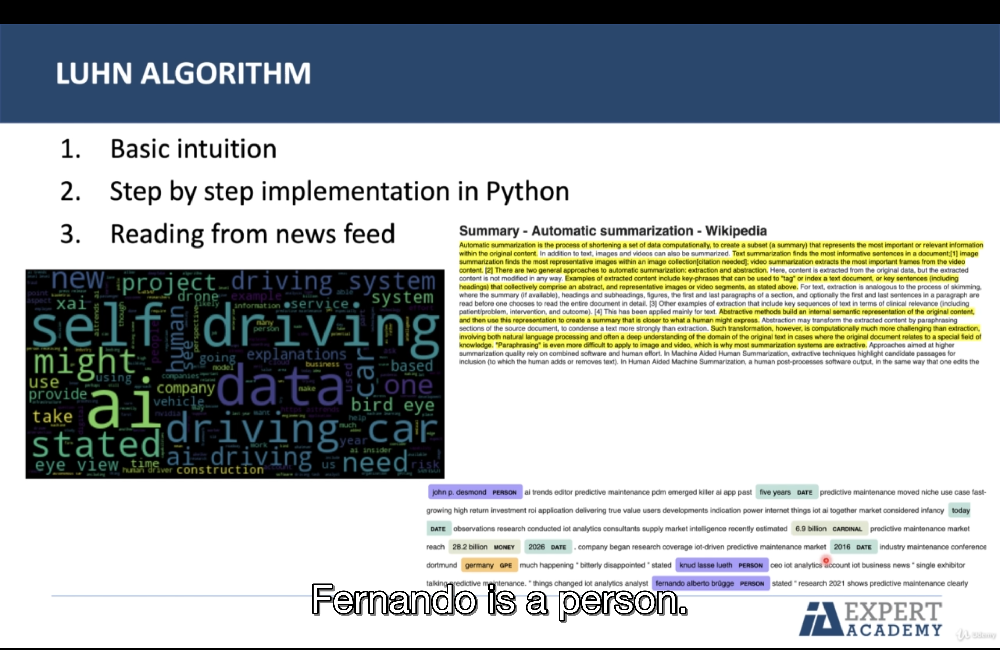
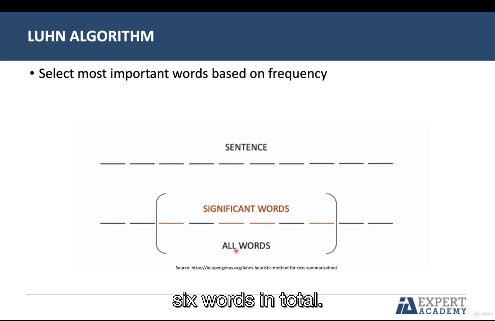
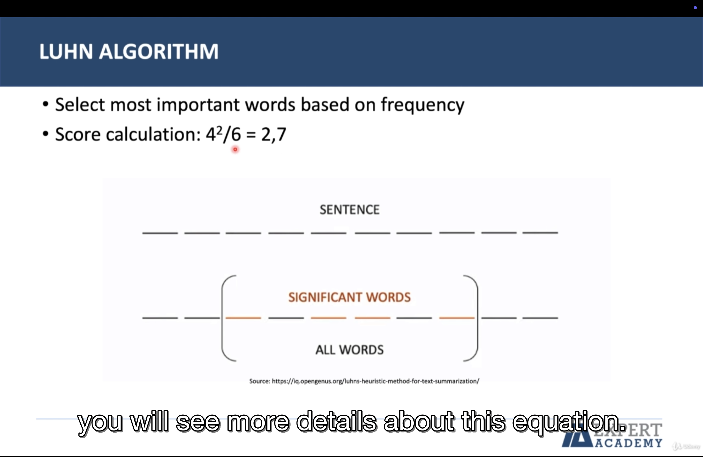

Hello and welcome to the new section of the course on text summarization in Python. In this lecture, I'm going to show you the plan of attack. As you can read right here, the goal of this section is to present you another important algorithm, which is the Luhn algorithm. It is considered one of the first efforts in the area of text summarization, also based on frequency. But the calculations are quite more complex than the other. Now, let's see the main topics that will be covered in this section.

In the first topic, you are going to learn the basic intuition. And I'm not going to cover all mathematical calculations step by step manually, because, as I mentioned earlier, the steps are quite more complex and it is easier to understand when we are implementing step by step. So this is the focus of topic number two. As you can see here, this image shows the final results, very similar to the one we implemented in the last section, the full text and in yellow, this summary with the selection of the most important sentences.

After we finish the implementation, you will learn some additional content, such as reading news from feeds, as you can see here in topic number three. And we will also generate the word clouds with the most frequent terms, these image here. So this is quite important in order to visualize the frequency of the words and also the extraction of named entities, for example, we can extract who are the people, which are the companies and so on. For example, see here, John is a person.

Fernando is a person. 2016 is a date. Germany is a location and so on. Now you will understand the basic intuition of the algorithm, which also selects the most important words based on frequency. However, we must indicate how many important words we want to select. This is the big difference if we compare to the other algorithm. And here you can see the equation that we are going to implement in this part. Here we have this sentence and a lot of words, tokens.

See that we select the significant words, which are the most frequent words. See here that we have one, two, three, four significant words and one, two, three, four, five, six words in total. And then we apply this square calculation, four squared over six. This number four means the significant words, one, two, three, four, four squared equals 16. Divided by six equals two point seven. Six is the total number of words. One, two, three, four, five, six. And this is the value of the square.

The higher the value, the more important the sentence is. And in the next lecture, we are going to start the step-by-step implementation and you will see more details about this equation. See you there.

2. 002 Preparing the environment.en
================================

See the code [here](./2.Text_Summarization_Luhn_algorithm.ipynb)

Hello and welcome to this lecture where we are going to start with the implementation of the Luhn algorithm, and you can click this link here in order to access the original paper that was published by H. P. Luhn. So the name of the algorithm is the name of the author. And you can see here that this article is quite old. It was published in nineteen fifty eight. And despite being a very old algorithm, it is important to understand the basics of the algorithm because most other algorithms are based on this article.

We can see here a lot of topics. For example, how to establish a set of significant words, how to establish the relative significance of sentences. We can see here a graph that shows the word frequency. So this algorithm is also based on word frequency. I encourage you to read this paper in order to better understand how the algorithm works. And now let's go back to our Google Colab file. We are going to implement this algorithm step by step so it will be easier to understand the whole theory.

We already have this Google Colab file. Just a reminder, if you want to run or to make changes, you need to click on file, save a copy in Drive. When you click this link, a copy of this notebook will be made on your own Google Drive. So you must have a Google account and be connected to it Let's click connect here in order to connect to the Google servers. We already have this first part of the codes already implemented. We are not going to implement it step by step because the code is exactly the same we implemented in the last section.

First, we are going to import the libraries: re, regular expression, nltk, Natural Language Toolkit, string, and heapq, to order the sentences. Let's run this. So after that we need to download this package here in order to be able to work with words and also sentence tokenized. Let's run this cell here. This message through indicates that the download was done successfully. After that, we need to import the stop words, let's run this cell. And again, we're going to use the same text that we used in order to understand the other algorithm.

We can see here all the sentences and we apply a regular expression in order to remove the empty spaces. Let's run this cell. We can take a look here at the text without empty spaces. We can create this variable here, nltk stopwords, and here we set that we want stop words regarding the English language. Let's run this cell and we can see here a list of stop words. So we are going to remove these words from this text here. And just a reminder that these words are not important to understanding the meaning of the sentences.

So we are going to remove them here. We create the pre-process function. It will receive as a parameter a text. First, we converts to lowercase. We apply the word_tokenize in order to access each one of the words. We are appending each one of the tokens to this list here. Then we remove these stop words using these statements and also we are going to remove the punctuation. After that. We are joining all the texts because it is in a list format. And finally we return to the formatted text.

Let's create this function. Let's call it, send the original text, run this code here and see that now we have the preprocessed text and in the next lecture we're going to start implementing the functions in order to calculate the scores for the sentences and also the function to summarize the texts. See you there.

3. 003 Implementation 1.en
=======================

See the code [here](./2.Text_Summarization_Luhn_algorithm.ipynb)

Hello and welcome to this lecture where we are going to continue the implementation of the Luhn algorithm, last lecture, we just prepared our environments and we have this text here, the same we used in the last lectures in order to test the algorithm step by step. As you can see here, there are two functions. The first one to calculate the sentences score and the second one the function to summarize the texts. And we are going to implement them together.

And let's start by this function here. Let's open a new cell of codes. I will create the function summarize and it will receive as a parameter the text that we want to generate this summary. And also another parameter. top_n_words. This is the parameter for selecting the most important words in the text. In the frequency-based algorithm, we used all the words in order to calculate the score of the sentences. On the other hand, in this other algorithm, we need to define the number of important words that we want to select.

We will see more details later on on this implementation. And just a reminder that the most important words are those that appear most in the text. Let's create the first variable, original_sentences. Let's open and close brackets. It means that we are going to define a list in Python. Let's create this other variable: sentence for sentence in nltk.sent_tokenize, and let's send as a parameter The text that we will get from this variable here, This for loop is going through each one of the sentences.

We are copying each to this variable and then adding to this list here just to check the result. let's print original_sentences. Let's create this function now. Let's call this function summarize and we are going to send the original text. Just a reminder that this variable is defined here, no preprocessing was applied. And also we need to specify the second parameter. And at this moment, I will just put this number five here. Later on, we are going to work with this parameter.

Let's run this code, see here that we have a list composed of each one of the sentences. Now, this second step is to apply our preprocessing function and will create another variable. Formatted text equals open and close brackets. In order to define the list format, let's call our function preprocess. I will put here the original sentence. This is a new variable I'm creating now, and let's define a for loop: for original_sentence in original_sentences.

So we are going through each one of these sentences here. In the first time we execute this for loop, it will take the first sentence and it will copy the original sentence and apply the preprocessed function. In the second time we run this for loop, it will take this sentence here. We'll copy to this variable, original_sentence, and then we apply the pre-process function in order to see the results. Let's print the formatted sentences. Let's just change the name here.

Formatted sentences and I put this first print in comments. Let's run this code. See here that we have in each position of the list, each one of the sentences with the application of the preprocessing phase. Now we need to get each one of these words here in order to count how many times they appear in the text, so we will create a new variable words in the format of a list. Let's create this variable words for sentence in formatted sentences. See here that we are going through each one of these tokens here, and we are copying to this variable here and then appending to this list.

Let's print this new variable words. Put this other print in comments. Let's create the function. See here, that's the variable word is not defined because we need to go through each one of the tokens. This for loop here is just going through each one of the sentences. And when we are going through each one of the sentences, we need to get each one of the words. So we need to implement another for loop: for word in nltk.word_tokenize. Before, we used sent_tokenize in order to tokenize the text by sentences.

Now we are going to tokenize each one of these sentences using the words. So in other words, we're going to access each one of the words of each one of these sentences. Let's set here sentence. Create this function again. Run again this code and see that now we have our list, and in each position of the list there is one word. But we can see here that there are repetitive words, for example, intelligence. And here again, intelligence, artificial and again, artificial.

So now we need to count the frequency of each one of these words. Let's put this code in comments. I will create this other variable, frequency equals nltk, we are going to call again the FreqDist. And let's specify here this new variable. Let's print the variable frequency in order to see the results run this code run here again. See, that's it's not possible to see the results. It will return in a different format. And in order to see the results, we need to put this codes, return frequency, create this function again.

And now we can take a look here that we have exactly the same result as the frequency based algorithm. We can see the frequency of each one of the words. For example, the most important words is intelligence. It appears four times, intelligent three times, artificial three times, reasoning twice, related twice, and so on. Now we are going to use this parameter, top_n_words. So we are going to specify how many important words we are going to select.

Let's put this code in comments. I will create this variable top_n_words. Let's access word, position zero. We specify position here because we are going to access this frequence dictionary and see here that we have the words in position zero and the number in position one. So we need to access the words because we are going to return. the most frequent words. Let's implement here a for loop: for word in frequency. This for loop here is accessing each one of these words in this dictionary and nltk has a function in order to extract the most common words.

So we are going to type here, frequency.most_common. And now we will specify here the parameter top_n_words. So we are going to get the top five words. We can finally take a look at the results. print top_n_words. Let's create this function. Run again and see here that we have these results intelligence, artificial, intelligent, machines and related. So those are the most frequent words, the ones that appear more in the text. And we are specifying here the five top most common words.

And in the next lecture we are going to continue this implementation. See you there.

4. 004 Implementation 2.en
=======================

See the code [here](./2.Text_Summarization_Luhn_algorithm.ipynb)

Hello and welcome to this lecture where we are going to continue the implementation of the Luhn algorithm. Last lecture we implemented this first part of the function to summarize the texts we just received, the original text. We apply the preprocessing function and after that we returned top_n_words, which is a list of the words that most appear in the text. Differently from the other algorithm, the Luhn algorithm uses the most common words. So we use this function most_common from the nltk library.

Now we are going to start the implementation of this other function to calculate the score for each one of the sentences, let's open a new cell of codes. Let's define the new function, calculate_sentences_score. It will receive as a parameter the sentences and also the important words. It means these lists here with these words, intelligence, artificial, intelligent machines and also the words related. Let's start by defining two variables. The first one, a list called scores.

As the name suggests, this variable will store the scores for each one of the sentences. Let's also create sentence_index equals zero. This variable will be used to specify the index for each one of the sentences. For example, this is sentence number zero. Sentence number one. Number two. Number three. Number four. Number five, number six. And finally, sentence number seven. After that, we are going to use this index in order to get to the corresponding text.

Let's implement a for loop: for sentence in, open and close brackets in order to define a list, nltk.word_tokenize. Let's send this parameter, sentence. So we are going to receive here the list of the sentences and we are going through each one of them in order to get the words regarding each one of the sentences. Let's implement another for loop here: for sentence in sentences. As you can see here, this for loop is quite similar to this one we implemented in this summarize function.

Just to check, let's print first a line here to separate the sentences, and after, let's print the variable sentence here. Let's create the function. Let's move back to the summarize function and we'll put this code in comments and let's call our new function, calculate_sentences_score, and we need to send here the sentences and let's put it here. Formatted sentences with the application of the preprocessing and the other parameter will be top_n_words, which is equivalent to this list of the top five words.

Let's create this summarize function. Let's call it again and see here that we are going through each one of the sentences and now we have each one of the tokens regarding each one of the sentences. And now that we have the list of the words in each sentence, we need to go through the other variable, the important words and check if that words are present in each one of these sentences here. So let's go back to our function. I will create another variable, word_index, a list. This variable will store the index

where the important words are in the original sentences. Let's implement a for loop: for word in important_words. Just a reminder that this parameter contains the list of the top five important words We can print here, print word, just to test and execute step by step. Let's call this summarize function again. See here that we have the original sentence and the important words, the first one, intelligence. So now we need to check if these words intelligence is in this list here.

Then we move on to the word artificial and check if this word is here. Then we move on to intelligence and check if the word is here. Move on to the word machines, check if it is here. And finally move on to the last important words and check if this word is here. Then we move on to the next sentence and we check word by word, and we need to store each index. Each one of the important words are, for example, first we're going to check intelligence, see here that this word is here and here, position zero, position one.

So we need to store this index one. Regarding artificial, the word is in position zero. So we are going to store position zero. The word intelligent is not present here. Machines is not present and related is not present. So we are going to store the index just for these two words here, then we move on to the next one. Intelligence is not present. Artificial is in position two, intelligence in position number one, and machines and related are not present in this sentence.

So this is what we are going to implement now, to store the index of each one of this sentence. And in order to better understand how we can get this index, let's create this test variable, a list composed of a, b and c, and we can type test.index, for example, letter b. See here that one was returned. Index zero, index one and index two. If we type c, two was returned. Let's type a, zero will be returned, so we can use this function here from Python in order to access the index of the words.

Now let's type here word_index.append. Let's call our sentence.index(word). So we are accessing the index of each one of the words. But there will be a problem in this code here. For example, let's change to letter g. You can see here that this letter doesn't exist in this test list. When we run this code, see here that we will get an error: g is not in list. We have the ValueError returned. So it will be a problem because as we can see here, the words machines and related are not present in this sentence.

So we will get this ValueError and this will be stopped. So now we need to implement a try-except code in order to not get this error here. So we can implement a try, and after this, except, let's put here ValueError, which is this same message we have here. So when we access a word that doesn't exist in a sentence, a ValueError will be returned, and then we can just pass. The error message will not be returned as here and we just move on to the next word. After the for loop, we can print the words index variable.

Let's create the function again. Run this code. See here that now we have the list with the numbers. Let's check the results. The word intelligence is in position number one. We can see one here and take a look. That's there is another word intelligence at the end of the sentence. But we can consider only once. We don't need to repeat the index of the words. After that, we move to the word artificial, which is in position zero. Let's analyze this other sentence here.

The word intelligence is in position number one, and the word artificial is in position number two. We can take a look at this other, position three and four. In this other, when we have only the word intelligence in position number two and see here that for this sentence, no important word was returns so far. Loop went through each one of these words here and it couldn't find the important words. So as a return, we have an empty list and we can sort these values here, for example, for this first sentence, one and zero, two and one.

And we need to put these numbers in order zero one and one and two, because we are going to use it in the next step of the algorithm so we can implement an additional code here. word_index.sort(). Let's create this function again and let's call it and see that now the numbers are in order. Zero one one two three four zero one zero one two. And in the next lecture, we are going to continue the implementation. See you there.

5. 005 Implementation 3.en
=======================

See the code [here](./2.Text_Summarization_Luhn_algorithm.ipynb)

Hello and welcome to this lecture where we are going to continue the implementation of the Luhn algorithm. Last lecture we implemented this part here, that we are going through each one of the sentences and checking if the important words are in the sentences. Then we store in this list the index where the word is in the sentence, for example, artificial is in position zero and intelligence is in position number one. Now, we are going to move back to our function here, calculate_sentences_score, and I will define here another parameter, which is the distance, because now we need to calculate the distance between these important words here.

For example, the distance between zero and one is one, because there is only one number between them, and considering this other sentence here, the distance between zero and two is two, because there are two numbers between them, and we are going to calculate the distance in order to calculate the score of each one of the sentences in some seconds. We're going to start with the implementation of this part. So it will be easier to understand After storing the word_index, we need to verify the length: if len(word_index) equals zero,

so we just continue the code without executing what we are going to implement. And we need this code because, as we can see here, there are sentences that don't present important words. So we just skip this list here in order to work only with these other sentences here that actually present important words. In other words, only the sentences that have the most important words will be selected. Let's go back to our implementation here. Let's create two new variables.

The first one, groups_list, a list, and the other one, group, and it will receive word_index in position number zero. In some seconds, we're going to see the values for each one of these variables. But first we can see that it will receive the index of the first word. For example, when we are going through this sentence here, we are accessing this number, which is the position of one important word. After that, we move on to the next sentence and we get position zero, which is number one.

After that, we move on to this sentence here and access this number here, which is the position of one important word. Let's create another variable, i equals one. This variable will be used in order to run our while loop that we are going to define here. while i less than len(word_index). So this variable will be used to control this while loop. So we need to go through each one of the word indexes. Moving again to this part here. If we are accessing this sentence here, we need to go through each one of these values.

When we are accessing this last sentence here, we need to go through each one of these other values here. Now let's implement an if statement: if word_index position i minus word_index position i minus one less than the distance, the new parameter we defined, then we're going to add in this variable group: group.append(word_index[i]). Else, let's access groups_list.append, let's select the group, and we're going to specify this symbol here in order to access all the elements of the list. group equals, in the format of a list, word_index position i. After the if statement we can increment the variable i, and after that groups_list.append(group).

Let's implement some print statements here, so it will be easier to test this code. The first one, let's print this group, set to here, the group variable. After that we can print again this other group that was defined here, and at the end, let's print all_groups and the variable groups_list. Let's understand this code here. And I selected this list, which is related to the last sentence. There are three important words. i equals one. And we are going to execute this code here: while i less than len(word_index), and the length of word_index is three, because there are three numbers here. At the first execution i equals one, one is less than three.

So we are going to enter this code here now. We are going to access word_index position one. So it means in the first execution, let's put here word_index position i equals this number here. We have position zero and position one. So word_index position one equals one, and we are going to subtract word_index[1 minus 1], equals zero. So we are accessing this number here. One minus zero equals one. And we need to compare to the new parameter, which is the distance.

So we are going to measure the distance between the important words. And let's suppose this parameter equals two. We can see here that one is less than two. So we are going to execute this part of the code. We're going to add this word_index position in this variable group. And we're not going to execute these statements after that. We increment this variable. So now i will be equal to two. Two is less than three. So we are going to execute this code again.

Let's put here: second execution. We are going to access word_index in position i, i equals two. So now we are accessing this number here, two, minus i minus one, two minus one equals one. So now we are accessing this number here, one. Two minus one equals one, one is less than the distance. So we keep executing this part of the code. When the subtraction is greater than the distance, then we execute this part of the code. After that we increment the value now I equals three.

Three is not less than three. So we finish executing this while loop. Something important to understand is that this while loop will also compare pairs of numbers. In the first execution, zero and one; in the second, two and one. And let's suppose we have more numbers here. For example, five, eight and nine in the third execution, the algorithm would compare five with two, in the other execution eight and five, and nine and eight. for example, when comparing both positions here, five minus two equals three.

So three would not be less than the distance. So we would execute this part of the code. And in short, we need to define groups of words: words whose distance is less than the distance that we need to specify would be in the same group. And if the result of this subtraction is greater than the distance, it means that the words are in different groups. So we would execute these parts of the code here. I know it seems a little bit confusing, but let's run this code and check the results so it will be easier to understand. I'll remove these comments.

Let's create again this function and let's call it. We can see there is one error here: missing one required argument, distance. Let's specify distance equals two for the first test. Run this code. This summarize function takes two arguments, but three were given. So we need to specify the distance here, distance, and let's send here the distance. So we are going to copy number two to this parameter and send to the calculate_sentences_score function. run this code again and again.

There is one error here, l. It's missing a letter. Just correct here. Recreate the function. Now let's execute again and we can take a look at the results, see that we have the prints for the group, group zero and one. And here we have all the groups considering all this sentence. For example, only one group considering zero and one here we have only one group, one two, only one group and so on. And as we have only a few words in these sentences, it will be difficult to see the separation between groups.

So let's try to change the distance to one. Let's run this code again and see that's now we have different groups. Each one of the words are put in a different group because of the distance parameter. In order to see better results, we can try to add another word here, for example, the word machines in the first sentence. Let's recreate this variable, recreate calculate_sentences_score, this summarize function. Let's change to number two again, run this code.

Now, it's interesting to see the results considering this first sentence here. See here that we have zero and one the word artificial and the word intelligence and the word machines is in position number five. So we would have a list with these numbers. Zero one and five one minus zero equals one is less than the distance. So we keep the words in this same group because they are very close in the text or otherwise five minus one equals four. Four is not less than the distance, which is equal to two.

So we execute this part of the code, and we put this word five in another group. So we will have two different groups for this sentence here: one group for words zero and one, and then the other group for the word in position number five. And the Luhn algorithm says the following: the more words in the same group, the more important the sentence is, and in the next lecture, we're going to use these groups here in order to calculate the score of the sentence.

So it will be easier to understand why to use these groups. See you there.

6. 006 Implementation 4.en
=======================

See the code [here](./2.Text_Summarization_Luhn_algorithm.ipynb)

Hello and welcome to this lecture where we are going to finish the function in order to calculate the scores. Just a reminder that in the last lecture we grouped the words according to this distance parameter. And it is important to say that you need to define this parameter here, the distance, and also the number of important words. In this first example, regarding the first sentence, there are two groups: one group composed of position zero and position one, which are related to the words artificial and to the word intelligence, and also there is another group with only a single word, which is related

to the word machines. We can see here all groups, group zero and one and group five. The more words in the same group, the more important the sentence is. Let's move to this function here and put in comments these prints here, and also the prints regarding the groups. And let's keep only print all_groups. Let's run this function again and let's call it just to see the new results. See here that we have two groups for the first sentence and one group for all other sentences.

And now we need to calculate the score for each one of these groups here so each group will have a score and the final score of the sentence will be the highest. For example, in this sentence here, there are two groups. So let's suppose the score for this group is three and the score for this group is two. As this one has the highest value, this number three will be the score for this sentence. So first, we need to calculate the score for each one of the groups.

The value of the highest score will be the score of the whole sentence. In these other sentences here there is only one group. So we will have a single score. Let's move up to the implementation. Let's open some new lines of codes and I will create the variable max_group_score equals zero at the beginning. And let's go through each one of the groups for g in all_groups. Just to see the results, let's print g, create the function again and let's run here just to test it step by step.

See that we have two groups and we are going through the first group, this second group. And as I said before, the other sentences has only one group. And in order to have different results, we can also try to add the word machines here just to see the generation of more groups. Now, let's run again. We can take a look here that for this sentence, group zero and one and group three. So first we go through this group and let's calculate the score and then we move on to this larger group and calculate the score and we will create a new variable.

important_words_in_group = len(g). So this variable will store how many words we have in this specific group. Let's create another variable, total_words_in_group. So we are going to count how many important words and also the total number of words. And we are going to implement this code here g[-1] - g[0] + 1. And in order to better understand this code, let's create another variable, test, a list of zero, one, three, four, six and nine.

Let's suppose these numbers here are the indexes for each one of the important words, if we type test[-1], we will get the last number. So if you want to access the last element of a list, you can type minus one. Let's change to minus two. So we are getting this number here. Let's keep minus one. Last time, test in position zero. This number here was returned, position zero. And here in this equation, we add one, plus one. So we will get these index here, number one and see here.

That's the value of this. First part of the equation will be nine and the value of the second part of the equation will be one. And we are subtracting then nine minus one equals eight. So total_words_in_group will be eight. And now let's calculate the score: score equals, we are going to multiply by 1.0 in order to have the values in the same scale, important_words_in_group. And we are going to square this value. Just a reminder that this symbol here will square the value.

For example, if we type two times two, it will multiply. And if we add another symbol here, see that we have exactly the same result. Let's try another number, three and three. The result is twenty seven and not nine, as we can see here. And we are using this based on the score calculation regarding the algorithm. First we square the important words and then we divide by the total number of words. See here that there are one, two, three, four important words,

one, two, three, four, five, six, which is the number of words. For this reason, we are squaring the value. Let's divide by total_words_in_group, and let's print the group score, and let's type score here. Now let's run this code again. Recreate the function, let's call it to see the partial results, see that we have the scores for each one of the groups. The first sentence, group zero one and group five regarding group zero one. The score is two, and for this other group, only five,

the score equals one. Regarding the other sentences, two, two, one, one. Let's take a look at this other: zero and one, the score is two, and with only one word, This score is one. Now we need to implement an additional code in order to get the best score or the highest number. For example, for this sentence we have two for the first group and one for the second group. So the score of this sentence will be two because this is the highest value, the same for this other sentence here.

Zero and one, the score is two; three, score equals one. So the score of the sentence will be two. Now, let's implement this code. This is the last step of this function if score greater than max_group_score. See here that we have defined this variable here and we will keep updating this variable in order to store the best, or the highest number. Let's update max_group_score equals score if the actual score is greater than the max. So we have a new max score.

And finally, after the for loop, after going through each one of the groups and after calculating the score for each one of them, we are going to add scores.append, max_group_score and also the sentence_index. Just a reminder that we created this variable here in order to control the index of each one of the sentences sentence zero, sentence one, sentence two and so on. And now we need to increment this value, sentence_index plus equal one. And finally, we can print the final scores, and let's put here scores.

We can also put these prints in comments. And let's test again, create the function, press here, and finally, let's run, and now we have the final scores. For example, sentence zero, the score is two; sentence one, score is two; sentence two, two; sentence three, the score is only one. This is the worst result. Sentence four, score equals two; sentence five, Again, we have a bad result. And this is the most important sentence. Sentence number six, the score equals three. And finally, we can return the score values, return scores.

Let's create the function again. And here I will create a new variable, sentences_score equals calculate_sentences_score, and just to check, let's print sentences_score. Let's recreate this summarize function, call it again, and see that we have the final results. In the next and last lecture we are going to finish the implementation and we will return the best sentences. See you there.

7. 007 Implementation 5.en
=======================

See the code [here](./2.Text_Summarization_Luhn_algorithm.ipynb)

Hello and welcome to this lecture where we are going to finish the implementation of the Luhn algorithm. Last class, we got the scores calling the calculate_sentences_score. Now, we need to order this list here in order to select the best ones. As we can see here, the best sentence for the algorithm is sentence number six and score is three. So let's put this code comments. I will create another variable best_sentences equals, and we are going to use heapq to order the sentences, nlargest.

Let's set here number_of_sentences. We can also set a new parameter here after the distance, number_of_sentences, the number of sentences that we are going to select, and the other parameter, sentences_score, which is this variable here, where we have the scores for each one of these sentences. We can also print best_sentences. Let's run this code, run this summarize function again. It's missing one arguments, number of sentences. Let's select only three sentences.

Run this code again. There is one error here. It's missing a letter here. Create the summarize function again. Run again and see here that now we have the best sentences. Number six, the score equals three. Number four, the score equals two. And number two, the score equals two. Of course, in this case study, our text is very small and we have the same score for some of these sentences. However, if you work with longer texts, you hardly ever will have this same values for the sentences.

And the last step is to get this sentences because here we have only the numbers. In order to get the texts, I will recreate this variable best_sentences. Let's define a list, open and close brackets. I will access original_sentences position i, and let's create the for loop: for (score, i) in best_sentences. This for loop is going through this list here. In this variable score we are getting the score, and in this other variable, i, we are getting the index of each one of these sentences.

So in this variable best_sentences here we are accessing from our original_sentences variable. And this variable here is the same we defined here, that we are going through each one of the original sentences. We can also take a look: print best_sentences. Run this code, call the summarize function again. And finally, we can see the best sentences: learn from mistakes and successes related to intelligent behavior, machines and science and engineering.

to produce intelligence. We can also return the values: return the original_sentences, the best_sentences and finally sentences_score. Let's recreate the function. And I will create these variables in order to check all the results: original_sentences, then we have the best_sentences and finally sentences_score equals summarize. Run this code and let's take a look at the values. First original_sentences. We can see the original text. best_sentences, these ones that

we saw before, and finally, we can take a look at the sentences_score in order to see the score for each one of them. In order to see the results in HTML, I have pasted this code here, which is the same we implemented before. First we import HTML in order to see this kind of code here in Google Colab. And we have this code here, that we are going through each one of the original sentences. If sentence in best_sentences, then we put this mark here in order to have a different effect, let's run this code.

And now we have the original text in white and this summary generated by the algorithm in yellow. And now that's the algorithm is already implemented. In the next lecture you are going to learn some additional codes in order to better visualize the results. See you there.

8. 008 Extracting texts from the Internet.en
=========================================

See the code [here](./2.Text_Summarization_Luhn_algorithm.ipynb)

Hello and welcome to this lecture where we are going to extract texts from the Internet in order to test our algorithm. This process will be quite similar to the one we implemented last section. First, let's install the library goose3 in order to extract texts from the Internet: pip install goose3. After the installation is complete, we can clean these outputs. Let's import the class in order to extract the texts: from goose3 import Goose. let's run this cell.

No error was returns, so it means the installation was successfully done. I will create the object G. Let's define our link in order to extract the texts. And here I'm going to paste this link here. That's article from Wikipedia about automatic summarization. I will create the variable article equals g.extract, and let's send here the link. The good point about this library is that you don't need to pre-process the texts. You don't need to implement additional codes in order to remove the HTML code.

We can take a look at the text. We access this attribute, cleaned_text, and see here that we have all the text regarding this article. Now let's call the algorithm. I will create the variables original_sentences, best_sentences and also score_sentences. Let's call our function summarize and I will send here the first parameter, article.cleaned_text. And it is important to say that we don't need to preprocess the text before sending to the function, because if we take a look at the implementation here, we are calling the pre-process function inside this function here so we can send the original text and this summarize function will do all the job.

Now we need to specify the other parameter, which is top_n_words, which indicates how many important words we are going to select. As we have a big text, we will specify three hundred. So it means that the algorithm will select the top three hundred most frequent words and you can play with this parameter and check the results. The next parameter is the distance in order to create the groups. So in order to divide the words into groups, the distance between the important words must be greater than ten. And again,

You can play with this parameter and check the results. And finally, the last parameter is the number of sentences and we will specify one hundred and twenty. Let's run this text and we can take a look at the length of the original sentences. See here that there are two hundred and ninety six sentences. And you need to specify this value according to the amount of sentences you have in the original text. Just a reminder, we can use that equation. One hundred and twenty divided by the length of the original sentences.

Let's multiply by one hundred. The result is forty percent. So when we use this number here, it indicates that we are extracting forty percent of the text. And finally, we can take a look at these variables. First original sentences here you can see two hundred and ninety six sentences. Now let's take a look at the best sentences that were selected by the Luhn algorithm. You can see here one hundred and twenty sentences. And finally, we can take a look at the scores.

Let's type here score_sentences. Just a reminder that in this second position, you can see the sentence ID, for example, the first sentence, this second sentence, the third sentence and so on, and here you can see the score, nine point nine, four, four, seven, seven, three point one and so on. And the algorithm will return the top one hundred and twenty sentences. And finally, we can visualize this summary. And in order to do that, I will perform a small change here.

In this part here, we don't have a function, so we'll delete this code and paste this new code here. So now we can call this function, visualize, which sends the title, the sentence list and also the best sentences. And it will present the summary in the HTML format. I'm not going to type this code step by step because we have implemented it before. We run this code in order to create the function. And finally, let's call it in order to see the final results and will open a new cell of code.

Let's call the function visualize the first parameter is the title so we can send here article.title. Let's send the original_sentences, and the best_sentences. Let's run this code. And now we can see the final results, the original text. And also in yellow, this summary, which are equivalent to the best sentences according to the algorithm. And in the next lecture, we are going to continue the implementation. See you there.

9. 009 Reading articles from RSS feeds.en
======================================

See the code [here](./2.Text_Summarization_Luhn_algorithm.ipynb)

Hello and welcome to this lecture where we are going to extract articles from RSS feeds, and if you never heard about this technology, RSS is a Web feed that allows users and applications to access updates to websites in a computer readable format. This feeds can, for example, allow a user to keep track of many different websites. So if you like a Web site, you don't need to access it every day. In order to search for new articles, you can develop an application to access the feeds so you will always get updated information.

Websites usually use RSS feeds to publish frequently updated information such as blog entries, news headlines or episodes of audio and video series. We can visit this link in order to see some articles and news about artificial intelligence. So you just need to access these links here, RSS feeds. Then we can use this link in order to develop our application and gets updated information. So let's open a new cell of codes and we need to install a new library: pip install feedparser.

Let's run this code in order to install this library. We can click here to clean the outputs, and let's import the library, feedparser. No error was returns, so it means that the installation was done correctly. Now let's open a new set of codes and I will import some other libraries before we extract the news. from bs4, bs4 means Beautiful Soup, which is another Python library in order to preprocess texts, especially texts extracted from the Internet, let's import the class

BeautifulSoup. We are going to use it in order to remove the HTML codes that we are going to extract from the articles. Let's import OS, which means operating system we're going to use to save files and also import json. This is a very common format used in the Internet to send information. In some minutes we're going to use these libraries so it will be easier to understand. Let's run this cell of codes and now I will type the URL according to the feeds, so we can access again this link and I will select AI Trends.

We can click this link, copy link. Let's paste it here, and now let's create another variable, feed equals. Let's call our new library, feedparser.parse, and we specify here this variable. Let's run this code to see some results. We can type feed.entries. A lot of information is returns. This are the information regarding the last articles that were published in this website. For example, we can see here information about the author.

And in these other key here, we can take a look at the contents. So all the text regarding this article is in this key here. We can also explore some of this information. Let's implement a for loop: for e in feed.entries. So we are going through each one of the articles that were returned. We can first print e.title. We can see the information about these articles here. So we are accessing only the title. We can also see the contents print e.content, and we need to access

position zero, because if we take a look here at the content, see that we have a list format, and the text is in this position zero, and then we can specify value. See here that we have content and the keys base, language, type and value. Inside this tag here that we will find in the text. Let's print it again. See here that we have a lot of HTML codes, p means paragraph. So we have a lot of paragraphs in each one of the texts. We can also print some signs here just to separate the articles.

This is the title of the article and here we have the text. But we need to remove this HTML codes to access only the text and we are going to do it using the Beautiful Soup library. So we do have some preprocessing steps already implemented to remove this code. I will create a new function, clean_html. It will receive the text as parameter. If text equals empty, we are not going to perform any changes, so we are going to return empty space and else if the text is not None, we are going to return.

Let's call BeautifulSoup. We specify here the text and here we will set what kind of code that we want to remove in this case, html5lib. This was extracted from the documentation so you can see more details here. And it is used to remove these specific tags here. And finally at the end, get text to get only the text. Let's run this code to create the function and we can perform some tests. For example, we can type here e.content position zero .value. We are accessing the first article. See that we have a lot of HTML codes.

Now let's call our function clean_html(e.content[0].value). Run this code. See that now we have only the text. Now we need to go through each one of the articles and apply this function in order to process the texts. I will create an empty list, articles. for e in feed.entries. We are going through each one of the articles, and let's add in this list, articles.append. Let's create it in the dictionary format. In the first position we will store the title and in the second position we're going to store the text.

Let's call clean_html(e.content[0].value). Let's run this code and now we can take a look at this new variable articles, see that we have the content and the title, and validate here that all HTML tags were removed and we can implement an additional codes if you want to save this data instead of running this code every time you need to access the articles, let's create a new variable, savefile equals os.path.join, and here we are going to specify the name of the file that we are going to save.

feeds.json. We are saving it in this format. Let's create another variable, f equals open, in order to save the file. Let's specify here the first variable, savefile, and 'w+' in order to write the file. Let's write: json.dump, to save in this format. Let's send here the articles variable, and indent equals one. In some seconds, we are going to check this parameter here. And finally, f.close() in order to close the file that we have just created.

We can click this button here. See, that's a new file was created. So we saved all this data which was in memory to this JSON file. So if you need to access in another time, you can just read this file and you don't need to run the code again in order to access the feeds. Let's open it and see that we have exactly the same formats that we have here. And as the name of this parameter indent suggests, this is to keep this indentation. If you don't use this parameter, all this text would be in a single line.

So it would be difficult to see the file. Now we can load this file. I will create another variable, blog_articles equals json.load(open. And here we need to specify the file, feeds.json, .read. And finally, let's take a look at this new variable, blog_articles. Now we have again all our articles that were read from this file that we have just created. And just a reminder that we are creating this file just for you to have an idea of how to save a set of articles when you don't want to read the feed so you can save this file and analyze the text in another moment.

And in the next lecture, we're going to explore the texts, See you there.

10. 010 Word cloud.en
=================

See the code [here](./2.Text_Summarization_Luhn_algorithm.ipynb)

Hello and welcome to this lecture where we are going to explore the texts that we have just extracted from the feeds and we are going to generate the word clouds, which is a nice way to see the most frequent words and the first step. We need to go through each one of these articles here and concatenate the contents. For example, we need to access this article and concatenate with this article, with this article and so on, because we need a single string in order to generate the most common words.

We can implement a for loop. First, let's create a new variable, feed_content, an empty string. for article in blog_articles. We're going through each one of the articles, and let's concatenate feed_content plus equal article, and let's access the content. We are accessing this key here just to get the content. Let's run this code. We can take a look at the feeds content variable. See that now we have all our articles concatenated. We can see there are a lot of text here now.

We need to preprocess this data, so we can create another variable, formatted_feed_content equals, let's call the preprocess function, and let's send here the feed_content variable. We can take a look at formatted_feed_content and we can compare the results. See here that the word by is considered a stop word. So it was removed. And just a reminder that we are removing punctuations. For example, after the surname here, we don't have the comma anymore.

We are converting the words lowercase and also removing stop words. We can compare the size of both texts. Let's visualize the length of the original variable, feed_content, and also the length of the new variable formatted feed content. We can see here the difference. One hundred and nine [unclear] and after the preprocessing step, only seventy eight [unclear]. And in order to generate the most frequent words is quite easy. We are going to import a new library: from wordcloud import WordCloud.

Let's import another library: matplotlib.pyplot as plt. This is the standard library. In order to generate graphs in Python, let's create a figure, plt.figure, and that will specify the size of the graph. It will be twenty by twenty just to be easier to visualize plt.imshow. Let's call the WordCloud class and we simply can call this function generate, and we are going to send formatted_feed_content. Let's run this code and finally we can see the word cloud, the most frequent words in these articles.

In order to not show this message here, we can put this symbol at the end. Let's run this code again, see that we don't have that message any longer to remove these numbers in the X and Y axis. We can type in additional codes, plt.axis('off'). Let's run this code again. And now we can explore these texts. For example, the most frequent words are self driving, probably these articles that were extracted are about this kind of technology, how to use artificial intelligence

to build self-driving cars. We can see here again, driving, car driving, again, human driven vehicle and so on, we can see these words, data, probably some articles are about data science or a how to explore data. And we can take a look here at this word explanation. And it may appear here because as these articles are about artificial intelligence, maybe in some of them there are some sentences like these. In this article, you will see an explanation about self-driving cars.

But actually, this word is not related to the context of the articles or to the context of artificial intelligence. So we can specify this word as a stop word, to not show it here. We can access our preprocessing function. Let's open this part here. See that we have the stop words list from nltk. And this is a default list. And we can add some other words, so we can just type stopwords.append, and let's type here explanation. So now we added the custom stop words according to our context.

Let's run this code, and then we can print our list of stop words. And we can see here at the end that our new custom stop word was added. Let's create again the pre-process function. We need to reprocess the text again. Considering the new stop words, we can take a look at the length. See here, seventy eight [unclear]. And after executing, seventy seven [unclear], so this word was removed. Now we can again run this code and see here that now we can see some more interesting words.

For example, data is bigger, there's no explanation, self-driving and driving car. The word cloud is very useful in order to find new stop words so you can define custom stop words according to the context of your texts. And in the next lecture, we are going to continue the implementation. See you there.

11. 011 Extracting named entities.en
================================

See the code [here](./2.Text_Summarization_Luhn_algorithm.ipynb)

Hello and welcome to this lecture where we are going to continue the exploration of the articles and in this time we're going to extract named entities. First, let's import another library, import spacy. And before, we were using the nltk library. However, there is a modern Python library for natural language processing in Python, which is spacy. So you can use both of them. And in order to visualize the named entities, we are going to use this other library.

So first, let's import it, and then we need to create an object, nlp, which means natural language processing, equals spacy.load. And here we need to specify the language, en means English. We can take a look at this object. See here, that's a new object was created here. You can see the address of this object in memory and it was correctly created using English language. So now we are able to use this language to work with the texts. If you want, you can check the documentation of this library and you will find other languages such as Italian, French, Portuguese and so on, now we need to create a document equals nlp(.

And here we are going to send the formatted_feed_content. This is a way to convert this string format to the spaCy format. So we will be able to use the functions from this library. Let's create this new variable and to show the name entities, let's import from spacy import displacy. And after that, let's call this function, displacy.render. Let's send here the document, style equals 'ent', which means entity, and also the last parameter, jupyter equals True, to visualize here in Google Colab, let's run this code and this library will go through each one of the tokens and try to identify the category.

Let's take a look at some examples at the beginning. For example, John [unclear] is a person. Twenty eight point two is related to money. Twenty twenty six is related to a date. Germany is related to a location. We can see Fernando Alberto is a person. It can also identify numbers, for example. Two hundred and eighty, a cardinal, 83, also a cardinal and so on. And also the library can return. the organizations, or the companies. For example, it is considering these words as an organization, another one, Italy, a location and so on.

And if you want to know more detail about these categories, you can access this link, so you can check a list of categories, then you can know more about each one of them. And the named entity extraction is very useful. So you can know about who the articles are or about what companies the articles are. And you can also extract some specific categories. Let's implement a for loop for entity in document.ents, and it will go through each one of the entities, and we can implement an if statement: if entity.label_ equals, for example, GPE, let's print entity.text and entity.label_.

Let's run this code here. See that we have a list, for example, Germany, Italy, U.S., China, [unclear] and so on. So this is very useful to see. For example, what are the countries. that are mentioned in the articles. And now that we had two extra lectures to visualize and explore the articles in the next lecture, we are going to summarize them. See you there.

12. 012 Summarizing articles from feed.en
=====================================

See the code [here](./2.Text_Summarization_Luhn_algorithm.ipynb)

Hello and welcome to this lecture where we are going to summarize the articles that were extracted from the feed. let's open a new cell of codes and I will implement a for loop in order to go through each one of the articles for article in blog_articles. Just to recap, let's print the article. We can see here that we have the title and also the content. Now we need to send only the content to our algorithm to get the summary. I will create the original_sentences variable, also the best sentences and I will put this symbol here because our function summarize

returns the list of original sentences, the best sentences and also the scores. But we are not going to check the scores. So we just put this symbol here to not save that result. Let's send here the first parameter, which is the text article, and we will specify here the content key, according to this part here. Then the next parameter is the top_n_words. Just a reminder that you need to perform some tests using different parameters and compare the results.

And we put this value. One hundred and fifty. The other parameter is the distance, and just a reminder that this parameter is used to build the group of words and we will keep the value ten. And also we have another parameter number of sentences that we are going to select. And I will specify number five for this first test. After we call this function, we will have the original sentences and the best sentences and then we can call the visualize function.

And we will send here the title, article['title']. We are accessing this part of the dictionary. And finally, original_sentences and best_sentences. Let's run this code and we will be able to see the results in yellow. We have this summary, the most important sentences. Just a reminder that we are selecting only the top five most important sentences. And again, we have the same problem we had in the first section of the course, because the texts are quite different.

So you may specify a percentage and not the number of sentences. See here that this text is quite big, is much bigger than the others. So we can make a small change to our function. Let's access the function. To summarize the texts. I will define a new parameter. Percentage equals zero at the beginning. This line here selects the number of sentences and let's implement and if statements if the parameter percentage is greater than zero. So we will implement a different code and we will just copy and paste.

Let's implement else here. And instead of selecting using the number of sentences, we will extract the length of the formatted sentences. This variable here, let's multiply by the parameter and also let's convert to an integer number, run this code in order to create the function. Let's go back to this topic here. And instead of sending the number of sentences we can specify percentage equals zero point five, let's run this code. And now we have great results.

We are selecting fifty percent of each one of the texts. And I will repeat again what I said in the last section. There are two important points when you work with text summarization: the first one is to define the size or the length of the summary, and it will be based on the size of the original text. So you can specify a percentage, as we have just implemented. The bigger the text, the bigger the summary must be. And it is necessary because if you have a longer text and you choose only a few sentences, this summary will not be so good because not all important sentences will be returned.

And this second important point is that the evaluation of this summary is somewhat abstract. So you need to read only the main sentences here and check if you can understand the general idea of the text. So it's a matter of generating this summary and read the text. You can also ask for other people to read the summary and ask for their opinion on the quality of the text. Another idea is to create a questionnaire on the original text and check if people can answer the questions by reading only this summary.

This is one of the most interesting ways in order to evaluate this type of algorithm and the next and last lecture of this section, we are going to save these results in HTML files. See you there.

13. 013 Summary in HTML files.en
============================

See the code [here](./2.Text_Summarization_Luhn_algorithm.ipynb)

Hello and welcome to this lecture where we are going to save the summaries, and this topic is quite interesting because let's suppose that you work as a consultant to a company and the company asks you to return the summaries, so you can send them to the managers of the company. This is Google Colab file. So a good idea is to save one HTML file for each one of the articles. And now we are going to implement this function and will open a new cell of codes. Create:

save_summary. It will receive as parameter the title, the original sentences and also best sentences. And first, we need to create an HTML template, and in this variable we will set the header of the HTML file. So don't worry if you don't know about this language, we'll just paste this code here. This is the initial structure of this kind of file. First you have this tag here. You open, and close at the end of the file. After that, you can specify the head, open and close.

See here that we have this position zero, open and close braces, because we are going to set the title of the article here. This meta is quite standard and it specifies it is an HTML file. And also we need to specify the charset. See here this other tag, body. And inside this tag, in this number one, we are going to send this text here, the original text and also this summary in yellow. Now, let's implement a very similar code we implemented before we created the text variable for sentence in the original sentences.

We are going through each one of them if sentence in best sentences. If the sentence we are analyzing now is in the list of the best sentence, then we will change that color to yellow. First we convert to string: sentence.replace(sentence. And here we are going to specify the HTML code, mark, open, and close the mark tag. And here we just put this sentence or otherwise, if the sentence is not in the list of the best sentences, let's just concatenate with sentence.

This code is similar to the one we implemented before. Now we are going to create another variable save_file, open(os.path.join, in order to get the current directory. In our case, we will save the file in this root directory in Google Colab. Here we need to specify the name of the file, which will be the name of the article, title plus .html. The last parameter, 'w', will be in order to write the file. Let's create another variable, html_file

equals, let's call our html_template. This variable we defined here, and we are going to send the parameters, .format. This first parameter will be copied to this position here. This is the title of the web page and the second parameter will be the text with this summary and also the original text. We're going to copy it to this parameter here. save_file.write. Let's call html_file.encode, and we need to specify UTF-8, which is exactly the same format that we defined here in the header of the file.

And finally, save_file.close(). Let's create this function. Let's call the function save summary. The first parameter is the title, article['title']. And again, we're going to send the original sentences and also the best sentences. Let's run this code. One error was returned. UFT, the correct is UTF. Let's run the function again, and again, call it. No error was returned. Now we can take a look here that we have one HTML file for each one of the texts.

Let's double click this file. See here, the HTML tag, open here and close here, and inside, the body tag. We have all the texts. We can also open it. And when we open it, see that we have the HTML file. So as I explained before, if you were a consultant to a company and you were asked to generate this summary, you can send the results in these formats. So the person who will read this summary will receive all this HTML files, considering all the texts. And in the next section of the course, you are going to learn another technique in order to summarize the texts.

See you there.

## 04 Cosine similarity

1. 001 Plan of attack.en
=====================

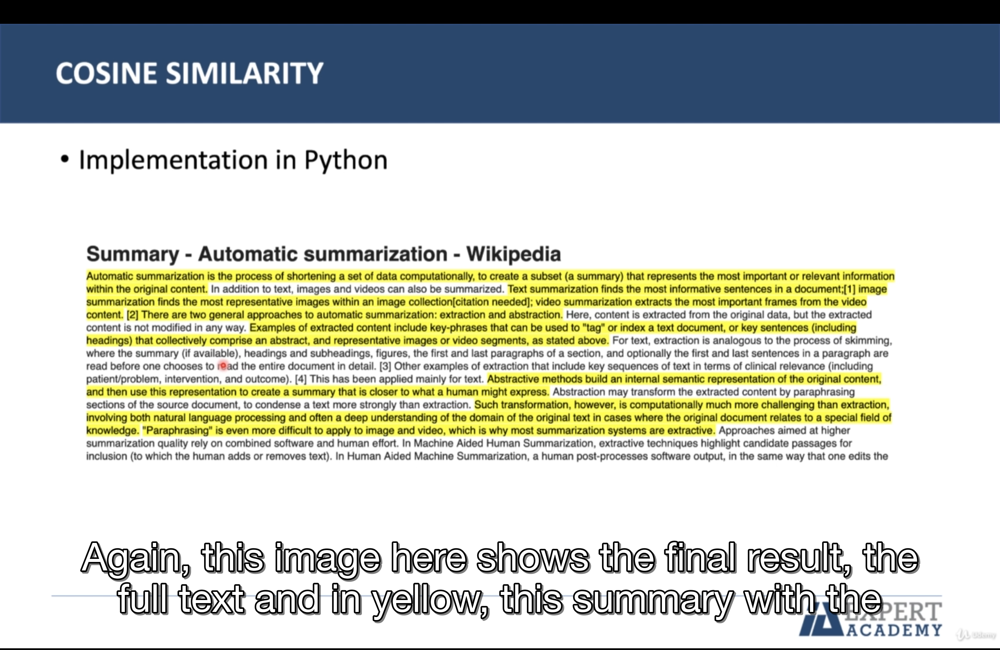

Hello and welcome to the new section of the course on text summarization in Python. In this lecture, I'm going to show you the plan of attack. As you can read right here, the goal of this section is to cover another technique to summarize texts, which is the cosine similarity. We will use some mathematical calculations in order to get to the similarity between sentences, how similar a sentence is to another. So it will be possible to calculate the score of each sentence.

We are not going to see intuition lectures because it is easier to understand when implementing step by step. And this is the only topic that we will cover in this section. Again, this image here shows the final result, the full text and in yellow, this summary with the selection of the most important sentences. In the next lecture, we're going to start the implementation. See you there.

2. 002 Preparing the environment.en
================================

See the code [here](./3.Text_Summarization_Cosine_similarity.ipynb)

Hello and welcome to this lecture where we are going to start the implementation of text summarization using cosine similarity, so it will be easier to understand the whole theory behind this technique. We already have this Google Colab file. Just a reminder, in order to run or to make changes to it, you need to click on file, save a copy drive. When you click this link, a copy of this notebook will be made on your own Google Drive. So you must have a Google account and be connected to it.

I will click this button here connects in order to connect to the Google servers. And we already have this code here, which is exactly the same we were using before. So we are not going to implement it step by step. We are going to import re, which means regular expression, nltk, the library to work with natural language processing, string, and also numpy, in order to have access to vectors and matrices. And I'm going to import a new library. The first one, import networkx as nx.

This library is used to generate graphs. Later on we will see it in practice and we are going to import another function: from nltk.cluster.util import cosine_distance. this is the function that we are going to use to calculate this similarity between sentences. Let's run this code. There is one error here, nltk. Run again. Now we are going to download this package in order to have access to sentence tokenization and also to have access to the stop words.

Let's run this code and will create this variable stop words and we are going to get all English stop words. We can take a look at some words that we are going to remove. Then we have this preprocessed function, which is exactly the same we implemented before. We are converting the texts to lowercase. After that, we go through each one of the tokens. We append to the list and then we remove the stop words and also we remove the punctuation. Let's create this function.

We already have this simple text, which is exactly the same we used in other case studies. We are removing the empty spaces here using regular expressions. Let's run this code and finally we can take a look at this text that we are going to use to test the algorithm. And in the next lecture, we are going to start implementing text summarization. See you there.

3. 003 Similarity between sentences 1.en
=====================================

See the code [here](./3.Text_Summarization_Cosine_similarity.ipynb)

Hello and welcome to this lecture where we are going to start implementing the function to calculate the similarity between sentences. The first step of this algorithm is to calculate how similar a sentence is to another. Let's open a new cell of code and then we'll create a new variable, original_sentences equals, let's define it in the format of a list. And we will create this new variable: sentence for sentence in nltk.sent_tokenize. And let's put here our original text.

Let's take a look at this variable original sentences. See here that we have sentence by sentence. Now we need to preprocess it. So we are going to create another variable formatted sentences. Let's define again in the format of a list. Let's call the preprocessed function. I will specify the parameter, the original sentence, and now let's implement a for loop: for original_sentence in original_sentences. So this for is going through each one of these sentences here in this list of sentences. We are copying to this variable and then we send to the preprocess function.

Let's take a look at the results, formatted_sentences, and now we can compare the results. Here we have the original sentences and here the formatted sentences. Just a reminder that we are converting to lowercase, removing punctuations and also removing the stop words. Now let's create a new function, calculate_sentence_similarity, and it will receive as parameters sentence1 and sentence2. The goal of this function is to return a number which will indicate how similar sentence one and sentence two are. The first step,

We need to get all the words from sentence one. Let's create in the format of a list. We will define this new variable: word for word in nltk.word_tokenize, and let's send as parameter sentence1. This code here is going through each one of the tokens that we are going to send. For example, if we send this sentence here, this for will access each one of the words. Now we need exactly the same code for sentence two, and we'll copy and paste here.

Let's change the name, words2, and let's go through sentence2. Let's print words1 and print words2. And we will create this function. Let's open a new set of code. Let's call calculate_sentence_similarity and I will specify the first sentence formatted sentences position zero and the second parameter will be formatted sentences position one. So we will measure similarity between position zero, the first sentence with position one, this second sentence, let's run this code.

There is one error here. There is a typo, word_tokenize. Let's correct this here and here. Run the function again, let's call it, and take a look here that we have the words regarding sentence one and the words regarding sentence two. But take a look here that we have the word intelligence and again, the word intelligence in the same sentence. And also the word artificial is in the first sentence. And we can see this word in sentence two. So now we need to get unique words instead of these repetitive words, in order to do that, let's create another variable.

all_words equals, let's define a set. When we use this data structure in Python, we specify the lists and then it will take only unique values. Let's put here words1 plus words2. And here at the beginning, we need to convert to the list format. Let's print all_words and we'll put this code in comments. Create the function again. Let's call it. Let's take a look here that now we have only unique words. For example, the word intelligence is appearing only once here and the same for the word artificial.

It is appearing only once here. And in the next lecture we are going to continue this function. See you there.

4. 004 Similarity between sentences 2.en
=====================================

See the code [here](./3.Text_Summarization_Cosine_similarity.ipynb)

Hello and welcome to this lecture where we are going to continue the implementation of the calculate_sentence_similarity function. Last class we specified sentence one and sentence two. The goal is to calculate the similarity between both sentences and see here that in the last lecture we got the unique words considering both sentences. Now we need to create a vector for each one of the sentences. There is this link here from Wikipedia about cosine similarity.

Take a look here, that this mathematical calculation is a measure of similarity between two non-zero vectors. So we need to convert our sentences from strings to vectors in order to be able to calculate this similarity between them. We are not going to see this step by step mathematical calculation because it is not the focus of the class and it is quite complex. And you can see the equation here. So we are trying to calculate similarity between two vectors.

We need to apply these equations here. If you want to know more details, the mathematical background, I encourage you to read this article from Wikipedia. Let's continue the implementation now. We need to define vectors. The first vector is related to sentence one, and at the beginning we will build a vector composed only of zeros. So let's multiply zero by the length. all_words. len(all_words) equals one, two, three, four, five, six, seven. There are seven unique words.

And we are building this vector according to the number of unique words. Let's do the same for vector2: zero times len(all_words). Let's print both vectors: print vector1 and print vector2. Let's run this code called the function again and take a look here that we have two vectors and the goal is to calculate similarity between the first vector and this second vector. It's important to emphasize that in order to perform the mathematical calculations we need to convert from strings.

This text here must be converted in a way that we can apply the mathematical equations so we are converting it to a vector. And now let's move on to the next step. When we implement a for loop for word in words1, we are going through each one of the words that are in this first list here. Let's put this code into comments. I will create the function again. Let's call the function see here that we are going through each one of the words regarding the first sentence.

And now we need to check if the unique words are in this sentence. Let's uncomment this code here, run again. See here that the first word is human, and it appears only once in this sentence. So the value for this word, human, will be one. Regarding the second unique word, study, it doesn't appear in the first sentence, so the value will be zero. Then we move on to the next words intelligence. Take a look here, that this word appears twice. So the value for this word

intelligence will be two. The word agents is not present in this sentence, so the value will be zero. The word intelligent is not present, the value will be zero. The word artificial appears only once, so the value will be one. And finally the word like appears only once. So the value for this word will be also one. This is a very common technique used in natural language processing to convert from text to numbers. And this format is called bag of words,

when you count how many times each one of the words appears in the texts is quite similar to the calculations regarding the frequency based algorithm. And in order to count the words, we can access our vector one, which at the beginning is composed of only zeros. We can access all_words.index. Then we specify the word, plus equals one. And in order to better understand this part of the code here, I will just copy this part to here. Open a new cell of codes and we will create this test variable to access the index.

We can type test.index, and when we specify the word, for example, study, one was returned, because this is the index of this specific word. Index zero, index one. If we type here agents, number three was returned. Position zero, one, two and finally, position three. So we are accessing the index of this vector to fill the vector1 variable. Let's print vector1, run the code, let's run again just to see the results. It should be easier to visualize. Let's comment this code here. Just to check: the word human appears only once, because of that we have a one here.

Then we move on to the word study. It is not present. So the value is zero words, intelligence, one here and another here. Value equals two. Then we move on to the words agents and intelligent, zero, because these words are not present, and finally artificial and like appear only once. Because of that, there are two ones here. And now we need to implement the same code now considering words2. Let's access vector2, all_words.index(word) plus equals one. Let's print vector2.

I will put this code in comments and let's put this other in comments. I will uncomment words2, just to check the results. Run the code again. Now we are visualizing this second sentence. The word human is not present here, zero. The word study, only once, associated with number one. The word intelligence is not here. Number zero agents intelligent and artificial. We can see here agents, intelligent and artificial. Three words here. And finally, the word like is not present because of that number zero is here.

So this is how we can convert a set of words into vectors in order to calculate cosine similarity. Now, the last step, let's return. And we will call the function cosine_distance. Just a reminder that it will take both vectors and use that mathematical calculations that we saw in this link here. And we need to send a vector one and vector two. Let's run this code, calculate the similarity. See that the value is zero point eighty one, and this value goes from zero up to one.

So the higher the value, the greater the similarity between sentences. And we can see we have a high number here because there are some common words here. For example, the word artificial is present in both sentences. We can try to calculate the similarity between the first sentence and this other sentence here, related to intelligent behavior. There are no common words between them. So this similarity will be small. The position of the sentence is zero.

One, two, three, four. So let's call the function, calculate the similarity between the zero and four. See here that similarity equals one. It would mean that both sentences are exactly the same. And in order to have higher values, considering greater similarity between sentences, we need to implement an additional code one minus cosine similarity, because this function returns the inverse value. Let's run again. Now, there is no similarity between both sentences, because there are no common words between them.

So similarity equals zero. They are completely different. Now let's put again zero and one and we will have another value, zero point eighteen. So this is the similarity between both of them, and not the value of eighty one percent. So the similarity between sentence zero and sentence one is eighteen percent. We can check the similarity between other sentences, for example, between zero and two. Let's take a look here. Is this sentence here? Take a look:

there are no common words, so similarity will be zero. We can take a look here. The result is zero. Let's try this one here. Solve problems, intelligence. There is only one common word. Let's change here to index number three, run this code. The similarity between the sentences is forty three percent. And if we type here sentence zero and sentence zero, let's run this code. Similarity is 99 percent, or if we round this value, similarity will be equal to one.

So it means that sentences are exactly the same when you have the same sentence. We are comparing this same vector in this part to here, vector one and the vector two will be exactly the same. And consequently this similarity between then will be one hundred percent. And this is the way we can measure similarity between sentences. And in the next lecture we are going to create a function in order to create this similarity matrix. So we need to calculate similarity between the first and all other sentences.

Then we need to move on to the second sentence and calculate similarity between the sequence and all other sentences. Then we need to move on to the next sentence, the third one and calculate the similarity between it and all other sentences. See you there.

5. 005 Similarity matrix.en
========================

See the code [here](./3.Text_Summarization_Cosine_similarity.ipynb)

Hello and welcome to this lecture where we are going to implement a function in order to create this similarity matrix, so we need to go through each one of these sentences here. Of course, they are converted to vectors and calculate the similarity between the first and all the others, between the second and all the others, between the third and all the others and so on. And I put this text here just to recap: the higher the value, this value here, the greater the similarity between sentences.

See that when we specify zero in zero, it is calculating this similarity, using the same sentence. So the value will be zero point ninety nine, or we can round this to one. The more words in common in the sentences, the greater the similarity between them. Let's define a new function, calculate_similarity_matrix. It will receive as a parameter all the sentences. And first, let's initialize the matrix with zeros and we'll create a new variable similarity_matrix equals np.zeros.

And now we need to specify the number of rows and the number of columns of this matrix. And I will type here len(sentences) and the second parameter also len(sentences). See here that there are one, two, three, four, five, six, seven, eight. So we are defining eight by eight matrix eight rows and eight columns. We can take a look at this matrix: print similarity_matrix. I will create the function. Let's open a new cell of codes and let's call the new function, calculate similarity matrix.

And let's send here the formatted sentences. Let's run this code. See here that we have eight rows and eight columns. Each one of these rows represents a sentence. So now we need to calculate this similarity. The first row is related to the first sentence and this value here is the similarity between the first sentence and itself. The second value, the similarity between the first sentence and the second, between the first and the third, between the first and the fourth and so on.

Regarding this second line, this value here is the similarity between the second sentence and the first sentence, this second sentence and itself the second sentence and the third, the second sentence and the fourth and so on. This line here represents the similarity between the third sentence and all other sentences. The similarity between the third and the first, between the third and the second and so on. Now we need to calculate all these values, calling the function we defined here. See that it receives as a parameter two sentences and it will return the similarity value.

Let's implement a for loop: for i in range(len(sentences)). This first for is going through each one of the rows, and now we need another for loop, an inner for: for j in range(len(sentences)). This other for is going through each one of the columns. If i equals j, we are not going to calculate this similarity because it makes no sense to calculate similarity between the sentence and itself. For example, this value here represents similarity between the first and the first.

So when i equals j, we are at this position here, so we are not going to calculate this value regarding the second sentence, this value here represents similarity between the second and the second. So we are not going to calculate this value. And in order to not execute the codes, we can simply type continue. So it will not execute the code that we are going to type. Now let's access our variable similarity_matrix position i and position j equals, and let's call calculate_sentence_similarity.

I will send sentences position i and sentences position j. We are accessing the list of sentences, which are the formatted sentences. It will receive the preprocessed text, will perform all this code here, and at the end we will have this value. Finally, after the for loop, let's return the similarity_matrix. I will create this function, let's call it. There's a typo here, add s, sentences, which is this parameter here. Create the function again, and call it again. And now we have this similarity matrix again.

These are the similarities between the first and all other sentences. For example, the first and the first, zero; the first and the second, zero point eighteen. We can also test here just to check the values, zero and one, the value is zero point eighteen. Then the first with the third, no common words, so the value is zero, then zero point forty three, the first and the fourth, and so on. And here we can see the values considering the second with all the other sentences, the third with all other sentences and so on.

So later on we are going to use this similarity matrix in order to calculate the score for each one of the sentences we are going to implement this step in the next lecture. See you there.

6. 006 Summarizing texts.en
========================

See the code [here](./3.Text_Summarization_Cosine_similarity.ipynb)

Hello and welcome to this lecture where we are going to implement the last function, which is the one to summarize the texts, we are going to use this similarity matrix in order to calculate scores for each one of the sentences. Let's open a new set of codes. I'll create a new function, summarize. It will receive as a parameter the text and also the number of sentences. The first step, we need to get the original sentences so we will implement the code quite similar to the one we implemented before.

We need to go through each one of the sentences for sentence in nltk.sent_tokenize, and we will put here the text. We're going to send the original text and do all the preprocessing after. Let's create formatted_sentences equals, let's call the preprocess function. I will specify here the original_sentence, this variable we create now: for original_sentence in original_sentences. We are going through each one of these sentences here. After we have all sentences we can generate

our similarity_matrix equals calculate_similarity_matrix. And let's send here the formatted_sentences. This is the same code we implemented before. Just to make sure everything is working, let's print the similarity matrix, create the function, let's call it summarize. Let's send the original text and then the number of sentences. Only three for this text. Let's run see here that we have exactly the same matrix as before. Now we need to generate a different data structure.

In order to store these values here, we will create another variable, which is similarity_graph equals nx. This is networkx, the package we imported before, and we are going to call this function, from_numpy_array. And here we are going to send our similarity_matrix. So we are going to convert from a NumPy matrix, this format here, to a graph, which is a widely used data structure to represent data. To better understand it, let's print similarity_graph.nodes and also print similarity_graph

.edges. This particular data structure will store the relations between the sentences. For example, this line here represents the first sentence and the first sentence is related to the second sentence. There is a kind of similarity between them. It is not related to the third sentence. It is related to the fourth sentence, not related with sentence number five or number six and number seven. And the first sentence is related to the last sentence.

So this data structure will store the relations, only the relations and not the numbers. Let's run this code. The first print is showing the nodes from zero to seven. It means the index of each one of the sentences. And take a look here, sentence zero is related to sentence one. As we can see here, sentence zero is related to three and it is related to seven. This and this. All the relations here, and sentence zero is not related with these other ones.

So this is the graph format, where we are storing the relations between sentences. Let's take a look at sentence one. It is related to sentence four. We can take a look at the matrix here. There's no... here, sentence two, three, four. So sentence one is related to four. And finally, it is related to this last sentence. So we have here one and seven. And regarding sentence number three, it is related to sentence four, to sentence five. Three is related to seven, four is related to seven and five is related to seven.

So we need this data structure to calculate the score for each one of the sentences. Now we need to measure the importance of each one of these sentences based on these connections. So we are going to use a very famous algorithm that was developed by Google, which is PageRank. This algorithm was one of the first efforts in Google, and it became very famous because of this algorithm. Firstly, it was used to return the most relevant results considering Web pages.

In other words, when you type something in the browser, there is an algorithm which will return to the most important Web pages. So this algorithm can also be applied to our scenario to find the best sentences. We can take a quick look at these links. Here you can see the history and all the calculations you have here, the equations. And if you want to know more details, you have the implementation in Python. See here that we have a matrix which represents the relations to understand the PageRank algorithm.

It will calculate the relevance of each one of the nodes based on the links. For example, see here, that's B has the highest score, thirty eight point four, because there are a lot of links. A lot of other web pages are pointing to the letter B, so it seems more important because other nodes are connected to it. For example, take a look at letter A. The score is only three point three because only letter D is connecting to letter A. And we can take a look at these other nodes here.

The score is only one point six because there are no connections coming to these web pages. Letter E, the score is eight point one. There are some connections coming to this letter. The second most important is letter C, the score is thirty four point three, and see that there is only one connection coming from B, there are other connections and the score is high because letter B is the most important. So if letter B, which is the most important Web page, is connecting through letters C, it means that letter C is also important.

So this is the very quick idea of this algorithm. Of course, we don't need to implement it from scratch because there are function which will receive as a parameter these connections and then it will calculate this score for each one of them. Let's create a new variable. scores equals nx. There is this function here, pagerank, and let's send here our similarity_graph. Now we can take a look: print scores. Let's recreate the function, and execute this code again.

We can see here the nodes: number zero, or sentence number zero, it has this score, zero point sixteen. Sentence number one, zero point fourteen. Sentence number two, zero point twelve and so on. Now we need to order these sentences to get the highest values, and to do that we can create ordered_scores equals, let's call this function from Python, sorted. And now we need to implement a for loop: for i, score in enumerate(original_sentences). This for loop here will return the ID and also the sentence.

Just to test this for loop, we can open a new cell of codes, paste it here, and let's print i and score. Let's run this code. See here that we have all sentences. This is sentence zero, sentence one, sentence two. So the enumerate function will give an index to each one of the sentences you associate with these values here. Now we can get both values. I will type another code here: scores[i], because we are going through each one of the sentences, and we are going to get the score.

So we will go through each one of this dictionary here to get the ID, and also the score. [unclear] and we need the higher numbers first. So at the end we type reverse equals True. Let's print the ordered_scores. Run this code. Take a look here, this is the highest score, zero point twenty one. And here we can see this. This artificial intelligence is related to reasoning in everyday situations and it has the highest score because of the calculations of the PageRank algorithm.

It means that this sentence has more connections with others. For example, we can see one connection zero two seven one two seven three two seven four and seven and five and seven. So this is the sentence with more connections after that in second place, zero point sixteen. Artificial intelligence is a human like intelligence. We can see that this is sentence number zero and we can check the number of connections one, two and three connections. In other words, we have something very similar

to this image here. Now we need to get the best sentences. I will create this new variable, best_sentences, an empty list at the beginning. Let's implement the for loop: for sentence in range(number_of_sentences). We are going through this parameter here. See that we specified number three. So we are going through the first three sentences. Let's append to the list, best_sentences.append(ordered_scores, and let's specify here sentence, and position one, because in position zero we have the score and in position one, the sentence.

And finally, let's return the original sentences, the best sentences and also the order scores. Let's create the function. And now we can also put this print in comments, create the function again and then we'll create the variables. The first one, original sentences, the best sentences and finally scores. Let's call the function. And take a look at the results. First, the original sentences after. Let's take a look at the best sentences. The top three sentences, artificial intelligence is related to reasoning in everyday situations, artificial intelligence is a human-like intelligence, and it is the study of intelligent artificial agents.

We can take a look at the scores. Let's type scores here: the best sentence, the second, the third, the fourth and so on. And the worst sentence is this other here, Learn from mistakes. Just to check, I will recreate the function just to see the results, see that there is no connection considering number six. Because of that, it was considered the worst sentence and finally, the last step. We can visualize this summary. I will just paste this code here, which is exactly the same we implemented before, in order to visualize in the HTML format. Let's call it, visualize.

The first parameter is the title artificial intelligence. This second parameter, the original sentences. And finally, the best sentences. Let's run this code. And here we can take a look at this summary that was generated by the cosine similarity algorithm and the next and last lecture we are going to extract texts from the Internet. See you there.

7. 007 Extracting texts from the Internet.en
=========================================

See the code [here](./3.Text_Summarization_Cosine_similarity.ipynb)

Hello and welcome to this lecture where we are going to move on to the last step, which is the extraction of texts from the Internet, the code will be quite similar to the one we implemented before the first step. We need to install the library, pip install goose3. Let's run this code. You can see here the processing. I will click this button in order to clean the outputs. Let's import the library, from goose3 import Goose. Create the object g, which will be responsible for extracting the texts. url.

Let's use the same article from Wikipedia again. And finally article equals g.extract(url). Let's run this code. We can take a look at the content, article.cleaned_text. Just a reminder that the good point of this library is that we don't need to preprocess the texts to remove the HTML code. Now let's create the original_sentences, the best_sentences, also the scores, equals, let's call this summarize function, article.cleaned_text.

Now we need to specify the number of sentences I will type here. One hundred and twenty. Let's run this code and it will take a longer time to run if we compare to the other algorithms because the mathematical background, all the calculations are more complex than the other algorithms. We can take a look here at the links between the sentences, Put this line here in comments in order to not show this message. Now, let's analyze the results. And again, you can use this equation.

One hundred and twenty divided by the length of the original sentences, times one hundred. So when we select one hundred and twenty sentence, it means that we are getting 40 percent of the text. Let's take a look at the original sentences. Those are all the sentences in the article. We can take a look at the best_sentences. Only one hundred and twenty most important sentences, according to the algorithm. And finally, we can see the scores. So it is interesting to see the scores of each one of these sentences.

As we have a big text, you can see that the scores are not so high. as for the other example, where we had only eight sentences. And finally, the last step, we can visualize this summary. Let's call the function, visualize the first parameter is the title. This second parameter is the original sentences. And finally, let's send the best sentences, run this code. And here we have the summary, the original text and also the most important sentences in yellow.

And similar to the other algorithms, we can define a percentage instead of defining the number of sentences so we can make a small change in this summary function. Let's define this new parameter, percentage. The default value will be zero, and I will simply implement an if statement here: if percentage greater than zero, let's change number_of_sentences equals, let's convert first to int, len(formatted_sentences) times percentage. So we are changing this parameter here and then we go through according to these values here.

If we don't set the percentage then we will select. Considering the number of sentences, Let's run this code and try to execute this summarize function again. Let's specify, for example, zero point two. It means that we'll return only 20 percent of the original text. Let's run the visualize function, and we can see that it seems that the algorithm is working, because there are fewer sentences that were selected. I don't want to be repetitive, but it is important to say again that there are two important points

When you work with text summarization. The first one is to define the size of this summary and it will be based on the size of the original text. So you can use the percentage parameter. The bigger the text, the bigger the summary must be. And it is necessary because if you have a long text and you choose only a few sentences, this summary will not be so good because not all important sentences will be returned. We can see an example in this text here, a lot of texts were not selected.

And the second important point is that the evaluation of this summary is somewhat abstract. So you need to read only the main sentences and check if you can understand the general idea of the text. So it's a matter of generating this summary and read the text. You can also ask for other people to read this summary for you and ask for their opinion on the quality of the text. And finally, another idea is to create a questionnaire on the original text and check if people can answer the questions by reading only this summary.

This is one of the most interesting ways in order to evaluate this type of algorithm. Now that you have implemented three types of algorithms in the next section, we're going to work with some specific libraries specially used for text summarization. See you there.

## 05 Libraries for text summarization

1. 001 Plan of attack.en
=====================

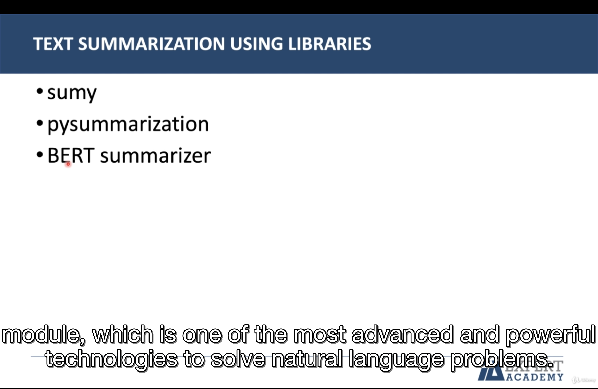

Hello and welcome to this new section of the course now that you have learned how to summarize texts using three different algorithms and most importantly, made the implementations from scratch, it's time to use some libraries. Before using pre-built libraries, It is very important that you first understand the basic of the algorithms and then you want to use the libraries so you will be more comfortable when working on text summarization projects.

We will work with three different libraries: Sumy, pysummarization and also BERT summarizer. Sumy uses the most basic algorithms, similar to those that we implemented step by step. This second one uses modern techniques of recurrent neural networks, while the third uses the BERT model, which is one of the most advanced and powerful technologies to solve natural language problems. The difference between the first and the other two is that the first uses frequency-based or statistical calculations similar to what we implemented before.

While others use datasets so that the neural network learns to identify the best sentences, they are quite more complex so it can be used for multiple languages because we basically need to count the number of times the words appear. On the other hand, libraries based on neural networks needs data sets in specific languages. For example, if the algorithm is trained for the English language, it is not possible to use it in other languages. For this reason, it is necessary to carry out a new training for each language.

And in the next lecture we are going to start with the implementation. See you there.

2. 002 Preparing the environment.en
================================

See the code [here](./4.Text_Summarization_using_Libraries.ipynb)

Hello and welcome to this lecture where we are going to implement text summarization using three different libraries and in the next lecture we're going to prepare the environment. We already have this Google Colab file. Just a reminder, in order to run or to make changes, you need to click on file, save a copy in drive. When you click this link, a copy of this notebook will be made on your own Google Drive. So you must have a Google account and be connected to it.

I will click this button here in order to connect to the Google servers. And we already have this code which is already implemented. We are not going to implement it step by step because it is the same we implement as before. We are importing nltk, Natural Language Toolkit, re, regular expression, and we are downloading this package to be able to work with word tokenization and also sentence tokenization. Let's run this quote. After that, we are installing the Goose library, to read articles from the Internet.

I will click here to clean the outputs. And this part of the code is accessing these websites, the automatic summarization article, because we are going to perform the tests using the same article as before. Let's run this cell of code. Just a reminder, to see the cleaned_text we can access this attribute. Run this cell. We can see here the text without the HTML code. Just a reminder again, the good point about using this library is that you don't need to process the text to remove the HTML code.

Let's create the original_sentences. We are going through each one of the sentences and storing them in a list. Let's run this code. See here that we can see all this sentences that were extracted. Finally, we're going to create this function. Visualize as the name suggests, we are going to use it to visualize the results. Let's create this function. And in the next lecture, we are going to use some libraries. See you there.

3. 003 Sumy library.en
===================

See the code [here](./4.Text_Summarization_using_Libraries.ipynb)

Hello and welcome to this lecture where you are going to learn how to work with the Sumy library. you can follow this link to see the documentation of the library. And this library is quite interesting because you can use a lot of algorithms. For example, the Luhn algorithm, the one we implemented step by step. And a good point is that if you want more details about each one of these supported algorithms, you can follow this link here and you can read the full paper, "The Automatic Creation of Literature Abstracts".

We can also see some other algorithms like Edmundson, Latent Semantic Analysis, this is a very relevant technique used in natural language processing, LexRank, TextRank, both based on the PageRank algorithm, quite similar to the cosine similarity we implemented before. And we can also see this algorithm, SumBasic, which is a method that is often used as a base line. This is quite similar to the first approach we implemented, the frequency-based algorithm.

And again, to read more about it, you can follow this link. Then you can see the original paper if you want to know more details about the algorithms. These references are very interesting. If you want to go deep in the area of text summarization, we can see here the supported languages, for example, Chinese, English, French, Portuguese, Spanish and so on. Now let's go back to our Google Colab file and perform a test using this article we extracted from Wikipedia.

Let's install the library: pip install sumy. Let's run this code to install the library. It's quite fast to install it. I will click here to clear the outputs, and now we need to import some classes. The first one, from sumy.parsers.plaintext import PlaintextParser, in order to read this kind of text here. Then we need to import the tokenizer: from sumy.nlp, which means natural language processing, .tokenizers import Tokenizer.

And finally, from sumy.summarizers, and I will choose the Luhn algorithm. We can see here the list we saw in the website. Let's import the package luhn, and we will import the class LuhnSummarizer. Just a correction here: sumy.parsers.plaintext. Let's run this cell. No error was returned so the library was successfully installed. Now we need to create a variable called parser. And the goal is to read this text here. Let's call PlaintextParser.from_string, because we have the data in the string format, and let's send here article.cleaned_text.

Pay attention that we are not sending the original sentences, because they will be used to visualize the results. We need to send to the algorithm the cleaned text, because this object here will tokenize the sentences. We don't need to tokenize them before sending to the algorithm. Now we need to call this class, Tokenizer, and we need to specify the language, in our case English. Let's create this variable. The next step, we need to create our summarizer, LuhnSummarizer.

No parameter is required. Let's run this code to create our algorithm. And finally, we can generate this summary. I'll create this variable, which will store the results. Let's call this summarizer, parser.document, and there is another parameter here, sentences_count. So you need to specify the number of important sentences you want to select. It is not possible to send a percentage here. So you need to perform that calculation we saw before to define the percentage of the text you want to return.

Let's create this summary. We can take a look at the results so we can see here one hundred and twenty sentences that were returned by the algorithm. Now we can put all these sentences in a list format, to call our visualize function, and we'll create a new variable, best_sentences, an empty list at the beginning. for sentence in summary, we can print the sentence. Let's run this code. See here that all sentences were returned, and now we need to append to the list best_sentences: best_sentences.append.

And I will specify here the sentence, and we need an additional code, because see that we have this Sentence tag here. So this is not in the string format. To get the results in the string format, we need to specify str here to convert them. Let's create this variable. I'll open a new cell of code and let's call the visualize function. The first parameter is the title. Let's send here the original_sentences and also the best sentences.

Let's run this code. And now we have quite similar results to the one we had when implementing from scratch. Now you can read this text to check the quality of this summary and in the next lecture we are going to work with the pysummarization library. See you there.

4. 004 Pysummarization library.en
==============================

See the code [here](./4.Text_Summarization_using_Libraries.ipynb)

Hello and welcome to this lecture where you are going to learn how to work with text summarization using another library, which is pysummarization. You can follow this link to see the documentation. And the most important thing to know about pysummarization is that it is based on LSTM, which means long short-term memory, which is a type of recurrent neural network. They are more complex and efficient techniques. You can take a look here at the description and if you want to know more detail, you can follow this link here.

You will find more information about the how to use the library. And as we can see here, we can work with several languages, for example, English, and we can see more examples with Japanese language. Now, let's go back to our Google Colab file. Let's install the library: pip install pysummarization. Let's run this code. After the installation was completed, I will click here to clear the output. And now we need to import some classes. The first one, from pysummarization.nlpbase

.auto_abstractor import AutoAbstractor, the class AutoAbstractor. This class will be used to generate the summary from pysummarization. But we have another package, tokenizabledoc, to tokenize the sentences, and we are going to access this package: simple_tokenizer import SimpleTokenizer. This is quite similar to the nltk tokenizer we implemented before. And finally, the last class, from pysummarization.abstractabledoc.top_n_rank_abstractor, to give scores to the sentences, import TopNRankAbstractor. Let's run this code. Now we need to create some new variables.

The first one, auto_abstractor equals AutoAbstractor(). Now we need to specify some attributes to this variable: auto_abstractor.tokenizable_doc equals SimpleTokenizer(). We are specifying the tokenizer. The other parameter, auto_abstractor.delimiter_list equals, and we are going to specify here dots and also this symbol, which means when we skip the line, basically these are the symbols you find when a sentence ends and when another sentence begins, the last variable.

abstractable_doc equals TopNRankAbstractor(). Let's run this code, and now we can generate the summary, and we'll create this variable, which will store the results. Let's call our auto_abstractor, and we will call this summarize function. And we need to specify the parameters. The first one, article.cleaned_text. See here that we send the document and also the abstractable_doc. So let's send here the variable abstractable_doc. Create the variable.

Now we can take a look at this summary. And here are the results. We have a dictionary format, open braces here. scoring_data, which means the most important sentences. For example, sentence zero, the score is twenty one, sentence one, score equals nine and so on. And in this key here, summarize_result, we have the best sentences that were returned. And you can see that in this algorithm, we don't need to specify the number of sentences because as this algorithm was trained, it's using a recurrent neural network.

It will automatically adapt to the size of the text. So it's a good point of this library that you don't need to calculate how many sentences you want to return. Now, let's create the list with the best sentences, best_sentences equals an empty list. Let's implement a for loop: for sentence in summary. And now we need to access this key here, summarize_result. Let's type here summarize_result. Just to check, let's print the sentence. Run this code.

See here. The most important texts were returned. Now, we just need to add them to the list of best_sentences.append. And let's specify this sentence here. Run this code. Finally, we can call the visualize function the first parameter article.title, the original_sentences and finally, best_sentences. Let's run this code. And we can see here that apparently no important sentence was returned. Here we have the original text and it happens because the format of this variable best sentences is quite different from the original sentences here.

Let's take a look at some examples. best_sentences. At the end of each one of the sentences, see that we have this symbol to specify that we are skipping a line at the ends of each one of the sentences. And if we go back to our visualize function, see here that we are checking if sentence in best sentences, but the original sentence does not present the symbols in order to skip the lines. So we need to remove them in order to visualize the results. So we will make a small change here.

I will call re.sub, the regular expression, and we will implement a similar code we implemented before, \s+, let's replace by an empty space. This is the same code we implemented to remove these symbols here. Now let's run again. We need to add another parenthesis here. Run the code again. Let's take a look at the best sentences. Now, that symbol was removed from the ends of each one of the sentences. Let's call again the visualize function.

And it seems it's not working yet because now we have this empty space. And when we are comparing the original sentences with the best sentences, they are different because the original sentences don't presents the empty space. So we can remove it by calling this function, strip. It will remove empty spaces from the beginning and also from the ends of each sentence. Let's run this code. Let's take a look at the best sentences, see that we don't have empty spaces any longer.

Finally, let's visualize the results and now we can see the list of the best sentences that were returned by this algorithm. We can see here that fewer sentences were returned if we compare to the other algorithm, because for the Sumy library, we need to specify the number of sentences we want returned. And when using these other library, the algorithm itself will identify the number of the most important sentences. So now you need to read this text and check the quality of this summary, and then you can compare with the other algorithm.

And in the next lecture, we're going to use another library, which is the BERT summarizer. See you there.

5. 005 BERT summarizer library.en
==============================

See the code [here](./4.Text_Summarization_using_Libraries.ipynb)

Hello and welcome to this lecture where we are going to work with text summarization using the BERT summarizer library. You can follow this link to see more details about the library. See that the name of the library is bert-extractive-summarizer. So we are working with that technique in which we extract the best sentences. We are not generating new texts here. You can see more details about how this library works, see that it uses the PyTorch library, which is a very famous library to work with deep learning.

And in this text, we can see how this library works. It applies a clustering algorithm and then it finds the sentences that are closest to the clusters' centroids. It uses the idea of calculating similarity between sentences similar to what we implemented in this section about cosine similarity. Now let's go back to the Google Colab file. The first step we need to install the library, pip install bert-extractive-summarizer. Let's run this code to install the library.

We can click here to clear the outputs and we also need to install another library. pip install transformers equals [unclear]. This is the version of this library we need to install in order to work with this library. This code is in the documentation of the library. Let's run this code to install the transformers library. Let's clear the outputs. Now we can import the summarizer: from summarizer import Summarizer. Let's run this cell and now we can create this summary.

Let's create the variable summarizer equals Summarizer() and now we can generate this summary. Let's call summarizer. And the only parameter we need to specify is the text, article.cleaned_text. Similar to the pysummarization library, We don't need to specify the number of sentences. Let's run this codes. And as this algorithm is quite more complex than the others, it will take some time to run. Then we can check the summary. Let's call this variable and here we can see this summary.

And this is not a list, it is plain text. And now we need to convert to a list format in order to call our visualize function. And we'll create another variable, summary_tokenized, open and close brackets, sentence for sentence in nltk.sent_tokenize. And let's send here the summary. We can take a look at this summary_tokenized. Let's run this. Now we have the best sentences in the list format. And the last step we can visualize this summary.

Let's call the function, visualize. The first parameter, article.title, the second parameter, the original_sentences, and the summary_tokenized. Let's run this code, and again, the good point about this library is that will automatically select the best sentences. You don't need to specify how many sentences you want to select. And again, you can compare these results with the other algorithms to evaluate what has the best results. And that's all for this lecture.

See you next time.

## 06 Final remarks

1. 001 Final remarks.en
====================

Hello and congratulations for completing this course on text summarization in Python. In this last lecture, we will quickly recap all the content that was covered. In the first section, You learned one of the most basic algorithms, which is based on the frequency of the words. Then you learned one of the most classical algorithms, the Luhn algorithm, which is one of the most important because all other modern algorithms were based on it. Then you learn how to implement summarization using cosine similarity and also the page rank algorithm developed by Google.

Finally, in the last part of the course, you learned how to use some libraries instead of implementing the algorithms from scratch, for example, the libraries Sumy, pysummarization and also the BERT summarizer. And just a reminder that the focus of this course was on NLP techniques, based only on natural language processing, and we didn't cover deep learning techniques. And also we worked with the extractive approach where you can see here we have the original text and we select the best sentences.

I really hope you enjoyed the course and feel more comfortable to take advanced courses on this subject, especially techniques based on neural networks and deep learning. Thank you. And see you in the next class.

