## 01 Introduction

1. 001 Course content.en
=====================

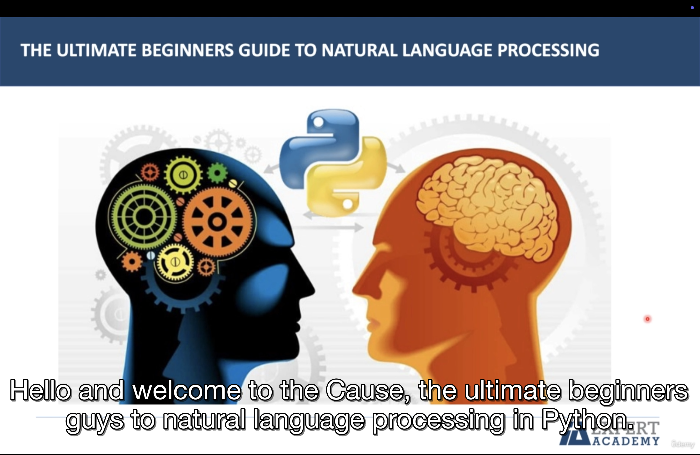
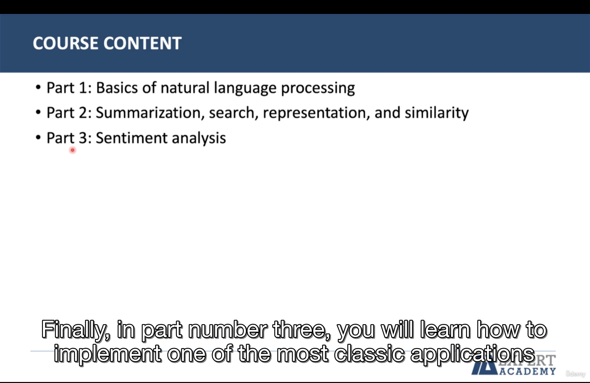
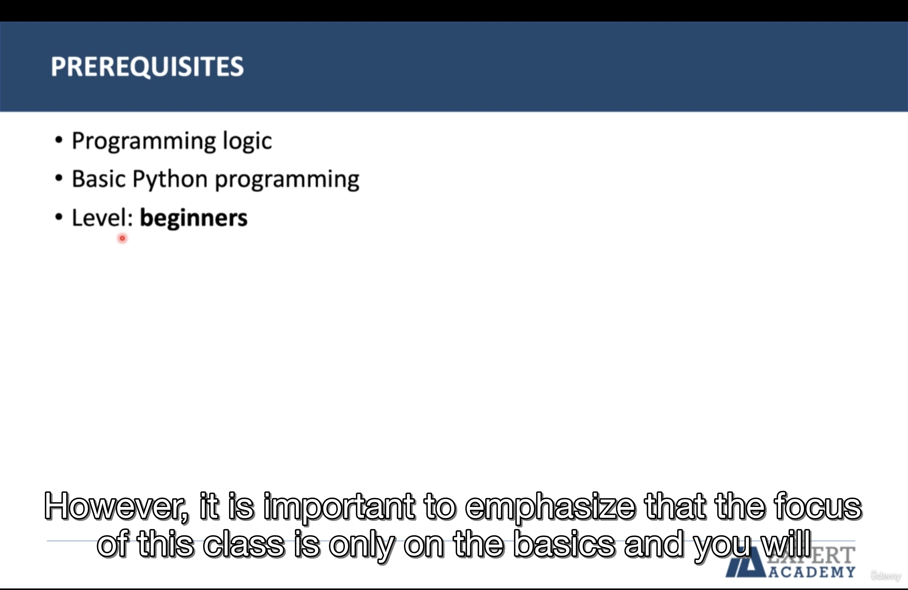

Hello and welcome to the course, The Ultimate Beginners Guide to Natural Language Processing in Python. My name is Jones Granatyr and I will teach all the lectures in this course. Congratulations for your interest in this subject, which is a hot topic in artificial intelligence. Many commercial applications can be developed in this area, such as chatbots, sentiment analysis, text summarization, speech transcription and many others. This class is divided in three parts.

And now let's take a look at the topics that will be covered. In part number one, you are going to learn the basics of natural language processing, and all implementations will be made step by step using Google Colab online, as you can see here. So you don't need to waste time installing libraries on your own machine. You need just an Internet connection to follow the course. Here you can see this source codes related to part number one and the list of topics that you are going to implement step by step.

We will start by installing the libraries in Google Colab. Then you are going to learn about part of speech, lemmatization and stemming, named entity recognition. This is a very interesting topic. As you can see here, we can extract entities, for example, the name of organizations, IBM, locations, for example, United States here and San Francisco here. You are going to learn about stop words, dependency parsing. This is a very interesting topic. For example, we can send this text: book a table for the restaurant and a taxi to the hotel.

Let's suppose you are developing a chatbot, and the chatbot needs to identify that the table is for the restaurant and the taxi is to the hotel, so we can use dependency parsing to reach this goal. See here that we can identify reservation of a table related to the restaurants and the taxi is related to the hotel. And then you are going to learn about similarity between words and sentences. And finally, we will cover about tokenization. In part number two, you will learn some key concepts about natural language processing, such as summarization, search, representation and similarity.

Here you can see the source codes and the list of topics that you are going to implement step by step. First, we are going to load the texts from the Internet. We will cover again named entity recognition so we can see all the entities that were recognised in this Wikipedia article. Most frequent words, word cloud. This is a very interesting topic where you can see the most frequent words in the text. We are going to preprocess the texts, for example, remove stop words, remove punctuation numbers and so on.

Then you are going to learn how to summarize texts. This is a very interesting topic. We can see the results here. Take a look that we have the original article about the natural language processing and highlighted in yellow are the best sentences. So instead of reading the full article, you can read only this yellow part, which was considered by the algorithm as the best sentences of the text. We will also implement keyword search. For example, we can see this Wikipedia article and in this particular example we are looking for the words computer and artificial.

So we can highlight where we found these words, then we will move on to text representation, and you are going to learn two of the most classical representations, which are bag of words and TF-IDF. And after you learn about TF-IDF, we are going to calculate similarity between sentences using cosine similarity. And then we are going to implement a very interesting example where we are going to simulate a chatbot to answer our questions.

We can see some results here. For example, you can ask who is Alan Turing? And the chatbot will look for this answer in the text. Then we can type what is artificial intelligence, and the chatbot will look for the best sentences in the text. Finally, in part number three, you will learn how to implement one of the most classic applications of natural language processing, which is sentiment analysis. Here you can see the source codes and the list of topics that you are going to implement step by step, where we use a real Twitter dataset with more than two million tweets. We will load the data, divide the dataset between training and test data.

We will preprocess the data, generate the word clouds in order to see the most frequent words in all tweets. Then you are going to learn how to detect languages. For example, the algorithm knows this is an English text, a Portuguese text and a Spanish text. Then we will implement sentiment analysis using nltk library, then using TF-IDF representation. And finally, we will use spacy library to implement sentiment analysis. The final results you can see here, for example, you send this text, I love this food, and it was considered ninety nine percent positive.

On the other hand, we can say that this text I hate this food, and it was considered ninety nine percent negative. Regarding prerequisites, you need to have a basic knowledge of programming logic and also basic python programming. The course level, as its name suggests, is for beginners in natural language processing who are taking their first steps in the field. This is not an advanced class. There are many more advanced algorithms and techniques.

However, it is important to emphasize that the focus of this course is only on the basics and you will not learn more advanced techniques. This can be considered the first course in natural language processing, and after completing it, you can move on to more advanced the materials. If you have never heard about this subject, at the end of the course you will have the practical background to develop some simple projects and take more advanced courses. That's it for this lecture.

In the next one, you will see some natural language processing applications and right after we will move on to the implementations, I hope you will have a great course and enjoy the content. See you next time.

2. 002 Introduction to natural language processing.en
==================================================

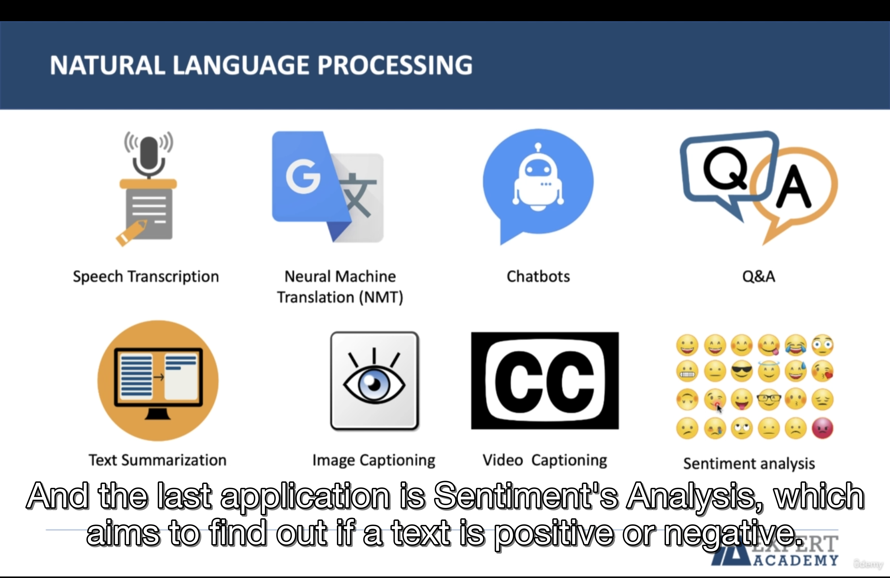

Hello and welcome to this lecture where you are going to learn a basic introduction to natural language processing, mainly we will see some interesting applications that can be developed. You can feel motivated to study this area if you know the applications. The first one is a speech transcription. You speak and the corresponding text is generated. Or you write and the algorithm reads the text for you. The area of natural language processing is related to both written and spoken language.

The second application is neural machine translation, which is translation between languages. For example, English text can be translated into Portuguese, Chinese, Spanish and many other languages. The next application is the chatbots, that have been used on a large scale by companies to serve customers. Instead of talking to a human attendant, customers can solve some problems by talking to machines. The interesting point is that currently chatbots can interact both by spoken and written language.

In this course, we will implement a simulation of a chatbot, so we will be able to ask questions and it will return the results. Of course, it will be a very simple but interesting implementation. The next application is Q&A systems, that are very useful in question and answer forums. As the name suggests, this type of system is useful for searching for similar answers, so there is no need for a person to answer frequently asked questions.

The next application is text summarization. As you can see in this image, we have the full text on the left side. Then we apply some specific algorithm and on the right side we have this summary. So the summary contains only the main parts of the text, this type of algorithm is very useful for those who are in the academic field. For example, studying in a master's or PhD class, the student needs to read a lot of papers, articles, and he or she does not have enough time to read all of them.

So a summarization algorithm can be applied and the students will need to read only this summaries that contain what is most important in the text. For example, instead of reading 10 pages, the student can read only five or four pages. We will implement text summarization in this class. This other image here shows image captioning, which is the generation of descriptions for images. For example, if there is an image of a black dog jumping over a fence, the algorithm will interpret the image and add the description.

This type of application is very useful, which will help people who have some difficulty seeing. We can also see here video captioning, which is the generation of subtitles to videos. And the last application is sentiment analysis, which aims to find out if a text is positive or negative. It is very useful for companies to analyze what their customers have been saying about products and services. For example, the company can post something on a social network and check the feelings that this post is generating.

We will implement sentiment analysis in this course, and that's all for this lecture. See you in the first section of the course where we are going to start at the implementations. See you there.

## 02 Basic NLP - spaCy library

1. 001 Plan of attack.en
=====================

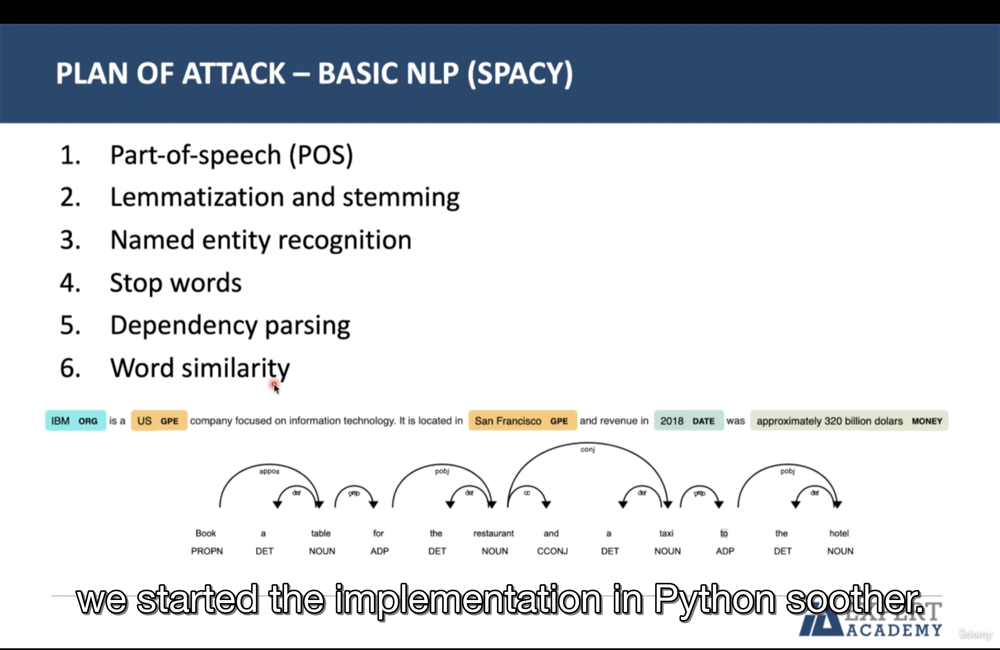

Hello and welcome to the first section of the course on natural language processing in Python, in this lecture, I'm going to show you the plan of attack, as you can read right here. The goal of this section is to present to you the basic concepts about natural language processing. using the spaCy library, which is one of the most used to develop commercial applications. Some big companies use this library to build real natural language processing projects.

Now, let's see the main topics that will be covered in this section. In the first topic, you are going to learn about POS, which means parts of speech. And the idea is to give names to the words or in other words, to identify if the words are verbs, adjectives, nouns and so on. Then you will understand in practice the difference between lemmatization and stemming, which is a very important topic in natural language processing. Then we will move on to named entity recognition.

And as you can see in this image, we can identify entities in the texts. For example, IBM is a company, so we have here the ORG tag. We also have location, for example, United States and San Francisco Bay and also money. Then you will see the concepts and implementation of stop words After, we will implement dependency parsing, so we can find relations between words. As you can see in this image, for example, the word book is related to the word table.

So it means in this sentence, we want to book a table in the restaurant. we can also see the relations between other words. For example, from the restaurant, you're going to take a taxi to the hotel. We will discuss it in more detail. Finally, in the last topic, you will understand about word similarity. In the next lecture we start the implementation in Python. See you there.

2. 002 Installing the libraries.en
===============================

See the code [here](./1.Introduction_to_Natural_Language_Processing.ipynb)

Hello and welcome to this lecture where we are going to start understanding the main concepts of natural language processing using the spaCy library, which is one of the most used in Python, and many companies use it in commercial and real projects. In this first and quick lecture, we will only install the library. We can follow this link. If you want to know more details about this library, we can see here that it can be used in industrial projects.

And if you want to know more details, you can follow this website. You can see the features. For example, it supports more than 64 languages. This is a very good point of this library. For example, you can develop projects in English, in French, Spanish, Portuguese and so on that are features related to named entity recognition, part-of-speech tagging, dependency parsing, sentence segmentation and also text classification, that we will implement step by step.

You can see a lot of articles and information about this library in this website. Now let's go back to our Google Colab file. If you are new to Google Colab, we are going to use it in all the course. So you don't need to install anything in your own machine. You can just follow this link in the class materials. And if you want to run or to make changes to these codes, you must click on File, Save a copy in Drive. When you click this link, a copy of this notebook will be made on your own Google Drive.

So you must have a Google account and you need to be connected to it. Now let's click on Connect. In order to connect this Google Colab file to the Google servers, we can take a look at the list of the topics that we are going to implement step by step. Installing the libraries, part of speech, lemmatization and stemming, named entity recognition, stop words, dependency parsing, similarity between words and sentences and finally, tokenization. To install the library, let's first open a new cell of code and I will just type pip install spacy, and we can type here --upgrade in order to download the latest version from the website.

After the installation is complete, we can see this message successfully installs some other libraries. We can click this button to clear the outputs. We can now import the library, import spacy, and also we can check the version that we are using. Let's type spacy.__version__. Run this cell of code. See here that we are using version three point one, point one. As you saw in the official website, it is possible to work with a lot of languages. For example, let's suppose you want to develop a project in Portuguese, you type python -m spacy download

pt. We can run this cell of code in order to install the Portuguese package. We can see a warning message here, that pt is deprecated [unclear]. We can type pt_core_news_sm. Let's copy and run this code again. After the installation is complete, you can see this message here, and in order to work with Portuguese you can just type spacy.load('pt_core_news_sm'). And if you want to work with French, for example, let's open a new cell of code: python -m spacy download fr

_core_news_sm. Let's run this cell of code, and all the packages regarding the French language will be downloaded. We can see here "Download and installation successful". And to work with this language, you just need to type spacy.load. If you want to build projects using other languages, you can follow the documentation to see what string you need to type here. Now let's download the package in order to work with English: python -m spacy download en_core_news_sm.

Let's run this cell of code. There is one error here, download, run again. Just a correction, we need to use web for the English language. For the English language, let's run again, and finally, we can see this message download and installation successful, and then the next lecture we're going to start understanding the basic concepts about natural language processing using spaCy. See you there.

3. 003 POS (part-of-speech).en
===========================

See the code [here](./1.Introduction_to_Natural_Language_Processing.ipynb)

Hello and welcome to this lecture where you are going to understand the first concepts about natural language processing, which is POS, that means parts of speech. it is very important to identify the type of each one of the words in a given sentence, for example, if a word is a noun, an adjective, a verb and so on, and it is important to find named entities, the topic that we are going to see in this step here. In order to better understand, let's open a new cell of code, and we are going to start by importing en_core_web_sm, the package we downloaded last class, in order to work with the English language.

Let's run this code and we will open a new cell of code and start the experiments using spacy library. The first step is to create a variable. The name of this variable will be nlp, which means natural language processing, and we need to load the English model. So we just type spacy.load('en_core_web_sm'). If you want to work with another language, for example, Portuguese or French, you just type these lines of code here. Let's create this variable, and to check if this variable is associated with the English language, we can type nlp.

We can see the package language, which means language en, English. If you see this message, it means that our algorithm, the spaCy library, is ready to work with the English language. Now we need to create a document, for example, let's type the following text. I am learning natural language processing. The course is in London. See here that we have a simple string, but in order to work with spaCy library, we need to associate this string to this nlp object, so we can just type here nlp, and we put inside parentheses

this string here. So it means that now we can process this text using spacy library, let's run this code and now we can implement a for loop to go through each one of these tokens. Let's create the for loop: for token, token is a variable I am creating now, in document, and let's just print token.text. Let's run this cell of code. See here that spacy went through each one of these tokens and we have them here separated. For example, I is the first token, am is the second token,

learning is the third token and so on. See here that the dot was also considered as a token. Now we can see what each one of these tokens are in the sentence. So let's type here token.pos_. POS means parts of speech. Let's run this code again. Just correct this typo here. And now we can see that I is considered a pronoun, am is an auxiliary, learning is a verb, natural is an adjective, language is a noun, processing is a noun, the dot is a punctuation and so on.

If you want to know more details about all these symbols here, you can follow this link, this article about parts of speech. We can see some examples. For example, this symbol ADJ, the description, adjective. And here you can find some good examples, for example, big, old, green and so on. Regarding auxiliary, we can see the examples is, has, will, should, do and so on. We also have conjunction, determiner, interjection, noun, numeral, particle and so on. We can see here the verb.

For example, run, runs, running, eat, ate, eating. When we type a word and it is considered as a verb, no matter if it is in the present or if it is in the past, spaCy will identify the verb and put the corresponding tag. We can also see here that London was considered PROPN. We can check this symbol here. It's a proper noun, for example, Mary, John, London and so on. So we can identify names of people or names of cities. For example, if you want to identify what are the cities that are mentioned in this text, you can just filter by this tag here.

So this is a very useful feature of spacy where you can identify what each one of the words are, if it is a proper noun, an auxiliary, an adverb and so on. And we can also see more details about each one of these words. I will open a new cell of codes. I will just copy and paste this code here. You can see the description. Now, let's type some other codes here: token.lemma_, which is related to the lemmatization that we will see in the next lecture.

We can also see token.tag_, token.dep_, token.shape_, token.is_alpha and also token.is_stop. So we can see that we can get a lot of information regarding each one of the tokens. Let's run this code again. And I will consider the first token that was identified. The first print is showing the original token. Then we can see the part of speech, PRON. Just a reminder here, we can see here that it is a pronoun. And now we can also see the lemma, for example, we have the same result.

But let's take a look at the word am, which is an auxiliary, and the lemma is be. It means that am is related to the verb to be in English. We can also see here that the word is, which is also an auxiliary, is related to the verb to be. So this is the lemma of the words. And we will discuss more about lemmatization in the next lecture. After that, we can see the tag, for example, VBP, VBG, and it is related to morphological information, for example, if the verb is in the present, in the future, in the past and so on. The next one is token.dep_, which is the syntactic dependency.

So we can see that there is a lot of linguistic information about each one of the tokens. token.shape_: see here that it shows information about lowercase or uppercase. For example, this X in the capital letter means that this token is in uppercase, and am is lowercase because, as we can see, the two x's are in lowercase. Then we can see if a token is alphabetic. For example, we can see here for I, the result is True, so it means it is alphanumeric.

We can see here that the dot is not considered, because False is being returned here, and after that we can see is_stop, which means if a word is a stop word or not. See here that I is considered a stop word, am is considered a stop word, learning is not considered a stop word and so on. We will see more details about stop words in this topic here. As we can see, spaCy provides us with a lot of information about the words and we can also implement a filter.

For example, let's implement again: for token in document, let's implement an if statement: if token.pos_ equals, for example, PROPN, let's print token.text. Let's run this code. See that only London was returned because, as we can see, it is the only token which is associated with this tag. Just a reminder, it is a proper noun. So if you want to filter only proper nouns, you can implement these kind of codes. For example, if you want to return only the verbs we can put here

this tag here, let's copy and paste this code and I will type here. Verb. Let's run this quote and only learning was returned, so it is very useful when you want to identify the tokens using the language features and in the next lecture, you will understand about lemmatization and stemming. See you there.

4. 004 Lemmatization and stemming.en
=================================

See the code [here](./1.Introduction_to_Natural_Language_Processing.ipynb)

Hello and welcome to this lecture where you are going to understand the difference between lemmatization and stemming. We can see here the definitions. Lemmatization aims to extract the meaning of the words based on the dictionary, so it uses complex morphological analysis. We extract the base word. On the other hand, stemming aims to extract only the root of the words. And in order to be easier to understand the difference, let's implement it in spaCy.

I will open a new cell of code and let's implement the same codes we implemented before for token in document, let's print token.text and also token.lemma_. It is the same code we implemented before. But in this code here we had a lot of information about each one of the tokens, and in this lecture we are going to discuss only about lemma. Let's run this code. See here that the lemma for the word I is the same; the lemma for am is be, which is related to the verb to be.

We can see here that the lemma for the word is is also be, because both am and is are related to the verb to be, for example, I am and he is. For this reason, both words have the same lemma. Take a look here that learning is the gerund, for example, I am learning, and it is related to the verb learn. So we are transforming the word learning into learn. We can also see that natural language processing has exactly this same result. We can see that course has also the same result, and the same for London.

Let's create another document, so it will be easier to understand. We need to associate the words to the nlp object, and let's type here learn and learning. We are going to extract the lemma for each one of these words. Let's implement here in the form of a list. For this reason, we open and close brackets. Let's extract token.lemma_ for token in doc. This for here is going through each one of the tokens. We are copying to this variable token.

And then we extract the lemma. See here that we have the same result. The lemma for learn is learn itself, because there is no way to reduce this word. This is the basic form of the verb. Regarding the word learning, we can convert to learn. Let's type some other words. For example, watch. Watching and watched, we have the verb in the original form, the verb in the gerund and the verb in the past. let's run this code. See here, that's all of them were converted to watch because watching and watched are related to the verb watch.

This technique is very useful to reduce the dimensionality of the data. Let's suppose that in a given text you have watch watching and watched the three words have the same meaning. So you don't need to store in memory the three words. You can convert watching and watched to watch. So instead of storing three words you would store only one word. We're going to discuss this process in more detail later on in this course. For now, you just need to understand what lemmatization

is, and there is a very similar concept called stemming. We can see here that we are going to extract the roots of the words. So let's open a new cell of codes to compare the results. I'm going to use another library we will import nltk, which means Natural Language Toolkit. It is a very famous library in order to work with natural language processing in Python. I will create another variable, stemmer equals nltk.stem.PorterStemmer. Porter Stemmer is the name of an algorithm in order to extract the roots of the words.

You can see more details here. If you want to know more information about how this algorithm works, you can follow this link to read the original paper. Now we can call our stemmer variable, .stem, for example. We can type here learning. Run this code, see that we have the same results as lemmatization. When we send learning, the result was also learn. Let's try with another word, stemmer.stem, for example, the word watching was converted to watch.

At first you can see that both have the same results. But now let's go through each one of the tokens of our original sentence: for token in document. Just a reminder that the document is this sentence here: I am learning natural language processing. The course is in London. So we can compare the results of both techniques. Let's print token.text, the original token, token.lemma_, and let's call stemmer.stem(token.text).

We are sending each one of the tokens to the Porter Stemmer. Let's see the results. The same for I. am was converted to the verb to be using lemmatization, and the result is the same using the stemmer. For learning, we already had seen before that we have the same results. Now we can see a small difference. For example, the same using lemmatization, but the word natural was converted to natur. So according to our stemmer, this is the root of the word. We can see here

language, and only languag, without the e. processing was converted to process. Course was converted to only cours, without e at the end. And here we can see that we have the same results. The word is was not converted to the verb to be. When we use stemming, we can lose the meaning of the words, because lemmatization uses morphological processes, while stemming only extracts the root of the words without any more complex linguistic processing. There may be words with different meanings, but the result will be the same.

When applying stemming, for example, a positive word can take the stem of a negative word, or on the other hand, a negative word can take the stem of a positive word. So in most cases, we prefer to use lemmatization rather than stemming because, as I said before, it uses complex morphological processes. Scientists of the linguistic field have studied in order to give these results to us. So in most cases we prefer to use lemmatization. And in the next lecture you are going to learn about named entity recognition. See you there.

5. 005 Named entity recognition.en
===============================

See the code [here](./1.Introduction_to_Natural_Language_Processing.ipynb)

Hello and welcome to this lecture where you're going to learn another natural language processing technique, which is named entity recognition, and the idea of this technique is to find and classify entities in text, such as people, locations, numbers, money and so on. This type of algorithm can be used in chatbots to know the subject spoken by the user. Later on, you will see some examples. Let's start by defining our text and I will type here. IBM, which is the name of a company, is a US company of information technology.

It is located in San Francisco, it is the name of a city, and revenue in 2018 was approximately three hundred and twenty billion dollars. Let's create this variable. See that it is in a string format, and now we need to associate it with our nlp variable. So let's call nlp and just put the text here. Now we can apply spaCy library to this text, and to extract the entities, this is quite simple. Let's implement a for loop: for entity in document.ents, and we are going through each one of the entities, and let's print entity.text and also entity.label_.

Let's run this code and now we can see the results. IBM is an organization, US is a location. Because of that we have this tag, GPE. San Francisco, a location. 2018, it is a date. And all this text, approximately three hundred and twenty billion dollars, it is related to money. If you want to know about all these tags, you can follow this link. You can see this table, so we can extract PERSON; NORP, which means nationalities; FAC, which means buildings, airports, highways, bridges; organizations; countries, cities, states; LOC, which means mountain ranges, bodies of water.

You can also extract the name of products events, for example, the Olympic Games, work of art, the Mona Lisa and so on. When working with named entity recognition, you can also see this table to understand each one of the tags. To better visualize the results we can implement an additional code. Let's import: from spacy import displacy, this displacy function. Let's call it, displacy.render. We will send here the document, style equals 'ent', which means that we want to show the entities.

And as we are in Google Colab, which is based on Jupyter Notebook, we need to specify jupyter equals True. Let's run this code. See that we have a very nice and interesting result. In blue we can see organizations in orange, we can see locations, name of countries or cities in green, dates, and in light brown, money. So this is very interesting to analyze the data. Then you can find specific information that you are looking for. I'll paste here another text: "Bill Gates was born in Seattle on 1955-10-28 and is the founder of Microsoft."

Then we can apply exactly the same code. We create this variable, recreate the document variable, we need to associate with the nlp object. And finally, let's implement the for loop: for entity in document.ents, and let's show the results: print entity.text and .label_. We will see other information. For example, Bill Gates is a person, Seattle is a location, or the name of a city, date, and Microsoft is an organization. I will copy this code to see the results in a better way.

Run this code, see here that we have the visual results. And if you are looking for specific information we can implement an if statement to filter only the information we are interested in. For example, let's implement again: for entity in document.ents, and now we implement an if statement: if entity.label_ equals PERSON, then we can print the name of the person. Let's run this code, see that the result is Bill Gates. So this code here is very useful when you want to know the people who appear on the text or the company who appear in the text.

So you can answer some questions like what are the people who are in the text or what are the companies mentioned in the texts? So the named entity recognition is very useful for these kind of tasks. And in the next lecture, you are going to learn about stop words. See you there.

6. 006 Stop words.en
=================

See the code [here](./1.Introduction_to_Natural_Language_Processing.ipynb)

Hello and welcome to this lecture where you are going to learn another important topic about natural language processing and the subject of this lecture is stop words. And we can see here that they are words that appear very often and they don't help to understand the context of the documents. One example of a stop word is the word it. And for example, we can consider that we are going to develop a system to identify whether a text is positive or negative.

We can conclude that the words it can appear in both negative and positive texts because it is not a positive or a negative word. This word is used in the balance of the context of the text, so it is not useful for classifying whether text is positive or negative. That's why we remove this type of words of the document, and that's what we will implement in this lecture later on. In this course, we will implement a sentiment classifier and we will move back to this topic.

And as we saw earlier, spacy can deal with a lot of languages so we can get a list of stop words for Portuguese, for French, for English and so on. First, let's import the French stop words: from spacy.lang.fr.stop_words import STOP_WORDS. Let's print the stop words. Run this code. See that there are lists of a lot of words that they are not important to understand the meaning of the texts so we can remove these words. We can also import stop words regarding Portuguese language from spacy.lang.pt

.stop_words. Let's import again the STOP_WORDS. Let's print run this code. And we can see here the lists of the stop words in Portuguese. Now let's import this stop words regarding the English language from spacy dot languages. See here the lists of the languages that you can use when you are developing your own projects. Let's type here en.stop_words, and again, import STOP_WORDS. Let's print the list of stop words. We can see here the words that we are going to remove.

For example, the words the, while, among, ourselves, be, will, the verb in the future, and so on. Now we can check if the word it is a stop word. We can type 'it' in STOP_WORDS. Run this code, see that the result is True. So it means that the word it is a stop word. And in order to get better results when working with complex natural language projects, we need to remove all these stop words. Now we can check the length to count how many stop words we have in this list: len(STOP_WORDS). There are three hundred and twenty six stop words in the English language.

We can also check if a word is a stop word using another code, different from this one here. We can use the nlp object, nlp.vocab, which means vocabulary, and then we can specify here, open and close brackets, the word it. We can check if it is a stop word: .is_stop. Run this code. See that the result is True. So the word it is a stop word. We can try with another word, nlp.vocab, for example, the word walk. Let's check if it is a stop

word. See that the result is False. Now let's create another variable, the document variable again, nlp, and I will type here the same code that we were testing before. I will just go up here. Let's copy this code. I am learning natural language processing. Paste the code here. Let's create this variable now. We can go through each one of the tokens for token in document we can print token.text. Run this code just to check that it is going through each one of the tokens, and now we can check if these words here are considered stop words. Let's implement an if statement: if nlp.vocab, I will specify here token.text, .is_stop.

If the word is a stop word, then we are going to print it. See here that I, am, the, is and in are considered stop words. Let's copy and paste this code. If you don't want to return the stop words, we can just type here if not nlp.vocab, .is_stop. If the word is not a stop word, then we can print it. For example, learning, natural, language, processing. The dot here is not a stop word. It is a punctuation. So if you want to remove it, you need to implement an additional codes.

And that's all for this lecture where you learn how to see if a word is a stop word in English, and in the next lecture we are going to move on to the next step, which is dependency parsing. See you there.

7. 007 Dependency parsing 1.en
===========================

See the code [here](./1.Introduction_to_Natural_Language_Processing.ipynb)

Hello and welcome to this lecture where you are going to understand another interesting topic about natural language processing, which is dependency parsing, and as we can read right here, we can access parent-child relations between the words. Let's open a new cell of code and we'll create the variable document. We will associate the text with the nlp object, and I will type: book tickets from London to Paris. Let's suppose there is an airline chatbot that needs to identify origin and destination.

For example, the origin is London and the destination is Paris. The customer types these texts in natural text and the chatbot must find the relationship between London and Paris. The chatbot must identify the correct cities to book the tickets from London to Paris and not from Paris to London. Of course, this is a very simple example. Just for you to understand how dependency parsing works, let's create this variable here. Open a new cell of code.

Now we will get the origin, equals document in position number four. Every token has a positional index, for example, position zero, one, two, three and position four. So it means that this variable will store the origin, which is London. Now let's create another variable, destination equals document position six, which means Paris. Let's take a look at both variables. print origin and destination. Run this code. See here that we have the correct variables associated to the cities.

As I said before, this is a very simple example, just for you to understand dependency parsing. Of course, you could implement a more complex code using named entity recognition to identify the names of the cities, something similar to what we implemented here. You could implement this if statement in order to check what words have this GPE tag. Now we can open a new cell of code. Let's type the following: list(origin.ancestors), so we will get the ancestors of the word London.

Let's run this code. We can see the word from, the word tickets and the word book, which are related to the word London. So now the algorithm knows that it needs to book the tickets, and it knows this is the origin because of the word from here, from London to Paris. We can implement something similar: list(destination.ancestors). Run this code. See here that we also have the words book and tickets. And what is very important to note is that instead of the word from, we have the word to, which is related to the destination, which is Paris.

So the algorithm knows that this is the final destination, and that's how dependency parsing works. If you inspect it here, spaCy can identify the relations between the words. For example, let's suppose you need to get the origin and the destination. So you can get it by checking these words, because you know that the word from is used when you are talking about the origin and the word to is used when you are talking about the destination. So you can implement, for example, a for loop in order to check if the word from is here and if the word to is here. We can also check if a word is an ancestor of another.

Let's type here document position zero. We are selecting the word book, and let's type here .is_ancestor(document position two). So we want to check if the word book is related to the word tickets. Let's run this code. The result is True. So it means that both words are related. So we know that we need to book our tickets and not to book a restaurant or to book a hotel. We know that we need to book a ticket because both words are related. And that's all for this lecture where we implemented a very simple example.

And in the next lecture, we will move on to a more complex example and we will also see some graphical results in order to better understand how dependency parsing works. See you there.

8. 008 Dependency parsing 2.en
===========================

See the code [here](./1.Introduction_to_Natural_Language_Processing.ipynb)

Hello and welcome to this lecture where we are going to implement a more complex example regarding dependency parsing. Let's open a new cell of code. I will create again the document variable, nlp, and let's type here a different text: book a table for the restaurant and a taxi to the hotel. We can consider the customer typed this text, and the chatbot must associate these words. It must know that the table is for the restaurant and its must know that the taxi is to the hotel.

Again, the algorithm needs to book the taxi to the hotel and not to book the taxi to the restaurant. So we need to identify the relations between the words. Let's open a new cell of code and I will create two new variables. The first one, tasks equals document position two. See here that position two is the table, and document position eight, which is the taxi. So this variable means the list of tasks that the chatbot must complete: Book the table and book the taxi.

And now let's create another variable. locations, document position five and document position eleven. Let's print both variables, tasks and locations. Just add an s here. Run this code, just delete this part, run again. The first variable stores the table and the taxi, and the second variable stores the restaurant and the hotel, the locations. And as I said in the previous lecture, you could use the named entity recognition or also the part-of-speech tags

In order to get these values here, we are implementing this example in the simplest way possible. just for you to understand how the parsing works. Let's implement a for loop: for local in locations. I will print some dashes here, and the local. We are going through this list, so we can see the restaurant and the hotel. Now let's implement another for loop: for obj, which means objects, in local.ancestors. We are accessing again the ancestors which will tell us the relation between the words.

Now let's print obj. Let's run this code. See here that regarding the restaurant we can see here book and table. We know that we need to book the table for the restaurant, and see here that regarding the hotel we have taxi. So the algorithm will know that the taxi is to the hotel. Don't worry about this repetition here, because we are going through each one of the words. But the important thing is that we have these relations book table and restaurants and also taxi and hotel.

Now, let's copy and paste this code here to send the final message to simulate the bot. Let's delete this print. if obj in tasks. So we are checking if each one of these words here are in the list of tasks, for example, table and taxi. When we find these words here, we follow the relation, table and restaurant, and taxi, hotel. Regarding the other words, see that book is not in the list of tasks, and here the word for is not in the list of tasks.

So we need to separate only the part of the sentences that we can find some kind of relation. Now, let's print: "Reservation of a {} to the {}", open and close braces, again open and close braces, .format, and let's put the obj and the local. We are going to copy this variable to the first pair of braces, and the second variable to the second pair of braces. Let's break the loop in order to not show these repetitive words. Now we can run this code. See here that we have the correct messages: reservation of a table to the restaurant and reservation of a taxi to the hotel.

We can see that using dependency parsing, we can find these relations. So when the user types this text to the chatbot, the chatbot could answer: reservation, table and restaurant, and reservation, taxi to the hotel, and ask the user to confirm if the selection is correct. Then the chatbot could proceed with the reservation, accessing some database in order to finish this operation. It is a very simple code, but you can develop a lot of applications using dependency parsing.

We can also take a look at another function. For example, now we will access position number five, position zero, one, two, three, four, five. So we are accessing the word restaurant. We can also take a look at the children. Let's run this code. Just put this close parenthesis here at the end, so we can see the relations considering the other side of the text. For example, the ancestors are related to the words that are on the left, and the children are the words that are on the right.

So you can find this kind of relation to and in the next lecture, we are going to implement another example considering dependency parsing. See you there.

9. 009 Dependency parsing 3.en
===========================

See the code [here](./1.Introduction_to_Natural_Language_Processing.ipynb)

Hello and welcome to this lecture where we are going to implement the third example, considering dependency parsing. Let's open a new cell of code. Let's import: from spacy import the function displacy, that we have used before. And the goal of this lecture is to visualize the dependency between the words let's create the document variable again, nlp, and I will use the same text as before: book a table for the restaurant and a taxi to the hotel. Create the variable, and now let's call the function displacy.render.

I will send here the document. The style will be 'dep', which means dependency parsing. If you remember, in the lecture about named entity recognition, see that we used the same function, but the style was 'ent', which means entities. Now let's run this code and check the results. Just another parameter, jupyter equals True. Run this code. We can see the dependency between the words. As this image is big, we can specify the size: options, open and close braces, distance equals ninety.

Run this code again and now we can take a look at the dependence. See here, book a table for the restaurant. In this first line we can see the original text. Here we can see the part of speech, as we saw in previous lectures. For example, table is a noun, restaurant is a noun, taxi is a noun and so on. And we can clearly see the relations. For example, the word book is related to the word table. So it means that the algorithm knows that we need to book the table. See this symbol, dobj, which means the kind of relation. See clearly, for example, book a table.

This word a is connected to the word table. Then we can see for and restaurant are connected, and then we can see that the taxi is connected to the word to, and the word to is connected to the word hotel. It's a very good way in order to better understand the relations between the words. Now let's consider only the words table. I will type here list(document[2].ancestors). And I will print the ancestors. Let's run this code.

See that the word table is related to the word book. You can see the arrows that are coming from the other words to the word you want to analyze, to see the ancestors. So it is easier to understand what ancestors are based on this graph. We can also take a look at the children: document position two, .children. Let's run this code. See that the children are going from the word table to the other words, for example, a, here. And for, last lecture I told you that the ancestors are the words on the left and the children the words on the right.

But there are some situations, for example, a is a child of table, and for is also a child of table. So you can see the directions of the arrows to know which are the ancestors and which are the children. So this is a very good representation to understand dependency parsing. And in the next lecture, we are going to implement the last example regarding this topic. See you there.

10. 010 Dependency parsing 4.en
===========================

See the code [here](./1.Introduction_to_Natural_Language_Processing.ipynb)

Hello and welcome to this lecture where we are going to implement the last example regarding dependency parsing. We will implement a very similar example, so it will be good to recap the content about dependency parsing. Now we create again the document variable, nlp, and let's type the following: What places can we visit in London and stay in Paris? It is a question, and let's suppose that the user typed this for the chatbot, and now the chatbot needs to identify that we want to visit London and we need a place to stay in Paris, so we can find the relations between the words again, let's create the variables.

locations equals document position six and document position ten, and also actions, document position four and document position eight. Let's print locations and actions. Run this code. In the first list we can see the names of the cities, and in the second list we can see the activities, visit and stay. And again, you can use named entity recognition in order to get the names of the cities. Now we implement the for loop, very similar to the one we implemented before for local in locations we can print the local see here, London and Paris.

Now we need to go through each one of the actions: for action in local.ancestors, and let's implement the same if statement: if action in actions, then we can print "{} to {}", open and close braces, to, open and close braces, .format(local, action). Let's type a break here. We are going to put the local in the first pair of braces and the action in the second pair of braces. Let's just delete letter s. Run the code again. We have good results:

London to visit and Paris to stay. So in this simulation, the chatbot would be able to identify the place that we are going to visit and the place that we want to rent the house, for example. Now we can see the relations. Let's type displacy.render(document, style equals 'dep', jupyter equals True, and options. We are going to specify the distance equals ninety. Run this code. And finally, we can take a look at the relations, for example, regarding the word visit.

We can see that the children are the words we, can and places. They are coming from the word to those other words here. And regarding the ancestors, we can see that there is no arrow pointing from other words to the word visit. So there is no ancestor for this word. And regarding the word stay, we can see that there is a connection between visit and stay. And that's all for these four lectures about dependency parsing. And in the next one, we are going to work with

similarity between words and sentences. See you there.

11. 011 Word similarity 1.en
========================

See the code [here](./1.Introduction_to_Natural_Language_Processing.ipynb)

Hello and welcome to this lecture where we are going to move on to another important topic on natural language processing, which is the calculation of similarity between words and sentences. And we are going to implement two examples. spaCy uses the GloVe algorithm, which means Global Vectors for Word Representation, to calculate or to measure the similarity between words and sentences. It's not the goal of this course to cover all the theory behind natural language processing.

So if you want to know more detail, you can follow the original paper here. Now let's implement our first example and we'll create the variable w1, which means word one, nlp, the word hello; w2, nlp, the word hi; and w3, nlp, the word or. We can see that we have different contexts. For example, hello and hi are greetings. And the word or has nothing to do with greetings. They have a different meaning.

So now we can calculate similarity between them and it's quite easy to calculate similarity in spacy. There is a function called similarity: w1.similarity(w2). So we are calculating similarity between the two, hello and hi. Don't worry about this warning, and we can see the results here, eighty five percent. So it means that hello and hi are eighty five percent similar. The higher the value, the more similar the words are. We can also measure similarity between w2 and w1.

We can see that the result is the same. Now let's calculate similarity between w1 and w3, which have a different context. Let's run. See that the similarity between hello and or is only twenty three percent. And finally we can calculate similarity between w2 and w3. Between hi and or the similarity is only 22 percent. Now I'll paste some sentences, text1, text2 and text3. When will the new movie be released? The new movie will be released next month.

What color is the car? See here that we have this same context. Here we are talking about the new movie and the third sentence. There is nothing to do with sentence one and sentence three. So now we can calculate similarity between sentences. For example, text1.similarity(text2). Run the code, see that the similarity between the first and the second is 76 percent, because we are talking about the same subject. Now, we can measure similarity between text1 and text3, which presents a different context.

See, that's the similarity is only twenty six percent. So the measurements of similarity between words and sentences is very useful. For example, if you have a commercial dataset and you want to find inconsistent words, for example, let's suppose we have the words New York and also the word NY. Maybe the user made a mistake when he or she was trying to type New York, and they typed only NY. So you can find the similarity between both words.

And if this similarity is above a specific threshold, For example, if they are 50 percent similarity or 60 80 percent similarity, you can consider these text here the same as these other text so you can go through all your datasets in order to try to find these words that are quite similar, because if they are similar, there is a good chance that the user has made a mistake. So it is a way to correct this sentence to this correct format here.

This is just an idea of how you can use a similarity between sentences and in the next lecture, we are going to implement this second example. See you there.

12. 012 Word similarity 2.en
========================

See the code [here](./1.Introduction_to_Natural_Language_Processing.ipynb)

Hello and welcome to this lecture where we are going to implement the second and last example regarding similarity between words and sentences. Let's open a new cell of codes. I will create a new variable text and LP and let's type here cat, dog, horse and person. And the idea is to go through each one of these words and calculate the similarity. For example, the similarity between cat and dog, cat and horse, cat and person, and then between dog and cats, dog and horse and dog and person.

Let's create this variable and now we will implement a for loop for text1 in text. Let's print, I will put here some dashes, text1. Run this code, see that we are going through each one of the tokens, and now we need to implement another for loop: for text2 in text, and I will print here text2. Let's run this code and now we need to calculate the similarity. Cats and cats, cats and dog, cat and horse and so on. Then we move on to the next token, dog: dog and cat, dog and dog, dog and the horse and so on.

Let's create a new variable, similarity = text1.similarity(text2). I will multiply it by one hundred in order to have the result in percentage. See here that the result is in the range from zero to one. Now let's print: open and close braces, "is", open and close braces, "similar to", again open and close braces, .format. Let's send the parameters: first text1, then the similarity and finally text2. I will put this print in comments. let's run this codes and now we can see the final results.

Cat is one hundred percent similar to cat. Cat is fifty seven similar to dog, sixty two to horse, twenty two to person. Then we calculate similarity between dog and cat. Dog and dog. One hundred dog and the horse and so on. This is a good strategy that you can implement to do something similar to this part here. I told you last class, if you want to find similar words, then you can define a threshold here and implement an IF statement. So if the similarity is above the threshold, then you can apply another process in order to correct the

data, in this particular example, and that's all about this topic regarding similarity between sentences and words. And in the next and last lecture of this section, we are going to talk a little bit more about tokenization. See you there.

13. 013 Word tokenization.en
========================

See the code [here](./1.Introduction_to_Natural_Language_Processing.ipynb)

Hello and welcome to this lecture where we are going to discuss more about tokenization, we have this variable document1 and the same text we have been using so far: I am learning natural language processing. The course is in London. Let's create this variable. And the process of tokenizing a sentence, It means that we are going through each one of these words. Then we call each one of them as token and we can also extract information. For example, the part of the speech we saw in previous lectures, let's open a new cell of codes.

I will type for token in document1, and let's print token. And this is the tokenization phase we saw before. See that we are separating each one of the words. And something very important is that the dot is considered as a punctuation. Now let's copy this code, paste it here, document2, and instead of using the natural language processing toolkit, we are going to delete this part. We have a simple string, and we can do something very similar using the split function from Python. for example, when it finds an empty space, then we can break this string in order to get each one of the tokens.

See here that we have a similar results. But there is a problem here. For example, the dots is together with the words processing, which is not correct. We need to select each one of the tokens. So if you use a simple Python function to tokenize this sentence, you may not get good results. And I made this comparison just for you to reflect about using or not using a natural language processing library, because if you are not using spacy or nltk library, you would need to implement all this process from scratch.

Another example. Let's type here: Ph.D. John is me. This is the right way to represent this word, Ph.D., it's a kind of abbreviation. Now let's put this code here, run the first sentence. See here that Ph.D. is together, because it means the degree of John, for example, he finished his PhD last year. And if we use a simple split, we can see that Ph.D. is together. But let's suppose you want to tokenized the sentences. For example, this is the first sentence, this second sentence and the third sentence.

Let's put here, instead of an empty space, dot, so we can separate the sentences. See that this split function cannot understand that Ph.D. is the same word. For this reason, when working with natural language processing, we need to use libraries, as I said before, spaCy or NLTK, because they have internal features that are already implemented in order to understand these kinds of contexts. And that's all for this first section of the course where you learn the basic implementations of natural language processing.

And in the next section of the course, we will move on to more interesting implementations. See you there.

## 03 Summarization, search, representation, and similarity

1. 001 Plan of attack.en
=====================

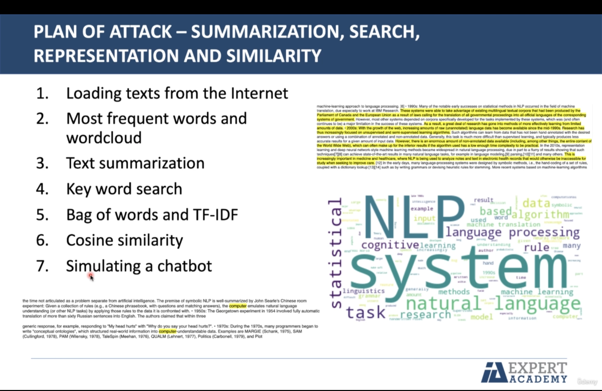

Hello and welcome to the second section of the course on natural language processing in Python. In this lecture, I'm going to show you the plan of attack. As you can read right here, the goal of this section is to work on four important topics summarization, search, representation and similarity. Now, let's see the main topics that will be covered in this section. In the first topic, you are going to learn how to extract texts from the Internet to perform some tests with natural language processing techniques.

The good point is that in this section where we work with real texts, then you will learn how to find the most frequent words and also how to generate the word cloud, as you can see in these images. Here, this topic is quite interesting because we can know which are the most frequent words in the text. The larger the letters, the more frequent the term is. The next topic is text summarization. Let's suppose you need to read a ten-page article, but you don't have enough time to read the full paper.

In this scenario, you can apply a summarization algorithm and reduce it to, for example, just five pages. This image shows an example that we are going to implement. The yellow sentences were chosen as the most important and we can only read them to get the general idea of the text. Then we will learn how to perform keyword searches. This image shows an example that we are looking for the word computer, which is highlighted here. And here in topic number five, you will learn two of the most important text representations, such as bag of words and TF-

IDF. They are useful when developing more complex natural language processing projects. And the idea is to convert texts to numbers so that the algorithms can process the data. Then we will use the TF-IDF representation to compute similarity between sentences using cosine similarity. And finally, we will simulate a chatbot that will answer our questions about any topic you want. We are going to use a Wikipedia article and the chatbot will answer questions like what is natural language processing, who is Alan Turing, what is artificial intelligence and so on. In the next lecture we start the step-by-step implementations.

See you there.

2. 002 Loading texts from the Internet.en
======================================

See the code [here](./2.Natural_Language_Processing_summarization,_search,_representation,_and_similarity.ipynb)

Hello and welcome to this lecture where we are going to start the second section of the course where you are going to learn about summarization, search, representation and also similarity, we already have this Google Colab file. Just a reminder, if you want to make changes or to run this code, you need to click on file, Save a copy in Drive. When you click this link, a copy of this notebook will be made on your own Google Drive. So you must have a Google account and you need to be connected to it.

I will click connects to connect this file to the Google servers. And in this lecture you are going to learn how to load texts from the Internet because we will use a sample text in order to perform the experiments using named entity recognition, most frequent words, word clouds and so on. Let's open a new cell of code and the first step we need to do is install spaCy library, and we will also upgrade to the latest version. Let's run this cell of codes.

We can see all messages here. I will click to clear the outputs. Let's import the library, and also let's take a look at the version that we are using, spacy.__version__, version three point one point one. As you can see here, now we need to download the package regarding the English language: python -m spacy download en_core_web_sm. Let's run this set of code. And just a reminder, if you want to work with other languages, you can follow the spaCy documentation in order to check what you need to type here regarding the language you want to work.

Now, we can import this library again, import en_core_web_sm, run this code. And now we can install another library to extract texts from the Internet: pip install goose3. This is the name of the library. This is one of the easiest libraries to load the texts from the Internet, since you just need to specify the link, the web page, you want to extract the texts and it is not necessary to process the data such as removing HTML code. So it is very easy to use.

Let's import: from goose3 import Goose, because this is the class that we are going to use to specify the link to extract the text. Let's create this object, g = Goose(), and now it's quite simple. I will paste here the URL regarding Wikipedia. We can follow this link, see here that we can see texts regarding natural language processing. So the idea is to extract all this text here in order to perform our experiments. Now let's extract the article. We create

this new variable, article equals g.extract, and I will send here the URL. Let's run this cell of code. Just correct this typo here, delete number three, run again. And now we can see information about this article. For example, let's type article.title. We can see the title of the article, Natural language processing. We can also see the text, article.cleaned_text. And the good point about this library, as I said before, is that it

will clean all the text, no need to remove HTML codes. Let's run this cell. We can see here all the text that was extracted from the Wikipedia page. We can also see more information about this article. For example, we can type article.authors. We can see the list of authors as we are extracting from Wikipedia, there is no authors, but if you have a different link, you can see the names here. We can also take a look at the links, article.links.

We can see here the list of all the links that were used in this Wikipedia article. So as you can see, it's quite easy and simple to work with this library. And in the next lecture, we're going to recap named entity recognition and we will extract the entities from this Wikipedia article. See you there.

3. 003 Named entity recognition.en
===============================

See the code [here](./2.Natural_Language_Processing_summarization,_search,_representation,_and_similarity.ipynb)

Hello and welcome to this lecture where we are going to extract named entities from our Wikipedia article, now, it will be easier to see the results since we have a big text. The first step, we need to create the nlp object, spacy.load. And here we need to specify en_core_web_sm. Let's take a look at this object. See here that we have just created the nlp object and it is associated with the English language. Just a reminder, if you are working with other languages, you can check the documentation in order to see what you need to type here.

Now we will create the document variable and we will associate with the nlp object since we want to process the text using spacy library. Now we can send here article.cleaned_text. Run this cell of code, and now we can go through each one of the tokens to see the part of speech: for token in document, let's print token.text, this symbol just to separate the characters, token.pos_. Just a reminder that it is the part-of-speech tags. So we can see here, for example, ADJ, punctuation, adverbs, nouns, verbs and so on.

And if you want to know more detail, you can follow these link here to check each one of the symbols. Now let's visualize the named entities: from spacy import displacy, displacy.render. I will send here the document, style equals 'ent', because we want to extract named entities, and jupyter equals True. Let's run this cell of code. And now we have a very interesting visualization, because we can see the named entities According to all this text here in the last experiments, in the last section, we had used a very simple text and now we can see all the list of entities considering this big text from Wikipedia, we can extract some specific tags.

Let's suppose you want to extract only the people who are mentioned in this article. Let's implement a for loop for entity in document.ents, if entity.label_ equals PERSON, as we can see here, for example, then let's print entity.text. Run this code, see here that we have some good results. For example, Alan Turing, John Searle, [unclear] and so on. Of course, there are some tokens that were returned to the people, for example, conference and explicit.

Then you can implement some additional filtering to remove these wrong tokens here. And in the next lecture, we are going to return the most frequent words, See you there.

4. 004 Most frequent words.en
==========================

See the code [here](./2.Natural_Language_Processing_summarization,_search,_representation,_and_similarity.ipynb)

Hello and welcome to this lecture where we are going to extract the most frequent words that appear in this Wikipedia article and this step is quite important and interesting, because we can see the hot topics that have been said or that have been written in the articles. You can see the words that people are writing the most. And it is quite important in the next step where we are going to work with word clouds. And also it is important for text summarization algorithms because both of these algorithms use the most frequent words to calculate the most important sentences in order to extract only the most important sentences that are related to the topic of the article.

Later on, we will talk more about it. Let's open a new cell of code. And instead of using spacy for the most frequent words, we are going to use NLTK. Just a reminder, it means Natural Language Toolkit. It is an important library to work with natural language processing in Python. Let's create a list of tokens. We can call nltk.tokenize.word_tokenize. And we just need to send here article.cleaned_text. We send all the text to this function.

See that one error was returned, because we need to download this package. So let's copy this code, paste it here. See that True was returned. So it means the package was successfully installed. Let's run again. And now we can take a look at the tokens variable See that it is a list in Python, because we can see at the beginning that we open and at the end we close brackets. And this is the list of tokens in this Wikipedia article, for example, natural, language, processing, NLP. There are some symbols here.

Open parenthesis, close parenthesis, is, a, which are considered stop words. Now we can take a look at the length of this list, len(tokens). See here that there are two thousand eight hundred and thirty one tokens in this article. Now we can count how many times each one of them appears in the text, so we can create another variable, frequency equals nltk, we can call FreqDist, which means frequency distribution, and we can just send here our list of tokens.

Then we can get most_common equals, let's call frequency.most_common, and we need to specify the top n words that we want to return. For example, let's suppose we want the top 10 most frequent words. Now let's visualize most_common. Run this code and see here that the most frequent token, and not exactly the most frequent word, is the comma. And it appears one hundred and seventy nine times then the seconds, the words, the which is a stop words and it appears one hundred and nineteen times.

So we can check the list of the most common words. Let's change from ten to fifty. Then we can get the top fifty most common words. We can see a lot of stop words and some symbols, open parenthesis and open and close brackets. We can see the word language, NLP, machine, learning, rules and so on, and this is not a good result, because there are a lot of symbols and stop words. Later on, in this step here, preprocessing the texts, we are going to implement a preprocessing function in order to remove the stop words, punctuation and so on.

And in the next lecture, you are going to learn how to generate the word clouds. See you there.

5. 005 Word cloud.en
=================

See the code [here](./2.Natural_Language_Processing_summarization,_search,_representation,_and_similarity.ipynb)

Hello and welcome to this lecture where we are going to generate the word clouds. Last lecture, we returned the list of the most common tokens. And as we can see here, it's not so good to see the tokens in the format of a list, so we can use the word clouds to better visualize the most common words or the most common tokens. Let's open a new cell of code. Let's import the library: from wordcloud import WordCloud, the WordCloud class. Let's create our variable cloud equals WordCloud().

Now we need to call this variable again. cloud equals cloud.generate. And let's send here article.cleaned_text. Let's run this cell of code, see that we cannot see the graph. So we need to import another library: matplotlib.pyplot as plt. This is the default library to visualize graphs in Python. Let's call plt.imshow, and I will specify the variable cloud here. Let's run. And now we can see this graph which shows the most frequent words.

Now let's make some changes to this graph in order to better visualize it. plt.figure(figsize. This is the size of the graph. Run again. See that. Now we have a big size so it is easier to see the most common words. We can also remove the X and Y numbers so we can just type plt.axis('off'). Run the code again. See that now the numbers were not returned, and to remove this matplotlib message we can just type this symbol here at the end. When we run it again, we have our final word cloud.

So this is very useful to see the most common words, the words that people are writing the most in the article. And we can see that the results are different from this one here, because when we use nltk, it doesn't remove the punctuations and the stop words. And regarding the word cloud, it automatically removes stop words and also punctuations. So it is easier to see the results. We know that this article is about natural language processing. So the most common words are natural, language, system, NLP, based, research and so on.

As I said before, this is very useful to see the most common words. And in the next lecture we are going to implement our preprocessing function and we will run the frequency and the word clouds again and we will compare the results. See you there.

6. 006 Preprocessing the texts.en
==============================

See the code [here](./2.Natural_Language_Processing_summarization,_search,_representation,_and_similarity.ipynb)

Hello and welcome to this lecture where we are going to implement a preprocessing function in order to clean this text, Just to remind, let's take a look at the most frequent words, or most frequent tokens. See here that symbols and also stop words were returned. So it's difficult to analyze this text. So now let's implement a new function and we open a new cell of code: def preprocessing. It will receive as a parameter a sentence, and a good practice when working with natural language processing is to convert the texts to lowercase.

Because, for example, if you have letter a, and letter A again in capital, the algorithms will consider both letters as different letters. But actually they are the same, so we can convert all the text to lowercase. To do it is quite simple. We just call this function, lower, and let's return the sentence. Let's create the function, now we call it, just to perform some tests step by step. For example, test, put this last letter in capital. Run this code.

See that the text was converted to lower. Now we can remove the stop words, as we saw here, the, of and in. Just a reminder that these kind of words, they don't offer a good understanding of the meaning of the text. So it's a good practice to remove them and we'll create the tokens variable. At the beginning it is a list. Let's recreate the tokens, open and close brackets, to have it in the format of a list: token.text for token in, let's call our nlp object, to associate each one of the tokens to the natural language processing object of spaCy.

I will put the sentence here. We can return the tokens instead of returning the sentence. Let's run. Now, we can just put some other text, natural language processing, and again see that in each position there is a token. Now we can process each one of them. And in the first processing, we are going to remove stop words: if not token.is_stop. We are using features from spaCy. So we are going to put the texts on this list only if they are not in the list of stop words.

Let's run this code again. I will just put some stop words here. For example, it and the run again. See that the stop words were not returned. They weren't copied to this list. We can also remove numbers. For example, let's put here one, ten, 50, run this code again. See that the numbers were returned, so we can implement an additional code here: or token.like_num. It means that we are checking if it is or it isn't a number. Create the function, and see that now the numbers were not returned.

We can also remove punctuation, for example, exclamation mark, dots and comma. See that the symbols were returned. Let's add one more statement: or token.is_punct. If it is not a punctuation, then it will be copied to this list. Create the function. You can see that numbers and punctuation weren't returned. We can also put some blank spaces here. Run this code again, see that the spaces were returned, so we can implement an additional code: or token.is_space. Create the function.

I can see that the empty spaces were not returned. Let's put here just letter b. See that it was returned, so we can implement an additional code: or len(token) equals one. So we will return only tokens with at least two letters. Run this code again. And finally we can see our final text with the application of all preprocessing steps. It has been returned in the form of a list, but with these in the string format as we have here, so we can just concatenate each element of the list and put it all together, and we will recreate the tokens variable. Let's put an empty space,

let's call the join command, and in the form of a list, let's access element for element in tokens. It means that we are going through each one of the tokens and we are concatenating with an empty space. Run this code again, the final test. See that this is the final result, with the application of all preprocessing steps. Now we can apply this function to the original text from Wikipedia, and we will create the new variable, article_cleaned equals preprocessing.

And let's send here article.cleaned_text. Let's take a look at the results, article_cleaned. See here that we cannot see stop words, neither punctuation and so on. We can compare the size of both articles: len(article.cleaned_text). This is the original text. And now let's calculate len(article_cleaned) after applying the function. See here that before the size was sixteen thousand and now it's only eleven thousand. Now we can get again the list of the most frequent terms.

We can copy this code here to generate the list of unique tokens, copy this code. I will paste it here, and then we can calculate the frequency, and we'll just paste the same code, and we just need to change here article_cleaned and here also article_cleaned. Let's visualize the top ten most frequent words. See here that the result is quite different. For example, language, learning and NLP, differently from the first execution, where there were a lot of stop words and a lot of other symbols.

But we can take a look that the dots and the open brackets were returned, because maybe when we were processing the text using spaCy, the library couldn't identify these symbols, so we can perform another change to our preprocessing function. After converting to lowercase, let's recreate sentence equals sentence.replace. We will replace dots for an empty space, and then you can do the same code. Just copy and paste the code for the words that spaCy couldn't identify.

Let's recreate the variable. See the size, eleven thousand three hundred thirteen. Now we have eleven thousand two hundred fifty eight. Run this code again, and see that the dots is not here any longer. And again, you can implement an additional code just using the replace command in order to remove these open brackets. Let's, for example, visualize the top ten most frequent words. Now the result is quite clear. NLP, system, processing, rule, statistical, data and so on. And also we can generate the word cloud using this new text.

I will just copy this code, let's paste it here. The only difference is that we are not going to use the original text, but the new variable article_cleaned. The result is quite similar to the one we had before, because this library removes, or it doesn't consider, stop words, punctuation and small characters to generate the word cloud. And in the next lecture you are going to learn how to summarize texts. See you there.

7. 007 Text summarization - intuition.en
=====================================

See the code [here](./2.Natural_Language_Processing_summarization,_search,_representation,_and_similarity.ipynb)

Hello and welcome to this lecture where you are going to learn the intuition about one of the most basic algorithms for Text summarization, which is based on the frequency of words, let's consider this initial text that has several sentences about artificial intelligence. For example, artificial intelligence is a human like intelligence. It is the study of intelligent artificial agents, science and engineering to produce intelligent machines, solve problems and have intelligence related to intelligent behavior.

Developing reasoning machines. Learn from mistakes and successes. And finally, artificial intelligence is related to reasoning in everyday situations. This will be the text that we will use as a case study in order to understand the mathematical calculations. Just a reminder that the goal is to select the most relevant sentences of this text here. To reach this goal, we need to follow a sequence of seven steps. As you can see here, the preprocessing of the texts, the calculation of the frequency of the words, and also the definition of the weights or the importance of each one of the words.

Then we move on to the next step, which is the tokenization of the sentences. After that, the sum of the scores for each sentence, the order of the best sentences, And finally, the generation of this summary, considering only the most important sentences. Now you are going to learn step by step each one of these steps here. Let's start by understanding step number one. And here you can see the original text. And just below the preprocessed text, we have the application of three types of processing.

The first one is the change to only lowercase letters. Above, We have uppercase and lowercase letters and here we have only lowercase letters. It is important to change the text because if we have these words here, intelligence with lowercase letters and again the word intelligence with capital letters, the algorithm will consider both as different words. So we need to keep them all in the same pattern. This second preprocessing was the removal of some stop words.

For example, this word is is not being used here. It, the, it's not being used in the processed text, the word of is not being used here. Also, the words and, have, to, again of, from, and is, the, and finally the word in. The words that were removed are called stop words. And they are removed because they are not so important for understanding the meaning of the sentence. Finally, the punctuation has also been removed from the texts, as you can see here, here and here at the end of each one of these sentences.

And this is the first step of the algorithm. This second step is to select each one of the words that are in the preprocessed text and count how many times each one of them appears in the text. In the left column of this table here, we can see the words. And in this second column, we can see the frequency. For example, artificial equals three. It means these words appears three times in the processed text. We can take a look here, one, two, and finally three times the word intelligence appears four times in the pre-process text.

We can take a look here, one, two, three, and finally four in this part of the text. And a lot of words appear only one time, for example, human, like, study and all those words here on the right part of the table, we can assume that the more a word appears, the more important it is. The frequency calculation is used in step number three, which is the association of weights. For each one of the words, we will use the word that appears more often in the text, which is intelligence.

And it appears four times according to this table here. You can see here a new table like the one we have been discussing with the addition of a new column. The weights for the words artificial is zero point seventy five. And you get this value. We simply divide the number of times the word appears by the highest value. Let's open the calculator in order to perform some tests. For example, artificial appears three times in the text. Three divided by four equals zero point seventy five.

Let's consider the word here machines. It appears two times in the text. Two, divided by four, the highest value. The result is zero point five. We can take a look at some other words, human, it appears, only one time in the text, one divided by four, which is the highest value. The result is zero point twenty five. And we can take a look. That's the weights for the words. Intelligence is one because we divide four, the number of times this word appears in the text, by four, which is the highest value.

The result is one. So it is considered the most important words. The purpose of this algorithm is to select sentences that contain words that appear more often. In short, sentences that contain the words intelligence, artificial and also intelligence are more important than sentences that contain these other words here that appear less often in the text. The next step is sentence tokenization, and the goal is only to separate sentence by sentence. See, here we are using the original text,

without the application of the preprocessing step. In this example, we can consider the dots here as the sentence delimiter, and here is the result, sentence by sentence. This is a very easy step. Now that we have the sentences, we can move on to step number five, which is the calculation of this score for each one of them. We use the values of the weights that were calculated before and we simply add the values. For example, for the first sentence, the value is three point twenty five.

We just add the weights, for example, zero point seventy five plus one, the weight for the words intelligence plus zero point twenty five, the weights for the words human plus zero point twenty five, the weights for the words like. And finally plus one, the weight for the word intelligence. See here that the result is three point twenty five and we perform exactly the same calculation for each one of the sentences. Please note that we do not consider stop words here.

For example, the word is is not consider the words. It is the are not considered for the calculations in this part of the table here you can see this sum and the scores for all other sentences. The higher the value, the more important this sentence is. On the other hand, the lower the value, the less important this sentence is. We can see that there is a tie between two sentences, the first and the last one. Both have the same score and this one here learn from mistakes and successes has the value zero point seventy five.

So it is considered the worst sentence after calculating the score. The next step is to order the sentences according to the score value as shown in this table here. In order to create this summary, we need to define how many sentences we will select. And it depends on the size of the text. The larger the text, the more sentences must be selected. As there are only eight sentences in this text, we can select the three most important ones. See here that we have three point twenty five three point twenty five.

Both sentences are considered the best one in the third and fourth place. We have again a tie. The value is two for each one of these sentences. And again, the worst sentence is this one here with the lowest value. And this is the last step of the algorithm in which we combine the main sentences to generate the final summary. As you can see here above, we have the original text and below the summary. In the next lecture we start the practical implementation of this frequency-based algorithm.

See you there.

8. 008 Text summarization - implementation.en
==========================================

See the code [here](./2.Natural_Language_Processing_summarization,_search,_representation,_and_similarity.ipynb)

Hello and welcome to this lecture where we are going to work with text summarization, which is a very interesting area of natural language processing. And as the name suggests, the goal is to summarize the text. Let's suppose you need to read a ten-page article, but you don't have enough time to read all the text so you can apply a text summarization algorithm to reduce the number of pages. For example, instead of reading 10 pages, you would need to read only five pages and the five pages contain only the most important parts of the text.

Last lecture, you had a brief overview of the simplest summarization algorithm, and in this lecture we are going to use the Sumy library in order to implement text summarization. Let's take a look at our article.cleaned_text. This is the original text without applying preprocessing and the goal is to summarize it. And the first step to apply the algorithm is to tokenize the sentences. Before, you learned how to tokenize the words. For example, you send to the algorithm natural language processing and it will return a list with each one of the tokens in a specific position, natural language and processing.

And when we work with the text summarization, we need to tokenize the sentences. So we need to identify where this first sentence starts and where this first sentence ends. We can take a look that it ends in this dot here, from natural to data. Regarding the second sentence, see here that it starts, "The goal is a computer", and it goes here, until "themselves". So the first step is to tokenize sentences. And in order to do that, we are going to use the NLTK library.

Let's create the original sentences variable open and close brackets to have it in the form of a list, and we'll create a new variable: sentence for sentence in nltk.sent_tokenize. And we are going to specify here the original text, article.cleaned_text. Before, we used word_tokenize with the NLTK library, and now we want to tokenize the sentences. This for loop means that we are going through each one of the sentences, and we are copying each to this variable, and we will keep all of them in a list format. Run this code.

Now we can take a look at original_sentences. Each position of the list is composed of a sentence: the first sentence, second, third, fourth and so on. And we need it in this format because, as you learned in the theoretical lecture, the algorithm will calculate the score for each one of them so we can select only the best sentences. Of course, we are not going to calculate it from scratch because the goal of this lecture is to use this library so we can type pip install sumy.

If you want to know more details and more algorithms to work with text summarization, you can follow this documentation link after the installation. We can import the library: from sumy.parsers.plaintext import PlaintextParser. This class is used to read the text in this plain format. We are not extracting texts from the Internet or from PDF files, so when we have this format we use PlaintextParser. from sumy.nlp.tokenizers import Tokenizer, as we saw before, in order to tokenize the words, and finally from sumy

.summarizers. You can see here a list with a lot of algorithms that are used to summarize texts. We are going to use SumBasic, which is quite similar to what you learned in the theoretical lecture. Let's import SumBasicSummarizer. Run this code. The first step is to create our parser to read the texts: PlaintextParser.from_string, because we have the text in this format, article.cleaned_text. See here that we are not sending the list of sentences. We are sending to the algorithm

the original text. This list here, the original sentences we will use to show the results Tokenizer. As we are working with English, Let's put here English. And the advantage of this library is that you can work with some languages, for example, Portuguese, French. You can look at the documentation and see what you need to type here to work with the language. You want to summarize the texts, Create the parser. The next step, let's create the summarizer, SumBasicSummarizer.

And finally, we can generate the summary just calling this summarizer, parser.document. And the next parameter is the number of best sentences that you want to return. For example, let's take a look at len(original_sentences). There are eighty seven sentences in this text, and in this parameter, we need to specify how many sentences we are going to return. For example, if you want 50 percent of the text, for example, if you have a ten page article and you want to reduce it to only five pages, let's divide fifty by eighty seven.

Run this code. We would have fifty seven percent of the text if we select fifty sentences. Let's suppose we want forty sentences, so we would select forty five percent. Let's keep forty here. Run this code. Now we can take a look at the summary. Let's type summary. There is a list with the best sentences, according to the algorithm you learned in the last lecture. Internally, the Sumy library will give a score to each one of these sentences and these are the best ones.

Now we can visualize this summary. First, I will create another list with the best sentences: for sentence in summary. We are going through each one of these sentences, because, see that it is not in a list format, we have open parenthesis. And to have it in a list format, we need open and close brackets, and we need it in the list format because the original sentences here are also in the list format. So it will be easier to implement and visualize the results.

best_sentences.append, we'll convert it to str format, sentence. Run this code. Now we can take a look at the best_sentences variable. See here that we have it in the format of a list. Now we will move on to the last part of the implementation and we will visualize it in the HTML page as if we were working with a Web page. And then we would show the results in these formats to the user. Let's import: from IPython.core.display import HTML.

Let's call this function display(HTML, put letter f, open and close the string, and I will type here h1. This is the HTML tag responsible for printing titles in web pages. We open and close the tag, and inside it we can put Summary, and here article.title. Let's run this code. There is a typo here, it's only display. Then we close parenthesis here. We can see the title in this format. We can change it to h2, then we will have the title in a smaller size.

Now we need to go through each one of the sentences for a sentence in original sentences. Let's print sentence. We are going through all sentences in our Wikipedia article. Now we need to verify if sentence in best_sentences. If the sentence we are processing now is in the list with the best sentences that were selected by the algorithm, then we can print it in a different format, and we'll create a new variable, text, an empty string. Let's concatenate plus equal, an empty space plus str(sentence).replace(sentence,

and we are going to put a mark here, which is another HTML tag. We open and close it, and inside we will just put the sentence. So it means that we are going to mark the best sentences or else if this sentence is not in the list of the best sentences, we will just concatenate with the sentence without any other effect. Now let's display HTML again, f, open for here the text. Close these symbols here, let's run it. And now we have the final results.

So now instead of reading all these articles, you can read only the yellow sentences because they were considered the best sentences according to the algorithm. Of course, in order to see if the results are good, you need to read all this summary and check if it makes sense and if you can understand the whole meaning of this article and you can also try other parameters. For example, instead of returning 40, you can choose more 50 60 according to the size of the summary you want to return.

And that's all for this lecture about text summarization. And the next one, we will move on to the next step, which is keyword search using spaCy. See you there.

9. 009 Keyword search.en
=====================

See the code [here](./2.Natural_Language_Processing_summarization,_search,_representation,_and_similarity.ipynb)

Hello and welcome to this lecture where you are going to learn another technique of natural language processing, which is very simple, and it is the keyword search. I will open a new cell of code and we'll paste this new variable: "Natural language processing is a subfield of linguistics, computer science and artificial intelligence." As we can see, this is the first sentence of the Wikipedia article, as we can see here, this part of the text. And the goal is to find keywords in this text.

For example, let's create this search strings variable in the format of a list and let's suppose we want to find the word artificial and also the word computer. The goal is to go through each one of these tokens here and find the positions. For example, the word artificial is here. The word computer is here. So we want to find the keywords in the original text. This is the goal of this new topic. This search strings variable is in the format of a list.

Now we need to create in the formats of this spaCy. Let's associate each one of the tokens to the nlp object. Now we put here: nlp(item) for item in search_strings. So we are going through each one of these tokens and putting it in the format of the spaCy. We can take a look at the tokens list. See here that we have artificial and also computer Let's import a new class, which is responsible for the search. We are not going to implement it from scratch, because spaCy has features to search for the keywords: from spacy.matcher import PhraseMatcher.

I will create the matcher, which is the variable that will search for the keywords. Let's call the PhraseMatcher, and here we need to specify nlp.vocab. vocab means all the English words according to our natural language processing object. Now we need to add this search: matcher.add. Here we can put any string, for example, SEARCH. The second parameter we don't need to specify, None, and then we need to send the tokens list. Run this code. Just correct here:

from spacy.matcher import PhraseMatcher. Run again. And in order to perform the search, it is quite simple. Let's create our document equals nlp(string). string is this variable here. So we are converting from a string to the format of spaCy. Now we create the variable matches, which will store the results. Let's call the matcher(document). And finally, we can take a look at the results. There are two results. The first number is a kind of identifier for the matches.

We can see that both values are exactly the same. We are not going to use this first position. And then we have 12 and 13, and 16 and 17. These are the positions of the text where our list of keywords was found. So we can take a look at these positions. Let's type here document[12:13]. Run this code. See that computer was returned. So position twelve to position thirteen means this token here. We can also type document[16:17]. See that the result is artificial, because it is in these positions here.

We can also access the words before computer and after computer, and also the words before artificial and the words after artificial, to the left and to the right. Let's paste this code. I will delete this part. Twelve minus five. Thirteen plus five. We can see here that computer is here. So we get one, two, three, four and five tokens to the left and one, two, three, four, five tokens to the right. Just a reminder, that's the punctuation is also consider a token and at the same way we can copy and paste this code.

Minus five, plus five, the word artificial is here, we take five tokens on the left and five tokens on the right. Now that you have understood how to get the results, we can apply it to all the Wikipedia article. Let's create a new variable. number_of_words equals 50, the number of words to the right and to the left. search_strings_html, and I will just concatenate our search strings just to show the results. Let's join the elements: element for element in search_strings.

Let's take a look at search_strings_html. Before, we had the format of a list, and now, let's just correct here, open and close parenthesis, we have it in the string format. Let's open a new cell of code. I will create the marked_text. First, let's display the title, HTML, f. Let's put here the h1 tag. Just a reminder that this is a title tag in HTML. And inside, search_strings_html.upper() to convert to capital, and just open and close parenthesis here.

See that we have the search strings. Now let's create our document equals nlp(article.cleaned_text). This is the original text that we are associating with spaCy library. Let's create the matches: matcher(document), to perform the search. Let's display the results: HTML f, let's put some HTML tags here, tag p, which means paragraph. Let's open and close. Let's open a new tag, strong, to have the results in bold, and I will put here "Number of matches", and here open and close braces to type Python code,

len(matches). Let's run this code. See that the number of matches is seven. We can print the variable matches and you will see that we have the same results we had before. For example, the ID of the search and the initial and final positions. So now we need to go through each one of these results to get the tokens so now we can implement a for loop for I in matches to go through each one of the results. Let's print i, just to check. See that we are going through each one of the results, and now we need to get to the start position, which means these values here.

See that position zero is the ID, position one is the starting point and position two is the end point. start equals i position one minus number_of_words, because we are not going to return only the words. We need all the context where these words are. For example, computer is here and we get some words here and some words here and then, in this case, fifty words to the left and fifty words to the right. And there may be a problem with this code here, because, for example, if we type twelve minus 20, no result was shown, because

twelve minus 20 equals minus eight, and the indexes in Python start at zero. So if we have a negative number here, for example, if we get this subfield word, there is only one word to the left. If we want to take two words, we will get an error, because we want to get the indexes. So now we need to implement a safe code: if start position less than zero, then we just convert the start position to zero, just to not have errors. Now let's implement another for loop: for j in range(len(tokens_list)).

Now we are going through each one of the tokens. Let's print here tokens_list position j. Just run this code. We have the first results and then we go through each one of the search tokens. Now we need to see if the word artificial is in this result here. And if the word computer is in this result here, then we move on to the next result position 16 to 17. Then we need to check if artificial is equal to the words which is in this position. And if computer is the same word that is in this position here, let's implement an if statement: if document[i[1]:i[2]].

So we are getting the word which is here. Because of that, we are accessing the document, exactly the same as we did here, document start and end positions. So we get the word, and now we need to see if the word is the same as one of the search strings. And in order to do that, we can calculate the similarity between them: .similarity(tokens_list position j) equals one. If the result is one, it means the tokens are the same. So let's create search_text equals, let's convert to string, tokens_list position j.

Let's mark the text: marked_text plus equal, let's convert to string document, and now let's get the start position until the end position plus number_of_words, and we replace the search_text, and I will put the same format we implemented before: open the mark tag, close the mark tag, and here search_text. We can skip some lines: marked_text plus equal  , an HTML code in order to skip the line. And finally at the end, display(HTML(f, let's define here another tag, blockquote.

It's an HTML code, blockquote, and here marked_text. Finally we can put these prints in comments. Let's run this code and see now that we have the results, number of matches seven so we can see one, two, three, four, five, six, seven results. And we can see in yellow the words that was found to the left. We have fifty tokens or less, depending if the token is at the beginning of the sentence, and fifty tokens to the right. We can see here computer-understandable data, tokens to the left and other tokens to the right, the same here possibly with a human or a computer, tokens to the left and tokens to the right.

So this is how you can use spaCy for a very simple but very useful search on texts. And in the next class we are going to start talking about bag of words. See you there.

10. 010 Bag of words - intuition.en
===============================

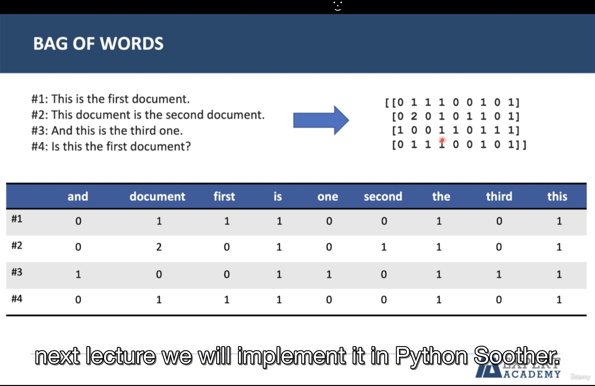

Hello and welcome to this lecture where you are going to learn one of the main and simplest ways to represent sentences, which is a bag of words, as you can read here, when working with natural language processing, we need to represent words in a numerical format as the computer and the algorithms can understand only numbers and not letters. So far, we have seen several natural language processing techniques, and for all of them, it was not necessary to run this process.

However, for more complex applications like chatbots, sentiment analysis, or searching for similar documents, we need to convert letters to numbers. To understand this first representation, The bag of words. Let's consider these four sentences here. "This is the first document." "This document is the second document." "And this is the third one." "Is this the first document?" The first step is to extract the unique words that appear in all sentences, for example, and, document,

first, is, one, second, the, third and this. We put the unique words in the columns of the table, and in the rows we put each one of the sentences: sentence one, sentence two, sentence three and sentence four. Now we need to fill this table with the number of times each word appears in each sentence. For example, considering sentence number one, the word and doesn't appear. Regarding document, it appears only once. first, only once. is, once. The word one doesn't appear in the first sentence.

The word second also doesn't appear. The word the, only once. third, it doesn't appear, and the word this, only once. As you can see here, there was a typo. It was in plural, but actually the word is singular. Now we move on to the next sentence, sentence number two. The word and, zero. Take a look here that the word document appears twice, here and here, and all other words appear only once, or they don't appear. Now, let's move on to sentence number three. We can see here the list of zeros and one, for example, the word document doesn't appear in the third sentence.

The word third, only one, the word this, only one, and so on. And finally, let's consider sentence number four. We can see only zeros and ones. As you can see, it's quite simple to represent the sentences, considering the bag of words format. The result is a matrix with the number of times the words appear in the texts. As you have seen, this is a very simple representation for converting letters into numbers and in the next lecture we will implement it in Python See you there.

11. 011 Bag of words - implementation.en
====================================

See the code [here](./2.Natural_Language_Processing_summarization,_search,_representation,_and_similarity.ipynb)

Hello and welcome to this lecture where we are going to implement that bag of words, representation, and don't worry about knowing for what we need this representation now, because we are going to use it later on in this course first. The goal is just to understand that the representation and right after we're going to implement some experiments using search and also using sentiment analysis, using this representation. Now we open a new cell of code, and we need to import

a new library: from sklearn, this is the standard library for working with machine learning in Python, .feature_extraction.text import the class CountVectorizer, because as you saw in the theoretical lecture, the bag of words representation is just a matter of counting how many times each word appears in each one of these sentences. Let's create our sentences variable. Now we use the same example we saw earlier: "This is the first document", the first sentence; the second sentence,

"This document is the second document"; the third sentence, "And this is the third one". And finally, the last sentence is "Is this the first document?". And then we will compare the results with the theoretical lectures. Let's just take a look at this variable sentences. We can see the four sentences here. And to convert the text to numbers is quite easy. Using the sklearn library, let's create a new variable, vectorizer = CountVectorizer(). Now we will create a variable called X, and let's call vectorizer.fit_transform in order to apply all the processes and count the words. Now you just send here the sentences.

Then we can print vectorizer.get_feature_names(). Run this code, see that we have the list of unique words, the same we have in this table. Now we can visualize the matrix, which is stored in this variable X. Let's type here X.toarray(). Run this code and we can take a look at the results, which is quite similar to the theoretical lecture. And this is how you can convert text to number as you saw. It's quite easy. Now let's apply the CountVectorizer, or the bag of words, to our Wikipedia article.

Just a reminder, we can see this variable, original_sentences. Each position of the list is composed of a single sentence of our Wikipedia article. Now we can apply exactly the same process. We will create a new variable, vectorizer = CountVectorizer(). Now we will create X_sentences. Let's call vectorizer.fit_transform. Now we will send here the original_sentences. Now we can take a look at the feature names, get_feature_names, so we can see the unique words.

See here that a lot of words were returned, and we can see that some stop words and some numbers were returned, because we didn't apply any preprocessing step. So we are just testing to see the initial results We put the print here so we can visualize it in a better way. Don't worry about numbers and about stop words here. The goal is just to understand the representation. We can also see how many unique words the algorithm found in this text. Let's calculate the length, len(get_feature_names). There are eight hundred and sixty one unique words. Of course, if you apply the preprocessing function,

this number would decrease. We can also see the matrix, X_sentences.toarray(). Run this code. You can see here the results, but it's not showing all the columns. Let's take a look at the first sentence. I will copy and paste, X position zero. We can see the vector corresponding only to the first sentence. Number three here, it means the specific word appears three times in the first sentence. Two times, only once, three times, and so on. as you can see, the problem of this representation is that there are a lot of zeros which are related to the unique words that are not present in the first sentence.

We can type here one, then we can see the results. Considering only this second sentence, there are a lot of zeros and ones, twos and threes, according to the number of times the words appear in the text. And again, don't worry to understand why we need this representation. In the next lectures, we will see more ways to represent the text, to convert text to number, and right after we are going to develop some experiments. So it will be easier to understand the representations.

See you there.

12. 012 TF-IDF - intuition.en
=========================

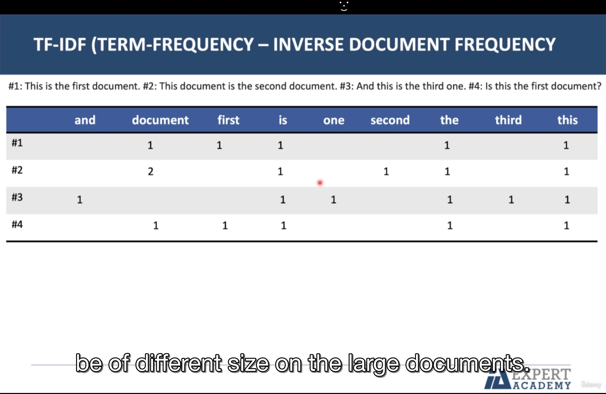
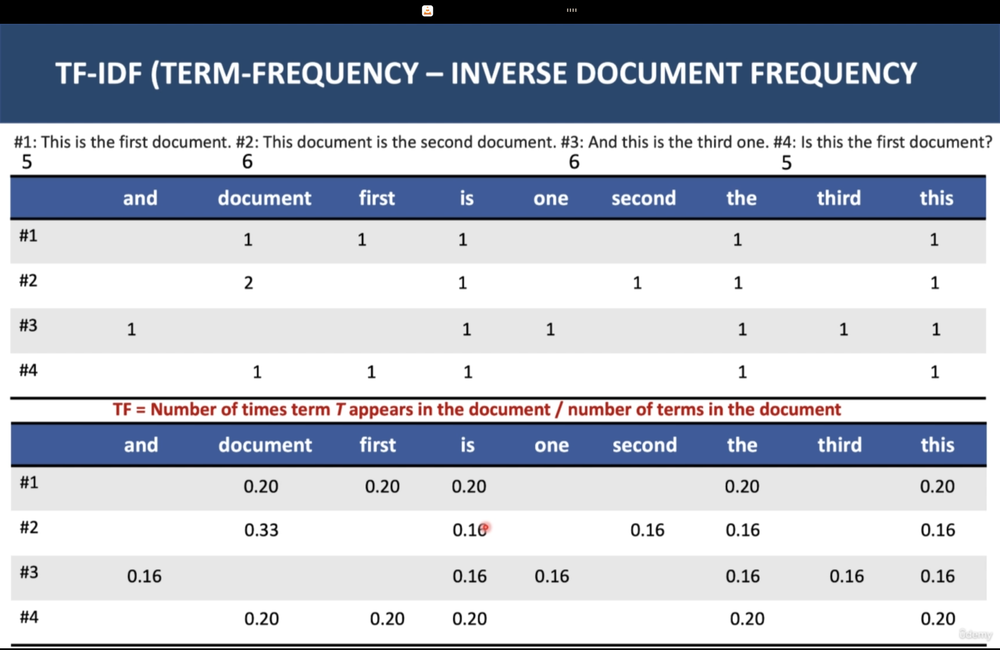
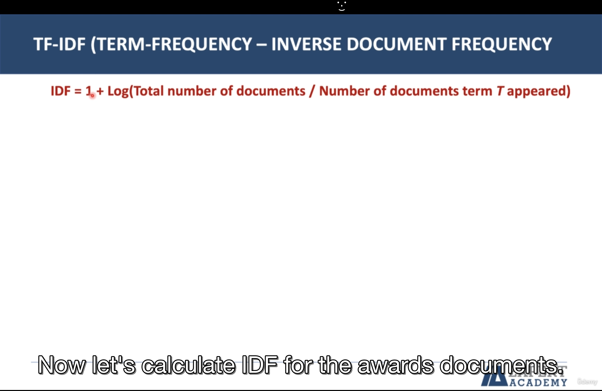
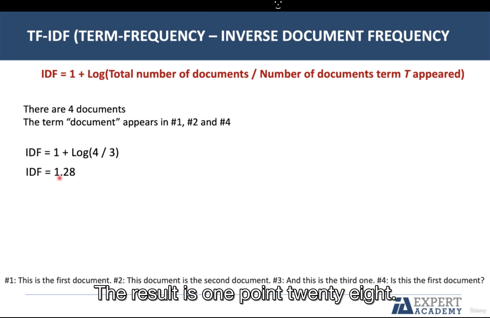
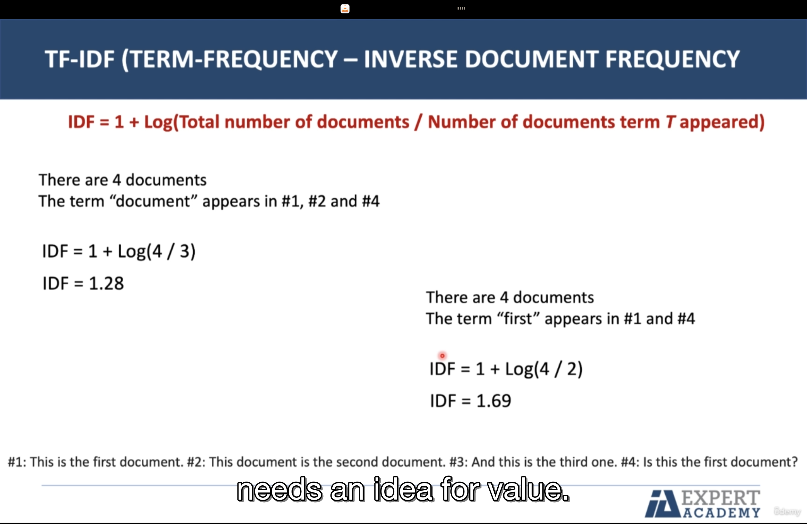
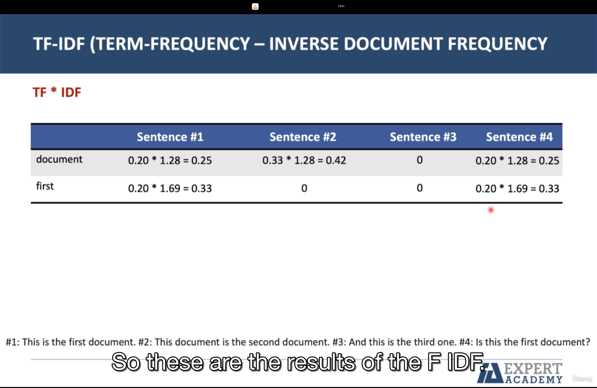

Hello and welcome to this lecture where you are going to learn another text representation, which is called TF-IDF, term frequency, Inverse Document Frequency, as you can read here before understanding it. Let's quickly review the bag of words representation where we only count the number of times that unique words appear in the text. This representation is not very good because frequent words dominate the documents and may not represent so much information about the context.

For example, a single word may appear 100 times and the other words appear less often. A higher weight will be given to the words that appear most often. And on the other hand, less weight will be given to the words that appear less often. And another problem of bag of words is that longer sentences will have greater weight than shorter sentences, since the number of words is greater. For example, in this example we can see the word document appearing twice, and the word first doesn't appear in this sentence.

We could have number one hundred here and number one or two here. So the word document would have a higher weight compared to the word first. TF-IDF came to solve those problems, since it considers the frequency of words by how often they appear in all documents. That's the big difference. In a bag of words, we only consider the frequency of a single sentence while in TF-IDF we consider frequency based on the number of times the words appears in the entire documents.

Let's consider these same sentences again. "This is the first document." "This document is the second document." "And this is the third one." And sentence number four is "Is this the first document?" Below you can see the frequency table, which is the same we used in bag of words, and it indicates how many times each word appears in each text. For example, the word document appears only once in the first sentence. As we can see here, the word document appears twice in the second document, we can see here and here and so on.

For the other words, as we discussed before, real texts or texts extracted from the Internet will be of different size and in large documents the frequency of the terms will be much higher than in the smaller ones. So we need to normalize the documents based on their size. A simple way is to divide the term frequency by the total number of terms. For example, document one has five tokens, or five terms, we can see here. One, two, three, four, five. Sentence two has six tokens.

One, two, three, four, five, six. Sentence three also has six tokens. One, two, three, four, five, six. And finally sentence four has five tokens. One, two, three, four, five. So now we can create this other table and we can apply this equation, TF, only this first part of the technique: the number of times term t appears in the document, divided by the number of terms in the document. We can fill in the table with these values. Take a look here

that all words appear only once in the document. So we just divide one by five, equals zero point two; one divided by five, zero point two; one divided by five, zero point two, and so on. Now we move on to the next sentence. See here that the values are different. Two divided by six equals zero point thirty three; one divided by six equals zero point sixteen; one divided by six, zero point sixteen for all other words. Then we move on to the next sentence.

See that all values are equal to zero point sixteen because we divide one by six. And finally we move on to the next step. We divide one by five, which is equal to zero point two for all words. All of them are in the range from zero to one. And this is the first step of the algorithm, the TF calculation. Now, let's move on to the second step, which is the IDF calculation. In the first step, which is also called normalization. All terms are considered equally important.

And now we need a way to weigh down the effects of too frequent terms. On the other hand, the terms that appear less in the documents also need some importance. So we need to weigh up the effects of less frequent terms. In other words, we reduce the weights of the most frequent terms and increase the weights of less frequent terms. We can get It's using logarithms, which is a concept of mathematics, and we are going to use the equation and I'm not going to go into detail.

Here is the equation where we consider the logarithm of the total number of documents divided by the number of documents term t appears in. And we add number one at the beginning of the equation. Now let's calculate IDF for the word document. We already know that there are four documents, sentence one, sentence two, sentence three and sentence four. And the term document appears in sentence one, sentence two and sentence four. We can see the original sentences here: document in sentence one, in sentence two. See that in sentence two the term document appears twice,

but we consider only number one, because we need to count only the number of documents term t appears in, and not how many times the term appears in each document. We can see that in sentence three this term is not present, and we can see document in sentence four. Now we can apply the equation: IDF equals one plus logarithm of four divided by three, the total number of documents divided by the number of documents term t appears in. The result is one point twenty eight.

And you get this result. We can move back to our Google Colab. We import the library math, and let's type the equation here: one plus math.log(4 / 3). The result is one point twenty eight. Another example, let's calculate IDF for the word first So we know that there are four documents. The term first appears in sentence one and sentence four. We can see here, sentence one and sentence four. Now, we can apply the equation one plus logarithm of four divided by two, the total number of documents divided by the number of documents.

term first appears in. The result is one point sixty nine. We can also see the results here in Google Colab, one plus math.log(4 / 2). See that the result is the same as in this slide. Here I'm showing the calculation for only two words, document and first. However, you need to perform this calculation for all unique words, since each word needs an IDF value. And that's all we need to do in the second step. Now we have the TF and also IDF values, and in the last step we just need to multiply them to get the result.

Here is the equation, TF times IDF. Let's calculate again for the words document and first, so we need to consider sentence one, two, three and four. Let's just start by sentence one. We can see that in this sentence the word first and the word document are present. Then we multiply the TF values by the IDF values. We are getting these numbers regarding the first step, zero point twenty and zero point twenty, and the other values are related to this slide here, one point twenty eight and one point sixty nine.

The result for the word document in sentence number one is zero point twenty five, and the TF-IDF value for the word first in sentence number one is zero point thirty three. Now we need to move on to the next sentence. "This document is the second document". Take a look here that the word first is not present. So we just consider the word document, and zero for the word first. Then we multiply zero point thirty three, which is related to this value.

Then we multiply by the IDF value and the result is zero point forty two. Now we move on to the third sentence. Take a look here. that the word document is not present and the word first is not present too. So we just put zeros here. Finally, let's move on to the last sentence. See that the word first and the word document are both present. So we just calculate zero point twenty and zero point twenty, which are related to these values. Considering sentence number four, the result for the word document in sentence four is zero point twenty five and the results for the words first in sentence number four is zero point thirty three.

So these are the results of TF-IDF. And in the next lecture we are going to implement it in Python. See you there.

13. 013 TF-IDF - implementation.en
==============================

See the code [here](./2.Natural_Language_Processing_summarization,_search,_representation,_and_similarity.ipynb)

Hello and welcome to this lecture where we are going to move back to the Google Colab file, and the goal is to implement the TF-IDF and we will compare the results with the bag of words representation. Let's open a new cell of codes and I will just paste here the same sentences we used before. Let's create this variable. Open another cell of code: from sklearn.feature_extraction.text import TfidfVectorizer. This is the class that we are going to use to perform the calculations. Let's create

the vectorizer equals TfidfVectorizer(), and then I will create the variable X equals vectorizer.fit_transform, and let's send here the sentences. The code is exactly the same we used before for the bag of words. Let's run this code, and now we can see some information. First we can type vectorizer.get_feature_names(). here we can see the list of unique words in the four sentences. Now we can also see the IDF values something similar to what we calculated before. Each word will have an IDF value. for example, this is the value for the word documents.

This is the value for the word first. In order to get the IDF values, we can type vectorizer.idf_. Run this code, and we can see the corresponding values for each one of them. See that the result for three words is number one, because they appear in all sentences. For example, we can consider the word is: it is in sentence number one, sentence number two, number three and number four. So when you apply the equation, the result will be one. We can just test it here. Now we copy

and paste, four divided by four, the result equals one. And don't worry about the small differences between the values here in Python and the values we calculated manually, because when we use the libraries, the calculations may have some differences because the authors who developed the libraries can use some improvements in order to get better results. But the idea is exactly the same. And regarding the first part of the calculation, the TF table, unfortunately, it is not possible to see this table here.

Now we can see the final values. Let's convert X to a NumPy array. This is the representation of the first sentence, the representation of the second sentence, the third sentence, and finally the last sentence. Now we can compare the results of the bag of words representation. Here we have only the number of times each word appears in the text. For example, one time here, one time, two times and so on. And now we have a different representation that are considering the equations you learned in the theoretical lecture.

Now we can apply TF-IDF to the original sentences. Let's just take a look at this variable. There is one sentence in each one of the positions. Now we can create again the vectorizer variable, TfidfVectorizer(). We'll create a new variable, X_sentences equals vectorizer.fit_transform, and let's send here the list with the original sentences. Take a look here that we are not processing the text. We are considering punctuations, numbers and also stop words.

Let's create this new variable then we can. print the feature names: print(vectorizer.get_feature_names()). This is the list of unique tokens. We can count the number of tokens. Let's type here len(vectorizer.get_feature_names()). There are eight hundred and sixty one unique tokens. The result is exactly the same we have here. So now we can make our first comparison between bag of words and TF-IDF. The total number of columns will be exactly the same.

So we need to use all unique words represented in the texts. Let's take a look at the variable X_sentences. Let's convert to array. Run this code. Each row is represented by a sentence, and we can take a look at the first sentence, X_sentences.toarray(), position zero. Now we can compare. Take a look here that we are accessing in this example position one only zeros and integer numbers related to the number of times the words appear in the texts. And now we can take a look at here that we have these values in the range from zero to one.

As we discussed in the theoretical lectures here, we can see the value of the multiplication, TF times IDF. This is a better way to represent the words because in the bag of words format, the words that appear most often will have a higher weight. So with this representation, we can give equal weight to the words, let's just see here, sentence number one. Then we can compare the results in the bag of words we could see in bigger numbers. And here we can.

see the TF-IDF values. And in the next lecture, we are going to use the TF-IDF representation in order to simulate the conversation of a chatbot. See you there.

14. 014 Cosine similarity.en
========================

See the code [here](./2.Natural_Language_Processing_summarization,_search,_representation,_and_similarity.ipynb)

Hello and welcome to this lecture where we are going to start the implementation of our chatbot. The goal is to send a question to the chatbot and it will calculate the similarity between our question and all sentences in the Wikipedia article, in order to return the most similar sentence. So it will be a kind of Q&A system, where we send a message to the chatbot and it will return the most similar sentence. And to calculate similarity between the sentences, we are going to use the TF-IDF representation and also the cosine similarity.

You can follow the first link if you want to know more detail about this mathematical calculation. We can see here that it is a measure of similarity between two non-zero vectors. As we can see here, we have this vector representation. Each one of the sentences are represented by a vector so we can measure the similarity between the vector that we are going to send to the chatbots and all vectors regarding all sentences in our Wikipedia article. If you want to know more detail, you can see here the equation.

And it is not the goal of the course to cover this step by step calculations of the cosine similarity. The other link here shows a step-by-step calculation. This is one of the most useful articles about TF-IDF and cosine similarity. It shows how to perform the calculations step by step. See here that there are three sentences and then we calculate the term frequency matrix. Then we calculate the IDF values for each one of the words. In step three, we multiply TF times IDF.

We can see here the implementation from scratch in Python, and then we can see here the cosine similarity. So if you want to know more detail about the how to calculate this, you can follow this link. We are going to use our X_sentences. Let's take a look here that it is a sparse matrix. There are eighty seven rows, each row is a sentence, and eight hundred and sixty one columns. Each column is related to each one of the unique tokens in the Wikipedia article.

We can type here X_sentences.shape just to see these values, eighty seven by eight hundred and sixty one. In this lecture we are going just to test the cosine similarity. So we are going to define another variable, X_test_similarity equals X_sentences, and we are going to get from sentence zero to sentence two. We are not going to select sentence three, because when we put this range here, Python will select only indexes zero, one and two. The upper boundary here is not selected.

Now we can convert this variable X_test_similarity to a NumPy array, because, as we saw before, we can take a look here, type X_sentences, it is in sparse matrix format. And in order to be easier to process this data, we are going to convert this to a NumPy array. Let's type here X_test_similarity.toarray(). Run this code. Now we can take a look at the type, type(X_test_similarity). See that now we have the NumPy format. Now We are going to add one more sentence here in this matrix.

Let's type the following: import numpy as np. X_test_similarity equals np.concatenate, and let's send here X_test_similarity and again X_test_similarity position zero. We are selecting the first sentence and we are putting it at the end of this vector. We will have two copies of the first sentence in this test matrix. Now we need to specify axis equals zero to concatenate row by row. Let's run this code. One error will be returned.

See here that the arrays must have the same number of dimensions. And what is happening here is that this variable is a matrix and this variable only the first sentence is represented as a vector. So we need to convert it to a matrix. We can just type .reshape(1, -1). Let's run this code. Now we can take a look at X_test_similarity. See that there are four rows. Let's check the shape, X_test_similarity.shape, four rows and eight hundred and sixty one columns.

Now we can import the function to calculate similarity: from sklearn.metrics.pairwise import cosine_similarity. Run this cell, import this function, and now we can perform the tests. Let's call cosine_similarity and I will send here X_test_similarity position zero. We are going to calculate similarity between sentence zero and let's send the next parameter position one. We want to measure similarity between the first vector and the second vector.

Let's run this code. See that an error was returned, because we need to reshape the data, exactly the same as we did before, so we can just copy this code here, and let's type here .reshape to convert from a vector to a matrix. Run this code, see that 0.13 was returned. So it means that sentence zero is 13 percent similar to sentence one. So this is how we can measure this similarity between sentences. We can take a look at them. Let's type here original_sentences, position zero and original sentences position one.

We are measuring similarity between these sentences. Of course, we cannot measure similarity comparing strings. So we are comparing both vectors, which are in this TF-IDF format. Let's perform another test, how we copy and paste this code here. Let's measure similarity between sentence one and sentence two. Run this code. See that the similarity between one and two is 17 percent. We can take a look at the sentences, original_sentences position one is the same we calculated here.

So let's change it to two. So this sentence is 17 percent similar to these other sentences. Now we can take a look at another example. How will change here to three? So we are calculating similarity between zero and three. See that the result is one, which means one hundred percent similar. And it happens because they are both the same because here we concatenated the first sentence at the end of the matrix. So when we have number one, it means that the sentences are the same.

The higher the value, the more similar the sentences are, and the lower the value, the less similar the sentences are. And we can perform one last test. We will just paste this code here. And let's suppose we want to calculate similarity between sentence zero and all other sentences of the dataset so we can just delete this part here. We don't need the reshape function, because this variable is in the form of a matrix. Let's run this code, just delete this additional parenthesis.

And we can see here similarity between zero and zero is one. They are 100 percent similar between zero and one, 13 percent similar, zero and two, only six percent similar and zero and three one hundred percent similar. And in the next lecture, we are going to use this cosine similarity function to build our chatbot example. See you there.

15. 015 Simulating a chatbot 1.en
=============================

See the code [here](./2.Natural_Language_Processing_summarization,_search,_representation,_and_similarity.ipynb)

Hello and welcome to this lecture where we are going to start the simulation of a chatbot. We are going to send a message or a text to the chatbot. It will use cosine similarity to calculate the most similar sentences to our question, and then we will send the results to the user. Let's open a new cell of codes. And the first step is to define the variable welcome_words_input equals, let's put some greetings here, for example, hey, hello and hi, and also welcome_words_output equals hey, also

hello, hi, how are you, welcome, and another one, how are you doing. These are the greetings that the user can type, and these are the answers that the chatbots will return to the user. For example, if the user types hello, the chatbot will select one message here. It will be a random process and it will answer to the user. For example, the user says hello, and the chatbot will answer welcome. We are going to perform some tests in this lecture.

Let's open a new cell of code. I'll import the library random, to select one random message from this list. And let's create the function welcome_message. It will receive as a parameter text. And let's go through each one of the words: for word in text.split(), the split function, which divides the tokens. For example, we can type here 'how are you'.split(). When it finds a blank space, it will put each one of the tokens in a position of the list.

So this is our way in order to go through each one of the words, of course, you can use spacy to tokenized the sentences instead of using the split command, but as this will be a very simple step, if we use split, it will work properly. Now we will check if word.lower(), let's convert to lowercase, in welcome_words_input. If any of these words is in this list here, we will select the answer here. So we will just return random.choice, and let's put here welcome_words_output.

This is a very simple function. Let's create it and now we can perform some tests. welcome_message. If we type hi, we can see that this word is in this list here, then we got as a result, how are you doing. Run again, welcome. Again, welcome, hey, and so on. Last test with another text, for example, if we type [unclear], it is not in the greetings input list, so it won't return anything. And this is the idea of the first function just to show the welcome message to the user.

And in the next lecture, we are going to continue the implementation. See you there.

16. 016 Simulating a chatbot 2.en
=============================

See the code [here](./2.Natural_Language_Processing_summarization,_search,_representation,_and_similarity.ipynb)

Hello and welcome to this lecture where we are going to continue the chatbot implementation. Let's open a new cell of code. Now we'll define a new function called answer. It will receive as a parameter the user_text. Let's create a list, cleaned_sentences, an empty list. Now we will go through each one of the sentences: for sentence in original_sentences. Just a reminder that this is the list of sentences of the Wikipedia article about natural language processing.

So the chatbot will be able to answer questions about natural language processing, which is the contents of the article. If you want to work with another subject, you can just change the codes and try other articles. Let's call cleaned_sentences.append, let's add a new row, and I will call our preprocessing function. Let's send the original sentence. After that, we can print the cleaned_sentences. Let's run this code to create the function.

Let's call it answer. For example, let's put here what is natural language processing, let's call it. We can see here the list of preprocessed sentences we are removing stop words, punctuations, numbers and so on. In last lectures, we hadn't removed the stop words. But to get better results, we are going to remove them from our sentences. Let's create a new variable, chatbot_answer, an empty string, and then we need to recreate the user_text, and we need also to preprocess this text.

Let's send here user text. let's print user text call the function run again. See here that we typed what is natural language processing, and it has removed all the tokens according to our preprocessing function. So we will measure our similarity only considering these three tokens here. The next step, we are going to call the cleaned_sentences.append, let's append the user_text. Take a look that in this part we are adding to the cleaned sentences all sentences of the Wikipedia article.

And in this line here, we are adding, in the last position of this list, the sentence that the user is typing. So we can take a look, let's print cleaned_sentences. I will put the first print in comments. Let's run this code. We can see here the last sentence of the Wikipedia article, and at the end is the sentence typed by the user. In order to see the last element of a list, you can just type minus one, so it will get only the last element.

Let's run it again. See, that's only natural language processing was returned. The next step is to convert texts to numbers so we can create tfidf equals TfidfVectorizer(). Let's create X_sentences = tfidf.fit_transform, and I will send here the cleaned_sentences. After that we can print, just to see the results, X_sentences.toarray(), and let's visualize the last position. Run this cell again, run the calling of the function, and we can see here the TF-

IDF representation for the last sentence, which is "natural language processing", that the user has typed. Now we need to calculate the similarity between this sentence here, this vector, and all other vectors in this variable here. Now we create the similarity variable equals, let's call cosine_similarity(X_sentences position minus one, which is the last one, and let's calculate similarity between the last and all other sentences. We can print this similarity.

Let's run again. And now we can see this list here, which is this similarity between this sentence typed by the user and the first one. Thirty eight percent, eight percent, zero percent similar. Fifty five percent similar, 10 percent similar and so on. Now, the goal is to get the index of the most similar sentence. And to do that, we can create another variable sentence. Index equals similarity. Now, I will use a NumPy function, argsort, to order the results.

Then we get position zero. I will put here minus two, because we don't want to get this final result here, because this one here means the similarity between this sentence and itself. Now let's print this sentence_index and let's run this code again. See, that's number three was returned so we can check position zero one two and position three. This is the highest value. Fifty five percent similar. And now we need to get this sentence. We can define a threshold in order to filter these values.

I will put another parameter here, threshold. The default value will be zero point three. And now we can get this value and check if it is above or below the threshold before. Let's just print similarity position, sentence index. Run again. See that one error was returned: index three is out of bounds, and it happens because the result is in the form of a matrix, as we can see here, two brackets so we can access position. Zero. And then we access these index here.

Let's run this code again now we can get the index and also the value. Now we can check if the similarity is under or over this threshold value. Let's type here: if similarity position zero and sentence_index less than the threshold, let's change the value of the chatbot_answer. See here that it was defined as an empty string. Plus equal, let's type a message: "Sorry, no answer was found." And then we can return the chatbot_answer. I will put this print in comments run again.

See that nothing was returned. So let's change the threshold, zero point nine. So we are expecting ninety percent similarity. Let's run. Sorry, no answer was found. Now let's implement the else statement: chatbot_answer plus equal, and we just need to access the original_sentences. It's important to emphasize here that we are going to return to the user the original sentences without applying preprocessing because it will be easier to visualize. So we use the processed sentences only to make the calculations, only to calculate the TF-IDF values.

And on the other hand, we use the original sentences to send the message to the user. Let's put here sentence index now. Let's create the function for the last time. Run this code. We need to change here. Zero point three run again. Natural language processing has its roots in the nineteen fifties, so we could get some good results here. Let's open a new cell of code and call our function again. Who is Alan Turing? We can see here that's a text regarding Alan Turing was returned so we could get good results, let's call it again: what is NLP?

And now we can get the most similar sentence to the sentence here. We can see here ideas of cognitive NLP. So this is how our chatbot is going to work. We will just calculate similarity, although it is quite simple to implement, the results can be quite interesting. And the next and last lecture, we are going to finish the implementation. See you there.

17. 017 Simulating a chatbot 3.en
=============================

See the code [here](./2.Natural_Language_Processing_summarization,_search,_representation,_and_similarity.ipynb)

Hello and welcome to this lecture where we are going to finish the simulation of our chatbots and we'll open a new cell of codes, let's create this variable, continue_dialogue, which means... Let's print a greetings message: "Hello, I'm a chatbot and I will answer your questions about natural language processing." Let's implement a while loop: while continue_dialogue equals True, we will keep executing the chatbot. Now we need to get user_text equals input(), just to test this part of the code.

This function input will open this box of text, so we can type anything here. For example, natural language processing. The text with type here will be copied. to this variable user_text. If user_text different from 'quit', then we can call our welcome_message function: welcome_message(user_text). If it is different from None, if a greeting was returned, then we can print chatbot plus, let's call again welcome_message(user_text). Here at the end we can implement an else.

If the user_text equals 'quit', then continue_dialogue equals False, and let's print another message: "Chatbot: Bye! I will see you soon." Let's run. For example, we can type hi, and the chatbot will select a greetings message, hello. It selected another message, hey, and so on. When we type quit we have the final message: Bye. I will see you soon. Now let's move on to this part to hear if we are not dealing with a welcome message, if the result of the function is None, then we can call this function here.

The answer function. Let's print chatbot, and after that, print, let's call answer, and I will send here user_text. Now our implementation is finished. Let's test. Hello. Hey, let's type. Who is Alan Turing and the chatbots will answer. According to the Wikipedia article, we can ask other questions. What is natural language processing? Then we can get this answer here. Let's type what is artificial intelligence. And we have the same answer here. So you can play with the chatbots and try other texts to see if the results are good.

As I said before, although this is a very simple implementation, we can get good results. Let's suppose you have your own websites and you need to answer frequently asked questions the users ask about your product or about your service so you can implement this kind of algorithm and the chatbots will get the most similar sentences and give answers to the users. It's a very easy and nice application that you can implement in your own projects. And that's all for this lecture.

See you next time.

## 04 Sentiment analysis

1. 001 Plan of attack.en
=====================

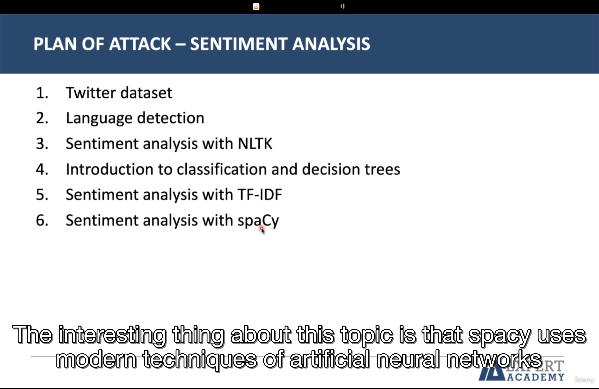

Hello and welcome to the third section of the course on natural language processing in Python. In this lecture, I'm going to show you the plan of attack. As you can read right here, the goal of this section is to implement sentiment analysis, which is one of the most classic examples in natural language processing. The goal is to send a text to this system and it will return whether the text is positive or negative. This type of application is very useful for companies to know the feeling that customers have about products or services, and then they can define marketing strategies to reach this goal.

First, we are going to use a real Twitter dataset with almost two million tweets. We are going to apply some preprocessing and visualization functions, as you have learned in previous sections. In topic number two, you will learn how to use nltk library to detect the language of texts such as English, Portuguese, French, Spanish and so on. This feature is very useful and it can be considered an additional preprocessing step for sentiment analysis.

Since you can first detect if the texts are in the correct language, Then we will perform sentiment analysis using the NLTK library in topic number three. Before developing our custom sentiment analyzer, you will have two additional theoretical lectures, one about the basics of classification and another about decision trees, as this area involves machine learning. It is important that you have this theoretical background before implementations. It is important to emphasize that we could use a lot of different algorithms, but we decided to use only decision trees,

since they are easy to understand. It is not the purpose of this course to cover the detailed theory of machine learning, but rather how to use it in natural language processing. In topic number five, we will implement sentiment analysis using the TF-IDF representation you learned in the last section. And finally, in topic number seven, we will use spaCy for the same task. The interesting thing about this topic is that spaCy uses modern techniques of artificial neural networks and deep learning, and in general the results are better than other approaches.

Another positive aspect is that it is not necessary to understand about neural networks to implement a sentiment classifier using spaCy, since the coding is easy and straightforward. In the next lecture, we are going to start the implementation. See you there.

2. 002 Loading the Twitter dataset.en
==================================

See the code [here](./3.Sentiment_Analysis.ipynb)

Hello and welcome to this lecture where we are going to start the implementation of sentiment analysis. we already have this Google Colab file. Just a reminder, if you want to make changes or to run this notebook, you need to click on File, Save a copy in Drive. When you click this link, a copy of this notebook will be made on your own Google Drive. So you must have a Google account and you need to be connected to it. I will click Connect to connect this file to the Google servers.

And let's start by loading the Twitter dataset, That will be our case study in this section. First, we already have these two lines of codes. We will install spacy and after that we can run this code to download the English packages. I will click here to clear the outputs. And now let's import the libraries. First, import spacy, import en_core_web_sm to have access to the English packages, import pandas as pd, pandas. This is a library to work with DataFrames in Python, and we are going to use it to load our dataset, which is in the CSV

format. import seaborn as sns, this is a library used to generate graphs. import numpy as np, vectors and matrices. import re, which means regular expressions, that we are going to use to clean the text of the dataset. import random, to generate random numbers. And the last one, from google.colab import drive. So we will have access to our Google Drive. Let's run this code, and the next step is to connect with our Google Drive because the data set we are going to use is quite big and it would take a long time if you want to click these button here to upload the data sets to the Google Colab environment so you can access the dataset, download it to your machine, then you can upload it to your own Google Drive so it will be easier and faster to access this big file.

Let's connect to the Google Drive: drive.mount. Here we need to specify the folder, /content. /content is this folder here, the default folder of Google Colab, and I will create a new directory called drive. Let's run this code. You can see that a link appears. You need to click this link, then you select your Google account. And after, you can see this code. Let's copy it, paste it here. We can click this refresh button, see that our new folder was created, called drive, according to the name here.

And now we have access to the Google Drive. Just a reminder that these folders that you are seeing here are my Google Drive. You will visualize your own Google Drive. I will access this folder, NLP, and this file here, train.csv. I will copy the path. Now we can open a new cell of code. I will create a new variable, train_data equals pd, which means the pandas library, .read_csv. Now we can send the first parameter, which is the name of the file.

Then we will specify header equals None, since there is no header in this file. Now we need to give names to each one of the columns. The first column of this Twitter dataset is the sentiment; the second, id; the third, date; then the next one is query, after that user, and finally the text. In some seconds, we are going to analyze each one of these columns. And finally, we need to specify the encoding of this file, which is latin1. Let's run this cell of codes.

And now we can take a look at the data, Now we type here train_data, run this cell of code. we have in the data frame format. We can see here that we have almost two million rows and six columns. Each one of the rows is related to a tweet a user posted on the social network. We can see here this column, sentiment: zero means a negative sentence, and four means a positive sentence or a negative tweet and a positive tweet. We already have this column here indicating whether a tweet is positive or negative.

Then we have id, which means a unique identifier, the date that the tweet was posted, query, it is related to the subject, the user who posted the text, and finally, this is the text. What interests us in this case study is only the text and also this sentiment, if it is positive or if it is negative, because the goal is to train algorithms in order to detect if a text is positive or negative. We can take a look at the sentiment values. Let's type train_data['sentiment'], the name of the column, .unique().

See that we have only zero and four. Just a reminder, zero means negative and four means positive. We can also generate a graph, sns.countplot. Let's specify here train_data['sentiment']. Run this cell of code. We can see the graph, that half of the tweets are negative and half of the tweets are positive. We can also count them: np.unique. Let's type here again train_data['sentiment'], return_counts equals True. So we will get two lists. The first one, we can see the amount of negative tweets and the amount of positive tweets.

And as I said before, our goal is to try to predict if a text is positive or negative using these tokens here. So we are going to use only the text column and the sentiment column. Date, query and user won't be useful for this case study, so we can just delete these columns. In order to do that, let's recreate train_data equals train_data.drop, and here we can specify the list of the columns, id, date, query, user, and the last parameter axis equals one.

One means that we want to delete the columns. If we put zero here, it would mean that we are referencing the rows. Let's take a look at the train_data. Run this code, see that now we have only the sentiment and the text, and that's all for this lecture. And in the next one we are going to talk about the train and test data. See you there.

3. 003 Train and test data.en
==========================

See the code [here](./3.Sentiment_Analysis.ipynb)

Hello and welcome to this lecture where we are going to prepare the data for the machine learning algorithms, just a reminder that our goal is to use these texts here to predict this sentiments if a tweet is positive or if a tweet is negative. So we need to perform some preprocessing on this data set. Let's open a new cell of code and we will create a new variable called X equals train_data.iloc. The iloc function from pandas. This is used to get only some columns of the DataFrame.

Let's put here this symbol. It means that we want to get all rows, almost two million rows and we are going to get only column number one. We can see that the sentiment is column zero and the text is column one. So we will put in this variable only the text. I will put here at the end .values, to convert to a NumPy array. Let's take a look at the X variable. See here, array. And we can see in each one of the rows there is a specific text. Now let's create another variable, y = train_data.iloc, all rows and only column zero, .values.

Let's take a look at the new variable. See here that we have only zeros and fours, negative tweets and positive tweets. Basically, when working with machine learning, we need to separate the variables. The first variable contains only these information. the texts, and the other variable contains only the class, or the sentiments that we want to predict. So now we have X and Y variables. Now we need to just select just a small part of this dataset, because as we can see here, there are more than one million rows.

And if we run the algorithms, considering all the rows, it will take a long time to process. So we will select just a small part of this data. We can do it by using the scikit-learn library: from sklearn.model_selection import train_test_split function. Let's create variable X, now we put this symbol here, variable y, and again this symbol. In some minutes you will understand this better. Let's call the function train_test_split. Now we will send here X, y, and the last parameter is the test_size, which will be equal to zero point nine seven.

Don't worry now about what test_size means, because we are going to use it just to select three percent of the dataset. So instead of using 100 percent of the data, we are going to use only three percent. If we want three percent, we specify here zero point ninety seven. Let's run this code now. We can take a look at X variable. See that there are some texts here. And let's see how many rows we have, X.shape. Now there are only forty eight thousand rows, so we applied this function just to select three percent of the data.

Now we can separate this data into the training data and testing data. When we work with machine learning, we need two datasets. One part of the data is used for training the algorithms, and after the algorithm is trained, then we use the test data in order to see how the algorithm is performing. In this lecture, we are going to divide this data into training and test data. And later on in this section, you will see more details about how the machine learning algorithms work.

So don't worry about it. Now let's create four new variables: X_train, X_test, y_train and y_test. Now let's call again the function train_test_split, and we'll put here X and y. X is this variable here, which is composed of only forty eight thousand rows. Let's define the test_size equals zero point two. So it means that in this variable X_test and in this other variable y_test, we will have 20 percent of the data which is related to the test size.

On the other hand, in these other variables, X_train and y_train, we will have the rest or 80 percent of the data. In other words, the machine learning algorithms will learn with 80 percent of the data and after the algorithm has learned, we are going to use 20 percent of the data in order to test and evaluate the performance of the algorithm. Again, we will see more details about it later on. See here that before we didn't specify this parameter, which is related to X_test and y_test, because in this first command here, the goal was not to divide the data into training and testing sets.

It was only to select forty eight thousand rows. Let's run this code and let's check the shape, X_train.shape. We can see here that we are going to use thirty eight thousand and four hundred rows to train the algorithm. Regarding the other dataset, X_test.shape, We are going to use nine thousand and six hundred rows to evaluate the algorithm. We can also take a look at the shape of the other variable, y_train.shape. We need exactly the same amount.

Just a reminder that the X variable represents the texts and the Y variable represents the classes, positive or negative. Let's take a look at the shape, y_test.shape. We also need the same number here, one variable to store the text and another variable to store the classes. We can also count how many positive and negative tweets: np.unique(y_train, return_counts equals True). Regarding the training dataset, we can see that there are nineteen thousand one hundred and twenty four negative rows,

and regarding positive texts there are nineteen thousand two hundred and seventy six rows. We can also count for the test dataset, np.unique(y_test, return_counts equals True). Run this code. We can see that there are similar amounts of rows, and in the next lecture we are going to move on to the next step, which is the preprocessing of the data. See you there.

4. 004 Preprocessing the texts.en
==============================

See the code [here](./3.Sentiment_Analysis.ipynb)

Hello and welcome to this lecture where we are going to preprocess the data. Let's open a new cell of code and we will create the nlp object, spacy.load. Let's type here en_core_web_sm, to have access to the English package. Let's type nlp just to make sure that the object was correctly created and it is associated with the English language. Now we just paste our code here, because the function that we are going to see is the same we implemented before.

Just a reminder, we receive as a parameter a sentence. The first step we convert to lower case, we remove dots, then we go through each one of the tokens using spaCy and we are removing some tokens, for example, stop words, numbers, punctuations, space or tokens with the length less than two. And then we just return the tokens. Now, I will call this function just to perform the first test, open a new cell of code and this text was extracted from this dataset.

Let's run this code and then we can see the results applying our function. But there are two problems here. All tweets have the name of the user and the name of the user starts with this symbol here. So we need to identify this symbol and remove the name of the user. And also we need to remove the links, as we can see here. In order to do that, we can use regular expressions which are used to go through a string and search for specific patterns. Let's recreate the sentence variable, and I will type re.sub, r, and inside this symbol, we are going to define our regular expression. First, to remove names of users, so we can type this symbol, @, which is the first token of the name of the user, and then in the form of a list we can type A and Z in capital.

So it means that we are going to remove the name of the user if it contains capital letters. Also, if it contains lowercase letters from A to Z, and we can consider also numbers from zero to nine and we can add one plus here, which means that we can have one or more characters and after we just need to put an empty space. So when we find the name of the user, we will replace it by an empty space. And here we need to send this sentence again. Let's run this code, call the function again.

And see that the name of the user was removed. Now we can implement something very similar to remove the links. Let's recreate the sentence variable, re.sub, r, and inside this part let's put h, t, t, p, s. But we can see here that we can have links with http or https. So letter s is optional. We can put the question mark, which means that we may have or we may not have letter s. Then this symbol, ://, to represent this part. And now we can put these symbols, which means the other part of the link. Let's define it in the format of a list:

capital A to Z, lowercase letters, zero to nine, and then we can put dots, for example, if you have twitpic.com, and this bar here means the bar that we can put after each directory of the web server, and finally a plus symbol indicating that we may have one or more characters. Now we will replace it by an empty space, and finally define the sentence again. Let's run this code, call the function again. See that it wasn't removed because there is a typo here.

Run again and see that now we have the clean tweets, removing the names of users and also URLs. Now we need to apply it to our dataset. So let's type here X_train_cleaned. It is a new variable. Let's define it in the format of a list. Now we'll create the tweet variable: for tweet in X_train. This for loop is going through each one of the tweets and we are copying each one of them to this variable. Now we need to call our preprocessing function in order to remove all these tokens.

Let's run this code, and it may take four or five minutes to finish processing. Now we can take a look at some sentences just to make sure they were processed. Let's implement a for loop: for i in range(10). Let's run this for ten times, and let's print X_train_cleaned, and here we can select a random number: random.randint, a number from zero to len(X_train_cleaned) minus one. We can test this code here, copy and paste. It will return the size of this dataset, the training dataset, and we need to specify minus one here because indexes in Python start at zero.

Let's run this code. We can see different preprocessed texts and take a look that the stop words, the names of the users and all those things with the files were removed. Now we need to apply the same process for the test dataset. Let's create X_test_cleaned equals preprocessing. Let's send here the tweet, for tweet in X_test. Let's run this code. And again, it may take two or three minutes to run. In the next lecture we are going to generate the word cloud to see the most frequent words.

See you there.

5. 005 Word cloud.en
=================

See the code [here](./3.Sentiment_Analysis.ipynb)

Hello and welcome to this lecture where we are going to generate the word cloud, considering the Twitter dataset, and this step is quite interesting to explore the texts so we can visualize the most frequent terms. And in order to do it, we need first to go through each one of the rows of the datasets and put all the texts together in the same variable, because as we can see here in each one of the rows of this variable X_train_cleaned, we can see a sentence.

And to generate the word clouds, we need to concatenate all of them in the same string. Let's create the text variable, an empty string. Let's define a for loop: for text in X_train_cleaned. We are going through each one of the rows, and then we can just concatenate text plus equal empty space plus text. Let's run this code, then we can take a look at the results, the text. We can see here that now one single string is storing all the texts of our dataset, and now we can generate the word cloud: from wordcloud import WordCloud.

Then we need to import matplotlib.pyplot as plt. Let's create the cloud variable, WordCloud(). Then cloud equals cloud.generate, and let's send here the new variable, all texts. Let's define the size of the figure: plt.figure(figsize equals 15 by 15), plt.imshow(cloud), and finally plt.axis('off'), to remove the numbers in the X and Y axis. Let's run this code, and now we can see the most frequent words. The bigger the size of the letter, the more frequent

the term is. We can see, for example, work, day, got, back, love, today and so on. As I said before, this visualization is very useful to see the most frequent terms. And in the next lecture, we are going to move on to the next topic. See you there.

6. 006 Detecting languages.en
==========================

See the code [here](./3.Sentiment_Analysis.ipynb)

Hello and welcome to this lecture where you are going to learn a very interesting topic, which is language detection using a specific library. This feature is very useful when you have texts of different languages in the same document so you can filter the texts by the language. Let's open a new cell of code and let's install the library. pip install langdetect. Run this code. Let's import the function: from langdetect import detect. We just need to send a text to this function, and it will return the corresponding language.

Let's call detect. I will type an English text: "This is an English text." Call the function and see here the result, en, which means English. Let's try with a different language, [unclear], in Portuguese. Let's run this code. We can see here pt, which means Portuguese, and let's perform the last test. Let's try a text in Spanish, [unclear]. Run this code, and the result is es, which means Spanish. Now we can check the languages of our dataset. Let's define the languages variable, an empty list, and now we will go through each one of the rows: for text in X_train_cleaned, and we'll append to this list the result of the detection, en, pt, es

and so on. So let's call languages.append(detect, and let's send the text. Let's run this code. See that one error was returned: "No features in text". It means that probably there is some empty strings here and in order to not get this error we can implement and if statements if text different from empty string, then we can run this code. And I will just change here to X_test_cleaned, to not take a long time to run this code. Let's run it, and it will take one or two minutes to finish.

Now we can take a look at the list of languages. Let's call np.unique and I will specify here the languages, return_counts equals True. Now we can see that there is a list with a lot of languages. Although this is an English dataset, some of the sentences were considered of another language. For example, fr means French, pt means Portuguese, es Spanish and en English. But the most part of the sentences are in English, six thousand seven hundred and twenty three.

So when you need to process some text, you can first run this code in order to identify the language before applying some preprocessing. Let's suppose you want to remove stop words. These stop words in English are different from the stop words in French that are different from the stop words in Portuguese and so on. So it makes no sense to process a French text and try to remove the stop words in English. So this is a good practice to first identify the language and then you can apply the preprocessing.

And it is also important to say that it doesn't mean that all these texts here are in these languages. Maybe the algorithm detected these languages incorrectly so you can check the dataset in order to confirm these results. And that's all for this lecture. And in the next one, we will start talking about sentiment analysis using nltk library. See you there.

7. 007 Sentiment analysis with NLTK.en
===================================

See the code [here](./3.Sentiment_Analysis.ipynb)

Hello and welcome to this lecture where we are going to perform sentiment analysis using nltk library, the good points about using nltk is that we just need to call a function and it will predict if a text is positive or negative and also neutral. And we don't need to train our own algorithm to do it. Later on, after you learn about nltk, then we will develop our custom algorithm to predict sentiments. Let's import nltk, and we need to download a package, nltk.download.

And the name of the package is vader_lexicon. Let's run this cell of code. See that the message True was returned. Now we can import the class: from nltk.sentiment.vader import SentimentIntensityAnalyzer. Let's run this code. Now we can open a new cell and let's classify some texts. nltk_classifier, we'll create this variable, which will be used to classify sentiments, SentimentIntensityAnalyzer(), and to get the results, let's call nltk_classifier.polarity_scores.

Let's test the first sentence. I love this food. Clearly it is a positive sentence. Let's run it and take a look at the results. You don't need to worry about this compound here. What is interesting for us is this three last results. See that positive sixty seven percent, neutral, and negative, so we can conclude that it is a positive sentence. I will copy and paste this code here and let's change this sentence. I hate this food. It is a negative sentence and see that when we change only one word, the algorithm can identify that it is a negative sentence and zero percent positive.

Let's open a new cell of code and let's change love and put have: I have this food. We can see the results that this sentence is one hundred percent neutral, zero percent negative and zero percent positive. As we can see, this nltk function is very interesting because it can adapt to the contexts by changing only one word. We have different results now. We can try with other texts. For example, X_train_cleaned position zero. This is the first text of our dataset.

Let's call again the function, X_train_cleaned position zero. It was considered a positive sentence, probably because of the words awesome, best and love. Let's try with another one, X_train_cleaned 2,000, for example. You can try other numbers. "Bad time tomorrow, they close on Sunday". Let's call our function. Let's just change here, X_train_cleaned 2,000, and this sentence was classified as neutral since there is no positive or negative words here.

And finally, you can also go through each one of these sentences for sentence in X_test, and let's print nltk_classifier.polarity_scores. Let's send here the sentence, put this symbol to separate, and then we type again this sentence. Let's run this code, see that it is going through each one of the sentences and we have the results. Negative, neutral and positive. We can check some of them. For example, 52 percent neutral. See here that maybe we need to perform some additional preprocessing the names of some users weren't removed, and then you can check the results if the sentences are positive, negative or neutral.

So using nltk is a very simple way to classify sentiments. And in the next lectures we are going to implement our custom sentiment classifier. See you there.

8. 008 Introduction to classification and decision trees.en
========================================================

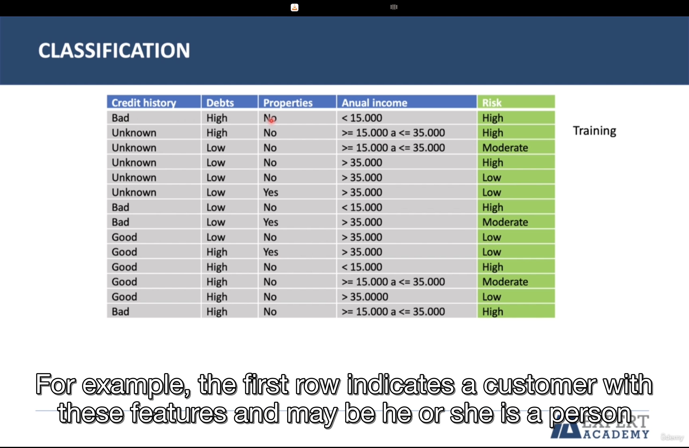
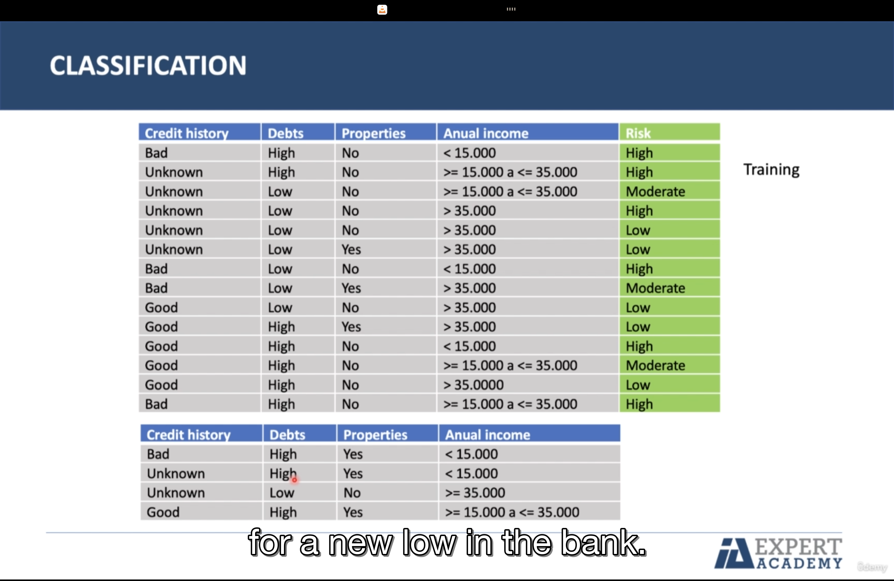
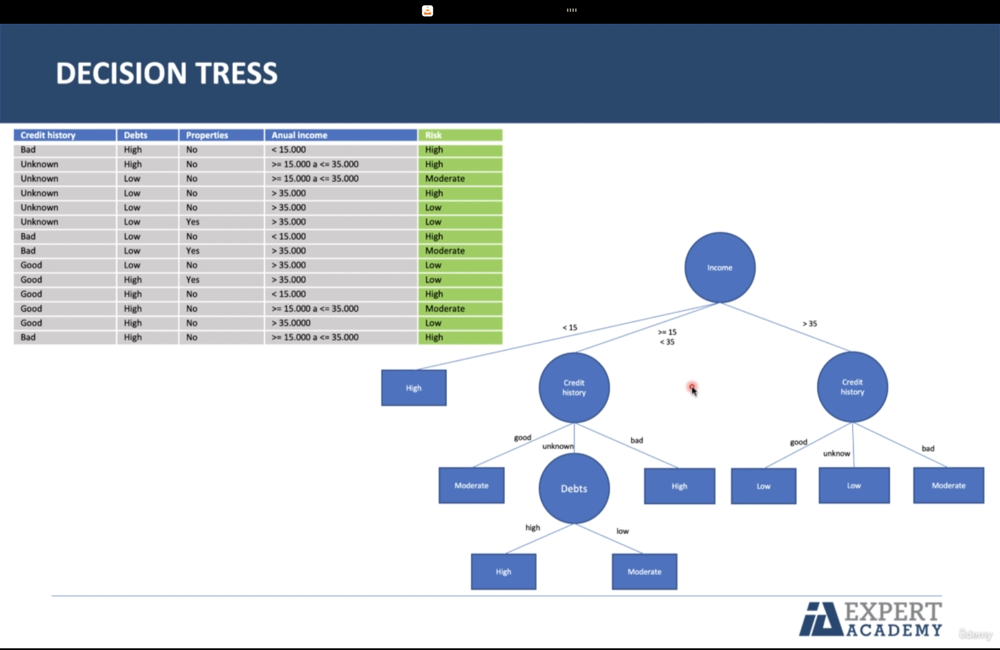
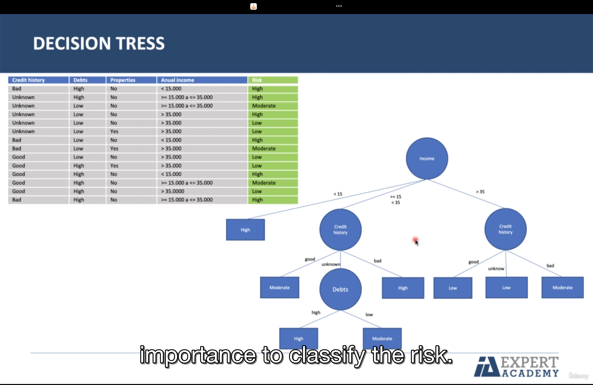
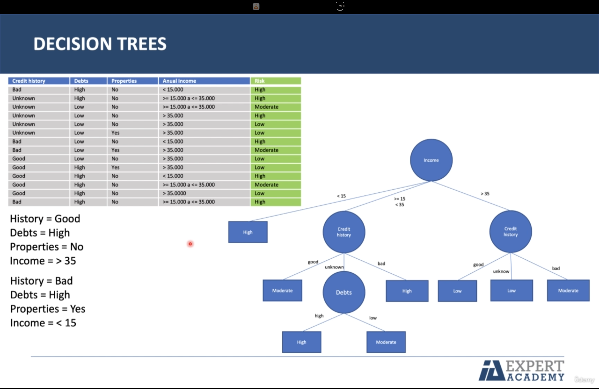

Hello and welcome to this lecture where you are going to learn the basics of classification, which is one of the main areas of machine learning to understand it. We will consider a general example not related to natural language processing. Let's consider these datasets of a bank with information about customers, for example, the credit history: bad, unknown and good. Debt, if the debt of the customer is high or low. If the customer has some kind of properties, like cars, houses, apartments and so on,

and the possible values are no and yes. And the last attribute, annual income, which can present the values less than fifteen thousand dollars a year between fifteen thousand and thirty five thousand and greater than thirty five thousand. The last column here is the risk and has three values, a high, moderate and low. This is the risk the bank takes in giving a loan to a person. See that each one of these rows is related to a specific customer of the bank.

It is a historical data set. So to apply machine learning techniques, it is necessary to have historical data with this column at the end, to identify the class of each customer. So the bank needs to have this historical data so the algorithms can learn from past data to make future predictions. This dataset is called the training data set. As you can read here, the bank needs to collect this data. For example, the first row indicates a customer with these features and maybe he or she is a person who has not paid the loan in the past.

So the bank has defined this customer as a high risk customer. The risk to give a loan to a customer with these features here is high. On the other hand, we can see this third customer here with these features and the risk to give a loan to this customer is moderate. For example, maybe the customer has paid only a half or 70, 80 percent of the loan. We can see the data about this other customer here, and the bank knows that the customer with these features here presents a low risk for the bank.

Maybe this customer always paid all the loans. Our machine learning algorithms will analyze this data and then make a prediction. For example, we can consider these other four customers with these features, and they have just applied for a new loan in the bank. See here that we don't have the class. And our goal is to predict the risk for each one of these customers. You send each one of these data to the algorithm, which will be able to indicate whether the risk is high, moderate or low.

First, we need to train the algorithm and then we can send the data to get the predictions. This is basically how machine learning works. And now let's understand one of the most basic algorithms, decision trees. Let's consider this same dataset here, and the goal of decision trees is to analyze all this data and generate a tree that looks like this one. We have the attributes here: income, credit history, debt, and again, credit history on the right, and the leaf nodes indicate the classes, for example, a high, moderate, high, moderate, low and so on, Several mathematical calculations are performed to generate the tree nodes.

See that the properties attribute is not in the tree here, because the algorithm did not consider its importance to classify the risk. And you don't need to worry about the mathematical calculations. It's not the goal of the course. And what is important to know is that this tree is generated based on this data. Let's say a new customer is applying for a loan and he or she has this data: history equals good, debt equals high, properties equals no, income greater than 35.

Now, we need to take this data and go through this tree here. Take a look that the root node is income. So we need to check the income here, greater than 35. See that greater than thirty five is at the right. So we move on to this part of the tree and we don't need to consider the left part. Now we need to see the credit history, See that the history is good. Now we need to find the way to follow the tree. See that good is pointing to the left,

and then we reach the leaf node, which is low. So the risk to give a loan to this customer is low. In this particular example, we didn't need to use debt and properties. We can conclude the risk based only on the credit history and the annual income. Now let's see this other example: history equals bad, debt equals high, properties equals yes, and income less than 15. Now we need to take the income, which is related to the root of the tree. Income is less than 15.

So we go to this node on the left, and then we can conclude that the risk to give a loan to this customer is higher. This is how decision trees work. First we analyze the data, generate the tree, and then we can classify the customers just following the nodes of the tree. And in the next lecture, we'll prepare the texts of the Twitter dataset to follow a similar format to this data here. And then we will create the decision tree and classify whether a text is positive or negative.

See you there.

9. 009 Sentiment analysis - TF-IDF 1.en
====================================

See the code [here](./3.Sentiment_Analysis.ipynb)

Hello and welcome to this lecture where we are going to implement sentiment analysis using the TF-IDF representation. Instead of using the sentiment analyzer from NLTK, which is already implemented, we are going to train a decision tree algorithm in order to classify if a sentence is positive or negative, let's open a new cell of code. And just to recap, now we type here X_train_cleaned from zero to five, just to see some of the tweets, or the sentences, that we are going to work.

We can also take a look at Y train. Just a reminder that in this variable here, we can see the texts and in this other variable we can see the classes. Zero means negative sentences and four means positive sentences. Now we are going to apply TF-IDF to our dataset. Let's open a new cell of code: from sklearn.feature_extraction.text import TfidfVectorizer. Let's create the variable vectorizer equals TfidfVectorizer(), and now we'll create another variable, X_train_tfidf.

We are going to convert from text to numbers. Let's call vectorizer.fit_transform, and I will send here X_train_cleaned. It is the same we implemented before. We send the text, and in this new variable here we will have the TF-IDF representation, from text to numbers. Now we can take a look at the shape, X_train_tfidf, and convert this to an array, .shape. We can take a look here that in our training dataset there are thirty eight thousand and four hundred rows, or tweets, and see here

The number of unique words are the number of columns in our data sets, thirty three thousand six hundred and thirty one. It is a big amount. We can also check the unique words, vectorizer.get_feature_names(). If you run this code, you won't see the results here in Google Colab, because there is a big number of words. It won't be possible to show in the outputs. If you try to run this code, maybe this part here, the RAM memory, will go up to this point here, and the environment will be restarted, and then you will need to rerun all this Google Colab file again.

So I recommend that you don't run this code. We can take a look at the length, len(get_feature_names()), see here that the value is exactly the same. Just a reminder that the unique words in our sentences are equivalent to the number of columns in our TF-IDF matrix. And to reduce the number of columns we can apply lemmatization, as we saw in the first section of the course. I will create another function, preprocessing_lemma. It will receive as a parameter the sentence.

Let's create the list of tokens. Then let's go through each one of the tokens: token.lemma_ for token in nlp(sentence). So we are tokenizing the sentence and we are getting only the lemma. After that, let's define the same code we implemented before to convert from a list to string: ' '.join(element for element in tokens). Let's return tokens. Run this cell to create the function. Just to recap, let's call it, preprocessing_lemma, and I will type here

the words learn, learned, in the past, and learning. When we run this code, see that the result is learn for all the words. So it means that in our matrix, when we find learned, it will be converted to learn, and when we find learning, it will be converted to learn. So it is a good idea in this scenario, where we have a big amount of columns. So it is a way to reduce the dimensions of our TF-IDF matrix. Now we can create another variable, X_train_cleaned_lemma equals, and let's call preprocessing_lemma.

Let's send here the tweet, for tweet in X_train_cleaned. We are going through each one of the preprocessed sentences and we are applying the lemmatization. Let's run this code, and it will take about four or five minutes. Now we can just copy this part of the code and we'll recreate the TF-IDF. Paste it here, and let's change to X_train_cleaned_lemma. Run this code, and now we can take a look at the shape, X_train_tfidf.shape. We can compare here.

This number before we had thirty three thousand and now we have only thirty thousand. So it's a good reduction using lemmatization, and we can apply it because all these words here have the same meaning. We are talking about learning something, so it doesn't matter if we use learn, learned or learning, for this particular case study. Now we can do the same for the test data. Let's create X_test_cleaned_lemma equals, let's call preprocessing_lemma, let's send the tweet, for tweet in X_test_cleaned.

Let's run this code, and it will take two or three minutes. This variable contains the text, and now we need to create the TF-IDF matrix. Let's create the new variable, X_test_tfidf equals vectorizer. We are going to call the transform function. When we run for the first time, we need to call fit_transform, so the algorithm will adapt to the unique words. And then when we want to run it again, we just need to call the transform function, and let's send here X_test_cleaned_lemma. Run this code.

Now we can take a look at the shape, X_test_tfidf.shape. We can see the number of rows, nine thousand and six hundred, and the number of columns is exactly the same, so you need to pay attention to have the same value here and here. Now our dataset is already prepared, and in the next lecture, we are going to create our decision tree classifier. See you there.

10. 010 Sentiment analysis - TF-IDF 2.en
====================================

See the code [here](./3.Sentiment_Analysis.ipynb)

Hello and welcome to this lecture where we are going to the last step of sentiment analysis using the TF-IDF representation. Let's open a new cell of code: from sklearn.tree import DecisionTreeClassifier. This is the algorithm that we are going to use to classify sentiments, the same you learned in the theoretical lecture. Let's run this cell of code. Now we can create our classifier equals, let's call DecisionTreeClassifier().

As you can see here, there are a lot of parameters that you can change in order to get different results. As the focus of this course is not on machine learning, we are not going to see more details about it. So we will keep it empty, to use the default parameters. To train the algorithm is quite simple. We just call the fit function and we need to send the variable X, which is the matrix of the TF-IDF values, X_train_tfidf. Take a look here that we are training the algorithm using only the training data, and after we are going to test using the other dataset, X_test_tfidf.

So in other words we are generating our decision tree using thirty eight thousand tweets, and then we will perform the tests with different tweets, nine thousand six hundred. And the next parameter is the true values, which are the classes. If the text is positive or if the text is negative, let's run this cell of code and it may take one or two minutes to run. We can see the information about the parameters and now we can make predictions. Let's open a new cell of code or we will create a new variable.

predictions equals, let's call our trained classifier, or our decision tree algorithm. Let's call the predict function, and we will send here X_test_tfidf. Just a reminder that this variable contains thirty thousand columns, and we are sending each one of the nine thousand texts, or TF-IDF vectors, to our decision tree classifier. And then we will get a prediction. If the text is positive or negative, we can take a look at the predictions variable. We can see the results for only the first three and the last three tweets.

For example, the first one was classified as negative. This second was also classified as negative and so on. Now we need to compare with this other variable, y_test, because here we have information about the true values that are already in the data set. So now we just need to compare the results. For example, we know that the first tweet is negative and the prediction was negative, so the algorithm could correctly get the values regarding the second tweet.

We know that it is a positive tweet, but the algorithm says that it is a negative tweet. So here we have one error. Regarding the third one, We know the value is zero, which means a negative text and the algorithm could correctly get it. Regarding this other one, it's a positive text and the algorithm could correctly predict this text. And now we need to compare each one of these nine thousand tweets. In order to do that, we can use some sklearn functions: from sklearn.metrics import accuracy_score, classification_report and also the confusion_matrix.

Let's run this cell of code. The first one is the accuracy_score. Let's call it, and we need to send here y_true and y_pred. The real results, which are in the variable y_test, and the predictions. So we are going to send here predictions. Let's run this cell of code and see that the accuracy is 67 percent. So the algorithm could correctly get sixty seven percent of the tweets, classifying if they are positive or if they are negative.

We can also generate the confusion matrix. Now we will create the cm variable, let's call confusion_matrix, and again, the same parameters, y_test and also the predictions. We can take a look at this matrix, and we can see how the algorithm is classifying each one of the classes. This value and this value are the correctly classified instances. For example, we can add 3,429 plus 3,082. Take a look here, the result is 6,511.

We know that there are nine thousand and six hundred tweets in total. So to get to this sixty seven percent, we can just divide by this number. We add the values and divide by the total number. See that the result is exactly the same. These are the correctly classified instances. And regarding the other cells here, they represent the errors. For example, this one here, we know that the class is four and the prediction of the algorithm was zero. So we can analyze this confusion matrix in order to see how good the algorithm is in classifying each one of the classes.

For example, the first row here means class zero. This second means class four. So if we take a look at only this first row, the algorithm could correctly predict this amount of negative text. And this other value here means that the true value is negative tweets, But they were classified as positive tweets. And regarding this second row, we can see here these value, which means the total number of positive tweets that were correctly classified as positive tweets.

On the other hand, this number here means positive tweets that were classified as negative tweets. So this is a good way to see how the algorithm is performing in each one of the classes. And finally, we can print the classification report to see more information about the algorithm. Again, we will send y_test and the predictions. Let's run this cell and we are going to analyze only recall and precision. For example, this number here means that the algorithm could identify sixty five percent of positive tweets.

And when it identifies positive tweets, the precision is sixty nine percent, on the other hand. the algorithm could identify 71 percent of negative tweets, and when it identifies a negative tweet, the precision is 67 percent. So we can conclude that this decision tree classifier is better to classify negative emotions rather than positive emotions, or positive sentiments. In the next lecture, we are going to perform sentiment analysis using spaCy library. See you there.

11. 011 Sentiment analysis - spaCy 1.en
===================================

See the code [here](./3.Sentiment_Analysis.ipynb)

Hello and welcome to this lecture where we are going to train our custom sentiment analyzer using spaCy library. Last lecture we used the decision tree classifier, which is a machine learning algorithm. However, you can use here any other kind of algorithm, like neural networks, SVM, Naive Bayes and so on. It's not the focus of this course to cover all these algorithms, since the idea is just to show you how to use some machine learning features in order to create your custom sentiment classifier.

We can take a look at this link here, where we can see how spaCy works, and it uses complex neural networks of the deep learning area, which nowadays is one of the most powerful algorithms to solve real world complex problems. And if you want to know more details, you can follow this link and read this article. Again, it is not the focus of this course to cover the deep theory about machine learning and neural networks. And the good point about using spacy is that you don't need to know about neural networks.

You can build your own classifier with a few lines of code. And I'll paste the code here, which is the representation of the dataset to work with spaCy. We don't need to convert text to numbers as we did before using TF-IDF and the scikit-learn library. This is another good point of using spaCy to classify text. See here that we can see a matrix, open two brackets here, close them here. There are two rows and columns. The first column is the text and the second column is the class, and see that these

braces represent a dictionary in Python, so we need to put the classes, positive and negative, and True and False. For example, this is a positive text, we set positive to True and negative to False. The second row, This is a negative text. Positive equals false. Negative equals true. So what we need to implement now is a for loop to go through all our texts and put them in this format so that spacy can read this and process the data. Let's open a new cell of code.

I will create a new variable, X_train_spacy, an empty list. for text, sentiment in zip. We are going through X_train_cleaned_lemma and also y_train. When we want to access two variables in the for loop, we need to use the zip function. Let's print the text and the sentiments. We are going through these variable and copying its contents to the text variable and also we are going through the classes and copy its contents to this sentiment variable. Let's run this code.

We can see here the text and also the classes, zero, which means negative tweets and four, that means positive tweets. We can stop the execution, clear the output and now we can implement an if statement. If sentiment equals four, if it is a positive text, let's create a dictionary, positive, and we set True here, and negative False. elif sentiment equals zero, If it is a negative text, let's copy and paste. Positive equals false and negative equals true.

If you have other classes, for example, the neutral class we can just put the name of the class here, a comma, for example, neutral False. So you can work with more than two classes as this dataset only has positive and negative. In this particular case, we just need this representation, and at the end, after processing one of the sentences, let's call X_train_spacy.append. In the first position, the text and in the second position, we will copy the dictionary that we created here.

Let's run this cell of code. We can take a look at the first results: X_train_spacy position zero to position five. And then we can see here the first sentence. Just a reminder that we preprocessed this sentence twice. We removed stop words, punctuation, and also we are extracting the lemma of each one of the words. So we can see here negative equals True and positive equals False. Regarding these other sentence, negative equals false and positive equals true.

Now that we have the dataset, we can open a new cell of codes and I will type here an LP, which is that object that we have been using so far. I will type pipe_names. I will run this cell of code and we can see some information, for example, lemmatizer, which means the application of lemmatization, and ner, which means named entity recognition. We can see here the tagger, which means the extraction of part-of-speech tags. So when we use this object, we are able to perform all options that are available here.

But we can see that there is no text classification. So we need to add another pipe here in order to be able to train a sentiment classifier. I will create a new variable, classifier_spacy equals spacy.blank. I will load a blank English model. Let's type here classifier_spacy.pipe_names. Take a look here that we have an empty list. So it means that all these options here are not available in this new object. Now we can add the text classification pipe, similar to these other options here.

Let's create the variable textcat equals classifier_spacy.add_pipe, and we will specify here textcat. You can find this name in the documentation of the library, so you must specify this word to be able to perform text classification. Now let's visualize the pipe_names. Run this code. See that now we have in this classifier_spacy object only the option to classify texts. Now we need to add the labels, or if the text is positive or negative so we can access this object here.

Let's type textcat.add_label('POSITIVE') and textcat.add_label('NEGATIVE'). Run this code. Don't worry about this number one here, and we can take a look at the labels, textcat.label_data. See that the result is positive and negative, according to these lines here. So now we have another spaCy object called classifier_spacy, which is able to perform text classification. And in the next lecture we are going to train the algorithm. See you there.

12. 012 Sentiment analysis - spaCy 2.en
===================================

See the code [here](./3.Sentiment_Analysis.ipynb)

Hello and welcome to this lecture where we are going to move on to the next step, which is the training step. Now we open a new cell of code, and we need to import a new class from spaCy: from spacy.training import Example. This class will store the texts. Now we need to start the training. Let's call our classifier_spacy object, .begin_training(). Internally, spaCy uses a neural network to perform the training and the classification. So we need to run it for several epochs, and we will create the for loop: for epoch in range, and we will specify number ten here, which means that we are going to train the algorithm for ten epochs. In each one of the epochs we are going to send

all instances, or all texts of the dataset, so it may take some minutes to train. And don't worry about this concept because they are related to neural networks. And so to better understand it, you need to study a little bit about the theory of neural networks. I will give you some insights about what the this code does, because as I said before, it's not the goal of this course to cover all the theory about machine learning and neural networks. The first step, we need to shuffle the data, random.shuffle(X_train_spacy).

And it is very useful for the neural network to not learn the order of the sentences. So every time we run this code, we shuffle the data. I will create another variable losses, which means the error because the goal of a neural network is to decrease the value of the error. So this variable will store the error during the training. We will see the error values in some minutes. for batch in spacy.util.minibatch, and I will specify here X_train_spacy.

And the second parameter is the size of the batch. I'll put one thousand and twenty four. To better understand, let's type here X_train_spacy. We know that there are thirty eight thousand and four hundred texts in our dataset to train the neural network. We are not going to send all this data at the same time so we can divide in batches of one thousand and twenty four instances so we can divide this number three eight four zero zero by one zero two four.

Take a look here, the result is thirty seven batches, and in each one of the batches there are one thousand and twenty four texts. This is commonly used to train neural networks. Instead of sending all the data, we send it in batches. Now we need to get the texts. Let's call classifier_spacy.make_doc. It means that we are going to build up documents, to convert to the spaCy format. We can put the text here. This function is the same as we were implementing before.

You can keep this text in this format just to have another example. I will call make_doc, but it's important to say that it is the same. And now we are going to go through all the texts: for text, and there is another feature in spaCy, which are the entities. So we are going to go through each one of the batches and I will select the text and also the entities and the entities means if the text is positive or negative. In other words, we are going through this data set here.

We can see in first position the text, and the entities, this dictionary here, which are related to positive and negative texts. Let's create another variable, annotations equals, and now we need to specify the categories. Let's open and close braces, which means that we are defining a new dictionary, 'cats', which means the categories, will be equal to the entities. It means that this dictionary will store these values here, positive False, negative True and so on, according to each one of the sentences: for text,

entities in batch. You can see that the code is similar to this other here. In other words, this variable will store the texts and this other variable will store the classes. And now we need to create the examples. Now we will create another variable, examples. Let's call this class, Example.from_dict(doc, annotation) for doc, annotation in zip(texts, annotations). This is quite simple, because see that we already have the texts and the annotations, which means the classes, and we are going through both variables.

We are copying the texts to the doc variable, the classes to the annotation variable, and then we are putting both objects in this Example class. It may seem a little confusing at the beginning, but we are just putting this dataset here in this other format, which is suitable for training the algorithm. And finally, let's call our classifier_spacy.update. This function will update the weights of the neural network. If you have already studied something about neural networks, you know that the goal of this algorithm is to update the weights. And then we can send here examples,

and also the second parameter, losses, the error. Let's put losses here. After running all this code, which means that we have finished executing one epoch, let's print the losses, just to see the value. Now let's run this code, and it may take some minutes to finish. You can see the error value, and the tendency is that after each epoch, the loss is being reduced. As you can see here, of course, these numbers are in scientific notation, for example, e minus zero six.

It means that before this number one, there are six zeros. So it means that this value here is zero point zero zero zero zero zero zero and then one, six zeros. The error is quite small. And again, don't worry about understanding this process, because as I mentioned before, the goal of the course is not to cover the theory of the neural networks. Now we can save this spaCy algorithm, so we don't need to train it again, because, as you saw, it takes some minutes to run it.

So let's call classifier_spacy.to_disk. We can put the name here, classifier_spacy. Let's run this cell of code, and then we can check here. See that a new folder was created. So now our trained classifier is already saved. Let's suppose you are developing a commercial application, for example, in the website and the user will send the text and he or she will get a prediction. If the text is positive or negative, you don't need to run all this training again.

So you can just base it on this folder. There are some other folders and some files here. And then you can just load this folder and call the classifier. We will implement it in the next lecture. See you there.

13. 013 Sentiment analysis - spaCy 3.en
===================================

See the code [here](./3.Sentiment_Analysis.ipynb)

Hello and welcome to this lecture where we are going to perform some tests using our new custom sentiment classifier. Let's open a new cell of code. I'll create the new variable, classifier_spacy_loaded. Last lecture we saved the trained classifier, and then we can load it in order to not need to perform all this training step again. And to do it is quite simple. We can just call spacy.load, and we can type the name of the folder, which is classifier_spacy. Just to make sure it was loaded successfully,

we can type classifier_spacy_loaded. Let's run this cell of code. See that the English object was returned. So it means that the algorithm was loaded correctly. Now let's test the algorithm with a positive text, for example. We can access y_test position 4,863. Run this code. See that the text is positive, and now let's create a new variable, positive_text equals X_test_cleaned_lemma position 4,863. Let's take a look at this text.

You can choose any one you want. We can clearly see that it is a positive text. And now let's create the prediction variable. Let's call classifier_spacy_loaded, and to get the prediction, we just need to send the positive_text. Let's take a look at the prediction. We can see that it returned the text itself. And in order to see the probabilities, we can type prediction.cats, and now we can see the categories, negative zero point zero zero seven and positive zero point ninety nine.

So it means that the algorithm considers this text ninety nine percent positive. We can also perform another test. Let's call again our classifier_spacy_loaded. We can type custom texts, for example, I love this food, .cats. Run this code. See that negative is less than one percent and positive ninety nine percent. Now we can choose a negative text. For example, 4,712. we can see that it is a negative text. Let's create the new variable.

negative_text equals, let's access our dataset, X_test_cleaned_lemma position 4,712. Let's take a look at this negative text. We can see here the word sad, and maybe the word [unclear], that may have a negative effect. So let's perform a test calling our classifier. We will create again the prediction variable, call our spaCy classifier, classifier_spacy_loaded, send the negative_text, and then prediction.cats. Run this code, see that the algorithm is working fine, 99 percent negative and less than one percent positive.

We can also send custom texts. Let's call the classifier_spacy_loaded: I hate this food, .cats. Run this code. See that it was considered only forty percent negative and 60 percent positive, and it happens because we haven't preprocessed this sentence. So when you send a sentence to the algorithm, you must apply the preprocessing function we implemented before. Let's change the I from capital to lowercase. Run again, and see that now we got ninety nine percent negative.

And that happens because our algorithm was trained using lowercase letters. So you must send to the algorithm the texts according to the preprocessing function. In the next lecture, we are going to perform the evaluation using all tweets of the test dataset. See you there.

14. 014 Sentiment analysis - spaCy 4.en
===================================

See the code [here](./3.Sentiment_Analysis.ipynb)

Hello and welcome to this lecture where we are going to evaluate the spaCy classifier using all the data from the test data set, so we need to go through each one of the rows and call our classifier similar to what we implemented before We open a new cell of code, a new variable called predictions, an empty list. And now let's go through each one of the texts: for text in X_test_cleaned_lemma. We can get the prediction equals, let's call classifier_spacy_loaded, and I will send each one of the texts.

Let's access the new list, predictions.append(prediction.cats). Let's run this cell of code, and it may take some seconds to run. Let's take a look at this variable, predictions. And we can see here the results for each one of the test tweets. We have a value for the negative class and a value for the positive class. We have probabilities for each one of the classes. But what we need is in the format of Class four, if the text was classified as positive and zero if the text was classified as negative.

So we need an additional implementation. Let's open a new cell of code. I'll create a new variable, predictions_final, an empty list. Let's implement a for loop: for prediction in predictions. So it means that we are going through each one of these predictions and we need to verify if the positive value is greater than the negative value. So now we can implement the following if prediction['POSITIVE'] greater than prediction['NEGATIVE'], then let's add to our new list, predictions_final

.append(4), which means a positive text, else predictions_final.append(0), which means a negative text. And at the end, let's convert this list to NumPy, so it will be easier to compare the results: np.array(predictions_final). Let's run this code. There is a typo here, positive. Run again. Now we can take a look at predictions_final. Now we have the same format as our other variable, y_test, which are the real sentiments in the dataset.

And what we need to do now is to compare the results. For example, in the dataset, we know that the first sentence is a negative sentiments and the prediction of the algorithm was a negative sentence Regarding this second text, the real answer is a positive sentiment, but the algorithm classified it as a negative text. We need to compare all rows, and in order to do that, we can just call our function accuracy_score. Let's send y_true, the real answers in the dataset,

y_test, and predictions_final. Let's run this cell of code. See that the value is sixty nine percent. Let's take a look at the TF-IDF results. We can see that we had 67 percent. So using spaCy we got a better result. And I encourage you to run this algorithm for more epochs, for example, one hundred epochs. So the results will be much better using this data set. You can get almost 80 percent. I'm not going to run it because since it would take a long time, we can also create the confusion matrix as we did before.

y_test and predictions_final. Just a reminder that using this confusion matrix, you can see the correctly classified instances and the incorrectly classified instances. So you can better measure the performance according to each one of the classes. And finally, let's print the classification report, y_test and predictions_final. Let's compare with the TF-IDF algorithm. We had 71 and 65, and now 70 and 68, we have slightly better results. And just a reminder that the recall means that the algorithm could identify 70 percent of negative emotional text.

And when it identifies a negative emotion, the precision is 69 percent. On the other hand, the algorithm could identify sixty eight percent of positive texts. And when it identifies a positive text, the precision is zero point sixty nine. And that's all for this implementation, where you learned how to build your custom sentiment analyzer using spaCy. See you in the next lecture.

## 05 Final remarks

1. 001 Final remarks.en
====================

Hello and congratulations for completing this course on natural language processing in Python. In this last lecture, we will quickly recap all the content that was covered. In part number one, you learned some basic concepts about natural language processing, such as part of speech, lemmatization, stemming, named entity recognition, stop words, dependency parsing, tokenization and word similarity. Then in part two, you learned other important concepts in practice, such as extraction of texts from the Internet, word cloud to visualize the most frequent terms, how to preprocess the texts, and also how to summarize texts, perform keyword search, and how to represent the texts using bag of words and TF-IDF.

Finally, in the last part of the course, you learned how to implement sentiment analysis in the Twitter dataset using NLTK, the TF-IDF representation and the spaCy library. I really hope you enjoyed the course and feel more comfortable to take advanced classes on this subject, since this is a course for beginners. Thank you and see you in the next course.
