## Bitcoin

1. Lecture 1
============

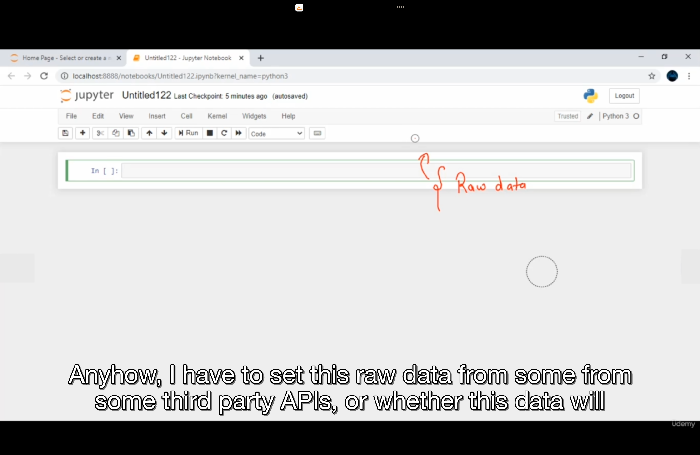
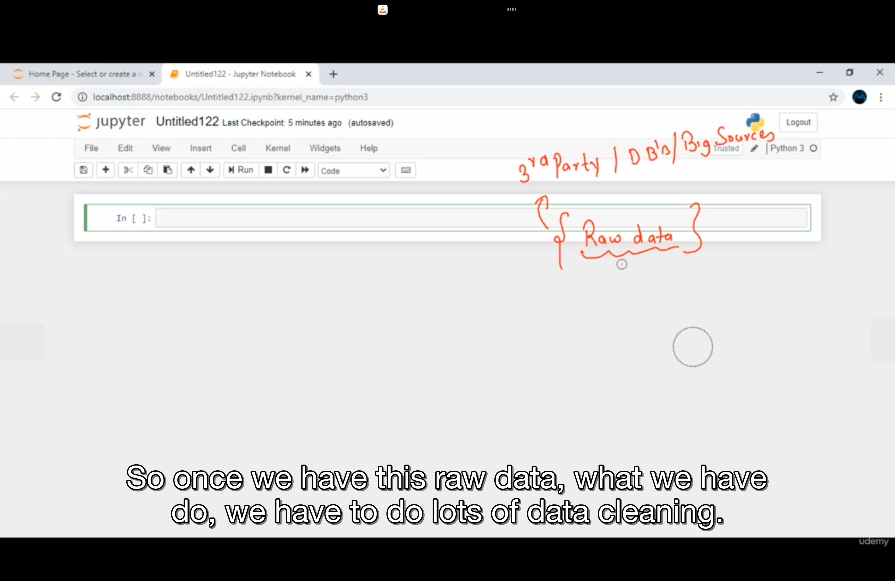
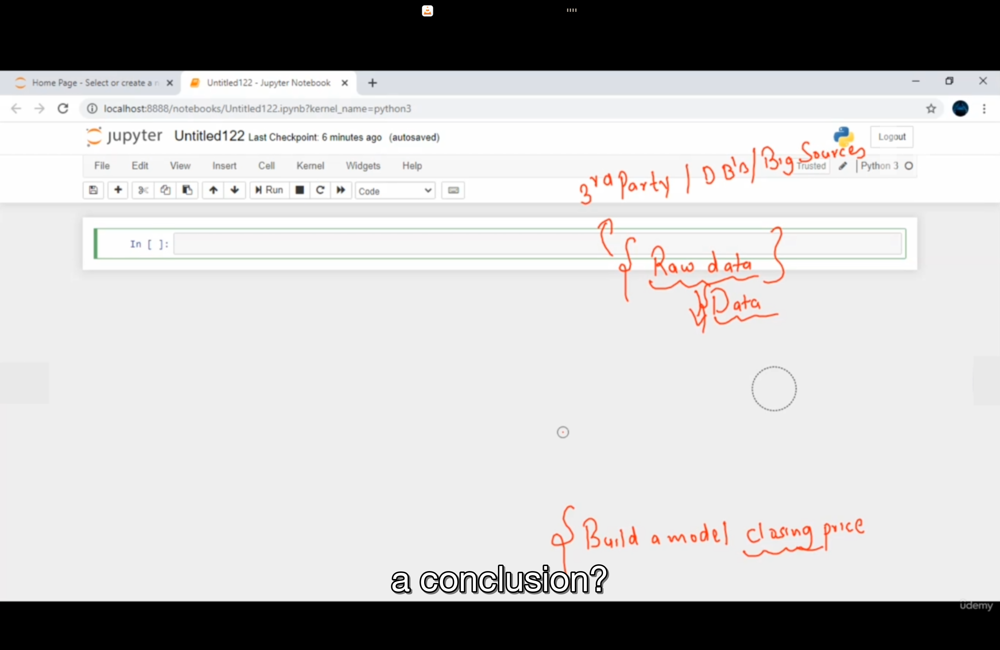
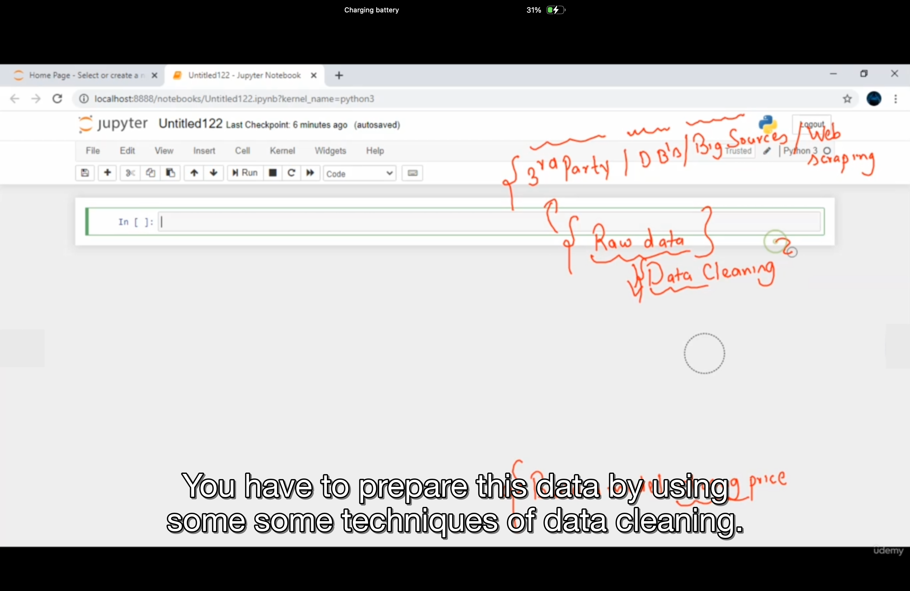
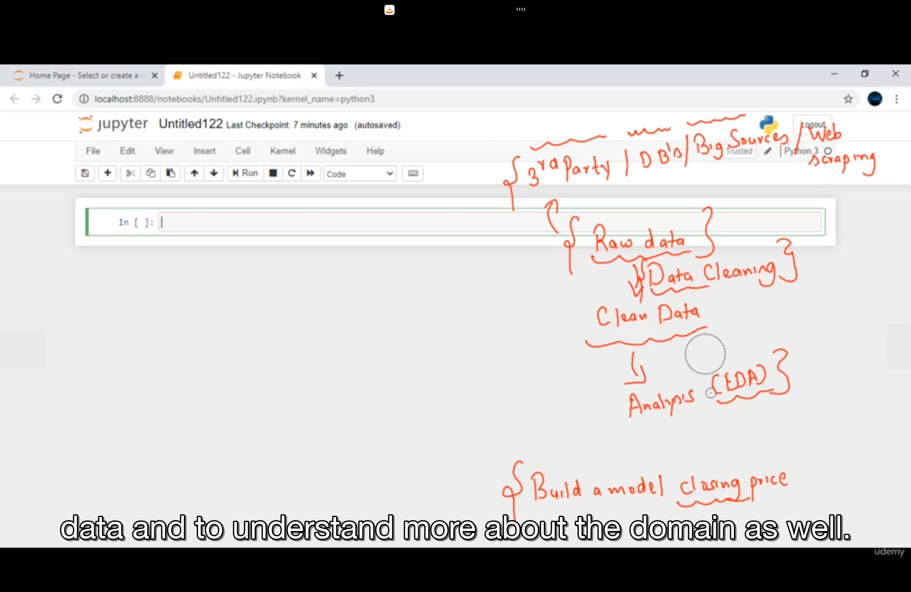
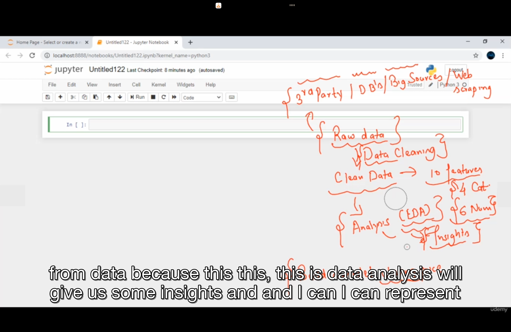
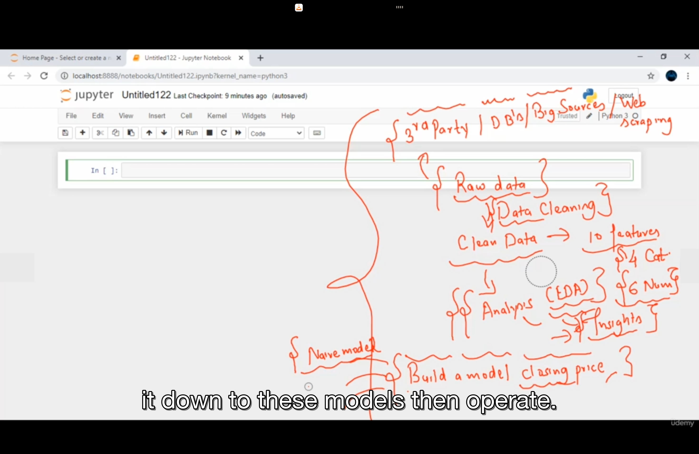
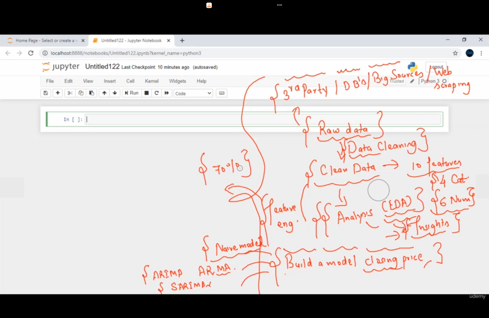
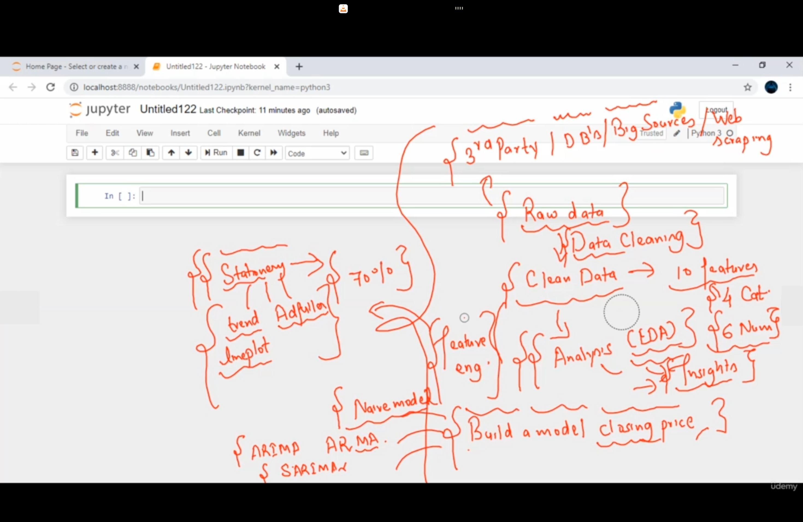
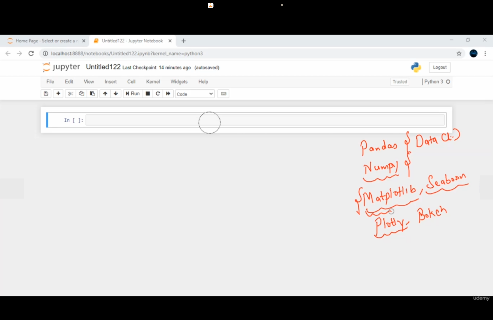
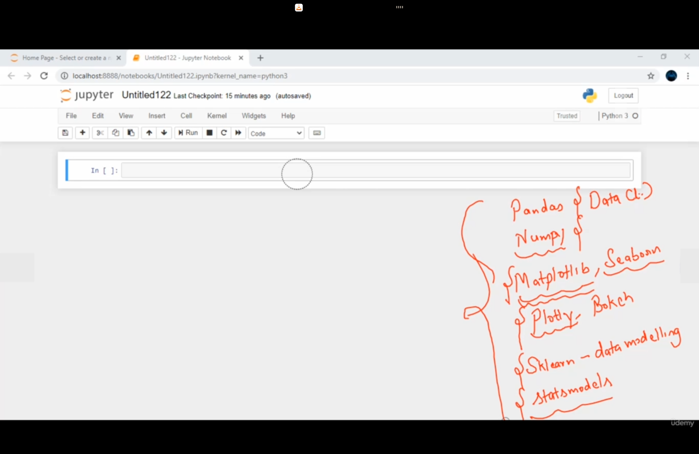

See the code [here](./1.ipynb)

Hello. Before going ahead in this particular session, let us have a quick recap of what we really have to do in real world use case scenarios. Let's see: in a real world use case, the data that is given to us is raw data. Anyhow, I have to fetch this raw data from some third party APIs, or this data will be in some databases, or we have to extract the data from some big data sources.

Let's say from Hadoop or MongoDB databases, or tons of big data frameworks; from there we have to extract this raw data. So once we have this raw data, what we have to do is lots of data cleaning. We have to apply lots of techniques of data cleaning, and we have to prepare our data, because our end goal is to build a model. Our end goal is to build a model that can predict what can be the

closing price of Bitcoin. So anyhow, I have to build a model that can predict what can be the closing price, but to reach such a conclusion, you have to do lots of things. You have to consider this raw data, and this raw data may be from third party APIs, or from some databases, or from some big data sources, or you have to do something known as web scraping; thousands of things you have to do to collect this raw data.

Once you have this raw data, you have to do data cleaning on the data; you have to clean this data. You have to prepare this data by using some techniques of data cleaning. Once you clean this data, then you have your clean data. Once you have this clean data, you have to understand your data, and to understand your data, you have to do lots of analysis on this data.

You have to do something you have heard about, known as EDA, which is exploratory data analysis. You have to perform exploratory data analysis to understand more about the data and to understand more about the domain as well. So you will understand your data once you understand each and every feature of this data. Let's say this data has 10 features, and out of 10 features,

I have some four categorical features and some six numerical features, so you can understand the distribution of these six numerical features. And you can also understand how the categorical features impact these numerical features. So you have to do tons of things. Once you understand the data, you have some insights from the data, because this data analysis will give us some insights, and I can represent these insights to my stakeholders.

So once I have these insights, based on these insights and based on some domain expertise, I can choose what type of model I can build, and one more thing: what type of evaluation metric I have to consider to evaluate my model. This is how we have to work in real world scenarios. So when we have to build a model, we can consider multiple algorithms. The very first algorithm that will come into the picture is something known as the naive model, or you can term it a baseline model.

So this is the very basic model, the baseline model that you can use. Apart from these models, we have some amazing models, which are auto regressive models; I have moving average models; I have something known as the ARIMA model. So we have thousands of models available for time series data. If we have seasonal data, then we have something known as SARIMAX. And one more thing you can do is actually during this data cleaning, once we have this data,

we have one more thing, which is known as feature engineering. This feature engineering almost takes over 70 percent of your entire project, because it's a very complicated step in your entire pipeline, whatever data science project you have, whether it's time series analysis, or some machine learning, or whether it's deep learning. So you have to do lots of things in this feature engineering.

If I talk with respect to time series analysis, in this feature engineering you can detect whether your data is stationary or not. To check whether your data is stationary or not, you have to do lots of stuff. You have to do some statistical tests, or some basic statistics: you can understand the trend of the feature by basically using a line plot.

Then we have some statistical tests, like the augmented Dickey-Fuller test, one of the very famous statistical tests to detect whether my data is stationary or not. Because for time series use cases, it is a must condition that my data must be stationary, and to ensure this, we have to do a bunch of things like this. So in this feature engineering, we have lots of stuff over there; then only can we build a model that can predict what can be the closing price of Bitcoin.

So this is exactly our main goal, and for this main goal, we have to do all these things in real world scenarios. So in the very first session, what we have to do is prepare our data, because we already have our data set, which is in CSV format. So we have to do data cleaning, or you can say data preparation, on our data. We have to clean this data. For the very first,

we have to open our Jupyter notebook. Let me clear my screen. Very first, we have to work with libraries. Let's say something known as pandas, which gets extensively used in data manipulation, or you can say data cleaning. Then we have something known as NumPy, which is numerical Python, if we have to do some mathematical stuff on data.

In such a case, we have to deal with this NumPy library. Then for data visualization stuff, we have to deal with matplotlib, and even with seaborn, which will give us some interactive visualizations compared with matplotlib. Now we have some amazing libraries for visualization, let's say some advanced level visualizations: we have something known as Plotly.

So in this entire project, we will use seaborn and matplotlib. Yeah, in an upcoming project, we will definitely use Plotly as well. And that's all right. We will use one more library, which is scikit-learn, which is extensively used in data modeling: whenever we have to build a model, we have to use scikit-learn. And with respect to time series use cases, we have to use something known as statsmodels.

It is an amazing library for time series. So mainly we are going to work with all these libraries. If you are not aware of these basic libraries, feel free to ask in the Q&A section of this course. I can definitely suggest some amazing blogs, some amazing references, so that you can get some basic idea behind what is pandas, what is NumPy, and what is Plotly, scikit-learn and statsmodels.

So don't hesitate. Feel free to ask in the Q&A section of this course, or if you need some basic lectures on all these libraries, feel free to suggest. So very first, let me just import pandas with its alias pd. Then I have to import NumPy, so I'm going to say import numpy, and create its alias as np. Then I'm going to say I have to import the matplotlib library, and from matplotlib, I have to import pyplot, and I'm going to create its alias as plt.

Then after that, I have to import seaborn, and I'm going to create its alias sns. Let me just execute this block of code. Once I execute it, I have to call a function, which is read_csv, because you will see this is CSV format data. It means I have to call this function. Let me just press tab there, and soon you will get a list of all the functions that are available in this pandas library.

Then let me just press shift tab there. You can check out the very first parameter that you have to pass is the file path. So here you will figure out this is my entire path. Let me just copy this path and paste it over here. And over here, if I press tab, you will see a list of all the files available at this particular path. So let me very first select my data set. This is my data set, so it will return a data frame object.

So let me store that object in some variable; I'm going to store this object in df. Let me just execute it. And if I print the object, you will figure out this is my data set on which we have to work. So this is my raw data. We have to do data cleaning, because this is my problem statement for this particular session. Let's say we have to understand this data, so I can say df.describe.

It means I just need some description of the data, some basic statistics of the data. Let me just execute. But there is a minor typo that you have to fix: it is describe. Execute. And these are the basic stats regarding the data, you can figure out: the Open feature has that much count, its mean is that much, its standard deviation is that much, the minimum value is this much, and all these things: the 25 percentile data, the 50 percentile data, which is the median, the seventy five percentile, and the maximum value.

That's all your basic stats of the data. And if I say df.dtypes, it means I just need the data types of each and every feature. Let me just execute. You will see the Date feature has the object data type, but this Date feature must support something known as timestamp nature. Because, of course, it is a must condition in time series use cases that the date feature must support timestamp nature. So what we have to do is convert its data type from object to date format.

So I'm going to say pd.to_datetime; this will convert my data type from object to datetime. So I have to convert its data type from object to datetime, and I have to update it as well. Then I just execute this block of code. Over here, if I say df.dtypes, you will figure out now it supports the datetime format, and earlier it supported something known as object.

And in time series, let's say we have to maintain a proper hierarchy. In such a case, I can say I have to sort my data on the basis of this date. So for this, I just call a function, which is sort_index. If I execute it, you will see all your values are now in a sorted order. So let me store this data frame, actually,

I have to update my df. Once I do all these things, if I say df.head, you will figure out this is your Date feature, and these are the row axes. But it is most convenient in time series use cases that this must be my row index. So for this, I'm going to say df.set_index, and I have to make my Date the index. Make sure you do all these things in a proper way, otherwise you will get something known as

KeyError. I'm going to say I have to update my df. For this, I say inplace equals True. Let me just execute it. And if I say df.head this time, you'll figure out now my Date becomes my row index. So here you have done some basic data cleaning on your data, and now, up to some extent, your data is ready for analysis. In the upcoming session, we are basically going to understand this data, and we are going to perform some basic data analysis.

And as we go ahead gradually, we will try to understand this data much, much more. So that's all about this session. If you guys have any issues regarding this session, feel free to ask in the Q&A section of this course. That's all about it. Hope you loved the session very much. Thank you. Have a nice day. Keep learning. Keep growing. Keep practicing.

2. Lecture 2
============

See the code [here](./1.ipynb)

Hello. In the previous session, we basically learned what exactly the lifecycle of a data science project is, as well as of a time series analysis use case in real world scenarios. That's what we learned in the previous session. And basically, we did some basic data cleaning on our data by manipulating the data type of the data features and sorting our data. And we made our Date feature the row index, because it's a must condition for time series use cases.

In this session, we basically have to perform exploratory data analysis considering the Close feature, because our end goal is to predict what can be the closing price of Bitcoin. It means we have to understand this feature in depth. So let's perform some basic exploratory data analysis on this feature. Let us first create a copy of this df. I'm going to say df.copy(), and

we have to store its copy somewhere else. So I'm going to say data. Let me just execute. And if I say data.head, you will figure out this is a similar data frame on which we have to work. So now we have to analyze this Close feature, meaning understand its trend. To understand its trend, we can simply use a line plot of this closing feature. For this, I'm going to say data['Close'].plot().

It means just plot the values of Close with respect to this date. That's the basic idea behind this function. So I just execute it, and in a while you will get this amazing plot. Let's say I have to manipulate something: let's say I have to assign a y label. So I'm going to say plt.ylabel, and what y label do you have to pass? Let's say I have to assign 'Daily Bitcoin price'; that is the y label we have to assign.

So you can execute it, and you will get such an amazing visualization over here with this line plot. And from this line plot, we come to know that in 2014 we had a spike in the closing price of Bitcoin, and over here in 2018, we again had a spike. So that's basically the inference from this line plot. Our main goal is to predict this closing price. So what we can do is store this closing price somewhere else.

So I'm going to say, let me store this closing price, let's say in data2, whatever name you want to assign. And if I say data2.head, you will figure out these are my first five values with respect to my date. So the second problem statement is all about: you have to resample your data. So what exactly does resampling stand for?

Let's say you have dates from the 31st of July. This is my very first date: my data starts from the 31st of July. And let's say I have to resample my data on a weekly basis. This is my problem statement: I have to resample my data on a weekly basis, and my very first date is the 31st of July. So from 31st July, my very first data point, till the 6th of August, my week will end here.

I will resample my data in this range. So let's say after resampling, I have to find the sum of the closing price. In such a case, I can apply the sum function to evaluate the summation of the closing price. Let's say we have to evaluate the average closing price in this window. In such a case, I can call the mean function. If we have to evaluate the maximum, we can call max; depending upon need, we will call different functions.

So let's try to resample your data using Python. Over here we have data2, on which we have to work. I'm going to say we have to resample basically on the basis of week, and on this, if I just call .sum(), you will see with respect to each and every week, you will get the summation of the values with respect to this week, my summation of the closing price. Exactly this one. Let's see.

Let's see, we have the values; with this, I can just plot all these values with respect to my date feature. For this, we can just call the plot function. Then in a while, you will get such an amazing visualization. In a similar way, let's say I have to resample my data on a yearly basis, so over here I just mention year. Let me just execute, and in a while, you will get this kind of plot.

Let's say my problem statement is: I have to find the average closing price with respect to different years. In such a case, I just call the mean function. Let me just execute this block of code. You will see this is the mean closing price, and you will see we have a spike over there: in 2017, we have a spike.

It means in 2017 we have the highest average closing price, almost close to 6500. So that's basically the inference from what you have plotted. In a similar way, you can apply lots of statistical operations like count, minimum, maximum, and so on, and you can play with the parameter to resample on a quarterly basis, on a monthly basis, on a yearly basis, on a weekly basis. So tons of things you can do on this data, and you can extract some amazing insights from this data.

So that's all about the session. If you guys have any issues regarding this session, feel free to ask in the Q&A section of this course. So that's all about it. Hope you loved the session very much. Thank you. Have a nice day. Keep learning. Keep growing. Keep practicing.

3. Lecture 3
============

See the code [here](./1.ipynb)

Hello. Before going ahead in this particular session, let's have a quick recap of what we have done in this time series analysis use case. In the very first session, we did some basic data cleaning and prepared our data for analysis as well as for modeling. In the previous session, we did some basic exploratory analysis on this data, and we also learned how we can resample our data on a weekly basis, on a yearly basis and on a quarterly basis.

We have done all of these things in a slightly better way. So now our problem statement is all about analyzing the average weekly closing price. It means that first we have to access the day of week from this data frame. So let me show you: this is data2, and from this data, we have to extract the day of week. So I'm going to say data2.index, and if I execute, you will get an index, or you can say a list.

And in this list, you will get all your dates. And on this, if I say I have to extract the day of week, and if I execute, you will get all your days of week in numerical format. So basically we are going to work on data2, which is my data frame. I'm going to say data2.groupby, and over here I'm going to say I have to group my data considering each and every day of week.

I have to pass this day of week, and on this, what do I need? I need my average closing price. Very first, I have to access my Close, and on this I'm going to just call mean. So let me just execute. You'll see with respect to day zero of the week, you have that much mean; with respect to day one, you have that much; and you have all the stats available over there. Let's see, if we have to manipulate it,

let's say we have to assign some labels there. So let's first store this somewhere else. I'm going to say it is weekly, and let me just execute. And if I say weekly.index, over here, very first, I have zero; just map it with Monday. So I'm going to say Monday, then I have Tuesday, then Wednesday,

then Thursday, then Friday, then Saturday, and last, Sunday. And this is exactly the list. Over here, if I say weekly.plot... let me show you one more thing: if I print weekly, you will see this is my day now. It means with respect to Monday, you have that much average closing price. So I'm going to plot all these things with respect to my day of week, so I just do this.

Let me just execute, and in a while, you will get such an amazing visualization. So you will see here you have a downward trend, then again upwards, then it becomes slightly constant over there [unclear]. So that's what we have analyzed from this visualization. So let's go ahead with our second problem statement. It is all about analyzing the average closing price by day, because over here we have analyzed all these things with respect to day of week.

But over here we have to analyze by day. First, we have to access each and every day. For this, I'm going to say, over here, day, and if I execute, you will get all your days. Let me store this list somewhere: I'm going to say this is my days. Let me very first execute, and if I print, this is my days.

Now I'm going to say I group my data on the basis of each and every day. For this, I'm going to say data2.groupby, and over here I have to mention days, because I have to group on the basis of this one. Then I have to access my closing price feature, and on this I just call mean, because anyhow I have to fetch the average closing price. In that way, you can achieve this goal. Let me very first execute this block of code. You see, with respect to day one,

this is my average closing price; with respect to the second day, this is my average closing price. So this is all aspects of your data. And let's plot this; for this I'm going to say .plot. That's it. So this is exactly the trend: how my closing price varies with respect to each and every day. Let's say I have to play with this visualization; let's say I have to enlarge the window size of this visualization.

In such a case, I will say plt.figure; in such a case, I can assign my own figure size. So I'm going to say I assign my own figure size by basically using this parameter, which is figsize. Let's take my own window of, let's say, 10 comma six. Let me just execute this block of code, and this time you will get a larger visualization over here. And if you have to assign a y label, then you can say plt.ylabel, and over here you can say this is my average closing price.

Very first, again, execute this block of code. And this time, on the x axis I have day, and on the y axis I basically have the average closing price. In a similar way, I have to understand this trend with respect to the quarter. So in such a case, what we have done here: we have basically analyzed by day. Then over here, we have basically analyzed by day.

So the similar story we have to do with respect to quarter. It means we have to access the quarter. So I'm going to say data2.index.quarter. If I execute it, you will get the quarter with respect to each date. You will see this is my third quarter, this is my second quarter, and so on. And over here, I have all these quarters. In fact, with .unique, I have all the quarters.

Then what we have to do is group the data on the basis of this quarter. Very first, we have to group my data on the basis of this quarter, on the basis of all these quarters. Then I'm going to say I have to access my closing price, and on this closing price I can just say plot the closing price with respect to the quarter. Let me very first execute this block of code.

And in a while, you will get this amazing visualization. You can play with this visualization: you can enlarge the window size by basically using this block of code. So over here, very first, again execute this block of code. You will get this amazing visualization over here. And over here you will see we have basically four visualizations with respect to each and every quarter, but there is no legend identifying each quarter.

So for this, we have to use something known as legend over here. Let me execute it again. And this is that amazing visualization. So with respect to the first quarter, we have the blue trend; with respect to the second quarter, we have this orange trend; with respect to the third one, we have this green trend; and with respect to the fourth one, we have this red trend. And this is the entire trend with respect to each and every quarter. So that's all about this session.

And if you guys have any issues regarding this session, feel free to ask in the Q&A section of the course. That's all about it. Hope you loved the session very much. Thank you. Have a nice day. Keep learning. Keep growing. Keep practicing.

4. Lecture 4
============

See the code [here](./1.ipynb)

Hello. Before going ahead in this particular session, let's have a quick recap of what we have done in this project so far. We did lots of data cleaning, and a bunch of analysis we have done on the data. We have this amazing visualization with respect to the quarter analysis of the closing price. That's what we have done in our previous sessions. So in this session, we basically have to analyze the trend of the closing price with respect to weekdays and weekends as well.

It means with respect to weekends we have to analyze some kind of trend, and with respect to weekdays some kind of trend as well. With respect to weekends, basically Saturday and Sunday, we have to understand some kind of trend. And with respect to Monday till Friday, we have to understand some different kind of trend. That's what we have to do in this session.

So first, with respect to Saturday and Sunday: over here we basically have my date, and over here I have my closing price. So on the y axis I have my closing price, and on the x axis I have my date, and it must follow this criteria, this condition. Similarly, over here in the second visualization, I have this closing price on the y axis, and on the x axis

I have the date, and it must follow this criteria: the date must be between Monday and Friday. So this is our end goal; anyhow, we have to achieve this. But the question is how exactly we can know whether the date is a Saturday, whether it is a Sunday, or whether it is a Monday. So in the previous session, using dayofweek, it will return us basically a list. Basically, it's a list.

It's not a set. So it will basically return us a list ranging between zero and six: zero, one, two, three, four, five, six. Yeah, it will return all these values: zero, one, two, three, four, five, six. Then I will simply put a condition. What we can do is create a function, and inside this function, we can say: if a value inside this list is less than five,

in such a case, I can consider this particular day a weekday; otherwise, I can consider this particular day a weekend. It will be my weekend. That's what we have to do, by defining our own custom function; that's what we are going to do in this session. So I'm going to say data.index; it will return all my index, and on this, if I call dayofweek, you will see all your values range between zero and six.

So the values it will return, let me store all these values in my data. I'm going to define one more column so that it will hold all this data. So I'm going to say it is my day_of_week. Let me just execute this block of code. And if I say data.head, you will figure out one more feature, which is my day_of_week, has been added to your data frame. Now what you have to do is define your own function. I'm going to say it is assign_labels, and over here,

whatever feature I pass, it will assign some kind of label, weekday or weekend. So I'm going to put a condition: if the feature value is less than five, in such a case I can say just return, or map it with, weekday. What if this condition is not true? In such a case, my control will come into this else block. In such a case, I'm going to say just return

weekend. So I'm going to say it is my weekend. Once we have all of these things, we just execute it. Now I'm going to say I have to apply this function on top of this feature. For this, I just say .apply, and I have to apply this assign_labels function. I'm going to say I have to apply this assign_labels.

Then if I execute, you will get all your values in the form of weekdays and weekends. Now what you have to do is store all these values somewhere else. For this, I can define one more column, or even you can update this feature. So I'm going to say it is my day_of_week. So let me just assign it, and execute.

And if I say data.head, you will figure out this is my day_of_week feature, and with respect to this date, this is a weekday; with respect to this date, this is the weekend. That's what this custom function does for us. Now basically, I need one visualization with respect to weekends and one with respect to weekdays. It means I need two visualizations; in such a case, I can create something known as subplots.

So I'm going to say plt.subplots. And over here, if I press shift tab, you will see the very first parameters are nrows, ncols and all these things. So here I can say my number of rows is one and my number of columns is two. It means I have to create a matrix of one by two. Then I can assign my own figure size: figsize, let's say 14 comma eight,

whatever figure size you want to assign. Let me show you what it returns. If I press shift tab, you will see all these custom parameters, and it says it will create a figure and a set of subplots. It means I have to store the figure somewhere and the subplots somewhere. So I'm going to store the figure in fig, then I store basically my subplots, let's say in ax. Then I have to execute this block of code.

It returns all these things. So definitely, on the very first axis, I will showcase the visualization with respect to, let's say, weekend. For this, I have to say data['day_of_week'] is equal equal to weekend. It means my day of week is the weekend. So this is my filter. Now I have to pass this filter inside my data frame, to get the filtered data frame.

So let me show you. If I say .head, you will figure out I have all the entries with respect to weekends. So from this data frame, I'm going to access my Close feature, and on the Close feature, I'm going to say just plot the values. And over here, let me show you one more thing: inside this plot, we have thousands of parameters.

So one more parameter is ax. Inside this ax, I'm going to say I have to showcase this visualization on ax zero, because it returns two axes: the very first is this one, the second is this one, and I have to showcase the visualization on top of this first axis. Then over here, I have to assign a title as well. So I'm going to say my title is, let's say,

weekends. So over here I'm going to say it is weekends. This time, I just do some modification in this code, and over there this time it will be with respect to weekdays, so I'm going to say it is weekdays, and all the other stuff will be similar. And over here, I have to mention this is my ax one, and my title definitely gets modified to weekdays. Then just execute this block of code, and in a while, you will get this amazing visualization.

You will see there is a slight difference, a mild difference between them. You will see with respect to weekends we have this much [unclear]; you will see we have a downfall over there. But over here, we don't have that much downward trend. So that's all about the session. And whatever issues you have regarding this code, regarding this project, even with this function, feel free to ask in the Q&A section of this course.

So that's all about the session. Thank you. Have a nice day. Keep learning. Keep growing. Keep practicing.

5. Lecture 5
============

See the code [here](./1.ipynb)

Hello, all. Before going ahead in this particular session, let's have a quick recap of what we have done in the previous sessions, as well as in this project. In the very first session, we performed some basic data cleaning on this data; we cleaned this data, and we basically massaged the data inside this data frame. And then we performed lots of exploratory analysis, a bunch of plots with respect to the analysis; lots of things we have done.

So in this session, what we have to do is build our baseline model, or you can say naive model, and using that model, we have to do predictions. So very first, let's understand what exactly our baseline model is, or you can also call it the naive model. So what exactly is this model all about? This model is all about my previous value. If I have to summarize this baseline, I can say my previous value is the best reflector of my next value, or I can say the next value entirely depends upon the previous value.

That's the very high level idea behind this baseline. Or you can say the recent history is the best reflection of the future. That's the very basic summary behind this baseline model. And for this model, you just have to use the inbuilt functions of pandas, which is shifting. You can say by using the shift operation on your data, you can easily build this model. So let's try to build this model. Very first, we have to access the Close feature, and if I press control enter,

you will see these are all the values. On these values, I'm going to say I have to shift my values by one row. It means this value gets shifted with respect to this date: this value gets assigned to this date. So if I execute this block of code, you will see at the very first index I have a missing value, and on the second entry I have this value.

So we have to store this value somewhere else. I'm going to say this is my prediction; whatever feature name you want to assign. So I'm going to say it is prediction_naive. Let me execute it. And if I say data.head, you will see a new feature, my prediction_naive, has been created. Let's say you have to plot all your predictions. For this, I'm going to say, let's say you have to plot the difference between your predictions

and your actual values. For this, I have to access Close, my closing value. Then I have to access my prediction_naive. And if I execute, these are all my values, so I just have to plot them. So I'm going to say just plot it, or I can modify my plot by assigning my own figure size of, let's say, 12 comma 10. Let me execute this block of code,

and in a while, we will get such an amazing visualization. You will see the values don't change that much; you can see your predictions get overlapped on this blue curve, which is my actual value. Let's say we have to evaluate how exactly my model is performing. For this, we have to use something else: we have to import some metric. So I'm going to say from sklearn, we have a module which is the metrics module.

And from this, I have to import mean_squared_error. This is the metric that we have to consider to evaluate how my model is performing. So here, we have to use this mean_squared_error, and here, very first, we have to mention what my actual data is, which is my Close, and then we have to mention what my predictions are. So here I'm going to say my predictions are prediction_naive.

Let's execute it. Oh, we have to take care of the missing value as well, because you will notice that at index zero we have a missing value. So to get rid of this missing value, I can say I have to access the data after the first index. Similarly, I have to access the data from index one onwards. And after that, let me execute this block of code: you will get the mean squared error.

But this is squared; anyhow, our main goal is to compute the root. So I'm going to say from NumPy, I have a function, np.sqrt, and I just pass all these things inside the sqrt function. Let me execute. So this is the RMSE that we have over here for our baseline model. So what exactly is its meaning? What does it stand for? It means we have a difference of plus or minus approx thirty seven point two.

We have a difference of plus or minus thirty seven point two between the prediction and the actual value. You can see if I do a subtraction of prediction minus actual, then I will get that much error. But the question will arise: yeah, it seems a very, very good model. You will see it's a very good model; this baseline performs well over there. So the question that will arise over here is: can we stay with this baseline or not?

Can we stay with this naive model or not? If you want my suggestion, I can say no, you can't stay with this baseline model, because in real world use cases, it is not necessary that my previous data, or I can say my previous day's data, is a true reflector of my future data, because rarely does this happen in real world scenarios.

It means we can't consider this baseline model even though it has better performance. So that's all about the session. In all our future sessions, we will try to do lots of feature engineering on the data. We will try to examine all the features of our data, especially my Close feature, because we have to predict what can be the closing price, and for better model performance, we have to examine this feature.

That is why we have to perform something known as feature engineering on the data, and further we will try some more advanced algorithms that will return us better model performance. Let's say using something known as Prophet. Prophet is an amazing library developed by Facebook. So we will also deal with Prophet as well as tons of things. Definitely, we will need to consider stationarity of this feature using the augmented Dickey-Fuller test, how to eliminate seasonality in this data; a bunch of things we will consider in all our upcoming sessions.

So that's all about the session. If you guys have any issues regarding the session, feel free to ask in the Q&A section of this course. I would highly urge you to ask whatever queries you have regarding this project, regarding this course. Feel free to ask in the Q&A section. So that's all about the session. Hope you loved the session very much. Thank you. Have a nice day. Keep learning. Keep growing. Keep practicing.

6. Lecture 6
============

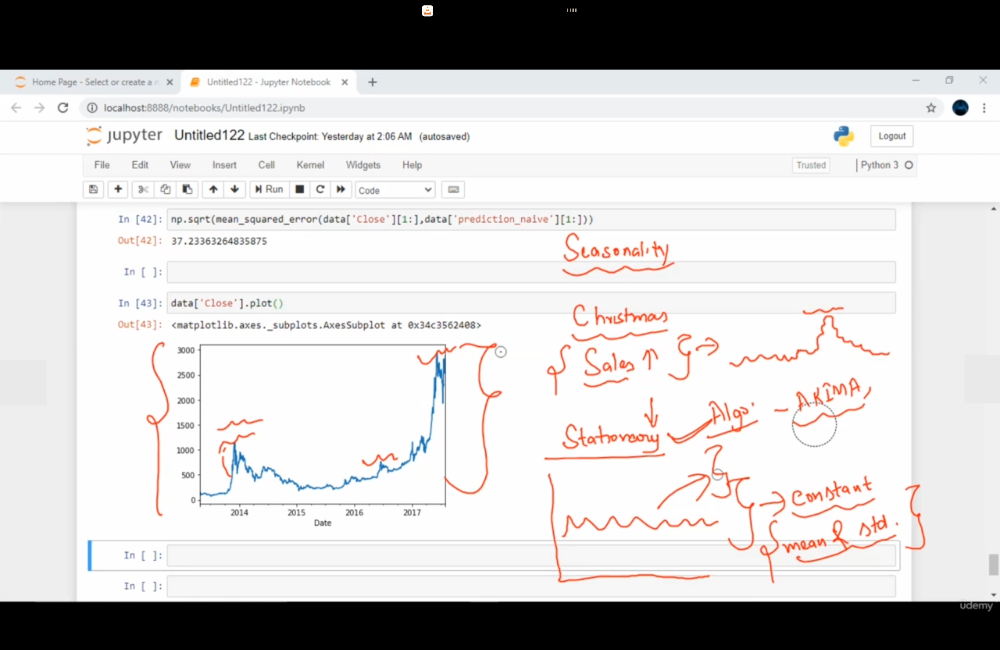
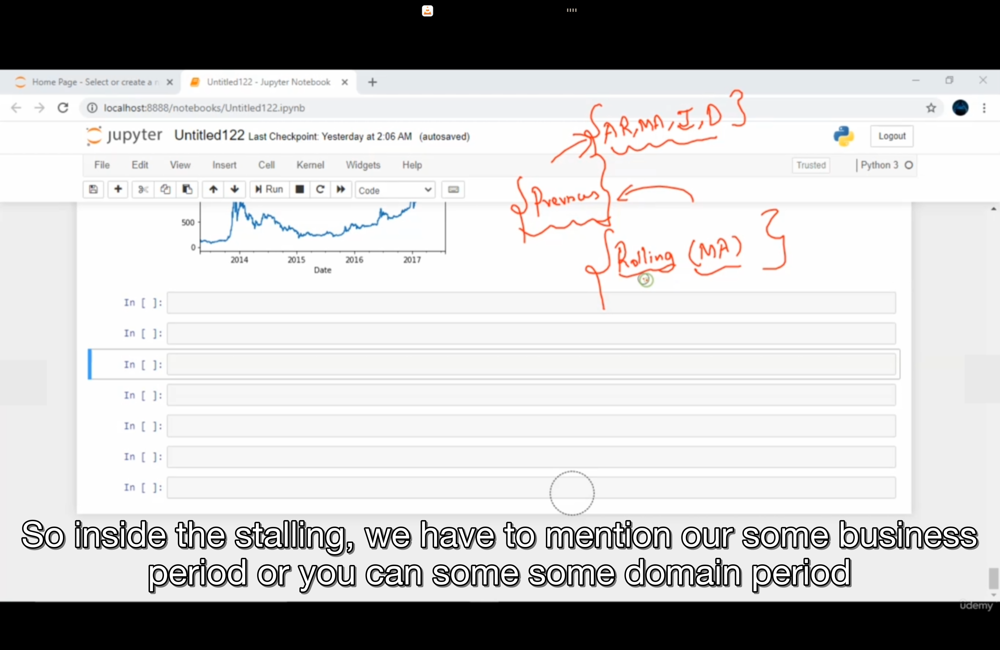
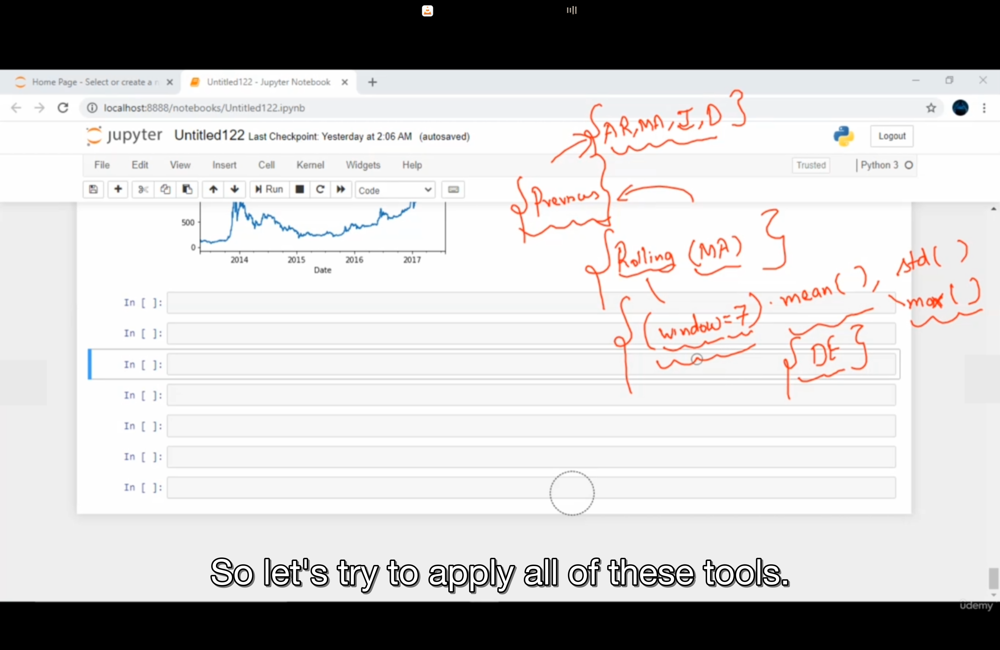

See the code [here](./1.ipynb)

Hello. Before going ahead in the session, let's have a quick recap of what we have done until now in this time series analysis project. We did some basic data cleaning and a great amount of analysis. In the previous session, we basically built our baseline model, which is able to predict, and this is exactly the curve: how exactly my prediction is going. And this is exactly my error. That's what we have completed using our baseline model. But in real use cases, we can't use this baseline model.

The baseline model is all about the previous value being the best reflector of future data, but that doesn't happen in real world use cases. So in this particular session, we basically have to examine whether we have seasonality, or something known as noise, in our data or not. So we have to examine this Close feature to understand what exactly the seasonality or the noise is. You will figure out we are basically working on this data frame.

So what we can do, basically, I'm going to say data['Close'], and on this, I'm going to say just plot the values, with figsize, and just execute this block of code, and you will achieve this type of visualization. So first, let's understand something known as seasonality. And after that, we will understand what stationarity is. You'll figure out, if I talk with respect to this visualization, you can figure out that here

we have some kind of seasonality going on, because you will see over here we have some kind of peak, over here some kind of peak, and over here some kind of peak. So maybe here there is some kind of seasonal trend over there. So let's talk with respect to, let's say, a festival, let's say Christmas. What exactly happens at Christmas? In the month of Christmas, our sales go up, in whatever domain it would be; our sales go up.

But let's say we have some summer months. In such scenarios, our sales go down, in some domains. It means each and every year, this will follow some kind of spike in the sales. So definitely, if we have that type of trend, every December we may have that type of trend. So this is exactly seasonality; in a similar way, this will somehow represent my seasonal trend over there.

And let's try to understand one more item, which is known as stationarity. So what exactly is stationarity? Suppose my trend with respect to date, my trend of the closing price, let me just draw it: suppose my trend looks something like this. So over here, you can see it is constant. So what exactly is this constant? Or you can say what exactly this trend is: it is a stationary trend.

Whenever we have the mean and standard deviation constant, or you can say whenever your mean and variance are constant, that is the stationary nature of our data. So it is a must: if you have a time series use case, your data must follow that type of order, and if not, try to make it stationary. Because once you have stationary data, whatever algorithm you are going to use, whether it will be ARIMA, or some advanced algorithms like SARIMAX, whatever it will be, it will give us better predictions.

That's why we have to make our data stationary. So let's apply something known as rolling, or you can say moving average, on the data. If you guys don't know what exactly a moving average is, kindly follow my previous videos where I have covered all these topics in much, much depth. So I would suggest you follow all my previous videos with respect to moving average models, which I have taught, and with respect to something known as ARIMA and what exactly it is.

I have explained it in depth, with respect to all these keywords, all these models. So let's have a quick summary of what exactly rolling is all about. Inside this rolling, we have to mention some business period, or you can say some domain period, and that period gets mentioned by basically the window size. So whatever window size I mention, on this window size, depending upon our domain knowledge, or after having a conversation with our domain experts, we will try to compute some functions over there; we can calculate something like the mean, let's say, or the standard deviation.

Or let's say our domain says the maximum value is an important factor within this interval; let's say within an interval of seven. In such a case, I can call this max function across seven business days. So let's try to apply all of these concepts using Python programming. I would say data['Close'].rolling, and over here, if I press shift tab, you can check out all these things.

The very first parameter you have to give is the window, which is exactly the business period. So I'm going to say my window is seven, and on this I'm going to compute the mean. Then let's say in another block of code, I can say again I have to use this rolling concept; my window period will be seven, and on this, I'm going to say just compute the standard deviation. Then I have to store all these values.

So the question is why we are going to do all of these things. Why are we computing the standard deviation? Because you will see over here we have some kind of seasonality available out there. So to eliminate this seasonality, [unclear], you can consider something known as the standard deviation of the data. So let me store all these values somewhere else. I'm going to say, let me store it in a series, mean,

and let me put this in a series, std. Let me just execute this block of code. Now, if I print my mean, you will figure out these are the mean values, and the first six values will be missing. Let me show you: if I say mean.head(20), you will figure out my first six values are missing values, because I have mentioned a business period of seven. So it will try to compute the mean of the first seven values, and whatever mean it calculates, it will mention over there.

Similarly, with respect to this row, it will try to consider these rows, and whatever mean comes, it will mention over there. Similarly, for each and every row, this entire process will happen, and you will get a mean of four to five over here, here, here and here. Similarly, with respect to the standard deviation as well, you will get the first six values as missing values, or you can say NaN values, over here. Let's say we have to plot my mean and standard deviation as well.

So I'm going to say mean.plot, and let me play with some more things: let me play with the window size on which we have to showcase this visualization. So I'm going to say plt.figure, and over here I have a parameter, which is figsize. It means I have to play with my figure, and over here I can mention my own window size. Let's say I have to customize my window size as, let's say, 15 comma six. And over here, when I plot my mean, let me assign my own label: label is exactly mean.

Once I assign my own label, I have to plot my standard deviation as well, so I'm going to say std.plot, and over here I'm going to say the label is, let's say, std, whatever you want to assign. Once I do all these things, I can also plot the original values, which is exactly this one. I can also plot these on the same visualization. So I'm going to say data['Close'].plot.

And over here you can assign some label as, let's say, original series, whatever label you want to assign. Then after doing all these things, I have to notify the legends as well. So for this, plt.legend. Let me just execute this block of code, and in a while you will get this amazing visualization. You will see with respect to this orange curve, this is exactly the standard deviation plot.

Then this green one exactly gives you the original series, and this blue one overlaps on this green curve. So this is exactly the mean values. So the inference from this visualization is that what I have computed over here is not a stationary trend; it varies with time. It means I have to make it stationary, and I have to eliminate its trend and its seasonality as well.

So that's all about the session. In the upcoming session, we are basically going to perform some more tests to check whether this Close feature is stationary or not, and if it is not stationary, we will try to make it stationary, and we'll try to remove its trend and its seasonality as well. That's what we have to do in all of our upcoming sessions. So that's all about the session. Hope you loved this session very much. Thank you. Have a nice day. Keep learning.

Keep growing. Keep practicing.

7. Lecture 7
============

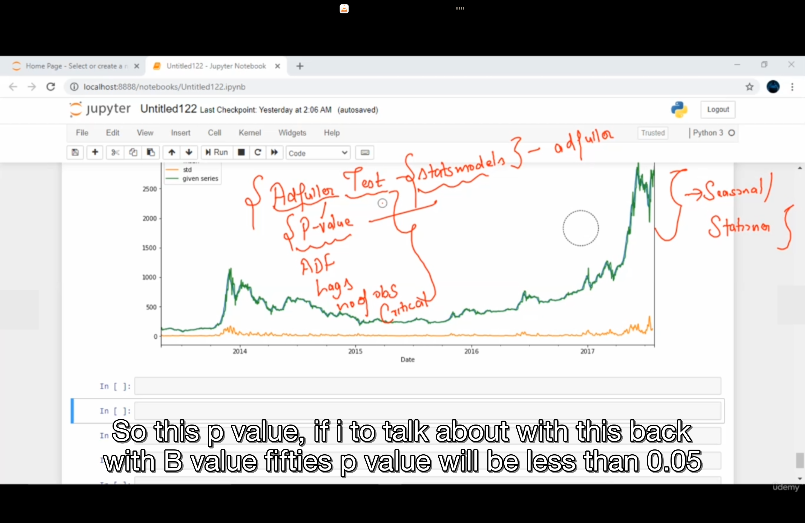
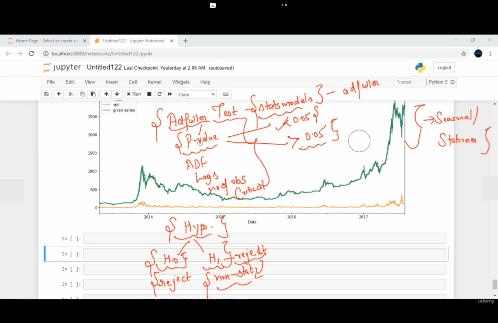

Hello, all. Before going ahead in this particular session, let's have a quick recap of what we have done in this project. We did lots of data visualization. We resampled our data on the basis of quarter, on the basis of month, year; lots of stuff we have done on this data, and we basically built this baseline model as well, which is able to give us predictions, and its RMSE is that much. That's what we have done.

And in the previous session, we used something known as the moving average and moving standard deviation on our data. That's what we already talked about. And in the previous session, we also learned from this visualization that it seems there is some kind of seasonality in the data, but let's try to prove whether this trend follows a seasonal trend or not. For this, we are basically going to use a statistical approach, which is exactly the augmented Dickey-Fuller test.

So the first problem statement is all about performing a test to detect whether I have stationarity or not. It means in this particular session, we have to detect whether this trend is a seasonal trend or a stationary trend. This is exactly our main goal in this particular session. So we have our statistical test, which is the augmented Dickey-Fuller test; this ADF is all about the augmented Dickey-Fuller test, and to perform this test in Python,

we have a function, which is adfuller, in statsmodels. So this augmented Dickey-Fuller test mainly depends on one parameter, which is your p-value. The most important value is exactly the p-value. Whatever p-value it returns, on the basis of that value, we have to decide whether my data is stationary or not. So this augmented Dickey-Fuller test basically returns some parameters: my ADF test statistic, and my lags, which are exactly my previous values; I have something known as the number of observations,

the total number of observations we have in the data. Then we have some critical values, some threshold parameters, with respect to this statsmodels library. Inside this statsmodels library, we have something known as adfuller, and inside it, we have all these parameters, but the most important one is the p-value. So if I talk with respect to the p-value, the first case is the p-value will be less than 0.05, and the second scenario is whether it will be greater than 0.05.

If it lies inside this zone, I can say we have strong evidence against the null hypothesis. So very first, let's try to understand some basics of what a hypothesis is and what the different types of hypotheses are. It basically lies under two categories: my null hypothesis, which is denoted as H zero, and my alternate hypothesis, which is denoted as H one. So if our p-value is less than 0.05, then in such a case we can say we have strong evidence against this null hypothesis.

Or we can say we can reject this null hypothesis, and basically my data is stationary. But what if it lies inside this zone, what if we have a p-value greater than 0.05? In such a case, we can say we have weak evidence against this null hypothesis, and we fail to reject this null hypothesis.

Hence, my data is not stationary, or my data is non-stationary. I can say if it follows this alternate hypothesis... In such a case, my data is not stationary. Or you can say if you are not able to reject the null hypothesis, in such a case your data is not stationary. And if you are able to reject this null hypothesis, in such a case your data is stationary. That's the very basic fact about my hypothesis.

It's all about this p-value. It's all about the probability value that plays a vital role inside the augmented Dickey-Fuller test. So let's try out all these concepts over here using Python. I'm going to say from the statsmodels library, we have to access tsa, and inside it we have something known as stattools, and from this we have to import adfuller. So I'm going to say from this, I have to import adfuller, which is responsible for performing this augmented Dickey-Fuller test.

So I'm going to say, very first, inside this augmented Dickey-Fuller test function, I'm going to say over here I have some arguments; over here I have to pass my feature. Over here, basically, I have to say data['Close']. So here I am going to say I have to access my data, and I have to access my Close feature. Then, do I have missing values in my Close? Let me show you whether we have missing values or not, so I'm going to say data['Close']

.isnull().sum(). It means I just need the summation of the missing values inside this feature. You will see we don't have any missing values, so it means we can execute this block of code, and you'll figure out it returns all these values, like a tuple stored there, and you will figure out what exactly it returns. So if I have to scroll down, the very first value really denotes my ADF test statistic.

The second is your p-value. The third is your lags used. The fourth is your number of observations. There are tons of values out there. So the most important parameter is exactly the p-value. So here you can see the p-value is less than 0.05. So in such a case, you can say, yeah, we have strong evidence against our null hypothesis. Hence, my data is stationary. Or we can say, yeah, we are able to reject our null hypothesis.

Hence, my data is stationary. Let's try to make this result a little bit user friendly, a little bit readable. For this, we can store this result somewhere else. So I'm going to say, let me store all these things, let's say in a result variable. And let me just define one more list, let's say labels, and the very first thing it really denotes is the ADF test statistic. So I'm going to say it is exactly my ADF test statistic.

The second is exactly my p-value. I'm going to say it is my p-value. The third is exactly your lags used, which are exactly your previous observations. The fourth is exactly your number of observations used, whatever label you want. The fifth is exactly the critical values; tons of things we have over there. Now what we basically have to do is combine this result and this label, and then we can

iterate over this result and labels, so that we can print it and make it more user friendly. So very first, we have to combine them, and to combine them, we have to use zip in Python programming. So I'm going to say I have to combine my result, then I have to combine my labels. Once I combine them, I'm going to say I have to iterate using a for loop. So basically, I'm going to say for value comma label in this combination, because I have to access the value from this result,

and I have to access the label from this labels list. Then once I iterate over this, I'm going to say I have to print something; I can add a placeholder, exactly a placeholder, and this placeholder will receive values from my format function. Then I'm going to add one more placeholder. It means this placeholder will also receive some value from my format function. So for this, basically, we have to call something known as format,

and at the end, we will basically mention our label and our value as well. Once I execute all these blocks of code, you will figure out it is much more user friendly: you will see you have that much value, and all of these things over here. Let's say we have to automate all this stuff, because this is exactly your second problem statement: you have to automate all these things, because what happens is that we basically write code line by line.

So you have to automate all these things. For this, we have to define a function that can automate all these things. So first, what we have done: we computed the mean and standard deviation. So very first, we define a function. I'm going to say this function is test_stationarity, whatever name you want to assign. So I'm going to say this function's name is this one, and whatever feature I pass,

with respect to that particular feature, we will try to test its stationarity. Then over here, very first, we have to compute the mean and standard deviation. Then over there, I will say I have to pass my feature. Similarly, over here, we have to pass my feature. I'm going to say we have to pass my feature. Once we have the values, we're basically just going to plot all these values.

So I'm going to say, let's just plot all these values. I have to provide the right indentation, because Python is an indentation-sensitive programming language. Then over here, I have to plot it with respect to my feature. Then what I have done over here, I have to perform this stationarity test, because I have to perform the augmented Dickey-Fuller test on the data. So I'm going to say I have all these things over here, and I have to provide the right indentation.

Once I have all these things, let's say we have to print something. So I would say if result at index one, because at index one we have the p-value, I'm going to say if at index one its value is less than 0.05, in such a case we have to print something. But what if this condition is not true? In such a case, we come to the else, and there also we have to print something.

So what do we have to print? If its p-value is less than 0.05, in such a case we can say we have strong evidence against the null hypothesis. So I'm going to say over here we have strong evidence against the null hypothesis, and we can also say, yeah, we have to reject this null hypothesis. Once I reject this null hypothesis, then we can also say, yeah, my data is stationary as well. So I'm going to say my data is stationary. Once I do all these things,

we can basically manipulate these things in the else. So I'm going to say this time we have weak evidence, and this time my data is not stationary. That's it. Now one more thing we have to take care of here: we have to pass a feature, and in case we have missing values, first we have to drop all these missing values. I'm going to say I have to drop all these missing values.

Now we have to just execute this block of code. Let's say we have to call this function and perform this stationarity test on, let's say, my Close feature. So here we just mention our Close feature. Once I execute this block of code, in a while you will get this amazing stuff. You will see that's the beauty of automation: you don't have to write these blocks of code again and again; you don't have to write all these things from scratch.

You will see you have that much value, and all these things: we have strong evidence against the null hypothesis, and hence we have to reject this null hypothesis, and hence it is stationary. That's what we have achieved with it; that's the beauty of automation. But still, you have figured out that we have some kind of trend, or you can say some kind of seasonality still available there, so we will try to eliminate

the trend that is available in my data. So this is exactly the problem statement for the upcoming sessions. That's all about this session. Hope you loved the session very much. And if you guys have any issues or queries regarding the session, while executing the code or understanding any part of this project, feel free to ask in the Q&A section. Just drop your query in the Q&A section. So that's all about the session. Hope you loved this session very much.

Thank you. Have a nice day. Keep learning. Keep growing. Keep practicing.

8. Lecture 8
============

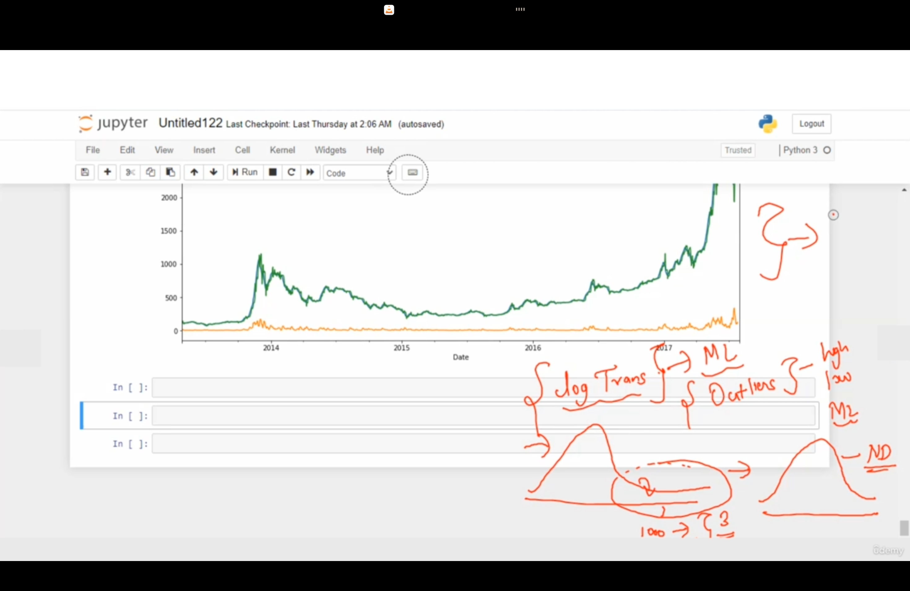

Hello, all. Before going ahead in this particular session, let's have a quick recap of what we have basically done in the previous session. If I talk with respect to the previous session, we basically automated my stationarity test by defining a function, which is my test_stationarity function. That's what we have done in the previous session. And if I talk with respect to the project, we built our model, did some data visualization, some group by operations; a lot of things we have already done on this data.

So in this particular session, we basically have to eliminate this trend, and this is exactly the problem statement: you have to eliminate the trend from your data, because you will see we have some kind of trend over there. But the question is how we can eliminate this trend. One of the very basic approaches, or you can say extensively used approaches, is to just apply a log transformation on the data. If we have higher values, just apply a log transformation on the data, let's say as in the case of machine learning.

If we have outliers in our data: outliers are basically those values that are either very high or very low. Let's say these are my low outliers and these are my high outliers. So before applying the log transformation on the data, let's say we have this type of curve. It means this is the zone where my outliers are available.

So if I apply a log transformation on the data, what will happen with respect to these high values? Let's say over here we have a high value, let's say a thousand. If I compute its log, its log will be somewhere close to three. It means this value gets converted into some range. So if I plot its entire distribution, or you can say probability distribution function, it will look something like this, which is exactly your normal distribution, because a normal distribution is good for machine learning algorithms.

Similarly, with respect to time series use cases: you will see we have some kind of trend available over here in this range. So what we will do is apply a log transformation on this data, and you will see your high values get converted into some range. So let me show you all these things over here using Python programming. I'm going to say, let me show you one more thing: data['Close'].

These are all my values. And on these values, I'm going to compute the log. For this, we have to call this log function, which is inside my NumPy module. Let me execute it. You will see my highest value over here, which is close to this one; it seems it is close to eight. And my lowest one, you will see, may be close to one or two. So you will see we have all these values in a small range; that's a lot more compact.

And on this, over here, if I just plot all these values with respect to the date, you will see it has this kind of curve. But before it, you can see we had a very large trend, but now we don't have that much trend. That's the power of the log transformation on your data. So let me store all these values. I'm going to say let me store all these things; I'm going to say it is log_data.

Let me store all these things. Now, basically, we have to compute our rolling average. The rolling average is nothing but my log_data; let me just show one more thing: on this, if I say .shift of, let's say, a window of seven, it means we are going to shift the values seven days ahead. So if I print, you will see all these values over here. So let me count the difference.

For this, I'm going to say log_data minus this one, and you will see we have a little bit of difference in my values. Let me say it is exactly the rolling average. So I'm going to say it is my rolling_average; let me store all these values over here. And this is all about the problem statement: smoothening the series using rolling to remove our seasonality factor. And this is all about your rolling.

So let's try to understand some basics: why there is a need for rolling, and then we have to apply it. If I talk with respect to smoothening of the series: smoothing is basically done by using something known as the moving average. If I am able to compute the moving average of the data, I am able to do the smoothening of my series. So this moving average is highly used in the stock market, extensively used in the stock market and in the finance domain as well; in lots of domains

we heavily use this moving average concept. And if I talk with respect to rolling, rolling is all about this: let's say we have to roll, let's say, five days, six days or seven days, and that is exactly the business period, depending on what my domain expertise says. I can say it's a window that we have to consider for my moving average. That's the basic idea behind it. That's what we're going to implement in this project.

So if I have to compute the moving average on this log_data, then I can say log_data.rolling, and over here I can assign a window size of, let's say, seven, and over here I can say just call mean. Let me store all these values. I'm going to say it is exactly my moving_average, whatever name you want to assign. Let me just execute this block of code. Now you basically have to plot

your log data and your moving average. For this, very first, I have to import matplotlib; let me show you whether we have imported it. You will see we already imported it in the very first session of this project. Now, using this alias of matplotlib, we are going to plot. What do we have to plot? We have to plot basically my log data, and here we have to assign a label: my label is basically log transformation, whatever name you want to assign.

Now I'm going to say I have to plot something else: for this, we have to mention my rolling average. Then for this we have to assign a label as well: my label this time is rolling average. So I'm going to say it is my rolling average. Once I mention all these things, we have to do plt.legend, because we have to showcase the color of each curve as well, so that we can understand more about our visualization.

And I'm going to say I have to customize my window size. For this, we have to use plt.figure, and over here we have to assign my own figure size, which is, let's say, 14 comma 10, whatever you want to assign, and just execute this block of code, and in a while, you will get an amazing visualization. This blue color is exactly your log transformation values, and this orange one is exactly your rolling average values. So you will see we don't have that much difference between our log values and rolling values.

It means we don't have that much difference between this log data and this rolling average. So what we can do is compute the difference as well. I'm going to say log_data minus moving_average, and whatever value it returns, let me store it. I'm going to say it is my log_difference. Let me execute it. First, let me show all these values: you will see these are all the values, which have a very, very minor difference between the log data and the rolling average.

Let me plot all these values. What we can do is check whether these values follow a stationary trend. For this, we just use the function we have already defined: you will see this is the function we defined in our previous session. And this time, we just have to call this function, and over here we just pass this feature. So very first, I have to store all these values in my data frame. Let me show you why we are going to store these values.

If I just pass this feature, I'm going to say log_difference, and if I execute it, you will see a KeyError, because we don't have the key log_difference in my data frame. Let me show you: if I say data.columns, you will figure out we don't have a column log_difference. So we have to store all these values inside my data frame. So I'm going to say data['log_difference'], and over here

we have to just assign this log_difference, and then execute. And this time, if I execute it again, you will get this amazing visualization. You will see we have strong evidence against the null hypothesis, and we have to reject this null hypothesis; hence our data is stationary. And you will see this green curve is exactly the original series, this orange one is exactly the standard deviation, whereas this blue curve, the mean, overlaps on my original data.

So it means the series is stationary with 99 percent confidence. That's how you have to use the concept of differencing. And over here, we basically have the data inside my log_data, and we are going to apply differencing by basically using the shift operation. So I'm going to say log_data.shift, and over here we can mention the parameter seven. Let me just execute it, and these are all the values.

We're going to store these values somewhere else, let's say in log_diff, whatever variable name you want to assign. Then basically, I'm going to plot this: plt.plot(log_diff). Let's just execute this block of code; you will see with respect to seasonality, we have this much trend, and if you want to play with its window size, you can play with figsize. Similarly, if you want to test it,

you want to check whether we have seasonality or not, you basically just have to call this function, and here you just pass this feature. But make sure this feature is available inside the data frame. So for this, very first, I'm going to just assign this feature, log_diff; just execute this block of code. I'm going to say it is exactly my log_diff, which is this one.

Let me just execute this block of code, and in a while, you will get this amazing visualization over here. So if I have to conclude from this visualization, then I can say the Dickey-Fuller test statistic is much less than the one percent critical value, as in the previous case. You can also say that, yeah, my time series is stationary with 99 percent confidence; look at this stationary trend over there.

So that's all about this session. In the upcoming session, we are going to build a time series model that can predict what can be the closing price of Bitcoin. That is exactly the problem statement for the upcoming session. So that's all about the session. And if you guys have any issues regarding this session, feel free to ask in the Q&A section of the course. That's all about it. Hope you loved the session very much. Thank you. Have a nice day.

Keep learning. Keep growing. Keep practicing.

9. Lecture 9
============

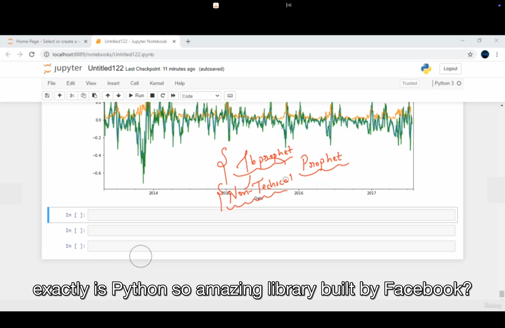
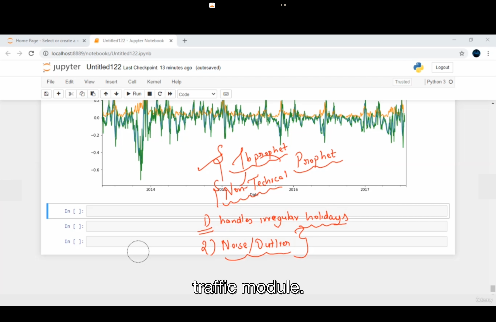
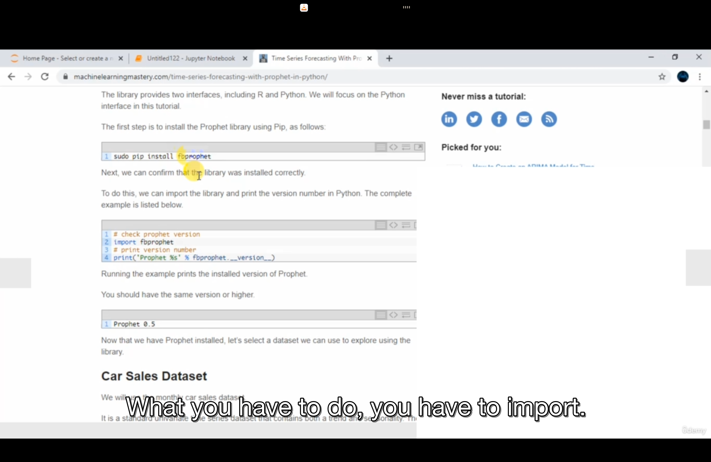

Hello. Before going ahead in this particular session, let's have a quick recap of what we have done in this project: lots of stuff, like stationarity checks, checking whether we have seasonality in our data or not, how to eliminate trend, rolling or moving average; most of this stuff we have already done on this data. So in this session, we basically have to do a forecast using the Prophet model, which is amazing, amazing stuff.

So let's discuss some basic ideas: what exactly is Prophet, and how exactly can we implement Prophet on our data? If I talk with respect to what exactly Prophet is: Prophet is a model that is available in the fbprophet module, the Facebook Prophet library. Facebook Prophet is an amazing library, even for non-technical users, because Facebook Prophet does a very good job even for someone who doesn't have an idea about Python. It's an amazing library built by Facebook.

So let's discuss some characteristics of this fbprophet module. The very important characteristic that I really love is that it handles irregular intervals, or you can say irregular holidays. Let's say in your entire data you have some irregular holidays; then Facebook Prophet will handle that scenario. And the second most important is if you have noise in the data, if you have outliers in your data, then that scenario also gets handled by this Facebook Prophet module.

So you can just go to Google and search Prophet time series. The very first hyperlink you can see is with respect to time series forecasting with Prophet in Python programming. Just click over there, and let me show you how exactly you have to work with it. You just have to install fbprophet; once you install it, you have to import it. And this is exactly the version of Prophet.

Now, this is exactly the documentation with all this stuff. So Prophet has been applied. Now you have to read all this stuff over here. So this is all about the data; this is all about the seasonality. You need to know how you have to feed your Prophet model. But before it, you have to prepare your data. According to the Prophet documentation, you have to make sure it follows all its protocols, and its protocol is as follows:

you have to make your date column ds and your output feature y. That's why we have to follow this, so that it follows the protocol. First, you have to install fbprophet. So I'm going to say pip install fbprophet. If you guys are getting any type of issues while installing the fbprophet module, feel free to ask in the Q&A section of this course. Once I install it, from this fbprophet module, we have to import something.

So I'm going to say from fbprophet we have to import the Prophet model. Then I have to initialize Prophet. For this, I'm going to say Prophet(), and I'm going to say it is m. Let me just execute it. Now basically we have to see the data frame, data, on which we are going to work. This is my data frame on which we are going to work.

And basically, we have to predict what can be the closing price. So I'm going to say I have to consider this closing price: I have to consider only the Close feature. For this, I have to mention this Close feature as well. So I'm going to store it in df, and over here I'm going to say df.head. You will see you have just one feature. Now I'm going to say df.columns, and in this I have to say my date will become ds, according to the documentation, and my output feature will become y.

Now I'm going to say all this stuff is OK. But before executing it, you have to make sure the date will be available in the form of a column. But here the date is available in the form of the row index. Very first, we have to get rid of that, so I'm going to say df.reset_index(). Then after that, you will see this is your data. Now you have to store it somewhere else. So I'm going to say, let me store it, and now I have all these things.

I'm going to say df.columns is ds and y. And if I say df.head, you will figure out this is your ds feature, and on the basis of your date, you have y, the closing price, because that is according to the protocol of the Prophet module. Now we have to say m.fit, because we have to fit our model. I'm going to say m.fit, and we have to just pass our data frame over there. Let me just execute this block of code.

So here you have a little bit of a warning: Facebook Prophet daily seasonality and tons of things; you can just ignore these warnings. You see, this is exactly its object at this particular address. Now we have to create some future dates on which we can do predictions. So I am basically going to say, let me store all of these things somewhere else. I'm going to say it is m; let me execute it.

Now you have to use this m and just call something else, which is make_future_dataframe. And over here, if you press shift tab, you can check out the documentation. It basically tells this function the periods that you have to assign, and on what frequency you have to create your data frame. I'm going to say my periods, let's say five hundred. So I'm going to say I need dates for 500 days, then my frequency will be daily.

So I'm going to say my frequency will be D. Once I pass all these things, I need to store my data frame. So I'm going to say, let me store it in future. Let me just execute it. Now I'm going to say I have to do prediction on this future. But let me show you one more thing: if I say future.head, or let me just call one more thing: future.shape. Over here, you will see you have basically 2056 entries, and you will see we have extended our future dates by 500 days.

Let me show you one more thing: if I say df.shape, you will see it has basically 1556 rows. So what actually happened over here? Once you create your future data frame, that data frame gets merged with this data, and this is your final data frame on which you have to do the prediction, your evaluation of your model, your cross validation; tons of things you can do on this data frame. Now, using m, in which I have my model, I'm going to say I have to do prediction. Then on what data

do I have to do prediction? I have to do prediction basically on the future data frame. Then I'm going to store all these things in forecast. Let me just execute this block of code. Now I'm going to say, let's say we have to visualize my forecast. For this, we have to say forecast.head, simple. So you will see these are my first five values. So these are all the forecasts returned by my Prophet model.

You will see with respect to the date, we have the trend; this is my lower prediction, or you can say lower bound of the prediction; this is my upper prediction; tons of things go ahead. But what exactly do you need here? Let me show you what you need. Inside this forecast, inside its forecasted data frame, I really just need my date, which is my ds. Then I have something, my yhat, and then I have something, my yhat_lower, because yhat_lower is exactly the lower bound of the prediction.

Then I have something, my yhat_upper, which is exactly the upper bound. So let me show you what we have here. So this is your yhat, and yhat is exactly the average of the lower bound and the upper bound, or you can say an average of yhat_lower and yhat_upper. If I call, let's say, I have to examine my prediction, so here I can just call tail, and you will see with respect to this date, this is your future date.

This is a future date; with respect to this date, you have this prediction. With respect to this date, this is exactly the closing price of Bitcoin; with respect to this date, this is the closing price of Bitcoin. This is the lower bound and this is the upper bound. So that's basically the idea behind my Prophet module. So the second problem statement is all about plotting our forecast as well. My Prophet module has an inbuilt feature, you can say an inbuilt function, that enables us to plot the forecast we have done here.

So for this, we are just going to call a function, which is the plot function inside this module. I'm going to say using this model, I'm just going to call m.plot, and over here I just have to mention my forecast. Let me just execute this block of code, and in a while, this is the amazing visualization. You will see over here we have some black dots and some curves. These black dots are exactly my actual data.

This is exactly my actual data. And this is the prediction; this is your upper bound, this is the lower bound; that was your idea behind how exactly the trend is going over there. So let me just scroll and let me show you one more. Yeah. So the very first is your plot here. It means this is your actual data, and this curve is exactly the predicted, you can say my predicted values, whatever you want to name it.

So these are my predicted values, and over here you will see the light blue lines. So this is exactly my trend: this is my lower bound and this is my upper bound. Let's say we have to plot each and every component; let's say, what is the trend on a weekly basis. For this, we can just say m.plot... you can just press tab, and over here you have a function, which is plot_components, and over here you just mention your forecast. Let me just execute this block of code.

And in a while you will get this amazing visualization with respect to trend, with respect to weekly, with respect to yearly, and tons of things over there. So that's all about this session. And if you guys have any issues regarding this session, feel free to ask in the Q&A section of this course. That's all about it. Hope you loved the session very much. Thank you. Have a nice day. Keep learning. Keep growing. Keep practicing.

10. Lecture 10
==============

Hello. Before going ahead in this particular session, let's go over all of the previous sessions and try to understand what we have done in this project. We did lots of exploratory analysis, feature engineering, stationarity tests on the data, building a baseline model and building a Prophet model as well. That's what we have done in the previous sessions. So in this session, we have to cross validate our Prophet model, because in the previous session we already built a Prophet model.

And that's all about the trend, all about how exactly my forecast is going. So now we have to cross validate that Prophet model. What we have done until now is build our model. Now we have to measure what my forecast error is. And in order to compute this forecast error using historical data, we basically have to compare

what my predictions are and what my actual values are. In order to compute this forecast error, you have to compare what you have predicted and the actual value with respect to the date. So in order to perform this operation, to compute this forecast error, we have to select some cutoff points in the history of the data, and what we will do

is try to fit the model with this data: whatever data we have up to there, we will fit our model with this data up to that cutoff point, whatever cutoff point we have selected. Once we do all these things, we can compare our actual values to my predicted values. To do all this stuff, there is a method available in Prophet, which is cross validation, my cross_validation method, that allows us to do all these things.

So basically, my Prophet module has an inbuilt cross validation technique. Let's say some of you have worked on machine learning. In machine learning, if you have to perform cross validation on the data, you have to perform cross validation using a module, which is scikit-learn. Inside this data modeling module, scikit-learn, there are tons of sub modules that help in performing cross validation in machine learning use cases.

But with respect to time series, we have this Prophet model. Inside this, we have cross validation, and inside this cross validation technique, we have some parameters, which are, let's say, my horizon; that is one of the most important ones; my initial, which is the initial training size of my cross validation method. And this horizon is basically my forecast horizon.

And this initial is basically the size of the initial training period. And we have one more parameter, which is my period: it is exactly the spacing between our cutoffs, like six months. So this is exactly my period. Machine learning cross validation is a little bit different from time series cross validation, because in time series use cases, we have to divide our data on the basis of time.

But in machine learning use cases, we can split our data randomly, or we can use some better approaches, let's say stratified k-fold, some amazing approaches. But in time series use cases, we have to divide our data on the basis of time. So let's try to perform this cross validation using the Prophet model in Python. Very first, we have to import the stuff that is responsible for performing cross validation in time series use cases.

So I'm going to say inside this fbprophet module, we have a sub module, which is diagnostics, and from this we have to import something known as cross_validation. Now just execute it. Now we have to initialize cross_validation, and over here, if I press shift tab, you can check out all these parameters I have explained to you. The most important ones are your horizon, your period,

and your initial training size; that's what I have already explained to you. If you go through the signature of this function, you will figure out what it does: it will basically cross validate my model, and over here you can read this entire documentation; there are tons of things you can read over there. So let me summarize all these things over here. In this initial, if you read it: if it is not provided, it is given a value of three times the horizon.

If I talk with respect to horizon: the horizon is basically my forecast time period. Let's go ahead. First, we have to mention our model, which is m. Then we have the horizon parameter, and in this horizon parameter, we are just going to say my horizon is, let's say, 365 days. It means we have to compute the forecast from the historical cutoff points. Now we have to mention our period. Inside this period, if I press shift plus tab, let me show you one more thing.

Inside this period, you will figure out this period is nothing but half of the horizon. So it means my period is, let's say, 180. Similarly, over here you have to mention the unit in days, because it's a time series. So I'm going to say it is days. Then I have one more parameter that I have to fix, which is my initial. So I'm going to say my initial is three times the horizon.

So I'm going to say it is exactly 1095, and I have to mention it in days, because it's a time series use case. Then let me store it in df_cv. Let me show you one more thing: if I say df.shape, you will figure out we have that many rows and that many columns in my data frame. Now we just execute this block of code; it will just take a while, and it will say over here it is making the forecasts with cutoffs between this date and this date.

And if I say df_cv.shape, you will figure out you have that many rows and that many columns inside this df_cv. And if I say df_cv.head, you can figure out this is the data frame, with one more parameter, which is my cutoff. So let's discuss how you apply cross validation on time series data.

Suppose you have data between 1964 and 1968. Suppose this is my total data set. Then how can you perform cross validation over there? At first, you have to consider some training data. Let's say my training data is, let's say, '64, '65 and '66. This is exactly my training data.

Or you can say this is my training data, on which you have to train your model. Then you have to consider some testing data. So I'm going to say my testing data is all about 1967 and 1968. So this is exactly my test data. And now we have to build some new data that we consider as my validation data. So my new data will be 1968 and 1969. That will be considered as basically my validation data.

Whatever new data set I'm going to create will be considered as my validation data. And now what we have done: in this use case, whatever cross validation I have applied over here on this data frame, we have basically cross validated on my test data, and it returns exactly df_cv.

So it means in this use case, the cross validation I have done is on the test data, and it gives me this df_cv, the cross validation results. Now, after doing all these things, you have to evaluate your model; you have to do model evaluation as well. To evaluate a model, there are tons of metrics you can use, let's say mean squared error, something known as root

mean squared error, or something known as MAE, which is mean absolute error. We have an amazing metric, which is MAPE, mean absolute percentage error. We have tons of metrics to evaluate how my model is performing. So now we have to plot our performance metrics. I'm going to say inside this fbprophet module, we have a sub module, which is plot.

From this, I have to import something else, which is plot_cross_validation_metric, and I can just execute this block of code. Now we just have to call this plot_cross_validation_metric, and over here, very first, we have to mention the cross validation data frame, which is my df_cv. So I'm going to mention it. And over here, I just mention my metric.

My metric will be, let's say, RMSE, root mean squared error. It will return the figure with all these things. And if I execute this block of code, in a while you will get this amazing plot. You will see this is exactly the horizon, in days, and on the y axis we have the root mean squared error. You will see with respect to this range, this interval, we have a little bit higher error.

So let's try to do similar steps with respect to MSE. Over here I just do some manipulation: MSE, mean squared error; just execute; this time you will get that much curve. You see, this is my mean squared error. Similarly, from this mean squared error as well, you can infer that in this interval, when the horizon is probably between this and three hundred and fifty, we have a little bit high error in our model. So that is exactly the inference from the Prophet model that we have built.

So that's all about the session and the project as well. If you guys have any doubts with respect to this session and with respect to this project, feel free to ask in the Q&A section of this course. That's all about the session and this project as well. Thank you. Have a nice day. Keep learning. Keep growing. Keep practicing.

## Birth

1. Lecture 1
============

Hello, and welcome to this time series analysis and forecasting project, in which our use case is to predict what can be the number of births on the following day. So this is exactly our use case: we have to predict what can be the number of births considering the date as an independent feature, or as our input feature. To predict this, we have to do lots of stuff: we have to do something known as data cleaning,

we have to prepare our data; we have tons of things to do, because whatever data we get, we will always get raw data. In industry, you will always get raw data, and you have to make sure that whenever you are going to build any model, whether it will be machine learning or time series or whatever model it will be, that raw data isn't acceptable as an input to my time series model. That's why we have to convert this raw data into an acceptable format.

And for this, we have to do lots of data cleaning, like dealing with missing values, doing a lot of feature engineering on the data; a bunch of things we have to do on the data. That's what we are going to do in this project. You will figure out my data set is available over here. This is exactly the data set on which I have to build a model. So very first, I have to open my Jupyter notebook, and over here I have to import some libraries, like pandas, NumPy, and visualization libraries like matplotlib and seaborn.

So I'm going to say I have to import my very first stuff, which is pandas, and I'm going to create its alias as pd. Once I import this, I'm going to say I have to import NumPy, which is numerical Python, which is extensively used whenever you have to do some numerical computations on data. Once I have imported NumPy, I'm going to say I have to import my data visualization library, that is matplotlib.

So I'm going to say I have to import matplotlib, and from matplotlib I'm going to import pyplot, and let me create its alias as plt. Now let me import one more data visualization library, seaborn, and I'm going to create its alias as sns. Let me execute it. And once it gets successfully executed, I'm going to say pd.read_csv, because you will figure out over here

this is CSV format data. That's why we have to call this read_csv function, which is defined in my pandas library. Over here, if I press shift plus tab, you will check out the entire documentation, all the parameters and functionality. The very first parameter that you have to pass is the file path. What exactly is the file path? So let me just copy where exactly the file is available.

So let me just copy this path, and over here I'm just going to paste the path, and if I press tab over there, you will get this data set, which is available at this particular path. Over here, I have to just prepend an r. Yeah, this is the path, and then the data set. What does this r stand for? It basically stands for raw string, whose task is to tell Python: this is the path, and this is the data set that you have. It returns a DataFrame object.

Let me store that object, let's say, in df_birth. Let me just execute it. And if I say df_birth.head to get a quick overview of how exactly my data frame looks, let me just execute this block of code, and you will figure out this is my Date feature, and this is my Births feature. But you will notice that, according to a time series use case... let me just remove this.

So basically, for time series use cases, you have to make this Date feature your row index. That's a must condition for time series use cases: whenever you have to build a time series model, you have to make this Date feature your index. To convert it into the row index, we have some more parameters; let me press shift plus tab.

Let me show you all those parameters. The very first parameter is exactly your path, and then parse_dates, which is exactly this one, because very first you have to parse the date, because right now its data type is exactly object. Let me show you: if I say df_birth.dtypes; oh, that's a typo; over there I would say it is dtypes.

And you will see right now this Date supports object type, but we know it must support timestamp nature. For this, I have to use this parameter, which is parse_dates, and over here I have to mention its index. So I'm going to say its index is zero. Then I'm going to say I have to make this the index, so I'm going to say index_col, and over here I mention the index of Date as well.

Once I do all these things, I can again execute this cell, and this time you will figure out right now this Date has become the row index, because this is a must condition for the time series use case. So now you have successfully read your data. Let's go ahead with our problem statement. The first one is all about: you have to get the distribution and the trend of the data,

or you can say what exactly the distribution of this Births feature is. For this, what you can do is convert this entire data into something known as an array. So I'm going to say df_birth.values, and if I execute it, all these values are exactly in an array. Let me store it, let's say, in births. I will execute it again. And if I have to cross-check

what exactly the data structure of this is, for this I'm going to say type of births. You will see right now it is something known as ndarray, from NumPy. That is exactly the structure of this births, which supports ndarray. It means it holds any form of array. Now we basically have to achieve the distribution of this births. So I'm going to say sns.distplot, and over here I have to just mention

basically my data frame, which is exactly df_birth. Let me just execute this block of code, and you will get this amazing visualization. From this visualization, you will see this is exactly the zone where we have some kind of outliers, or you can see these are my high outliers. Let's say I have this distribution;

let's say my distribution is skewed towards the right hand side. It means I have some values that are much, much greater than the range. Something like the distribution of income of Indians, or any other country: this is the income of Indians. From this, you will see in this zone basically the millionaires and billionaires lie.

So this is exactly the zone where high-earning people lie, and this is where the middle class basically lies. And this is basically the zone where poor people live. So this is exactly, I can say, right skewed. So I can say this is my right skewed distribution. And let's see, if I have this type of distribution,

this is exactly left skewed. Then I can say this is the zone where my low outliers are available, and this is the zone where I have high outliers available: here I have high outliers, and here I have low outliers. Let's say I have data of persons whose ages are given; let's say we have data like this.

Let's say I have data: six, seven, let's say 11, 11. Let's say I have all these persons' data from twenty five, twenty six, up to, let's say, 99. From this data, we will notice we have very few data points available in this range. So these are my low outliers. And again, if I plot its probability distribution function,

it will look something like this. Then the next thing is all about the trend of this data. For this, I'm going to say df_birth.plot. I can simply plot my births values with respect to the date. If I execute it, you will get this amazing visualization, and you will notice this is exactly the trend. From this trend, you will notice this is exactly a stationary trend.

This is exactly a stationary trend. So what exactly is a stationary trend, or you can say, what is stationary series data? It is data that doesn't have any trend, or you can also say it has a constant mean and standard deviation. Because from this trend, you will notice it has a constant mean, you can say, throughout the data and its interval.

That's why it will come under the stationary trend; you can say it is stationary in nature. So from this visualization, when I called this plot function, it plotted the births values with respect to the date, and once I plotted this, I got stationary data, or you can say data that doesn't have any kind of trend, or a constant mean and constant standard deviation throughout the data.

So that's all about the session. In the upcoming session, we are going to perform some basic statistics on the data. So that's all about it. And if you guys have any issues, any doubts regarding this session, feel free to ask in the Q&A section of this course. So that's all about it. Hope you loved the session very much. Thank you. Have a nice day. Keep learning. Keep growing. Keep practicing.

2. Lecture 2
============

Hello. Before we go ahead in this particular session, let's have a quick recap of what we have done until now in this project. In the previous session, we analyzed the distribution, and we came to know we have some kind of outliers available. And then this is exactly the trend that we have. So in this session, we have to use something known as rolling on our data.

But before that, let's perform some basic statistics on our data. For this, very first, I have to access my data frame, and on this I'm going to say I just need a description of the data. So I'm going to just call the describe function. Let me just execute; this is all about my stats of this. And if you need these metrics in transposed form, you can just call .T. So let me just execute it. You will see I have that much count,

my mean is that much, my standard deviation is that much, I have a minimum value of that much, the 25th percentile data is this much, the 50th percentile data is this much, which is exactly your median, your 75th percentile data is this much, and your maximum value is this. So that's all about the basic stats of the data. Now you basically have to perform something known as rolling on the data. So let's very first understand what this rolling is all about, and why we use rolling.

Whenever you have to do smoothening, or you can say whenever you have to smooth your time series, in such a case you have to use something known as the moving average. In this moving average, you have to consider rolling. In this rolling, you have to just set some window size.

Or you can also consider this window size in terms of business: you can consider the window size as a business period. Let's say my business period is five, or my business period is 10, or seven. So what is this business period all about? Let's see. I have some data with respect to the first date, second, third, fourth and fifth; let's say with respect to five dates I have some data points: D1, D2, D3, D4 and D5.

With respect to these, I have to compute what can be the value on this date. Let's say I am a domain expert. This domain expert will say you can consider the mean of the first five values, depending upon what type of experience that domain expert has; or it can consider the max value between these first five days, or the minimum, or some other function, whatever this domain expert defines.

So that's what rolling and the moving average will do for us. Inside this rolling, we have to set some window size, or you can consider this window size as your business period, and here your domain expertise comes into the picture. So let's apply rolling on our data.

I'm going to say df_birth.rolling, and over here, if I press shift tab, the first parameter is all about window. So I'm going to say my window is, let's say, 10, and I'm going to say just compute its mean. And if I execute, you will get all these values. Let me show you: let's say .head(10). Let me set the window to 10.

Let me just execute it. This time you will see these are my first nine values that are NaN values, which are my missing values, because I have set my window size to 10. So what it will do is compute the mean of the first 10 rows and assign that mean over there. Similarly, over here it will consider the next 10 rows, and their mean will get assigned over there. That's what this rolling and moving average does for us.

So let's say I'm going to set this value as, let's say, 20; that's what my domain expertise suggests. And let me store all these values, say, in df_birth_mean. Let me just print these values as well. Let me just execute it; you will get all these values over there. Now you can also plot these values.

So I would say .plot; just plot it, and you will get this amazing visualization over there. You will see over there in October we have a little bit of a spike. From this visualization, I can see, yeah, there is very little trend available over there, if I exclude this interval. Similarly, if I consider, let's say, a window size of five over here, less than five, let me execute it again, and this time you will see you have that much visualization, and this time

there is less trend available over here. So basically, rolling, or you can say the moving average technique, is used a lot of times in, let's say, the stock market, basically by stock analysts, and they basically use this technique to remove noise in data. So whenever you have noise, or you can say irregular patterns, you can definitely consider this rolling technique on the data to remove this noise, or irregular patterns, from the data.

So that's all about the session. And if you guys have any issues or queries regarding this session, feel free to ask in the Q&A section of this course. So that's all about it. Hope you loved the session very much. Thank you. Have a nice day. Keep learning. Keep growing. Keep practicing.

3. Lecture 3
============

Hello. Before going ahead in this particular session, let's have a quick recap of what we have done in this project. In the previous session, we used the concept known as rolling, and we got this trend once we applied rolling on our data. Whenever we have noise in our data, at that time we have to use something known as rolling and moving average. And this is exactly the trend that is almost close to stationary.

And this is exactly the distribution of our data. That's what we have analyzed in all our previous sessions. So in this session, we have to do prediction using something known as a baseline model, and we have to evaluate the accuracy of the baseline model as well; that's what we have to do in this session. So first, let's try to discuss the different types of models in time series.

The very first one I would mention is your baseline model. The baseline model is all about my future prediction: in this baseline model, my historical data is a good reflector of my future prediction. That's the exact meaning of this baseline model. The second model is the exponential model. The third is the auto regressive,

you can say the AR model. The fourth is the MA model, which is your moving average model, which I have shown in a previous session, and the fifth is the ARIMA model, one of the most demanded models in time series. The sixth is the SARIMA model: whenever you have seasonal data, whenever you have something known as seasonality available in your data, at that time you have to use the SARIMA model. And one more is the SARIMAX model.

This is your seventh, the SARIMAX model. So in this session, we are basically going to use this baseline model. So what's this baseline all about? Let's discuss some key points of this baseline. You can also consider this model the naive model. Let's say today the number of births is somewhere around 41.

Let's say this is my present data. So we can also assume that tomorrow we will also get forty one; that's what this baseline model is all about. If I have to explain this baseline model in a very layman way, I can say the recent history is the best reflector of the future. So this is my future data, and you can consider this data as present or historical data, so the recent history is the best reflector of the future.

That's all about this baseline model. Anyhow, we have to create such a baseline model that can predict what can be the number of births. That's a very basic approach. But let's try to apply this baseline concept on this use case. To build this model, you just have to use one operation on your data, which is exactly the shift operation. So let's say on the 28th of March,

you have a number of births, let's say 31. And let's say on the 29th of March, your number of births is 34. And let's say you have to predict what can be the number of births for the 30th of March. Using this shift function, or shift operation, you can shift this value over there. So I'm going to say on 30th March, I have 34 births. In a similar way, for this one as well: I can say on 29th March, I have 31. That's all the idea behind my baseline model.

That's a very basic approach, a very baby approach. But let's implement it on this use case. So I'm going to say df_birth is exactly my data, and on this, if I call head, let me just execute; these are my first five values. On this data frame, df_birth, if I say .shift, it means I have to shift my values by one. And if I execute it, you can see the shift by one index.

If I execute, you will get these values over here, as I have shown you. So let me store all these forecast values in, let's say, a forecast series. Let me just execute it. Now we basically have to concatenate this df_birth data frame and this forecast series. So I'm going to say basically pd.concat, and over here, what do I have to concatenate?

Basically, I have to concatenate my data frame and my forecast series. And then I have to mention axis equal to one, because I have to concatenate them side by side. Then I'm going to say it is my birth_df, let me just say. Let me just execute; this time you will see this is my Births and this is my Births again. Let me just modify the names of my columns.

So I'm going to say birth_df.columns: the very first one, you can say, is actual_birth, and the second column name you can assign is forecast_birth. Once I manipulate the column names, I can say birth_df.head. Let me just execute. This time you will see it has that much actual births and that much forecast births. You will see on this date it has an actual number of births of 32.

But my naive model, or you can say baseline model, predicts it has that much. So once I have built this model, now we have to check what exactly the accuracy of this baseline model is. There are basically two ways you can compute its accuracy, or you can say error. The first one is: either you can do it on the complete data set,

or you can use something known as train_test_split, which is defined in scikit-learn. What this train_test_split will do is provide training data and testing data in some ratio, whatever ratio I pass there. Its default ratio is, I think, 75/25. So 75 percent of the entire data will be considered as training data, and 25 percent will be considered for the evaluation of the model.

Over here, you will see in this birth data you have, I think, around 300-odd observations. So you will figure out you don't have that much bulk data, so you can check how exactly your model is performing by considering this complete data. If you're not using the train_test_split approach, there's no issue, because you don't have that many observations to split into training and testing. What you can do is

consider this entire data for evaluation. For evaluation, you have to use something known as mean squared error. So I'm going to say from sklearn.metrics, I have to import something else, which is mean_squared_error. Let me just execute it. Let me just say mean_squared_error, and over here, if I press shift plus tab, you will check out all of these values:

what are your true values, what are your predictions, and all these things over there. So I'm just going to say birth_df, and very first I have to access this forecast_birth. This is exactly a feature. One thing you have to make sure of is that we have to pass data that doesn't contain any missing values, because here I have a missing value.

So to get rid of this missing value, you have to pass the data after the first index. It means I have to access the data from this index; it means I have to ignore this first row. Then I'm going to say birth_df, and over there I have to access this actual_birth, and I'm basically going to access the data from this one onwards, because I have to make sure that the data I'm going to pass has an equal number of observations.

And once I have all these things, let me just execute it. This time you will get that much mean squared error. Now, if you really want its error, you have to compute its square root, because it is squared. To compute the square root of this error, you have to use the sqrt function that is defined in NumPy. Let me execute it again. This time you will get an error rate of nine point one seven.

So what has happened over here? Mean squared error gives us the square of the error. So once I use np.sqrt, it will return the actual error. So what exactly does it mean? It basically means we have an error of plus or minus nine. That is going to happen in a prediction; that is the exact meaning of this error. So if we have high outliers in the data, then this error will get increased.

So what if we have high outliers in the data? Try to deal with that, because you will notice we have some kind of outliers available here. So if I'm able to handle these outliers, then apparently this error, which is close to nine, will definitely decrease. So that's a drawback of having outliers in your data. If you guys have any issues regarding this session, feel free to ask in the Q&A section of this course.

So that's all about the session. Hope you loved the session very much. Thank you. Have a nice day. Keep learning. Keep growing. Keep practicing.

4. Lecture 4
============

Hello, all. Before going ahead in this particular session, let's have a quick recap of what we have done until now in this project. In the previous session, we basically built a baseline model whose error is approx close to nine. And anyhow, I have to improve this error. So this is exactly the main goal in this session: we basically have to apply the ARIMA algorithm on our data, and we have to check what exactly the error rate of my model is.

That's what we have to do. So first, we have to import some stuff that will help us apply the ARIMA algorithm on our data. So I'm going to say from statsmodels, which is a library, .graphics.tsaplots, and from this I have to import something known as plot_acf. If I just press tab there, I'm going to say just press tab, and it is exactly plot_acf.

And this is exactly plot_pacf. So plot_acf and plot_pacf will give us the values of p, d and q, because ARIMA needs the values of p, d and q. If you don't know all these things, kindly check out my previous videos, where I have explained all these things. So let me just execute it now. Very first, we have to import some other stuff, which is exactly ARIMA. So I'm going to say from statsmodels.tsa.arima_model, this is exactly that

sub module, and from this I have to import something known as ARIMA. Let me just execute this block of code. Now I'm basically going to say I have to use this plot_acf. So I would say I have to use plot_acf, and over there I have to use df_birth, which is exactly this one. And in this, I have to access this... let me show you what exactly this feature is all about.

Yeah, this is the feature I am talking about. So over here, I have to mention this Births feature. And if I execute this cell, you will get the autocorrelation plot, which will give us a value; in a similar way, if I say I have to use something known as plot_pacf, let me execute, and this will give you a value as well. So let's discuss all these things in much, much more detail.

So the ACF plot will give us the value of q. And from this autocorrelation graph, we will come to know the value from where the lags cross this boundary. This value is exactly the p value, so you can see your p value can be two or three. You can either consider two, or consider three. In a similar way, if I have to find the value of q from this autocorrelation plot, then I can say

this plot will give us the value of q; the partial autocorrelation gives us the value of q, and from this you will see q can be three or four. So this is exactly the q value, and the p value is two or three, and the d value is exactly zero because my data is stationary. That's why we have to consider this d value as zero. So now what you have to do is create some training data and some test data.

So I'm going to say on this df_birth, if I call something known as shape, you will figure out it has that many rows. So what you can do is consider, let's say, the first 320 for training, and the rest will be for testing. So I'm going to say basically df_birth, and over there I'm basically going to say I have to access the first 320 data points for training.

So I have to say it is exactly training_set. Now, the rest of the data points will come under testing. So basically I'm going to say it is exactly this one: I have to assign 320 onwards as my testing data, so I'm going to say it is exactly test_set. Let me just execute this block of code. And if I say training_set.shape, you will see it has that many data points over there. And with respect to testing, test_set.shape:

you can also call something known as shape there, and you will see it has that many data points available in this test set. Now you have to initialize your ARIMA model, so I would say ARIMA; if I press shift plus tab, the very first parameter is endog. It means: what is your training data on which ARIMA is going to learn the relationship? So for this, I'm going to say my training data is exactly training_set.

Then I have one more parameter, which is order. So in this, I have to mention the values of p, d and q, as I have already explained to you from this autocorrelation and partial autocorrelation. So once I initialize this ARIMA, let me store its object, let's say, in arima. Let me just execute it. Now we have to fit our data. So I'm going to say arima.fit, and here I have to initialize it.

So I'm going to say, let me store that object, let's say, in model. Let me just execute this block of code. There is a ValueError that will come across here. So let's try to understand what this error is all about. You will see: the AR coefficients are not stationary; you should induce stationarity; choose a different model order, or you can pass your own start params. So what you can do is play with this pair; let's say I set my d as one.

So let me again execute it. Let me again execute this block. You will see all this stuff gets successfully executed. And if I say model.forecast, over there I have a parameter, which is exactly steps. It means on how many days you have to do prediction. So steps equals, let's say, forty five. And if I execute it, these are all my predictions. So over here, you have to access this array; for this, I have to access index zero.

These are all my predictions that are done by my ARIMA model. Let me store all these predictions in pred. Once I do this, I have to check what exactly the error in the ARIMA model is. For this, I have to use something known as mean squared error. Over here I have to pass my actual data, which is in test_set, and then my predictions in pred. Let me execute. You will get that much mean squared error. Now you have to compute its square root.

So I'm going to say np.sqrt of this one, and then again execute. You will see your ARIMA model gives an error of plus or minus 6.6, whereas your naive model returned an error rate of approx 9.1. So my ARIMA model slightly performs better in this use case. But the question that will arise over here is: why do we have to select only this pair? Why not another pair? Why not three, one, two? Why not two, one, two?

Why not four, one? Why not all these pairs? Why only this pair? So definitely you can play with all these parameters. And in the last session of this project, we have a session on something known as hyperparameter tuning that you can consider. In this hyperparameter tuning: whenever we initialize our ARIMA model, it is not necessary that this pair will play a much, much better role.

So in such a case, we have to test our model with each and every pair by doing something known as permutations and combinations, from mathematics. I would just write some basic code using some for loops; I just iterate and pass some values. And once I hypertune my model, with respect to each and every pair I will get some mean squared error value. Whichever pair has the least MSE value,

I will consider that pair for my ARIMA model, initialize my ARIMA model, and then I will try to do prediction. That's what we will do in this hyperparameter tuning: we will try each and every possible pair by doing simple maths, permutations and combinations. We basically follow it in Python: we just iterate over all these pairs, and we will get the MSE value with respect to each and every pair. That's what we will do

using this hyperparameter tuning. So that's all about the session. And if you guys have any issues regarding this session, feel free to ask in the Q&A section of this course. So that's all about it. Hope you loved the session very much. Thank you. Have a nice day. Keep learning. Keep growing. Keep practicing.

5. Lecture 5
============

Hello. In this particular session, we basically have to perform something known as normalization on our data. But before performing normalization on this data, let's have a quick recap of what we have done in this project. Lots of data operations, and the distribution, which is a part of data visualization; this is what we have done. Then some basic statistics we have done on our data.

We have basically built a baseline model and an ARIMA model, and we have done predictions. That's what we have done. So the various models that we have built: the very first model is our baseline model. The second model that we built is my ARIMA model. So we built ARIMA, and we also built the baseline. In this baseline, we have an accuracy of plus or minus approx

9.1 approx, and in ARIMA we have this accuracy, which is exactly my error, not accuracy. So this is exactly the error rate of six point six one. Similarly, over here, this is my error rate, not accuracy. It means my prediction is fluctuating within a range of plus or minus nine of my actual value. That is the exact meaning of this error rate. And we got to know ARIMA has that much error rate.

So the third model that we are going to build over here: anyhow, we have to decrease this error; we have to minimize the error, or I can say I have to optimize my time series model. So the third approach that we can follow is performing normalization on the data. Once I normalize this data, which is the births data, I will try to apply ARIMA again on my data, and then we will check what happens with our error rate.

That's what we are going to do in this session. But before it, let's try to understand what normalization is and in what type of use cases you have to apply this normalization. Whenever my data is on different scales... let's say you have the heights of a hundred students, and they are on different scales.

Then in such a scenario, we can bring our data onto the same scale. To bring your data onto a scale, you have to use something known as normalization. So what exactly does this normalization do? It will bring our data into some range, let's say into the zero to one interval. Whatever the height of the student, it will come under this zero to one interval; that's what this normalization will do.

So suppose you have data on the heights of students. Let's say their heights are, let's say, 120 centimeters, 160 centimeters, 180 centimeters, 186 centimeters. Let's say this is the data of students, or even you can define more data points. On this data, we have to perform this normalization.

So you have to use a basic formula; if I have to explain it in one way, you have to use such a formula that you can hold this entire data in this range. What type of modification do you have to do so that you get it all in this range? So, considering this 120, I will say x i; my x i is 120. So I'm going to say x i minus the minimum value.

The minimum value here is 120, divided by maximum minus minimum. My maximum is 186 and my minimum is 120. So this will get converted basically into zero. In a similar way, if I try to convert this 160, it will get converted into something like 40 upon 66, which is somewhere close to 0.6. In a similar way, you will get all these values, whatever the height of a person. So from this data, you will notice we don't have that much fluctuation, because all our data points are in this range.

So this is the data that is suitable for my algorithm, even if we have a machine learning use case; this data is much, much better than the original data. That's why we have to normalize the data, because this data fits much, much better for machine learning, in the case of linear regression or logistic regression or whatever use case we have. But the question arising here is why there is a need to work on normalization: because in real world scenarios, if we have normalized data, in the case of machine learning or even time series, there are many algorithms that perform much, much better if we have normalized data.

That's the power of having normalized data in real world use cases. To perform this normalization, you basically have two ways. The very first way is using the inbuilt functionality defined inside Python, inside a library, scikit-learn, which is extensively used in data modeling and feature engineering. Inside sklearn, we have something known as the MinMaxScaler class.

Using this MinMaxScaler, you can easily perform this normalization. But if you are good with your programming skills, you can define your own function and write this block of code, which is exactly x i minus the minimum of x, divided by the maximum of x minus the minimum of x. That is the simple logic you have to write inside this block of code.

So let's try to apply normalization using Python. I'm going to say from the sklearn library, I have something very amazing, which is the preprocessing module, a sub module inside sklearn. I'm going to say from this, I have to import my MinMaxScaler class. Let me just execute it. Oh, we have a typo in this import keyword. So while you are working with Python, make sure that whatever code you are writing follows all the rules of Python programming, because it is an extensively case sensitive programming language. Then execute it.

Now I'm just going to initialize my MinMaxScaler, because I have to create its object. I'm going to say, let me store its object, let's say, in scaler. Let me just execute it. Using this scaler, you have to call a function, which is fit_transform, that will transform all the values of this df_birth. Let me show you what exactly this df_birth is. Let me execute.

So this is exactly the data frame. What this will do is convert the births into a range of zero to one; that's what I have shown you. Let me store all these values somewhere else. So very first, I have to apply this on df_birth and store the values, let's say, in birth_normalized. So I'm going to say it is exactly birth_normalized. Let me just execute it.

And if I visualize my birth_normalized, you will figure out these are all my values in the default array data structure, and you will see all the values are exactly in the range zero to one. That's what my normalization does for us. So now my data is ready. Now you can feed this data to my algorithm. So very first, we have to define some training and some testing data. I'm going to say inside this birth_normalized,

let me show you one more thing: if I say birth_normalized and call size there to check the size of this array, you'll figure out it has that many data points, that many elements in this array. So let's say for training purposes, I will consider the first three hundred twenty data points. So I'm going to say zero to 320. Let me remove this comment.

So I'm going to say zero to 320, and this is exactly my training set. So I'm going to say it is my training_data. Let me define my testing set as well. I'm going to say birth_normalized, and after 320, whatever elements we have, let me store that in test_data. So I'm going to say it is my test_data. Let me just execute this block of code. Now basically we have to initialize the model.

So let me initialize my ARIMA model. I'm going to say ARIMA; I can just press tab, and over there we just have to mention p, d, q. Very first, I have to mention my data, which is exactly this parameter. So I'm going to say I have a training model considering this training data, so I have to mention this training_data. Then I have to say my order: order equals... what I have is basically two comma one comma three, because this is the pair that I have shown you, and I have passed this pair.

Yeah, this one. So similarly, once I initialize my ARIMA, let me store its object in arima. I can just execute this block of code. Using this arima, I'm just going to call a function, which is the fit function. Once it is created, let me store it in model. Let me just execute this block of code. Using model, I can do my prediction. So I'm going to say model.forecast, and over here I have one more parameter, which is steps: it means on how many days you have to do prediction.

So I'm going to say steps equals, whatever; let me just execute. This is the array that you have to pick. Here I have to pass its index; let me just execute. These are all my predictions. Let me store them in pred. Let me just execute. Now you just have to use the MSE to check how this ARIMA model is performing once I have normalized my data. I'm basically going to say mean_squared_error, and over there, very first, I mention my actual data, which is my test_data,

and I have to mention my prediction, which is pred. Let me just execute. So this is my mean squared error. And if you are thinking that you have a much lower error here, you are wrong, because this is... let me show you one more thing. Let me show you what I have in my predictions. You will see these are normalized values, and what exactly we need

is my actual predictions. It means on all this data, we have to perform something known as inverse transformation. So let me perform inverse transformation on this data. Using this scaler, I'm going to say inverse_transform, and over here I have to mention this pred. I have to convert this into a 2D array using reshape, because I need the predictions in the right shape. For this, I have to use reshape, and over here mention minus one comma one. Let me just execute.

These are all my actual predictions. These are the predictions that you exactly need. Let me store all these predictions, let's say, in actual_forecast. Let me just execute this block of code. Now we have to perform inverse transformation on this test data as well. So I just have to use this block of code again over here.

So I'm going to say I have to pass this test_data inside this inverse_transform function, and over there, I have to mention my actual_forecast. Let me again execute. And this time you will get that much mean squared error. Now you have to compute its square root. So I'm going to say np.sqrt, and over there, I just include all these things. Let me just execute; this time there is a minor decline in your error. You will see when we didn't have normalized data, at that time our error rate was basically this; let me show you.

So this is exactly your error when you had your ARIMA model without normalized data. But once you normalize this data, there's a minor decline in your error. And if we have huge data and we have outliers in our data, in those scenarios this error rate will decline; definitely it will decline much, much more. So that's all about the session. And if you guys have any issues, any doubts regarding the session, feel free to ask in the Q&A section of this course.

That's all about it. Hope you loved the session very much. Thank you. Have a nice day. Keep learning. Keep growing. Keep practicing.

6. Lecture 6
============

Hello. Before going ahead in this particular session, let's have a quick recap of what we have done in this project. We have basically built three models. The very first is my baseline model, the second is my ARIMA model, and the third model that we have built is my ARIMA model with normalization, and we did this normalization using the MinMaxScaler class, which is available inside the scikit-learn module.

So in this particular session, we basically have to perform basic feature engineering on our data. We have to examine each and every feature, and we will try to extract some more features using some basic domain knowledge. So in this session, we have to perform something known as feature engineering, and in this feature engineering we have to do tons of things, but here we will try to extract some features, or you can term it feature extraction.

So we will try to extract some features from our data frame, which is df_birth. In this data frame, we have a feature, which is my Births. From this Births feature, we can create some more features, and we will try to examine how important they are. So definitely we can create some more features, like, let's say, lag features, and we can create these features basically by calling shift on my data.

I'm going to create a feature lag1, and over there I can shift the values by one row index. That's what this shift stands for. In a similar way, we can create some more features, like moving average. In this moving average, I will consider my rolling concept, and inside it we will consider some window size, or you can say some business period, the number of observations, from some basic domain knowledge.

Let's say my window size is three. So this is the number of observations that we have to use to calculate the statistics, and on this I will compute the mean. And let's say I will name this feature, let's say, MA3. In a similar way, I can create some more features, let's say moving average four, and over there I can consider my window size as four, and on this I can compute the mean. In a similar way, I can create some interesting features.

Let's say I have expertise in some area, and I know that within an interval of seven days, the maximum value is a good reflector of our business. In such a case, we can construct one more feature, let's say max_5 or max_7, and in such a case I can use rolling over there, and I can define my window size as seven, and on this I can just call max.

It means: what will be the maximum value of the seven data points? Just extract that maximum value and store it at that particular index. That's what max and rolling will do for us. In a similar way, we can create some more interesting features, like minimum, let's say min_5. Just having a basic knowledge of the domain and some subject matter expertise, we can create so many variables.

Just having a very basic knowledge of the domain, we can create dozens of features over there. The more you dig inside this data and the business, the more you will figure out this feature engineering. Feature engineering is the most creative part; apart from interpreting your model, it is the most creative part in the entire lifecycle of a data science project.

So let's try to create some more features. If I say df_birth, and if I call head, you will figure out this is my data frame. The first feature that we have to create is my lag feature. Basically, I can create the lag feature by basically shifting my values. So I'm going to say df_birth.shift, and over there I just shift my values by one index, and whatever value it returns, let me store it somewhere else.

So I'm going to say it is my df_birth, and in this I have to create one more column, which will hold all the values over there. So I just have to execute this cell, and if I say df_birth, let me just print the data frame: one more feature, which is my lag1, has been created over here. In a similar way, I can play with these lag features, and over here I can say just shift the values by two,

and let me create a feature lag2. In a similar way, I can create one more feature, lag3, and over here I can say just shift the values by three. Let me just execute. But before executing it, one thing that you have to make sure of: if you are going to shift the values, then you have to mention on what column you have to shift your values. In this data frame, you shift the values considering this feature, which is my Births.

So over there I have to mention this feature. I'm going to say it is exactly this feature. Let me just mention it; in a similar way, I have to mention this and this. Let me just execute. And again, if I say df_birth, let me just print this data frame: you will figure out three more features, lag1, lag2 and lag3, have been created over here. So let's try to apply the rolling concept on our data.

I'm going to say I have to access the feature, and on this I'm just going to call rolling. Over there I mention my window size: very first, I define a window size of three, and on this I'm just going to call the mean operation. Let me just execute. This time you will get all these values. Let me store all these values; let's say I create one feature, and I'm going to say its name is MA3.

Let me execute, and if I print this df_birth data frame, you will figure out this is my data frame. Let me execute. One more feature, which is my MA3, has been created over here. In a similar way, you can play with this rolling. So let's say I have to create one more feature, let's say MA4. So I'm going to say it is my MA4, and over here,

after defining my window size of four, I can just execute it. This time I'm going to say just consider the max operation, and this time, let's say my window size is five, and I can define this feature as, let's say, max_5. So let me just execute. And this time I'm going to say just apply the minimum operation, and this time my window size will be, let's say, five,

and I can define a feature that holds all the values as min_5. Let me just execute it. And if I say df_birth, let me print it. These are all the features; we have created over seven features, and we can examine how important they are. So if my domain satisfies this condition, then I can consider this feature for my modeling, for my predictions. In a similar way,

if this moving average three feature satisfies my business, I can consider this feature for my predictions. That's what we have done here. So let's try to extract some more features. Let's say we have to create one more feature, let's say day. I can fetch the day from this date. So for this, very first, I access this df_birth data frame, and on this,

if I call index, let me execute: these are all the indexes, in the form of a list. And on this index, or you can say on this date, if I call something known as day, let me just execute, you will get all your days over there. So let me just store all these days somewhere else. I'm going to say it is my df_birth, and over here I define one more column, which is my day. For this, I define the column, and I'm going to say day. Let me just execute.

And now we can also extract the month from this. So I'm going to say over here this time I have to extract the month, and this time I have to hold my month in a feature, which is my month. Let me just execute again. And now, if I say df_birth.head, you will figure out these are all the features that I have extracted by doing feature engineering on our data.

If you have to create some more features, let's say year, extract it: I'm going to say .year, and I can store the year in this year feature. If I execute, one more feature, year, has been added to the data. And you will figure out you have some missing values in your data frame. So on this df_birth, you can drop all your NaN values, or you can say missing values. So I would say dropna, and I have to mention my inplace parameter as True, because I have to update this data frame.

So let me just execute this block of code. You will see this time you don't have any missing values in your data. So now we don't have any missing values, or you can say we don't have any dirtiness in the data, and we can consider this data for analysis as well as for modeling. So that's all about this session. If you guys have any issues regarding this session, feel free to ask in the Q&A section of this course. That's all about it.

Hope you loved the session very much. Thank you. Have a nice day. Keep learning. Keep growing. Keep practicing.

7. Lecture 7
============

Hello. Before going ahead in this particular session, let's have a quick recap of what we have done until now in this project: building the baseline model and the ARIMA model. In the previous session, we basically performed some basic feature engineering on our data using some basic domain knowledge. That's what we have done in the previous session. So in this session, we basically have to apply the Dickey-Fuller test on the data. But before applying the Dickey-Fuller test,

let's understand what exactly this test is, and let's understand some basic terms, which is a stationary time series. So let's understand all these things. What exactly is your Dickey-Fuller test? ADF stands for augmented Dickey-Fuller test. So what does this test do? It basically tests whether your time series is stationary or not.

It basically tests whether the trend of your data follows a stationary nature or not. That's all about this particular test. But the question is: why do we need stationary data? Why not non-stationary data? Whenever we have stationary data, it basically helps us make our predictions better. That's why we have to consider stationary data for the use case.

So what exactly does stationary stand for? Stationary is all about: if your mean and your variance are constant over a period of time, such data follows a stationary trend. There are basically multiple ways, but let's discuss some approaches by which you can detect whether data follows a stationary trend or not.

The very first is data visualization, the very basic approach, by performing data visualization on your data, and the second is a strong statistical test, let's say this Dickey-Fuller test, the augmented Dickey-Fuller test. There are multiple ways, but these are the extensively used approaches in real world use cases. In the very first session, we basically performed data visualization, and over there we figured out we have a bit of trend, or you can say a bit of seasonality, you can use this term.

Yeah, there is some kind of seasonality available over there. It means from this visualization we can say the variance is not constant over the data, and we need constant variance for our use case. So anyhow, we have to perform the Dickey-Fuller test on the data, and we have to detect whether our variance is constant, whether our data follows a stationary nature or not. That's what the augmented Dickey-Fuller test will do for us.

So let's very first compute whether our mean and variance are fluctuating or not, whether they change with respect to the data or not. If I split this df_birth into two parts, the first one and the second one, what will be the mean of this one and what will be the mean of this one? Or you can say what will be the variance of this one and what will be the variance of this one?

This is what I'm going to do, and if we have some fluctuation in the mean, it basically means, yeah, it is not stationary. In such a case, we have to run some statistical test to check whether it is stationary or not. So let's very first check using this basic approach, which is my mean and variance approach. Let's very first create a new data frame; you can split your data frame. I'm going to say df_birth, which is your data frame, and on this data frame I'm going to say just consider the first 200 rows, or 201 rows, in one part.

So I'm going to say it is exactly df_first, and in a similar way I can say this is exactly the second: after 201, whatever we have, let me store this somewhere else. I'm going to say df_second. Let me just execute this block of code. So very first, we have to access our first data frame, and on this, I have to just access this Births feature, which is exactly this one, and on this I'm just going to say just compute the mean.

Let me execute. You have that much mean. In a similar way, if I do similar stuff for our second data frame, you will see we have fluctuation in our mean. You have a fluctuation; our former assumption was that my data follows some stationary trend, as it appeared to be, but over here you will figure out the mean is varying. It means you have to run some other statistical test to detect whether you have a stationary trend or not.

So in such scenarios, you have to perform the Dickey-Fuller test on the data. So let's try to discuss some key points with respect to this particular test, the augmented Dickey-Fuller test. To perform this particular test, we have a function inside a module, which is my stattools module. Inside this package, we have a function, which is my adfuller, that is responsible for performing this Dickey-Fuller test.

It returns four main values, or you can say four key points. The very first is your ADF test statistic. The second is your p-value; that is exactly your most important value. The third is your number of lags, or you can say lags used. The fourth is your number of observations. So these are the key values that this Dickey-Fuller test will return to us. Among all these values, the most important one is the p-value. So if I consider this p-value,

this is almost similar to hypothesis testing, which is a part of inferential statistics. So it is almost similar to your hypothesis testing; let me discuss some basics of this hypothesis testing. In this, we have basically two types of hypotheses. The first is your null hypothesis, which gets represented as H zero. The second is your alternate hypothesis, which is denoted as H one. So if this p-value is less than 0.05, then I can say

I have to accept this alternate hypothesis, which says the data is stationary. So the key point of this Dickey-Fuller test is: if it returns a probability value less than 0.05, in such a case your data is stationary. If its probability value is less than 0.05, in such a case my data is stationary. And if its probability value is greater than 0.05, then my data is not stationary. So let's try to code it over here using Python programming.

So first we have to import our Dickey-Fuller test function, which is exactly adfuller. I'm going to say from the statsmodels library I have a module, which is my stattools. So I'm going to say tsa.stattools; you can just press tab over there, and this is exactly the module. From this, I'm going to import exactly my Dickey-Fuller test. Let me just execute this block of code. Now what we have to do, basically...

Let me just show you one more thing. If I have to initialize this Dickey-Fuller test and press shift tab over there, you will figure out you just have to pass your x, your feature, and what it will return: basically it will return my ADF test statistic, my p-value, your most important value, used lags, number of observations and critical values. That's what this test will return to us.

So I'm going to say, let me show you one more thing: what exactly is my data frame? My data frame is exactly my df_birth. If I just call head on this data frame, you'll figure out this is my data frame on which we have to work. So over there, I'm just going to say df_birth, and over there, I just mention my Births feature, and I can just execute this block of code.

But before executing this block of code, you get a minor typo, which is exactly because this feature is Births. So I'm going to say it is my Births feature. Let me just execute, and you will get this amazing stat over here. You will see this is my p-value, because if I shift here you will see: the second value it denotes is exactly my p-value. You will see this is my p-value, and the first is my ADF test statistic.

So these are all the values that my Dickey-Fuller test returns. But let's say you figured out these values are not that user friendly, because we can't see what exactly they represent. So let me just do some modification there and make an amazing function that will modify all these things and make it more interactive. So let me just define my own custom function. I'm going to say it is, let's say, adfuller_test.

I'm going to say it is exactly adfuller_test, whatever name you want to assign; it's all up to you. So whatever feature, whatever column I pass to this function, it will perform this Dickey-Fuller test on this column. So I have to say I have to use this Dickey-Fuller test, so I would say I have to use this, and over there I just pass my column, and this column will receive whatever feature

I pass to this function. So whatever it returns, let me store all these statistics. Let me store all this stuff, let's say in result. So I'm going to say, let me store all these things in result. Now let me define a new variable, let's say labels, and in this list, I have to store whatever it returns: the first is exactly my ADF statistic, the second is my p-value, then the lags used, then the number of observations used.

These are my four main values. Let me define a list, and over here I'm going to say it is my ADF test statistic; this is my very first feature. The second, most important feature, I can say, is the p-value. The third is the lags used. And the fourth one, you can say, is the number of observations used. So this is my fourth feature. So now what you have to do is combine all these things, because over here you will see

this stuff is not that user friendly. What you can do is, before this value, append a string, p-value, over there. To append the string p-value, you can just zip your result and labels, or you can say you can just combine the result and labels. So I'm going to say, very first, let me just combine these result and labels.

So for this, I'll use zip, and over here I'm going to say I have to zip my result and labels. Once I combine them, I'm going to iterate on this, because I have to print each and every thing: I have to print my ADF test statistic, my p-value, my number of observations used; I have to print all these things. It means I have to iterate on this zip object. So I would say for value comma label in this zip, and I have to provide proper indentation, because I can't skip this.

So you have to make sure that you have proper indentation over there. Then once I have all these, I have to print something. So I'm going to say I would print something. What do I have to print? I'm basically going to say whatever I print, let me put a placeholder, and this placeholder will receive values from my format function. So I say this placeholder, then I have to add a colon,

then again I have to say my placeholder, then I'm going to say .format, so that the first placeholder gets replaced by my label over there, and the second placeholder gets replaced basically by my value. So I'm going to say it is my label, and then my value, because from this result I have to access the value,

and from these labels I have to access the label. So we have to print: over here we have a label, and over here we have some value, in this format. Then I'm going to say I have to put a condition over there. The condition is basically: my result at index one, because over here you will notice my p-value is exactly at the first index; I'm going to say if result of one is less than or equal to 0.05,

0.05 is exactly my threshold, then in such a case I have to print something. But what if this p-value is greater than 0.05? In such a case, we have to come to the else block. So I'm going to say I have to come to my else, and in such a case I have to print something; I can print whatever we really want to print. So I'm going to say over here: yeah, I have strong evidence against the null hypothesis,

because if my p-value is less than 0.05, then in such a case I can say I have strong evidence against the null hypothesis. Or we can say I have to reject my null hypothesis. So I would say reject the null hypothesis; I would remove this one, and I have to say my data is basically stationary. So I have to say my data is stationary. But what if this p-value is greater than 0.05? In such a case, I would just copy this.

I just copy this statement, and I have to print a slight variation of it. So I'm going to say over here: in such a case, I can say I have weak evidence against my null hypothesis, and in such a case, we fail to reject our null hypothesis, and in that case my data is not stationary. So let me just execute this block of code. And now I just call this function, and over here I'm basically going to say df_birth, and basically I have to access my Births feature, which is exactly this one.

So I just have to execute this block of code. You will get these amazing statistics over here, and what we have done: we have a statement over there: yeah, if the p-value is less than 0.05, in such a case, I have to say I have strong evidence against our null hypothesis, and we have to reject our null hypothesis; it means my data is stationary. So this is the final conclusion of my Dickey-Fuller test. So that's all about the session.

And if you guys have any doubts regarding the session, in understanding the basic idea behind why we are going to use this statistical test to detect whether my data is stationary or not, feel free to ask in the Q&A section of this course. That's all about the session. Thank you. Have a nice day. Keep learning. Keep growing. Keep practicing.

8. Lecture 8
============

Hello. Before going ahead in this particular session, let's have a quick recap of what we have done until now in this birth prediction project: lots of data manipulation, data analysis, some statistical tests on this data, building the ARIMA model, building the naive model, or you can say baseline model, and the ARIMA model with normalization. In the previous session, we performed the augmented Dickey-Fuller test on the data to detect whether my data has a stationary nature or not.

So that's what we have done in our previous session. So in this session, we basically have to hypertune our time series model, and we have to detect which pair for ARIMA, you can say which pair of p, d, q, will fit best for my ARIMA model. So let's understand all these things. Let me show you one more thing, what we have done in a previous session: we fetched our values of p, d, q over there.

And let me show you where exactly we initialized ARIMA. You will see over here we have the pair two comma one comma three, but it is not necessary that this pair will give us the best accuracy. So in such a case, I have to hypertune my model; I can say I have to find our best pair. So hyper tuning basically is all about playing with the combinations, you can say playing with the pairs of p, d, q. Whichever pair's output gives us the least MSE, you can say mean squared error,

whichever gives us the least MSE, then I will consider that pair for my ARIMA model. That's the very basic idea behind hyper tuning. That's what we will basically do in hyper tuning: we will try to hypertune the model by fetching the best pair. So what can we do basically to find the best pair? We can define three variables, p, d, q. In p, I will store values from, let's say, zero to seven or zero to eight.

Similarly, in the case of d, in a very rare case this value will be large, so I can consider the values zero, one, two, three. In a similar way, I can store values in q, let's say from zero to 10, or zero to five. And over here, I can iterate on this p, d and q, basically with simple for loops, with a simple block of code over there.

I can write three for loops over there. Once I write these three loops, I will get a pair of p, d, q, and each and every time I will get a different pair of p, d, q. Once I get a different pair, we have to fit our ARIMA model with this pair, and we will try to check what exactly the mean squared error is, considering this pair. That's the basic idea behind using these nested for loops.

So let me very first read this data again. This is my entire way of reading the data, so I will just copy all these things, and I'm going to say I just paste it. I have to work on a new data frame, so over there I can say this time it is data. This time this is my data, and I have to just execute this block of code. Now, if I say data.head, you will figure out this is the data set on which we have already worked.

So now we can define the range of values with respect to p comma d comma q. These are exactly my hyperparameters. So what exactly are hyperparameters? The parameters that we can play with to get an optimized model are known as my hyperparameters. So here I can say in p, or I can say in p_values, I can store some values ranging between zero and eight. In a similar way, I can define one more, q_values, and over here I can

store values ranging between zero and 10. In a similar way, I can store one more variable, d_values, ranging from zero to three. Let me just execute it, and I'm going to say basically iterate on this: for p in p_values, this is my p values; and if I write my second for, I'm going to say for d in d_values; then I'm going to say for q in q_values. Then over here, what do I have to do?

Let me just print it. So I'm going to say, let me just store it in some variable. I'm going to say this time, let's store all these things in my order. So I'm going to say order is p comma d comma q, and let me just print this order. Let me just execute this block of code; you will see you have a different pair each and every time. Now what you basically have to do is train ARIMA each and every time, but with different, different pairs.

So basically over here, very first, you have to define your training data. So I'm going to say my training data is exactly the data from zero to, let's say, 300. Because over here, if I say data.shape, you will figure out it has that many rows in the data frame. I will consider 300 data points for my training purpose, so I can store this, let's say, in train, and this time over here I'm going to say after 300, whatever we have, let me store it in

test. Once I do all these things, I can define one list, let's say predictions, to store all my predictions. And let me put some more things: I'm going to import warnings. Once you import these warnings, if you have any warnings across your cell after executing this block of code, this will disable all the warnings, whatever warnings come across after executing this block of code.

So I'm going to say from this warnings module I have to import something else: from warnings I have to import something known as filterwarnings, which is exactly this one. Then I'm going to say in filterwarnings: whenever a warning comes, just ignore it. That's it. Let me just execute it. Over here, I basically have to do my predictions; or you can say I have to evaluate my model on this test data.

It means I have to iterate over this test data. So basically, I'm going to say for i in range of whatever the length of this test data is. Once I iterate over it, I have to initialize my ARIMA model. So I'm going to say ARIMA; basically I have to initialize this ARIMA, and over there, very first, if I press shift tab, you will see the very first is your endog parameter, which takes your training data.

So over here I have to mention this train; I'm going to say I mention this training data. Then over there, I have to mention the order. Over here we have the order that we already defined; we will receive the order from over here. Then I have to say, let me store this ARIMA, let's say, in arima. Once I store my ARIMA, then basically I'm going to say arima.fit, and you can set disp equal to zero to get rid of whatever output will come.

Then I have to do a prediction using this model. So first, let me store this in model, and now I'm going to say model.forecast, and basically I have to do predictions, and I'm going to say I have to access the predictions at this index, and whatever predictions come over here, let me store that prediction, let's say, in pred_y. And whatever prediction comes over here, with respect to each and every test data point,

I have to append that prediction in my predictions list, because in this predictions list I have to store all my predictions. So basically, I'm going to say on this predictions list, I just call my append function, because I have to store all my predictions in this predictions list. I'm going to say I have to store this pred_y; simple. Once you do all these things,

let's say I have to evaluate my model as well. For this, I have to call my mean_squared_error, and over here I mention: what is my test data, or you can say what is my actual data, and what exactly are my predictions. In these predictions, I have all the predictions. I'm going to say, let me store this error, let's say, in an error variable, and let me print this error as well. So I'm going to say print, and I'm going to say basically my mean squared error is this much, with order whatever the order is; let me print that as well.

So whatever placeholders you have defined there, they can receive values from my format function. I'm going to say .format, and the very first placeholder will get replaced by this error, and the second placeholder will get replaced by this order. So over here, I have to mention my error. The second thing is exactly my order, the order you have to find out. Once I have all these things,

we can do one more thing: to get rid of any type of error, you can add something known as a try/except block. So over there, I can say, let me provide indentation for my try block. I'm going to say it is exactly my try block, and in this except block, I will say if any error occurs, just continue, or just skip it, so I can use the continue keyword for this.

I can use the continue keyword for this. So let me just execute this block of code. Well, before executing it, you have to fix a minor issue that I have done over here. You will figure out you have to write the try block over here, not before this for block, because my error will come once I start iterating on this test data; there might be a possibility that the error will come over here. It means I have to put this try block over here.

So basically, very first, I have to remove this indentation; I'm going to remove all this indentation. Let me say this is my try. And over here, I have to say, let me provide indentation for this try block. Then I have to say basically my try block will get initialized over here. Now we just have to execute this block of code. But before that, you have to make sure that you provide proper indentation in each and every case.

So here you have to provide proper indentation. Now all this stuff is OK; let me just execute this block of code. Over here you will see this is the output that is coming across your screen. You will see when we have this pair, it is returning your mean squared error as this, with the order. At this point, we have this pair; it says here your mean squared error is this much, and we have an order of this much.

For this order, it says here I have a mean squared error of this much and I have an order of this much. In a similar way, with respect to this pair, I have back the mean squared error again. So definitely this block of code takes a couple of minutes, as you will see; there are lots of iterations that will happen over there, whereas with respect to this, you have to acknowledge this kind of error.

You will see there is a drastic decrease in your error when you have this pair; then you have this pair, you have this pair, you have this mean squared error, then you have this pair. So once you get the least value of your mean squared error, once the cell gets successfully executed, you basically have to initialize your ARIMA, and over there you have to mention the pair which returns the least MSE; let's say over here, let's say below,

I have the least MSE here, so I can choose this pair, zero, one, two. So here I can say my pair is zero comma one comma two, and I can initialize this ARIMA, and that's the ARIMA. Using this ARIMA, I can do a prediction, and you can check how exactly my predictions are, and even you can visualize the predictions as well. So that's all about the session. If you guys have any issues regarding this block of code, whatever issues, whatever doubts you have,

feel free to ask in the Q&A section of this course. That's all about this project, and I hope you loved this project very much. Thank you. Have a nice day. Keep learning. Keep growing. Keep practicing.

## S & P

1. Lecture 1
============

Hello, all. Welcome to the very first session of this time series analysis use case, in which we are going to build a time series model that can predict what exactly can be the prices of different stocks, considering all the data like the timestamp, the opening price, and tons of other features. Considering all this data, we have to build a time series model that can predict what exactly the price of a stock is.

You will find out this is exactly the data set, and the very first assignment is all about collecting our data for the analysis. So let's open my Jupyter notebook IDE, where we are going to code in the Python programming language. Very first, we have to import some basic stuff like pandas, NumPy, some basic data visualization libraries like matplotlib and seaborn, and some advanced visualization libraries like Plotly and Bokeh, and tons of stuff we are going to import over here.

So very first, let me import pandas, which is our data manipulation library. I'm going to say import pandas, and I'm going to create its alias as, let's say, pd. Once I import pandas, I have to import the NumPy library as well, which is extensively used when we have to perform some descriptive statistics, some numerical computations on our data. So I'm going to say I have to import numpy,

import numpy, and let me create its alias, or shortcut, np. Once I import it, let me import some data visualization libraries like matplotlib and seaborn as well. So I'm going to say I have to import matplotlib; from matplotlib I have to import pyplot, and let me create its alias as plt. Once I import it, let me import my amazing data visualization library, which is seaborn. So I'm going to say import seaborn as sns.

Let me execute this block of code. But before executing, you have to fix this typo, which is exactly in this import keyword. So I'm going to say it is exactly import; let me execute. Once it gets executed successfully, we basically have to collect our data for the analysis, and you will figure out I have this entire data at this particular path. So very first, we have to collect this entire data, which is available over here.

Look at how many stocks we have in this amazing bulk data. To deal with this particular path, you have to deal with the operating system. In such scenarios, you have to import some stuff, so I'm just going to say import the os module in Python programming. Let me import it. Once I import this os, now I'm able to connect with my OS, so I would say os.listdir. If I press tab, you will see this is exactly the function; then if I press shift

tab here, you will see whatever path I pass to this function, it will return a list containing the names of the files in the directory. So let's say I will pass this path to this function. Let me pass this path and let me prepend a raw string over here so that Python will understand, yeah, this is exactly my path. Once I execute this block of code, you will figure out we have all the data sets available over here, and we have to consider this data for my analysis as well as for my modeling stuff as well.

Let's say for this project, we are basically going to consider data of four top notch companies. The very first is Apple. The second one is Amazon. The third one is, let's say, IBM. And the fourth one is top notch, which is Google. So we are basically going to consider the data of these four top notch companies. So what we can do is store the data sets of all four companies in a list.

So I'm going to say, very first, let me define a list, and you will see with respect to Apple, this is exactly my data set. So I would say this is my very first data set, with respect to Apple. Then with respect to Amazon, if I scroll down, you will see with respect to Amazon we have this data set, which is AMZN_data.csv. So I'm going to say it is with respect to Amazon. Now we have some other data sets with respect to Google and with respect to IBM: you will see with respect to IBM, we have this data set.

So let me just paste it there, and definitely with respect to Google, you have this data. So let me show you: yeah, this is exactly with respect to Google. So I would say it is with respect to my Google. And let me just name this list. I'm going to say it is company_list. So it is exactly the name of my list. Now I can define a blank data frame, and what I will do is store the data of each and every company in that blank data frame. So first, I'm going to say pd.DataFrame.

You just have to press shift tab, and it will return me a blank data frame. So I'm going to name it as, let's say, all_data. Once I execute it, I have to iterate on this company_list, because in this company_list I have the data of four top notch companies. So I'm going to say for file in this list. Once I iterate on this list, I have to read each and every data set.

So for this, I have to use some inbuilt function of the pandas library, which is read_csv, because these are CSV files. So here, if I press shift tab, you will see very first you have to mention the file path. This is all about the signature of this function. So here basically I have to mention the path. Let me just copy this entire path from here; let's define a variable, and let's say its variable name is, let's say, path.

And here I just paste the path. Now I have to prepend r as well, so that Python understands, yeah, this is exactly the path. Now let me execute this block of code. Now, very first, I have to mention my path, then I have to add my forward slash over there. So I'm going to say I have to add my forward slash. Then I have to add my file as well; let me just say this is exactly my file, because this way I can access each file

from this list. Now, once I have all this, let me store it: I'm going to say it is current_df. Now what we have to do is concatenate this all_data and this current_df. So I am basically going to say pd.concat, and here, if I press shift tab, let me remove this; if I press shift tab, you will see the entire signature of this function.

And these are all the default values set by Python and pandas. So here, in this list, very first, we have to mention all_data. The second one: I'm going to say I have to concatenate this all_data with this current_df. So I would say I have to concatenate both data frames. Then I'm going to say I have to update my all_data as well, because I have to store all the data in this all_data data frame.

So once I do all this, I just execute this block of code; all this stuff gets executed. Now I'm just going to say all_data.shape, to check the dimensions of the data frame. Let me execute. You will see it has that many rows and that many columns in your data frame. And I'm just going to say, yeah, I just need an overview of how exactly the data frame looks. So I'm going to say all_data.head.

Let me execute. You will see you have the date, you have the opening price, you have the highest price on this particular date, the lowest, of these tech companies, and this is exactly the volume of the stock traded on this particular day, and this is the closing price of this particular stock on this particular date, and this is the name on this particular date. That's all the basic stuff about the data. So that's all about the session.

And if you guys have any doubts regarding the session, feel free to ask your queries in the Q&A section. I am always ready to help you. So that's all about it. Hope you loved the session very much. Thank you. Have a nice day. Keep learning. Keep growing. Keep practicing.

2. Lecture 2
============

Hello. Before going ahead in this particular session, let's have a quick recap of what we have done until now in this project. In the last session, we basically collected our entire data by writing this basic logic: we basically iterated on this company_list, and we collected the data of Apple, Amazon, IBM and Google. That's what we have done in the previous session. So in this session, what do we have to do?

Basically, we have to clean this data, and we have to analyze what exactly the closing price of each and every company is, with respect to Apple, Amazon, IBM and Google. So let's say I have to cross-check what exactly the data type of each and every column of this all_data is. I'm just going to say .dtypes, meaning what exactly the data types of each and every feature are, and you will figure out the date has the object data type by default, assigned by the pandas library.

But we know this date feature should support the date format. It means we have to convert this object to the date format. So I'm going to say pd.to_datetime, and here basically I have to mention that particular feature, which is exactly my date. Which is exactly the date; so I'm going to say I have to assign my close parenthesis over there, and basically I have to remove this. Now what we basically have to do is update this

date feature as well. So I'm going to say I have to update it as well. I'm just going to execute this block of code. And again, I'm just going to paste; let me execute. This time you will figure out right now it supports the datetime format. It means right now your data is ready for analysis purposes with respect to this date feature. So what exactly is my problem statement all about? It is all about: I have to analyze the closing price of each and every stock.

So let me show you one more thing. Very first, I have to access my data frame, and on this, I'm going to access Name, and on this, if I just call unique over here, it means I just need the unique entries in this Name feature. Let me execute. You will see it has all four stocks available over there, so it will return me a list, or you can say an array. Let me store it somewhere else.

So I would say it is all about my tech_list. Let me execute. Let me print this tech_list as well. So this is exactly the list. Now we basically have to analyze this closing price with respect to each and every stock. But you will notice over here in this all_data you have the entire data with respect to Apple, Amazon, IBM and Google. So you have to fetch the data separately for each of the stocks.

So I'm just going to define a filter, and in this filter, I'm going to say Name equal equals Apple. So this is exactly my filter. Then I have to pass this filter into my data frame. So let me just execute this block of code, and again I'm going to execute it. You will see this is the data with respect to Apple stock.

Now you basically have to analyze the closing price, let's say, with respect to Apple. What you can do is use something known as the plot function from matplotlib. And if I press shift plus tab over here, you will see the entire documentation and signature of this function: here you have to pass x, y and tons of stuff. Look at this: you have some data on the x axis, some on the y axis, and here you have to pass in what format you have to show your data points.

That's all about the signature. So basically on the x axis I have to pass my date, so I'm going to say df['date'], and on the y axis I have to pass my closing price, so I would say it is df['close']. Now we just have to execute this block of code. You will see this is exactly the closing price trend of my Apple stock. Now you have to do similar stuff with respect to each of your stocks:

with respect to your Amazon, your IBM, your Google. But that approach doesn't make a lot of sense in real world use cases, because you have to again create a filter, then you have to build a data frame, then again you have to plot it. For these types of problem statements, the very first approach is that you can create a function. The second is: if you have a smaller number of stocks over here, what you can do is

use something known as loops. So I'm going to say, basically, let me use the concept of loops over there. I have to iterate on basically my tech_list, because I need each and every stock from this tech_list. But before going ahead, let's discuss what exactly my approach to solve this problem statement is.

Very first, I'm just going to use my for loop. Once I have this for loop, I'm just going to create subplots, so that on each and every subplot, I will visualize, or analyze, the closing price of each and every stock. That is exactly my approach. So the very first step is the for loop, and the second step is all about creating subplots.

So I'm going to say plt.subplot; press tab, and this is exactly my subplot. And if I press shift plus tab over here, you can check out the entire documentation of the function. You will see in subplot, I have to pass my number of rows, my number of columns, and the most important is your index. So let me discuss what exactly this documentation is all about. Let's say I have two rows and two columns, and the index I will receive

from this for loop. But the question will arise how you can receive this i, which refers to your index, from this for loop. For this, you basically have to use something known as enumerate in Python. So let me show you what exactly this enumerate is all about. Let me show you in an example. Let's say I say for company in, and here I use this enumerate over this tech_list.

It will return the very first item, some index, and then it will return a company. So this enumerate will return us some index, and the list element that I'm going to store in this company. Now let me just print, let's say, my index, and let me just print my company as well. So I'm going to say, let me print this company, which is exactly this one, and let me execute. You will see it has the zeroth index with respect to Apple.

It has the first index with respect to Amazon, and it has the second index, and all these indexes are mentioned over here. So here you can just use enumerate in the same way: I have to use enumerate on my list. What it will return is basically the index, and whatever index it returns, I'm just going to pass my index to the subplot. That's it. Once I have the subplot, on each and every subplot I will visualize the closing price of each and every stock. But to analyze the closing price of each and every stock, you need

the data of each and every stock. For this, you have to use the concept of filters over there. So I'm going to say, very first, I have to access my data frame, which is exactly this one, and from this, I have to access this Name, and this will equal this company. So I'm going to say it will equal this company. Now this is exactly my filter. Now we have to pass this filter into my data frame.

So I'm going to say I just pass this filter into my data frame. This is exactly my filter, and this all_data is my data frame. Then let me store that data frame. Once I store it, I'll just use something known as the plot function from matplotlib, and in this I'm going to say, very first, I have to access it. Now I have to say df

['close']. It means I have to plot the data points of the close. Now I can assign some titles: I'm going to say plt.title, and I will assign my title as this company, and this company will be received from here. Now I just have to execute this block of code. But before executing this block of code, there is one little thing that you have to take care of: this index, if you figure it out, will

return a matrix of two cross two, and at the very first index we have to plot our visualization with respect to Apple. It means my indexes must be in order. With respect to Apple, I have the first index; with respect to Amazon, we have the second index. But it returns an index of zero with respect to Apple. So if I say initialize the index as one, it means I have to pass start as one.

And if I execute it, you will see now we have one with respect to Apple. It means now your issue is solved. So here I just pass one; it means I'm going to say initialize your index as one. Now all your code is ready for execution. Now let me execute this block of code. But here you have to say this is small d. Now execute it, and you will get this amazing visualization. Just in a while, you will see this is that compressed visualization here.

So in such a case, what you can do is play with your own figure size. So I'm going to say plt.figure, and here I have an important parameter, which is figsize, and in this figsize I'm going to say it is 20 comma 10. Let me execute this block of code. And this is that amazing visualization with respect to Apple, Amazon, IBM and Google. You will see this is exactly the closing price trend with respect to Apple; with respect to Amazon,

it is somewhat close to Apple's trend, whereas with respect to IBM, we have a downward trend. And from this closing price trend, we will see that Amazon and Google have a somewhat very similar trend. It means they have a higher correlation. So that's all about the session. And if you guys have any issues, any doubts regarding this logic, feel free to ask in the Q&A section of this course.

I am always ready to give you your solution. So that's all about the session. Hope you loved the session very much. Thank you. Have a nice day. Keep learning. Keep growing. Keep practicing.

3. Lecture 3
============

Hello. Before going ahead in this particular session, let's have a quick review of what we have done until now in this project. In all our previous sessions, we basically collected our data for analysis purposes, and in the last session, we analyzed what exactly the closing price of Apple, Amazon, IBM and Google is. That's what we have done in the previous sessions. So in this session, we have this assignment in which we have two problem statements.

The very first is all about: we have to analyze the total volume of stock being traded each day with respect to Apple, Amazon, IBM and Google. That is exactly the very first problem statement. It means we have to do similar stuff, but this time over here I don't have this closing price; this time I have this volume feature. So I'm just going to copy-paste it here and do some modifications for volume. I'm going to say it is exactly my volume.

Let me execute this block of code. It will definitely take a while, but it will return this amazing visualization. You will see with respect to Apple you have that much trend, whereas with respect to Amazon you have that much trend, whereas with respect to IBM you have that much, and with respect to each and every tech company you have an assigned title. Now to make these visualizations a little bit interactive,

or you can say deployment level visualizations, we have to use some smart approach. For this, we have to use something known as Plotly. If you guys haven't installed Plotly earlier, you can simply install it using this command, which is pip install plotly. You just have to execute this block of code, and Plotly will get installed in your environment. Once it gets installed, you have to import some modules that are available inside Plotly.

So I'm going to say import plotly.express as px; let me create its alias as px, and let me execute this block of code. Now let me just paste it and do some modifications over there. So very first, you have to remove this subplot; just remove it. Now, from this px, I have an amazing function, which is line. Let me press shift plus tab over there, and you will figure out

very first, we have to pass the data frame, then the data on the x axis, the data on the y axis, and these are all tons of parameters that we can play with. The very first is all about my data frame, and my data frame, you will see, is exactly df. So very first we pass my df. Then on the x axis, I'm going to say it is exactly my date. Then on the y axis, it is exactly my volume.

Then I have the title: I'm going to say the title is all about my company. So I have to remove these quotes, and here I am going to say it is exactly my company. Once I have all these, I remove this block of code, because I have already assigned my title. Now it will return me some object; let me store it in fig. Now I would say fig.show, because I have to showcase my figure.

Let me execute this block of code again. It definitely takes a couple of seconds to show you some amazing visualizations, and you will see over here with respect to Apple you have this amazing visualization. Let's say I have to zoom this visualization into some interval, let's say between Jan 2014 and July 2015. So I can just select this particular zoom.

Let's say I select this zoom, and you will see this is exactly the trend within this particular interval. And if I want to reset it, I can just say reset axes. That's it. In a similar way, I can play with tons of stuff we have over here with respect to Plotly: you will see you can zoom in, zoom out; tons of stuff we can do here, and even you can download this visualization in PNG format. So the second problem statement is all about: we have to analyze our daily price change in the stock.

With respect to this problem statement, the data that we are going to consider is my Amazon data set, and you will figure out, over here this is my entire data set. Let me just copy my path here. Very first, I have to read the Amazon data set, so I'm going to say pd.read_csv, and very first here I have to mention that particular path, and here I have to prepend r so that Python understands what exactly the path is.

And here I will say it is this AMZN_data.csv, exactly this one, and it will return a data frame. Let me store it in df. Let me execute. And if I say df.head to get a rough idea of what exactly is going on inside my data, you will figure out this is the data with respect to Amazon: this is the particular date, this is the opening price, this is the highest price, and we have tons of features available over here.

So the problem statement says we have to analyze your daily price change in the stock. You will figure out you don't have a feature for the daily price change, a one day percentage change, in your data frame. It means you have to create that feature using your basic domain knowledge. So how to create that feature? You can create that feature, let's say, one day percentage return. And this feature is nothing

but my closing price minus the opening price, divided by the closing price, multiplied by 100. Well, this is exactly your daily percentage change, so you have to use some basic programming skills to create this feature. So let me just create this feature. Very first, I have to access its closing price. Then I have to access my opening price.

Now we have to close this bracket, and I'm going to say just divide it by basically your closing price. Now, once you have all this stuff, you have to enclose the result, and to convert it into a percentage, you just multiply it by 100. And if I execute it, you will see your values with respect to each and every date. Now you have to store these values somewhere else; for this, define one more column.

So I'm going to say its column name is, let's say, one day percentage return. That's it; this is exactly my column. Now I have to execute it, and again, if I call head, you will figure out one more feature gets added to your data frame. Now you basically have to analyze the daily price change in your Amazon stock. What you can do is use an amazing visualization from Plotly, which is line.

And this is exactly the entire documentation of this function. Very first, I define my data frame, which is exactly df. On the x axis, I have to mention my date. Then on the y axis, basically, I have to mention this feature, which is exactly the daily percentage change. Then I'm going to say I have to mention a title as well. So I'm going to say my title is all about daily percentage change. Now it will return me some figure object.

So let me say it is fig, so I would say fig.show. Let me execute this block of code, and you will see this is exactly the daily percentage change in basically Amazon. And from this visualization, you will see on 24 July, Amazon stock suffered a huge loss; you will see we have a drop somewhere close to [unclear]. And basically, if I point my cursor here, you will see on 27th October

we have somewhere close to a four percent increment in Amazon stock, whereas there is [unclear] where we have a six percent increment in Amazon stock. But let's say I just want the trend within some interval. So I just have to select that interval. Let me select this particular interval. You will see this is exactly that interval, and this is exactly the trend that is going on from Jan 2015 to Jan 2017. And you will see we had this drop over there on 24 July.

And that is the inference from what we have done over here. Let's say we have to achieve similar stuff using something known as matplotlib or seaborn. So how do we achieve it? Very first, let me just call something known as head. You will figure out right now my indexes are in a numerical format, but if you want this type of visualization,

you have to make this date your row index, because in time series analysis use cases, all the things happen with respect to the date. So you have to make your date the index. So I will say df.set_index to make this date the index. Once I make this date the index, I have to set some range, some interval. So I'm going to say my interval starts at 2016-01-01, and the second is the maximum range.

Let's say this maximum range is, let's say, 2016-03-01, or you can say 04-01, whatever you want. Let's say this is my second. It means this is exactly my interval. It means this is your data on your x axis. Now you have to pass the data for the y axis. So this is exactly for the y axis. Now I'm just going to say just plot it. That's it. Let me execute. And this is exactly that plot

that you have achieved using basically matplotlib. And if you have to make this visualization a little bit interactive, you can use something known as xticks, and in these xticks you can rotate the dates. So I would say plt.xticks, and here I have a parameter, which is rotation. In this rotation, I'm going to say just assign vertical. Let me execute this block of code again.

And this is that amazing stuff over here: you will see this is the trend within this interval, what we had over there. So if you guys are getting confused about what type of approach to consider: whether I have to consider Plotly and just zoom in, which is exactly the first approach, or whether I have to write that much code to achieve this result. I would recommend you consider both approaches, but at least write this block of code, so that you can understand how you can analyze your data by writing your own code.

And if you guys have any doubts regarding what I have done over here, feel free to ask in the Q&A section of this course. I'm always ready to give you your solution. So that's all about the session. Hope you loved the session very much. Thank you. Have a nice day. Keep learning. Keep growing. Keep practicing.

4. Lecture 4
============

Hello. Before going ahead in this particular session, let's have a quick recap of what we have done in this project. If I have to start from the very beginning: basically, we collected this entire data for our analysis as well as for time series modeling. That's what we have done in all the previous sessions. We have done some amazing visualizations over here, and from all the visualizations, we have come up with some amazing inferences as well.

And in the previous session, we basically analyzed what exactly the daily percentage change in my Amazon stock is. That's what we did in the previous session. So in this session, we basically have this problem statement. The very first one is all about analyzing our monthly closing price. So very first, I call head on my data frame so that I will get a quick overview of how exactly my data looks.

You will see this is exactly the data set. And on this data frame, if I say .dtypes, you will figure out the date has been assigned the object data type, but we know this date feature should support the date format. It means we have to transform this object into a date. For this, we have an inbuilt function inside pandas, which is exactly to_datetime.

And here I have to mention this date. So I would say df['date'], then I have to update it as well, so I would say df['date'] equals that. That's it. Now we just execute this. Let me just cross-check whether all this stuff happened or not. And you will see now it supports the timestamp nature. And let me show you one more thing: if I say df['date'] and I need the data at index zero, let me execute it.

You will see now this date is exactly in the form of a timestamp. Now let's go ahead with the problem statement. The very first is all about analyzing your monthly closing price. So what exactly will be your approach? In this data frame, you basically have to resample your data frame on the basis of month.

So let me write it down: I have to resample my data frame on the basis of month. To resample your data frame on the basis of month, you have to make this date feature the row index. Right now, these row indexes are in a numerical format, so very first we have to make sure my index is this date feature. For this, I'm just going to say df.set_index,

and here I just say it is exactly my date, and here I'm just going to say inplace equals True, so that I update my data frame as well. Let me execute it. And again, if I call head, this time you will see this date feature now becomes my row index. So now we basically have to resample my data on the basis of month. That's it. Let's go ahead with the problem statement in which you have to analyze your monthly closing price.

It means you have to access this close feature. So for this, I'm just going to say I have to access this close feature, and on this, I'm just going to say just resample your data on a monthly basis. So here I have to mention M. And what do we have to do? We have to analyze our monthly closing price. So we can analyze basically the mean price of each and every month.

It means once I resample it, I have to compute the mean of the closing price of each and every month. For this, I just call mean over there. Let me execute. You will see with respect to this month you have that much mean; with respect to this date, or you can say zero one, you have that much mean; with respect to zero four, you have that much mean.

That's it. I have to visualize this data, so I can just call plot on this series. So let me just execute it again, and you will see this amazing visualization over here. You see how exactly it is increasing, somewhat according to an exponential distribution. So let's go ahead with our next problem statement, which is all about analyzing your yearly closing price. It means over here you have to mention year. Let me execute; you will see yearly it somewhat looks exponential.

So let's go ahead with our last problem statement. That's all about checking whether the stock prices of the tech companies like Amazon, Apple, Google and IBM are correlated or not. So this is exactly the problem statement. But in this df data frame, you will figure out that this is the data frame with respect to my Amazon. And if I scroll to the top, you will figure out in this all_data,

you have the entire data frame with respect to Apple, Amazon, Google and IBM. But let me show you one more thing: you don't have a data frame in which you have the closing price of each and every stock, which would make it easy for you to perform your analysis. Let's see what I'm trying to say. What you can do is basically define a data frame.

And in this data frame, you can store your closing price of Apple as one feature, your closing price of Amazon as another feature, your closing price of IBM as the third feature, and the closing price of Google as the fourth feature. That is the data frame I want. Once we have that data frame, it will become easy for us to perform my analysis, to analyze this problem statement in which I have to perform this correlation stuff over there.

So anyhow, my main goal is to achieve this data frame. That is exactly my main goal. Over here in this company_list, which I defined previously, you will figure out we have all four data sets. It means we have to read each and every file again and again. So why do this task again and again? Why not create a function? So I'm going to say I have to read the file again and again, so let me name that function read_data, and what will this function do?

Whatever path I pass to this function, and whatever file I pass to this function, it will return my data. So I'm just going to say pd.read_csv, because you will see these are all CSV files. So here we have to use this function, and here I have to say whatever path I pass to this function will get mentioned over here.

Then I have to mention my forward slash. So I am going to say I will mention this forward slash. Then I'm going to say I have to concatenate it with my file name. So I am going to say it is exactly my file name. So it will return me some data frame. Let me execute this block of code. And now, very first, let me define a variable, path, where I can store the path where exactly these data sets are available.

You figured out this is exactly that path. Let me copy it and let me just paste it over there. So let me just paste this path over there. Let me execute this block of code, and I just have to call this function. That's it. And here I have to mention this path, then I have to access the data. So how to access this data? Here I'm just going to say, let me show you how you can access it: I would say company_list,

and if I pass index zero, because this Apple data set is available at index zero, let me execute it, and you will see this is exactly the data set. So it means here I just pass it. So here I'm going to say, let me just execute it, and here I will say, let me remove this. Let me execute. You'll see it returns this amazing data frame with respect to Apple. So let me store it somewhere else. It basically returns a data frame.

Let me name it apple, and I'm just going to say apple.head, and you will figure out there's a typo, and it is exactly this. Let me execute. This is that amazing data frame with respect to my Apple. Now you have to perform the similar stuff again and again. So let me just copy it and do some modifications. This time I have to say index one; this time it will return me data with respect to basically my Amazon. So I would say it is exactly my amazon. Let me execute it.

And this time I have to mention index two, and this time it returns IBM. So I would say it is exactly ibm. Let me execute. And this time I'm just going to say index three, and this time I have to mention it is exactly google. Let me execute. All this stuff gets successfully executed. Now you basically have to create a blank data frame.

And in that blank data frame, you can store the closing price of Apple, of Amazon, of IBM and of Google. That is exactly my approach. That's why I did all these tasks, defining a function to read the data. So let me just define a blank data frame. I'm going to say it is exactly pd.DataFrame, and let me name it, let's say, close. Let me execute. Now what do we have to do?

Let me show you one more thing: if I say amazon['close'] and execute it, you will see this is exactly the closing price with respect to my Amazon. Now we have to store this closing price of each and every stock. So very first, let me start with respect to Apple. So here I am going to say it is exactly my close, and here I have to store it in a column that I have defined as, let's say, apple.

Once I define that, I am going to define a column, and this time I have to store with respect to Google, so I would say it is exactly google, and here I would say it is exactly close. This time, I'm just going to say I have to store the closing price with respect to, let's say, Amazon, so I would say it is exactly my amazon. And this time I have to access the closing price with respect to Amazon, and this time I define one more column, basically with respect to my IBM.

And this time I'm going to say it is all about IBM's closing price. Now let me execute it. And again, if I say close.head, you will figure out this is the data frame that you exactly need to perform your analysis. Now over here, you will see we have multiple numerical features. And whenever we have multiple numerical features, we basically have to perform something known as multivariate analysis.

But the question is how to perform your multivariate analysis using Python programming. For that, we have something known as the pairplot function in seaborn, which is responsible for performing multivariate analysis. So here I'm going to say sns.pairplot, and if I press shift tab, in this data parameter, I just mention what exactly I have defined. So I'm going to say in data, I just mention my close.

Let me execute it. It will definitely take a couple of seconds, depending upon what specifications you have, and you will see these amazing visualizations over here. You will see with respect to IBM versus Apple, this is how my data points are scattered over here. This is basically IBM versus Google, and you will figure out this is Amazon and Google, and this is how my data points are scattered over here. Look at this linear trend over here. What does it mean?

It means there is a higher correlation between Amazon and Google. And you will see this is exactly my histogram. These diagonal visuals make no sense at all, because IBM versus IBM makes no sense at all. Now I just need a correlation for all these stock prices. For this, I'm just going to say close.corr(). Let me execute, and this is the correlation over here, and you will clearly see with respect to Amazon and Google we have the highest correlation among all the tech companies, almost close to zero point eight eight.

It means if Amazon's price increases, there is an eighty eight percent chance that Google's price also increases. That is the exact meaning of this correlation. Let's say I have to make this matrix a little bit interactive. For this, I can use something known as a heat map. So I'm going to say sns.heatmap, and I have to just pass all this stuff, and let me execute all these things. But here we have a typo, which is exactly this one.

Let me execute. You will see this is that amazing heat map. Let's say I have to make sure I show my value in each and every cell. For this, we have to use something known as the annot parameter, and here I'm just going to say annot equals True. Let me execute it again, and this is that amazing heat map over there. You see, this is the color bar that gets assigned because we are using a heat map, and from this color bar we can definitely see how light the color is for each correlation.

And you will see over here 0.89 is the highest correlation, between Amazon and Google. That's what we have analyzed from this, because it is somewhat close to a linear trend. So that's all about the session. And if you guys have any issues or doubts regarding this session, feel free to ask. I'm always ready to help you guys. So that's all about it. Hope you loved the session very much. Thank you.

Have a nice day. Keep learning. Keep growing. Keep practicing.

5. Lecture 5
============

Hello. Before going ahead in this particular session, let's have a quick recap of what we have done in this project. We did lots of data analysis and data preparation in this project. We have done a lot of stuff, doing some amazing visualizations using Plotly with respect to each and every stock, whether Apple, Amazon, Google or IBM; dozens of things we have done in this project. In the previous session,

we performed something known as correlation, and we inferred that Amazon and Google have the highest correlation over there. And we have Amazon and Apple with a correlation of 0.82. That's what we have done in all of our previous sessions. So in this session, the very first problem statement is all about analyzing the correlation of the daily returns of the stocks. But you will figure out we don't have any data frame where we have the feature of daily return with respect to each and every stock, because over here this is exactly the closing price.

And in this all_data, let me show you what we have: in this all_data data frame, we basically have all this stuff: lowest price, closing price, volume traded with respect to each and every date, and all this stuff, with the tech company associated over there. And we created some more features.

Over here, we created a feature which is exactly percentage return. But this is with respect to basically my Amazon data. This time, we have to do similar stuff with respect to each and every stock, and we have to analyze its correlation as well. Let me just comment on what exactly our approach is and what exactly we need. We need a data frame in which we have features

like, let's say, apple_change, or you can say Apple daily percentage change. In a similar way, you have to create one more feature, which is Amazon daily percentage change. In a similar way, we have to create one with respect to Google, and in a similar way with respect to IBM. These are all the things that you have to do on the data in order to get this data frame, so that it makes your task easy for analysis.

That is exactly your main goal. So very first, let me define a blank data frame, let's say data. So I'm going to say it is pd.DataFrame. Once I declare that data frame, if I take this apple, and on this if I call head, you will figure out this is exactly the opening price and this is exactly the closing price, and my daily change will be closing minus opening.

That is exactly my daily change. And if I have to convert it into a percentage, basically we have to say closing minus opening divided by closing, and to convert it into a percentage, I have to just multiply it by 100. So this is exactly the approach, and we have to store all this data in this data data frame. So very first, I'm just going to say in this apple data frame,

I have to access the closing price. Then I'm going to say I have to access the data frame, and here I have to access open. Let me execute. You can figure out this is exactly my daily change. And if I have to convert all this stuff into a percentage, very first I have to divide it by my closing price. So I'm going to say divide by the closing price. Now I have to multiply it by 100.

So I will say, let me just multiply it by 100. So this is exactly the stuff, in the form of a percentage, that you exactly need. Now you have to store all this stuff somewhere else. I will say I have to store this in data; you have to define a new column. So I'm going to say it is all about my apple_change. Once I define that new feature, in a similar way I have to do similar stuff

for each and every stock. For this, I can say this one, this one, this one; the second is all about my Google, so I'm going to say it is exactly my google. So I have to manipulate it over here as well, and in a similar way over here as well. And the third one is exactly my Amazon. So I'm going to say it is exactly my amazon.

And this one, I'm going to say it is exactly my amazon; in a similar way, it is exactly my amazon. The fourth one, you can consider some more data; let me show you. So the fourth one is exactly, I think, my IBM. Let me show you. Yeah, this is exactly my ibm. So this time I have my IBM. Let me just manipulate it: it is exactly ibm.

In a similar way, I can say it is exactly my ibm. Once I do all this stuff, I have to store all these values somewhere else. So I'm going to say, let's say, in google_change. So I'm going to say it is exactly google_change; in a similar way, this time I have to say it is exactly amazon_change; in a similar way, I have to say it is exactly my ibm_change.

Let me just execute this block of code, and if I say data.head, you will figure out a new data frame, which is exactly your main goal, because considering this data, you can easily perform this analysis. Now, on this data frame, if I say data.corr(), let me execute. So this is exactly the correlation value, and you can clearly see Amazon and Apple have the highest correlation, something close to 0.27.

It means if there is a daily change in Amazon, there is a [unclear] percent chance that the daily change in Apple is similar. That is the exact meaning of this correlation. Let me make this a little bit interactive. So I'm going to say sns.heatmap, and I'm going to say I have to pass something known as the annot parameter, and I have to set its value as True. So I would say it is exactly True. Let me execute.

And this time you will see this amazing visualization over here, and this is the value I am talking about over here. So let's go ahead with our next problem statement. It is all about performing something known as value at risk analysis with respect to Apple. It means I just need the distribution of this apple_change feature. So I'm basically going to say sns.

distplot, and over here just say data['apple_change']. Let me execute this block of code. You will see it has this distribution over here, and you can clearly see it somewhat follows a normal distribution. Let's say I just need the standard deviation of this apple_change. For this, I just call std. Let me execute. You will see it has that

standard deviation; it is somewhat close to 1.1. Let's say I need some descriptive statistics with respect to this feature. For this, very first, we have to access this feature, and on this, I can just call the describe function over there. You see, the data has that many data points in this feature, the mean is this much, the standard deviation

is this much, the minimum value is this much, the 25th percentile value is this much, the 50th percentile value is this much, the 75th percentile is this much. You have all these stats available over here. Let's say I just need what exactly the 10th percentile data is. For this, I'm just going to say I have this feature, and on this I'm just going to call something known as quantile over here. In this quantile, I have to mention some value. You will see over here

it returns values at the given quantile over a particular axis, whatever value I pass over here. Let me show you what will happen if I pass 0.25: if I execute, you will see it returns the similar statistic, a negative 0.65. In a similar way, if I pass 0.1, it will return a value of minus one point four two. So let's say I have to infer something from this value. I can say

it basically means that 90 percent of the time, the worst daily loss will not exceed that much percentage. That is the exact inference. And if I need an entire description of this data frame, I'm just going to say data.describe() over there. Let me execute, and you will see these amazing stats. Let's say I have to transpose this matrix.

For this, I just call .T, which is responsible for performing the transpose operation that converts your rows into columns and vice versa. Let me execute. You will see these amazing stats with respect to apple_change: you have the statistics, your maximum value, the 75th percentile; tons of things you have over here. Similarly with respect to google_change, with respect to amazon_change, or you can say daily percentage change, and with respect to IBM daily percentage change,

we have all these stats available over here. From all these stats, we can present some amazing insights. That is exactly the main goal. So that's all about the session. Hope you loved the session very much. If you guys have any issues understanding any line of code, feel free to ask in the Q&A section of this course. I'm always ready to help you and to give you your solutions. So that's all about the session. Hope you loved the session very much.

Thank you. Have a nice day. Keep learning. Keep growing. Keep practicing.

6. Lecture 6
============

Hello. Before going ahead in this particular session, let's have a quick recap of what we have done until now in this time series analysis project: lots of data analysis and data manipulation over here. In the previous session, we analyzed each and every tech company, whether Apple, Google, Amazon or IBM. That's what we have done until now. So in this particular session, you have to perform in-depth analysis on the Amazon data.

Let's say we can analyze the trend of the closing price of the Amazon stock, or the opening price of the Amazon stock; you can do that. So let me show you we have automated how we can read our data just by calling our function. This is exactly the function we created. So very first, we have to read our data, and you will figure out this Amazon data is available at this index.

It is exactly the first index of this company_list. So first, we have to call this function, which is exactly read_data; you can just press tab. And very first we have to mention, if I press shift plus tab here, very first we have to mention what exactly the path is. You will notice over here in path we basically stored the path where exactly we have all our data sets.

So here we have to mention this is exactly the path, because in this path I have all my data. Then I have to mention what exactly my data set is. My data is at this first index. So let me execute; you will figure out this is exactly the data set with respect to Amazon. Let me store it somewhere else. I'm going to say it is exactly amazon_df. Let me execute. And again, if I say amazon_df.head to get a quick overview of how exactly it looks, you will figure out it has all these features:

the opening price, the highest price with respect to this date, the lowest price, and the closing price as well. These are all the attributes that we can consider for in-depth analysis of Amazon. So definitely we need the trend of how exactly the opening price of Amazon moves. Whenever we need a trend, in such a case you can use a very handy function, which is exactly known as line.

So I'm going to say we have to use a line plot for this. We are going to use basically Plotly for this stuff, so that we can get some amazing visualizations. So I'm going to say it is exactly px.line. Let me press shift plus tab over there: if I press shift plus tab over here, you will figure out the entire signature of this function. The very first parameter is all about my data frame, then some data on the x axis, the y axis, and tons of parameters we have over there.

So depending on your mood, you can play with all these parameters of this line plot. So I'm going to say my data frame is exactly amazon_df; if I press shift tab, this is exactly the data frame. And here, on the x axis, I have to mention my date, because I need the trend with respect to this date feature. Then on the y axis, I have to mention all of the features.

For this, I'm just going to say amazon_df.columns, and if I execute it, you will see these are all my columns. Let's say I need the opening price, highest price, lowest price and definitely the closing price. So let me copy all these features. In this way, I can store all these features in this list. And I can store this visualization somewhere else: I'm going to store this visualization in fig, and let me just call the show function to showcase

the figure. Let me execute this block of code, and over here you will get this amazing visualization. Let's say I need the trend within a certain interval, so I can select that particular interval. Let me just reset axes, and let's say I just need the trend within, let's say, this interval. Yeah, this is exactly the trend, and if I hover my mouse over here, you will see the opening price is, let's say, 578 [unclear], and over here

the highest price is five forty four point nine five. And this is exactly the notation: this blue line represents the opening price and this orange one represents the highest price. So this is all about my trend, my in-depth analysis of Amazon stock. And if I reset the axes, you will get your original plot over there. Now you have to come up with the second problem statement, which is all about: what exactly is the relationship between the moving average and the closing price of Amazon stock?

But you will figure out you don't have a moving average feature in this Amazon data frame. It means you have to create this feature. So let's have a quick idea of what exactly this moving average is. Let me very first call, let's say, head on my Amazon data. So I'm going to say amazon_df; I'm going to access my closing price, and let's say on this I call head, and here I pass 10. Let me execute.

You will see these are my first 10 values of the closing price of Amazon stock. And let's say you have to create a model that can predict what can be the closing price on this particular day, or you can say at this particular index; I have to create such a model. From a very, very basic approach, I can say this fifth index value is nothing but the average of these four values.

But the question is how I came up with this solution: why do I consider only the mean of the first values? Why not some maximum, or some other mathematical computation, let's say minimum or anything else? Why not? This is the thing where basically your domain expertise will tell you what type of operation you have to perform:

whether you have to consider the minimum of the first five, or the maximum, or whether you have to do some other operation on this. That's what domain expertise will tell you. So to perform your moving average, you have to use something known as the rolling concept. So rolling is all about this:

let's say I have to roll some values with some window size. But again, the question here is what window size I have to consider: whether I have to consider a window size of 10, or five, or twelve; what type of value I should consider as my window size. So again, there's a catch there: let's say a domain expert of the stock industry will tell you what type of window size you have to consider, because definitely your

domain expert has an amazing idea of the domain, because he knows, let's say, in the first ten days, on which day my value can be maximum; he can definitely have a good idea because he is a domain expert. So to implement the concept known as moving average, you have to use something known as rolling. So I'm going to say amazon_df, and over here I access close.

And on this, I'm going to say rolling over all my values, and here I have to mention my window size. You see this window; in this window, I'm going to say I have to set my window size to, let's say, five. And let's say I call, let's say, mean over here. The domain expert says yeah, you can compute the mean of the first five values,

or you can say the fifth value is exactly the mean of the first values, or you can say the sixth value is the mean of the first five values; that's from my domain expertise, a placeholder for this stuff. So let me execute this block of code. You will figure out these first are NaN values, which are exactly the missing values, but after a few values you can notice this is exactly the mean of all these values.

It means this two sixty three point three one is exactly the mean of the first five values. So now, let's say actually this is the first moving average. Let's say my window size is actually 10. If I execute it, you will see over here the first nine values are exactly NaN values, and after that I have all my mean values, depending upon what window I have mentioned over here.

I have to store these values somewhere else. For this, I'm going to say amazon_df; to store these values, I have to create a feature. So I'm going to say the feature name is, let's say, 10_day_average. Once I define this feature, now I basically have to do some modifications over there. So here I'm just going to say it is exactly 50, and I can change my window range over here.

In a similar way, I can play with, let's say, a window size of 100. So I'm going to say it is exactly 100. Let me execute. And if I say amazon_df, which is exactly this one, and on this I call head, let me execute this block of code; you will see all of this stuff gets executed and three more features have been added over here. Let me just call something known as tail in order to get the last five rows. You will see there is a fluctuation between the values, and definitely you will see the 10 day moving average value with respect to this date is exactly that much.

But my 50 day moving average value is that much, and my hundred day moving average value with respect to this date is definitely this much. So that's what we have done over here, depending upon some domain expertise. So now we have to identify the relationship between this moving average and the closing price. It means I can check what exactly the trend is. So whenever we have to check a trend, consider a line plot for this.

For this, I'm just going to say px.line, and here, if I press shift plus tab, this is all about the documentation of this function. Very first, I have to mention my data frame, which is exactly amazon_df, and on the x axis I basically need my date feature, and on the y axis I have to pass all these columns: close and all these three features. Before this, I'm going to say amazon_df.columns. Let me execute, and over here,

very first, I have to pass my close feature. After it, I have to pass basically these three features, which are exactly this one. So let me just paste them over there, and I can enclose these features. Now, after doing all this stuff, I can store this figure somewhere else; I'm going to say it is exactly my fig. Let me just call show on this figure. Let me execute this block of code.

But before executing it, you have to take care of this minor typo: you have to put your assignment operator over there. Let me execute this cell, and you will get amazing visualizations over there. You will see the closing price is represented by this blue curve, whereas this green curve is with respect to the 50 day moving average value, whereas this purple curve is with respect to the 100 day moving average, and this orange represents my 10 day moving average.

So if I have to infer from this trend, then I can say definitely, close to January 2016, it is almost an upward trend after the 10 day moving average crosses your 100 day moving average, and we can see there is a first major decline after the 10 day moving average crosses the hundred day moving average. That is exactly the inference from this trend that I have achieved over there.

So that's all about the session. Hope you loved the session very much. And if you guys have any issues regarding the session, feel free to ask your doubts and queries in the Q&A section of this course. Have a nice day. Keep learning. Keep growing. Keep practicing.

7. Lecture 7
============

Hello. Before going ahead in this particular session, let's have a quick recap of what we learned in the previous session, as well as in all of this project. We did lots of data analysis and lots of data manipulation over here. In the previous session, we used something known as the moving average, in which we used the concept of rolling, and we got to know the trend, or you can say the relationship, between the closing price of Amazon and the moving averages.

That's what we have done in the previous session. So in this session, the problem statement that we have to cover is all about performing analysis considering Amazon's historical prices. So let me just call this amazon_df.head over here, and you will figure out it has all these features. We basically have to analyze the Amazon historical prices.

It means I can consider the opening price, the highest price, the lowest price and the closing price as well. But if I say amazon_df.dtypes to cross-check the data types of each and every feature, if I execute it, you will figure out the date has the object data type, but it must support the timestamp nature, because this is a must condition for time series analysis use cases.

It means we have to make sure that the date must be a timestamp. For this, I have to say pd.to_datetime, and here I'm just going to say amazon_df, and I have to pass this feature, which is exactly date. Once I access it, I'm just going to execute it. And again, if I check the dtypes and execute, this time you will see it supports something known as the datetime format.

And if I say amazon_df.head, you will figure out this is exactly the entire data, and this data starts from 2013. And let's see, if I say amazon_df.tail, let me execute it: you will see we have the latest data with respect to 2018. Let's say, to perform your historical analysis, we need all those dates that are greater than 2017. Let's say this is my condition.

This is my must condition. For this, you have to create a filter. So I'm going to say it is exactly amazon_df, and I have to access my date. So whenever you have this condition with respect to the date, you have to deal with something known as the datetime module, because here you will figure out this date right now supports the timestamp nature.

It means we have to deal with this date, and for this, I'm going to say import datetime as dt. Let me execute it. Now I'm going to say .dt.year, and if it will be greater than 2017. So this is exactly my filter, my condition. You will see False, False. It means at this particular index, this condition is false: at this particular index, my date is not greater than 2017. But over here you will figure out

these dates are greater than 2017. So it's all up to you what you want; let's say I want all the dates within 2015. That's your condition, whatever you want; it's all up to you. So I have to pass this filter into my data frame. I'm going to say it is definitely amazon_df, and I have to pass this filter into the data frame.

It will return some data frame; let me store it somewhere else. I am going to say it is exactly last_year data frame. Let me execute it. And again, I'm going to say last_year.shape: you will see it has almost 26 rows. And if I say last_year, if I print this data frame, you will find out this is the entire data. Now you basically have to analyze this Amazon historical price.

It means you have to analyze this opening price, highest price, lowest and closing price with respect to it. That's exactly what you mean. To analyze the trend, you need your opening, lowest, closing and highest price. To analyze the trends of all these features, you can consider something known as a line plot, or to understand the distribution of all these features,

you can consider something known as a distribution plot, or you can consider something known as a box plot, because this box plot is much, much better than the distribution plot, because it will help us detect the outliers in my data. So we can just call our distribution plot, or line plot, or box plot, and we can pass

all those four features. But let's say what if we have some repetitions in the data? In such cases, I can group my data on the basis of the date. Because what if we have different readings, different values of the opening price or highest price on this date: let's say on this second of January I have this opening price,

but let's say over here on the 2nd of January we have another reading. So in such a case, you can group your data on the basis of this date, and you can consider the mean of this opening price, of this highest price, of this lowest price and of this closing price. So that's what I'm going to do.

I'm going to say I have to create a group by. So very first, I have to access this last_year.groupby, and here I have to say I have to group my data on the basis of this date. Let me store its groupby object, let's say, in g. Let me execute it. And now if I say g.aggregate, because I have to aggregate all the features, and in this aggregate, I would say on this open, I have to call my mean function.

So I'm going to say np.mean. Once I call this mean, I'm going to say on this high feature, just call np.mean. Then on this low feature, I have to just compute the mean. So I'm going to say on this low feature, just compute the mean. Then I'm going to say on this closing price, just compute the mean of the closing price. Let me execute.

You will get this; let me store all this data somewhere else. So I'm going to say it is exactly monthly_averages. Let me execute. Let me remove all these typos and execute it. Now I'm going to say it is exactly monthly_averages; I'm just going to call head. Let me execute. Now one more thing:

I have to reset my index as well. So I'm going to say monthly_averages.reset_index, because I need one more column. You will figure out right now this date is the index. So I'm going to say reset_index, and I'm going to say inplace equals True. Now let me execute it again. And if I say monthly_averages.head, let me execute.

You will see this time you have open, high, low and close; you have all this stuff. Now basically I need the distribution, or I can say the box plot, of these open, high, low and close features. I just need this box plot. To achieve your box plot, either you can call the box function from Plotly, or you can use some amazing stuff like candlestick, an amazing visualization

in the graph_objects module of Plotly. Very first, you have to install some external modules to use very handy stuff like candlestick. So very first, we have to install something known as chart_studio. So I'm going to say it is exactly chart_studio. Now you have to just execute it to install it.

Now I'm going to import chart_studio: I'm going to say import chart_studio.plotly, and I'm going to create its alias as, let's say, py. Once I import this, I'm going to say import plotly.graph_objs; press tab, and it is go, and I create its alias as go. Now again I'm going to say import plotly.tools, and I'm going to create its alias as tls.

Now let me import some more stuff: let's say import plotly.figure_factory as ff. And this is exactly the module, graph_objs, that will be extensively helpful to achieve your candlestick visualization. Let me tell you what exactly this visualization is all about. It is almost similar to your box plot, but definitely it's a very amazing way to showcase your box plot in a much more interactive way. Once I import all this stuff, I'm going to say from the Plotly visualizations, I will set my Plotly in offline mode.

I set it offline, and then I'm going to say from this, I have to import some tools, which are exactly download_plotlyjs, and I have to initialize my notebook mode, because I have to showcase my Plotly visualizations in offline mode. Because there are two modes to showcase your Plotly visualizations: the very first is the online mode, and the second is the offline mode.

So if you need this offline mode, you have to use this init_notebook_mode, and in this you have a parameter, which is connected, and you have to set this parameter to True to use the functionality of the offline mode of Plotly. Now, after it, we have to use some other stuff, like plot, and to showcase the visualization in your Python notebook, you have to use something known as iplot.

Then after it, I'm going to say I have to set my iplot connected to True, because I need my visualizations in offline mode. So I'm going to say basically connected equals True. Let me just execute this block of code over there. Now I'm going to say using this go, I have amazing stuff, which is this Candlestick, which I'm going to talk about. That is almost similar to the box plot,

but definitely it's an interactive visualization if I compare a box plot with this candlestick. So I would say go.Candlestick; let me press shift plus tab. Then you will see all these parameters over here. We have tons of parameters over there: we have x, and tons of things. So what it will return to us is basically something known as a trace, and I can name it trace; simple.

So I'm basically going to say over here, in x, I'm going to say monthly_averages, and I have to basically access my date, because on the x axis I just need a date. Now we have to mention basically my opening price. So over there, I'm basically going to say monthly_averages, and I have to access my open price.

Now we have to convert all these values into an array, or you can say a list, so I have to use .values.tolist(), because I have to convert the values of this opening price into an array, or you can say list. Once I do all these things, now we have to mention our values with respect to the high. For this, I'm just going to say it is exactly my monthly_averages, and I have to access the values of high.

And for this, I'm going to say .values.tolist(). And again, I have to define, I can say, I have to access one more, which is exactly low, and I can just copy all these things, and here I just mention it, and I just manipulate this low parameter. Then I'm going to say I have to access close as well. And here I do a modification; I don't want this.

Now, once I do all these things, I can store this in my trace. Over here, if I say go.Figure, if I press shift tab, there are two main parameters that you have to take care of. First is your data: what exactly is your data? In this data parameter, you're going to store the trace.

So in this, let me say it is exactly my trace. Over here, my first parameter is all about data, and we have a second, more important parameter, which is exactly layout. In this layout, you can manipulate your axes, your title, and tons of things. And you're going to store this in figure, and I can say iplot of the figure. Let me just execute this block of code.

Now you will see this is an amazing candlestick. You will see on top, you have the opening price, your highest price, your lowest price and all these things: on the fourth January you have that stuff; on 5th January you have that stuff. So you have all these things over there, and you can see over here there is a slider available below the candlestick. If I slide this, you will get much, much better visualizations. Look at this.

Look at how dynamic my visualizations are. And if you want to disable this slider, we have parameters for this. In this layout, you can set what exactly the x axis is, what the y axis is, whether you want to disable it, what the title is; tons of things over there. So let me say in this layout parameter,

basically over here, I have a parameter, layout. In this layout parameter, I can define my own layout. For this, I'm going to say basically over here, by default, I would define a dictionary, and in this dictionary mention all the things. Very first, let me set some title. In this title, I can say basically Amazon historical price, or whatever title you want.

So I'm going to say Amazon historical price; this is my title now. Now what you can do is set some x axis title, and do dozens of things, whatever you want. Let me just say, let me just press shift tab over here. You will see in this layout, which is by default set to None, and if I scroll down in this layout, you will see an instance of the Layout class.

Let me show you what you can do. It basically supports dictionary properties. It means whatever modification you do in your layout, you have to mention all these things in the format of a dictionary. Tons of things you can see: autosize, bargap, bargroupgap; tons of things. There are hundreds of things that you can play with in this layout and a bunch of stuff like that. With respect to each and every visualization, we have this layout available.

Now we have something known as the x axis. In this xaxis, I can basically set some title, so I'm going to say it is exactly title, and in this title, I have to mention my date. Now, if you want to disable this slider, you have an amazing parameter for this, which is exactly your rangeslider.

And in this rangeslider, basically, I have to mention values in the form of a dictionary. By default, its visible is True, so I can set it as False. Simple. So I would say just set it as False. Now, once I'm done with respect to my x axis, let me just enclose it, and I'm going to say basically now I have to play with my y axis, so I'm going to say it is exactly my yaxis.

Now in this yaxis, I'm going to set the title, and the title is all about my stock price, in US dollars or in euro, whatever you want. So I'm going to say stock price in US dollars. So it is exactly US dollars. Or if you want to use the dollar notation, you can also use it. Once I set the title of this, I have to remove these extra braces. Now all this stuff is OK.

Let me execute it. Let me just check; I have a minor indentation issue. So over here, I just mention a comma, and execute again. If I execute this cell again, this time you will see there is some modification in the visualization: you don't have any slider available over here, and over here you have the axes titles. And if I hover my mouse anywhere, I will get this amazing visualization.

So that's all about the session. And if you guys have any issues or any doubts regarding what I have done with respect to this candlestick, or whatever stuff, feel free to ask in the Q&A section of this course. So that's all about the session. Hope you loved the session very much. Thank you. Have a nice day. Keep learning. Keep growing. Keep practicing.

8. Lecture 8
============

Hello. In this particular session, we are going to learn what exactly the Prophet module is and in what type of scenarios you can basically use Prophet. Before understanding this Prophet module, let's understand what we have done in this project until now. We basically collected the entire data for our analysis, and over here we basically analyzed what exactly the closing price with respect to each and every stock is.

That's what we have done. And after this, we did tons of things, like the volume traded, and over here I performed something known as resampling. So here we resampled my closing price; I can say I resampled my average closing price, and this is exactly the trend. That's what we have done. And in the previous session, we did this amazing visualization, which is exactly my candlestick.

And in this candlestick, you will see it basically has two colors. The first color is exactly pink. On this particular day, you will see over there it's your downward spiral. It means on this day there's a downward trend. From this, you will see your opening price is 1445 dollars, whereas your closing price is 1390 dollars. So from this entire visualization, we come to know

the bigger the size of the candle, the more fluctuation on that particular day in the prices. This is what we already analyzed in the previous session. So in this particular session, what do we have to do? We have this problem statement for you. The very first one is all about preparing our data for time series modeling, because we have analyzed the raw data to a great extent. Now we have to create

a model that can predict what can be the closing price, or you can say what can be the opening price, or what can be the highest price, or what can be the lowest price; whatever you want, a good model that can predict all these things. So we are going to use amazing stuff, which is exactly the Prophet model. This library was built by

a top notch company known as Facebook. Facebook Prophet's main goal is to make it easier for experts and non-experts to make high quality forecasts that keep up with demand. That's why they have built this amazing solution for us, which is exactly known as Prophet. So let's talk about some of the great characteristics of this Prophet model.

The very first one is: whenever we have hourly observations, or weekly observations, or, let's say, daily observations in our data, it will handle all these scenarios. Or, let's say, if we have some holidays that occur at irregular intervals,

whenever we have this type of situation, it will also handle that type of scenario. And the third one is one of the most important ones: whenever we have missing values, or whenever we have outliers in our data, Prophet will also handle that type of scenario. This is exactly a prime characteristic of this Prophet module. The fourth one is whenever your historical trend changes.

That type of scenario will get easily handled by my Prophet model. And the fifth one is whenever we have a nonlinear trend in the data; that can also be easily handled by Prophet. Let's say, with respect to the closing price, let's say the closing price follows something known as a nonlinear trend, and you have to predict

what can be the closing price on that particular date, whatever date. So if, let's say, the historical trend shows I have a nonlinear trend, Prophet will also handle that type of scenario. That's what Prophet will do for us. So now you have to install an amazing library, which is exactly Prophet. So I'm going to say pip install, and here I'm just going to say fbprophet. You just have to execute it, and Prophet gets installed in your environment.

If you guys are getting any issues regarding the installation of this library, feel free to ask your query, with a screenshot, in the Q&A section of this course. Now, basically, we have to import all these things from fbprophet. I'm going to say just import Prophet. Let me execute this block of code. And now we have to initialize this Prophet. So I'm going to say, let me initialize this Prophet; let me create its object, and let's see, if I press shift plus tab over there,

these are all the custom parameters that you can play with; a lot of things we have over there. So let me keep all these parameters at their defaults. Let me execute it again. Let's say we are going to predict, let's say, the closing price of Amazon. Let's say we have this use case: we have to predict what can be the closing price of Amazon.

And for this, we are going to basically use this Prophet model. So now if I say df.head, you will figure out we have all these things. Now, if I say df.columns, you will figure out these are all my columns, but you need only the closing price, because considering this date, you have to predict what can be the closing price of the Amazon stock.

That's why you need just this feature. It means I have to drop all the other features. So I'm going to say basically df.drop, and here I have to mention my feature names in the form of a list, so I just copy them. Let me just paste them over there. Let me just remove close. Once I have all this stuff, I can say axis equals one, because I have to remove columns, and I'm going to say inplace

equals True, because I have to update my data frame as well. So I would say inplace equals True. Here I have to remove this typo. Let me just execute this block of code. Now, if I say df.head, let me execute it again. You will see now I have just the date feature and the close, the closing price of the stock. Maybe some of you have three more features, which are your moving average prices for windows 10, 50, 100.

So definitely you can have these features, because of what I showed in the previous session; let me show you what we have. Yeah: basically in df we have one more feature, which is exactly one day percentage change. So what you can do is again read this Amazon data set over there. Let me show you what you can do.

Over here, you can call read_data, and over here you just have to mention the path, and over here I'm going to say company_list, and let me just print this list, which is exactly company_list. You will see your Amazon data is at the first index. So let me pass it.

And definitely, let me store it in df. Let me execute. And this time you have a minor typo; over here you have to [unclear]. Let me execute it now. All your stuff gets successfully executed, and now you can execute it again. And now what you have in df is just the two features: the first is your date, and the second is your closing feature, considering which you have to predict.

So let me Google Prophet; let me just go through its official website. Let me select the hyperlink over here, and let me scroll down. Let me show you what exactly happens here: you can see with respect to ds and y we have this data set. Now let me show you one more thing:

what exactly we have to do. According to its documentation, we basically have to make sure our column names are in this format. It means the date must be, according to your Prophet documentation, ds, and your output feature must be y. That is a must condition for my Prophet model. So I'm going to say basically, I can just copy it and let me say this is a must condition for this.

So let me execute it. And if I say df.head, let me execute it again. You will see now your data is according to your Prophet model. Now let me just go through it again. One more thing you will notice over here: you have to make sure that the date must follow the timestamp nature. For this, let me show you: if I say df.dtypes, you will see this ds right now is in object format.

So now I'm going to say pd.to_datetime, and here I'm basically going to say df['ds'], and over there I'm basically going to say df['ds']. Now let me just execute it again. And again, if I say df.dtypes, let me execute again; this time you will figure out it now supports something known as the timestamp. Now you have to feed the data to the Prophet model.

So I'm going to say m.fit, and I need to mention my df. Let me execute it again. It will take a couple of seconds, depending upon what processor you have, what specifications you have. So now you will see all this stuff has successfully executed. Now you basically have to create some future dates so that you can do predictions on them. Now you have to create those future dates.

So I'm going to say m.make... you can say m.make and press shift tab. You can just press tab, and over here you will see make_future_dataframe. Let me select it. I can select the cell, and here, if I press shift tab over there, you will see all these parameters: for what periods you have to create your future data frame, and by default its frequency is daily; you can

manipulate it to a certain extent, and we have include_history equal to True. So we have all these things. Now let me say I have to create a future data frame of 365 periods. And I can store it somewhere else. So I'm going to say it is exactly, let's say, future_prices, whatever data frame name you want to assign. Let me just execute it. And if I say future_prices.shape, you will see this time it has 1624.

And if I say df.shape, you will figure out basically this time it has that many rows. So if I say 1624 minus 1259, let me execute it. And this time you will see it has basically three sixty five more data points that get added to my future_prices, because we have written this code to create my future dates, so that I can do predictions, because I have to predict the future.

That's why I have to create those future dates. So that's all about the session. Hope you loved the session very much. And if you guys have any issues, any doubts regarding the session, feel free to ask in the Q&A section of this course. That's all about it. Hope you loved the session very much. Thank you. Have a nice day. Keep learning. Keep growing. Keep practicing.

9. Lecture 9
============

Hello. Before going ahead in this particular session, let's have a quick review of what we have done in the previous session. In the previous session, we basically prepared our data for analysis and for modeling, because we have to create a time series model that can predict what can be the closing price of the Amazon stock. To create such a model, we have to prepare our data.

That's what we basically did in the previous session. So in this session, we basically have to do predictions and plot them as well. That is exactly the problem statement for this particular session. So I'm going to say m.predict, because I have to predict. So I'm going to say m.predict, and mention on what data I have to predict: I'm going to say on future_prices I have to do predictions. Then, after doing predictions,

I have to store my forecast somewhere else. So I'm going to say I have to store my forecast, let's say, in a forecast variable. Let me just execute it over here. And if I say forecast.head over here, you will figure out we have all this stuff returned by my Prophet model. But basically what matters is your yhat, yhat_lower and yhat_upper. These are the values that matter a lot, and definitely your yhat.

Let me show you. Yeah, this is exactly yhat, so yhat is basically an average of yhat_lower and yhat_upper. So now we basically have to consider four main things: your ds, and yhat, yhat_lower and yhat_upper. So I would say I have to consider, very first, ds; the second is exactly yhat; the third is exactly yhat_lower;

the fourth is exactly yhat_upper. This is exactly my fourth variable. Let me access all these things, and I can call, let's say, tail, whatever I want, so I'm going to say tail over here. You will see these are all the future values; let me just pass, let's say, 10. Let me execute. You will see with respect to this date, this is the lower bound given by the Prophet model, and this is the upper bound,

and that is exactly the mean prediction, you can say, with respect to 29 January of 2019. That is exactly the prediction given by my Prophet model. Let's say we have to plot all these predictions. To plot all these predictions, there is an amazing function in our Prophet model, which is exactly the plot function. So I'm going to say m.plot, then here I have to mention what data we have. We have the data basically in forecast.

So I can say I have forecast inside this forecast. Let me just execute the cell over there. And in a while, you will get this amazing trend; you will see with respect to the date, this is exactly the trend. You will see the black data points are exactly your actual data points, whereas this curve is exactly the prediction. Let's say I have to plot the components of this forecast. So I'm going to say m.plot_components,

and in this I have to mention this forecast. So let me just execute it again. And you will see over here, with respect to the date, we have this trend; with respect to day of week, we have this trend; whereas with respect to January, March, May and all these things, we basically have that type of trend that is followed by my Prophet model. So we have all this stuff available over there; all these things get returned by my Prophet model.

Let's say you have to do predictions on, let's say, a monthly basis, because over here, if you figure it out, when we created our future data frame, if you notice over here with shift plus tab, my frequency is daily. It means we created our future dates on a daily basis. This time, I'm going to say my frequency will be monthly. It means I have to create my data on a monthly basis. So I am basically going to say over here,

I have a parameter, which is my freq. So here I'm going to say freq equals M. And let's say we have to make this Prophet model more advanced. What I can do is play with some custom parameters of Prophet. So I'm going to say, very first, initialize this Prophet, and over here I have one more important parameter that we can play with, which is exactly changepoint.

Let me show you: this changepoint_prior_scale has a default value of 0.05. The larger the value, the more change points we have in our curve, and if I have a low value of this changepoint prior scale, then fewer change points. So here I'm going to manipulate this value. I'm going to say 0.01, or a greater value; you can consider 0.02 or 0.03.

But from my own experience working in the stock industry, I think this value fits much, much better than 0.02 or 0.03. Now let me store this in m, and let me execute it. And this time I'm going to say m.fit, and here let me pass my df. Let me just execute it again. All this stuff gets successfully executed. Whatever data frame it returns, let me store it somewhere else. So I'm going to say it is exactly my future. Let me execute.

And one more thing you will notice: we have to manipulate this periods as well. Let's say I have to create a data frame of periods twelve, in a monthly way. So let me execute it again. And if I say df.shape, let me just execute it again; you will see it has that many dimensions. And if I say future.shape, let me just execute it again; you will see it has basically twelve more data points that get added just because of this block of code.

Now we basically have to do predictions on this future data. So I'm going to say m.predict, because I have to predict on the future data. So I'm going to say predict on future. Whatever prediction it returns, let me store it in, let's say, a forecast variable. Let me just execute it. Now we have to plot it: I'm going to say m.plot of forecast. That's it. And if you want to assign some title, I'm going to say plt.title, and you can assign whatever title you want.

So I'm going to say, let's say, it is monthly prediction, and you can say monthly prediction in a one year time frame; this is my title. And I'm going to say plt.show. Let me just execute this block of code, and you will get this amazing visualization. Look at this trend: we are doing predictions in a monthly way. That's what we have achieved over here. So if I have to infer from this visualization, then I can say

yeah, Amazon's stock price is showing a sign of an upward trend in a yearly fashion; you will see how exactly it increases. All right. I can also say Amazon's stock price goes up during January, because you will see how exactly it increases; there is a sudden spike over there. From this, we can clearly see that it is spiking in January. So that's all about this session and this project as well.

So if you guys have any issues or queries regarding this project, feel free to ask in the Q&A section of this course; I'm always ready to help you, and I'm always ready to respond as soon as possible. So that's all about the session. Hope you loved the session very much. Thank you. Have a nice day. Keep learning. Keep growing. Keep practicing.
