# Machine Learning Foundations

## Introduction to Machine Learning
<!-- pages: 2-4 -->

> **Definition.** "Learning is any process by which a system improves its performance from experience (data)."
> — Herbert A. Simon (Nobel Prize in Economics & Turing Award winner)

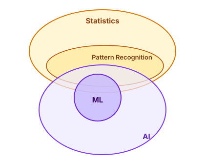

- **Machine learning (ML)** is a field of computer science that uses statistical techniques to give computer systems the ability to "learn" (i.e. progressively improve performance on a specific task) with data, without being explicitly programmed.
- The name "Machine Learning" was coined by **Arthur Samuel**.

### Traditional Programming vs Machine Learning

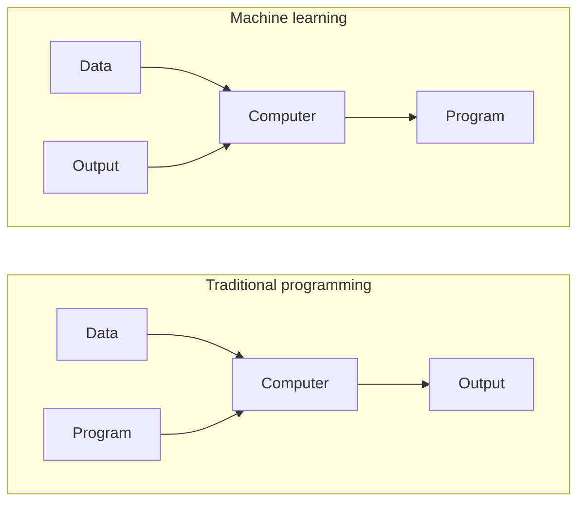

### Types of Machine Learning

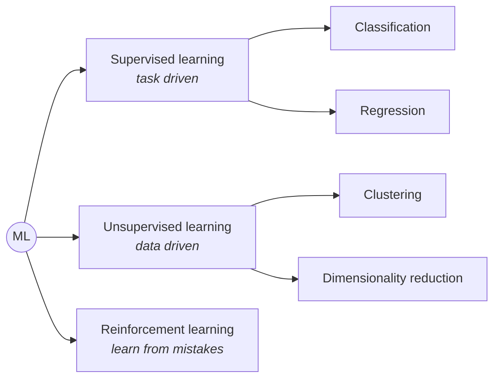

- **Terminology.** Data records = examples / instances / cases / samples / observations. Their attributes = variables / features / measurements / dimensions.
- **Goal.** Learn a classification / regression model $f$ from the data $\{(x_1, y_1), (x_2, y_2), \dots\}$, where each $x_i = (x_{i1}, x_{i2}, x_{i3}, \dots)$, by minimising the prediction error / loss function on the training set; then apply $f$ to a never-seen example $x$ and output the predicted value $y = f(x)$.
- **Classifiers:** KNN, SVM, decision tree, neural network, naïve Bayes, Bayesian network, logistic regression, random forest, deep learning networks, etc.
- **No Free Lunch theorem** in statistics — David Wolpert: no single model works best for every problem.

### K-Nearest Neighbours (KNN)

KNN labels a test point $x$ with the class that has the majority of representatives among the neighbours of $x$.

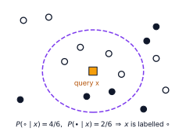

*Example:* of the 6 neighbours of the query point, 4 are ○ and 2 are ●, so
$$P(\circ \mid x) = \tfrac{4}{6}, \qquad P(\bullet \mid x) = \tfrac{2}{6} \;\Rightarrow\; x \text{ is labelled } \circ.$$

### Decision Trees

A decision tree is not unique. We want a smaller and accurate tree. Finding the best tree is **NP-hard**, so all current tree-building algorithms are heuristic algorithms.

### Regression

Regression fits a **line of regression** through the data points: the dependent variable $Y$ is predicted from the independent variable(s) $X$.

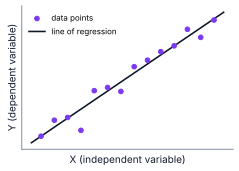

**Types of regression:** linear, polynomial, SVM (support vector regression), decision tree, random forest, ridge, lasso and logistic regression.

**Logistic regression** fits an S-curve: the predicted $y$ lies within the range 0 to 1 (between the asymptotes $y = 0$ and $y = 1$).

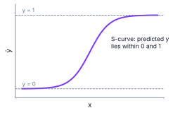

### Reinforcement Learning

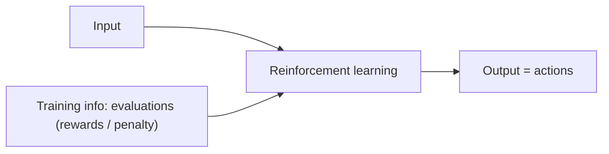

### Deep Learning

**Deep learning** is the learning of representations in data. If you provide the system tons of information, it begins to understand it and respond in useful ways.

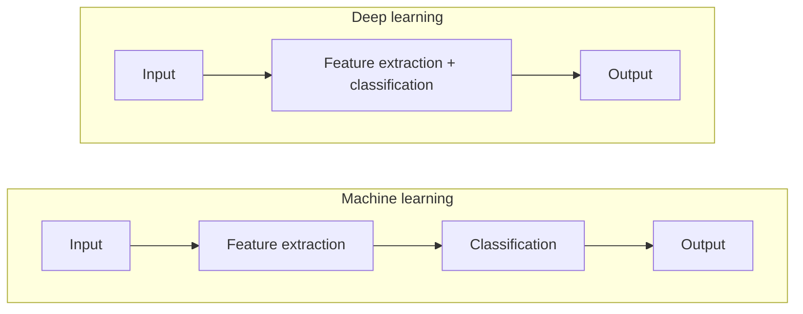

**Two kinds of deep-learning inference models:**

- **Discriminative models** model $P(y \mid x)$ directly — e.g. regression, SVMs.
- **Generative models** estimate $P(x \mid y)$ and then find $P(y \mid x)$ — e.g. GANs, naïve Bayes.

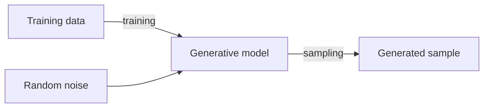

## Linear Algebra & Matrix Calculus
<!-- pages: 5-7 -->

### Vectors, Matrices and Norms

- A **vector** in $\mathbb{R}^n$ is an ordered set of $n$ real numbers.
- An $m \times n$ **matrix** is an object in $\mathbb{R}^{m \times n}$ with $m$ rows and $n$ columns.
- **Trace:** $\operatorname{tr}(A) = A_{11} + A_{22} + \dots$
- **Transpose rules:** $(A^T)^T = A$; $\;(A+B)^T = A^T + B^T$; $\;(rA)^T = rA^T$; $\;(AB)^T = B^T A^T$.
- **Norms** quantify the "size" of a vector (the length of a vector). Given $x \in \mathbb{R}^n$:
  $\|cx\| = |c|\,\|x\|$, $\;\|x\| = 0 \iff x = 0$, and $\|x + y\| \le \|x\| + \|y\|$ (triangle inequality).

| Norm | Definition |
| --- | --- |
| Euclidean $L_2$-norm | $\|x\|_2 = \sqrt{x_1^2 + x_2^2 + \dots + x_n^2}$ |
| $L_1$-norm (Manhattan distance) | $\|x\|_1 = \lvert x_1\rvert + \lvert x_2\rvert + \dots + \lvert x_n\rvert$ |
| $L_\infty$-norm (uniform norm) | $\|x\|_\infty = \max_i \lvert x_i\rvert$, e.g. $\|(1, -1, 5)\|_\infty = 5$ |

Norms can also be defined for matrices, e.g. the **Frobenius norm**
$$\|A\|_F = \sqrt{\sum_{i=1}^{m}\sum_{j=1}^{n} A_{ij}^2} = \sqrt{\operatorname{tr}(A^T A)}.$$

- **Dot product:** $\vec{A}\cdot\vec{B} = |\vec{A}|\,|\vec{B}|\cos\theta$ and $x^T y = \sum_{i=1}^{n} x_i y_i$.
- The vector **outer product** has rank one: $\operatorname{rank}(x y^T) = 1$.
- If $u \cdot v = 0$ with $\|u\|_2 \ne 0$ and $\|v\|_2 \ne 0$, then $u$ and $v$ are **orthogonal**; if $u \cdot v = 0$ with $\|u\|_2 = 1$ and $\|v\|_2 = 1$, they are **orthonormal**.
- **Orthogonal matrix:** $U \in \mathbb{R}^{m \times m}$ is orthogonal iff $U^T U = U U^T = I$. Each row / column of an orthogonal matrix is an orthonormal vector.

### Matrices as Transformations; Eigenvectors

- When we compute $y = Ax$, the matrix $A$ maps the vector $x$ into its **column space**: if $x$ is not in the plane spanned by the columns $a_1, a_2$, then $A$ rotates $x$ and brings it into that plane.
- There are certain vectors that a matrix cannot rotate — it can only stretch them. These are the **eigenvectors**; eigenvectors are *rotationally invariant*:
$$A x_e = y = \lambda x_e.$$

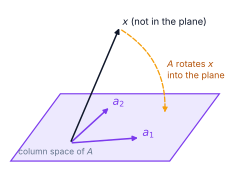

### The Regression Problem as Least Squares

We need $m$ and $c$ to find the best-fit line $y = mx + c$. Suppose 3 points lie on this line; then
$$\begin{aligned} m x_1 + c &= y_1 \\ m x_2 + c &= y_2 \\ m x_3 + c &= y_3 \end{aligned}
\quad\Longrightarrow\quad
\underbrace{\begin{bmatrix} x_1 & 1 \\ x_2 & 1 \\ x_3 & 1 \end{bmatrix}}_{A}
\underbrace{\begin{bmatrix} m \\ c \end{bmatrix}}_{z}
= \underbrace{\begin{bmatrix} y_1 \\ y_2 \\ y_3 \end{bmatrix}}_{b},
\qquad Az = b.$$

This is an **overdetermined system**. Since the system is not fully solvable, $b$ is not in the column space of $A$.

But we can find a relaxed / approximate version of the problem: project $\vec{b}$ onto the column space of $A$, say $\hat{b}$, so that $A z^* = \hat{b}$ and the error $e = b - \hat{b}$ is orthogonal to the columns:
$$A^T e = \vec{0} \;\Rightarrow\; A^T(b - \hat{b}) = 0 \;\Rightarrow\; A^T b = A^T \hat{b} = A^T A z^*$$
$$\boxed{z^* = (A^T A)^{-1} A^T b}$$

**Projection matrix:** $Pb = \hat{b} = A z^* = A(A^T A)^{-1} A^T b$, so
$$\boxed{P = A(A^T A)^{-1} A^T}, \qquad P^2 = P.$$

**Ordinary least squares (OLS)** minimises $\|b - Az\|_2^2 = \sum_i (y_i - \hat{y}_i)^2$.

### Definiteness, Subspaces and Rank

- $A \in \mathbb{R}^{m \times m}$ is **positive semidefinite** iff $x^T A x \ge 0 \;\; \forall x \in \mathbb{R}^m$, and **positive definite** if $x^T A x > 0$. If $A$ is positive definite then all its eigenvalues are positive.
- A **subspace** $V \subseteq \mathbb{R}^n$ satisfies $0 \in V$, and if $x, y \in V$ and $c \in \mathbb{R}$ then $c(x + y) \in V$.
- Vectors $x_1, x_2, \dots, x_m$ **span** $V$ if $V = \{\sum_i \alpha_i x_i \mid \alpha \in \mathbb{R}^m\}$.
- **Four fundamental subspaces** of a matrix $M$: column space $\operatorname{Col}(M)$, row space, null space $\operatorname{Null}(M)$ and left null space.
  $\operatorname{Null}(M) \perp \operatorname{Row}(M)$, and $\underbrace{\dim \operatorname{Null}(M)}_{\text{nullity}} + \underbrace{\dim \operatorname{Row}(M)}_{\text{rank}} = n$.
- $\operatorname{rank}(M)$ = dimensionality of the row / column spaces.
- **Rank factorisation:** if $\operatorname{rank}(M) = k$ for $M \in \mathbb{R}^{m \times n}$, then $M = \underbrace{C}_{m \times k}\,\underbrace{R}_{k \times n}$ — used in recommender systems.

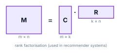

### Inverses, Eigen-Decomposition and SVD

- $M^{-1}M = MM^{-1} = I$; $\;(M^{-1})^{-1} = M$; $\;(M^T)^{-1} = (M^{-1})^T$; $\;(MA)^{-1} = A^{-1}M^{-1}$.
- $Mx = y$ has a solution if $y \in \operatorname{Col}(M)$ — possibly infinitely many solutions.
- The term *eigenvalue* comes from the German word **Eigenwert** ("proper value").
- **Eigen-decomposition:** $A = V \Sigma V^{-1}$, where $V$ is the matrix of eigenvectors of $A$. It exists if the eigenvectors are linearly independent.
- If $M$ is **real symmetric**, then $Q$ is orthogonal and $A = Q \Sigma Q^T$, with $QQ^T = I \Rightarrow Q^{-1} = Q^T$.
- If $A \in \mathbb{R}^{m \times n}$ is not a square matrix, we use the **SVD**: $A = U \Sigma V^T$.

### Matrix Calculus

For $f : \mathbb{R}^n \to \mathbb{R}$, e.g. $f(x) = x_1^2 + x_2^2$, the **gradient** is
$$\nabla f = \begin{bmatrix} \partial f / \partial x_1 \\ \partial f / \partial x_2 \\ \vdots \end{bmatrix}.$$

- **Level curves** are curves for which $f(x)$ is constant, e.g. $x_1^2 + x_2^2 = k$ (concentric circles). Contour maps are constant-function curves.

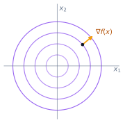
- The gradient is always **normal to the level curve**, and it points in the direction in which the function is increasing fastest.
- Useful identities: $\nabla(x^T a) = a$ and $\nabla(x^T A x) = Ax + A^T x$.
- **First-order optimality condition:** $f'(x^*) = 0$. In a multidimensional system the gradient should vanish, $\nabla f(x^*) = 0$, where $x^*$ is a critical point (local minimum, local maximum or saddle point).
- **Second-order optimality** uses the **Hessian matrix**
$$\nabla^2 f(x_1, x_2) = \begin{bmatrix} \dfrac{\partial^2 f}{\partial x_1^2} & \dfrac{\partial^2 f}{\partial x_1 \partial x_2} \\[2mm] \dfrac{\partial^2 f}{\partial x_2 \partial x_1} & \dfrac{\partial^2 f}{\partial x_2^2} \end{bmatrix}.$$

## Optimisation & Support Vector Machines
<!-- pages: 8-9 -->

### Optimisation

- Optimisation is all about **minimisation / maximisation** (largely unsolved in general).
- Most real-world problems are **non-convex** in nature.
- When there are multiple local minima and local maxima, the functions are called **multimodal functions**.
- If there is only one minimum, such functions are called **convex functions**.
- If the Hessian $H \succ 0$, then $x^*$ is a minimum; if $H \prec 0$, then $x^*$ is a maximum.
- **Convex function.** For $x_3 = \theta x_1 + (1-\theta)x_2$ with $0 \le \theta \le 1$, $f$ is convex if
$$\theta f(x_1) + (1-\theta) f(x_2) \ge f\big(\theta x_1 + (1-\theta)x_2\big) \qquad \forall \theta \in [0,1],\; \forall x_1, x_2 \in \operatorname{dom} f.$$
  In deep learning, most objective functions are non-convex.

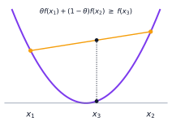
- A **convex set** contains the line segment between any 2 points in the set: $x_1, x_2 \in C,\; 0 \le \theta \le 1 \Rightarrow \theta x_1 + (1-\theta)x_2 \in C$.
  - The intersection of convex sets is convex.
  - If $f$ is convex then $-f$ is concave, and vice versa.
  - $e^x$, $-\log x$ and $x \log x$ are convex.

### Steepest Descent and Newton's Method

**Steepest descent:** $x^{k+1} = x^k \pm \alpha^k \nabla f(x^k)$, where $k$ is the iteration.

- The gradient is the rate of change of the function at a point. Using the gradient as the search direction helps reduce the number of iterations needed.
- **Convergence:** stop when $\lvert f(x^{k+1}) - f(x^k)\rvert < \varepsilon_1$ (tolerance).
- **Procedure:** initialise $x^0 = [0, 0, 0]^T$ → find $\nabla f(x^0)$ → write $x^1 = x^0 \pm \alpha^0 \nabla f(x^0)$ (a function of $\alpha^0$) → find $f(x^1)$ → set $\dfrac{d f(x^1)}{d\alpha^0} = 0$ to get $\alpha^0$ and hence $x^1$ → repeat.
- A **quadratic function** has the form $x^T A x$.
- **Newton's method** for optimisation uses
$$x^{k+1} = x^k - \big[\nabla^2 f(x^k)\big]^{-1} \nabla f(x^k),$$
  i.e. the step size is the inverse Hessian. It reduces the number of iterations but increases computation.

### Constrained Optimisation and KKT

**Problem:** $\min f(x)$ subject to $h(x) = c$, $g(x) \ge b$ and $x \in S$. If $f(x)$ is a convex function and $S$ is a convex set, it is called a **convex programming problem** — a locally optimal solution is globally optimal.

With a Lagrange multiplier, at the optimum $\nabla f = \lambda \nabla g$:
$$\nabla\big[f(x,y) - \lambda g(x,y)\big] = 0 \;\Rightarrow\; \nabla L(x, y, \lambda) = 0 \;\Rightarrow\; \frac{\partial L}{\partial x} = 0,\; \frac{\partial L}{\partial y} = 0,\; \frac{\partial L}{\partial \lambda} = 0$$
— the **optimality conditions (KKT)**.

### Support Vector Machines (SVM)

- SVMs are also called **strong learners**; invented by **V. Vapnik** in Russia in the 1970s.
- They are **linear classifiers** that find a hyperplane to separate 2 classes of data (+ve and −ve).
- **Kernel functions** are used for non-linear separation.
- The problem is a **convex optimisation** and is guaranteed to be solvable.

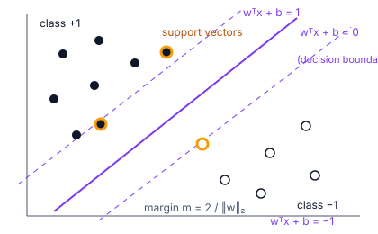

- The **margin** of a linear classifier is the width by which the boundary could be increased before hitting a data point.
- The **maximum-margin classifier** is the one with the maximum margin. A thick margin is preferred — for a thin margin the chance of error is high.
- **Support vectors** are the data points that the margin pushes up against.
- We should **maximise the margin**:
$$m = \frac{2}{\|w\|_2} \qquad \left(\because\; \frac{\lvert (b - 1) - (b + 1)\rvert}{\|w\|_2} = \frac{2}{\|w\|_2}\right).$$
- For class 1, $w^T x_i + b \ge 1$ and $y_i = 1$; for class 2, $w^T x_i + b \le -1$ and $y_i = -1$.
- Maximising $\frac{2}{\|w\|_2}$ is the same as minimising the convex function $\frac{1}{2}\|w\|_2^2$. So the problem is
$$\min_{w, b}\; \frac{1}{2}\|w\|^2 = \frac{1}{2} w^T w \quad \text{such that} \quad y_i(w^T x_i + b) \ge 1.$$
- Using **Lagrangian multipliers**:
$$L(w, b, \lambda) = \frac{1}{2} w^T w - \sum_{i=1}^{n} \lambda_i \big(y_i(w^T x_i + b) - 1\big),$$
  where e.g. $w^T x = [w_1, w_2]\begin{bmatrix} x_1 \\ x_2 \end{bmatrix}$.
- **Primal SVM problem:** $\min_{w, b} \max_{\lambda} L(w, b, \lambda)$; $\lambda = \alpha$ (Lagrange multiplier) $\ne 0$ only for support vectors.
- SVM follows the **strong duality** relation ($d^* = p^*$, primal = dual); under weak duality $d < p$. Strong duality holds for convex optimisation problems with constraints.
- **Wolfe dual problem:**
$$\max_{\alpha}\; \sum_{i=1}^{m} \alpha_i - \frac{1}{2}\sum_{i=1}^{m}\sum_{j=1}^{m} \alpha_i \alpha_j y_i y_j x_i^T x_j \quad \text{such that} \quad \alpha_i \ge 0 \text{ and } \sum_{i=1}^{m} \alpha_i y_i = 0.$$
  It depends only on $\alpha$ (the Lagrange multipliers). Then $w = \sum_i \alpha_i y_i x_i$ and $b = y_i - w^T x_i$ — so we get the hyperplane.
- **Hard-margin SVM** → linearly separable data; **soft-margin SVM** → non-linearly-separable data.

## Kernel SVMs, Multi-class Classification, KNN & Decision Trees
<!-- pages: 10-12 -->

### Non-linearly Separable Problems (Soft Margin)

- We allow an "error" $\xi_i$ in classification, based on the output of the discriminant function $w^T x + b$. $\sum_i \xi_i$ approximates the number of misclassified points.
- **New objective function:**
$$\frac{1}{2}\|w\|^2 + C \sum_{i=1}^{n} \xi_i \quad \text{s.t.} \quad y_i(w^T x_i + b) \ge 1 - \xi_i \;\text{ and }\; \xi_i \ge 0,$$
  where the $\xi_i$ are **slack variables** and $C$ is the trade-off hyperparameter between error and margin (the **regularisation parameter**): a large $C$ means a high penalty for errors.
- **Wolfe dual problem:**
$$\max_{\alpha}\; W(\alpha) = \sum_i \alpha_i - \frac{1}{2}\sum_{i,j} \alpha_i \alpha_j y_i y_j\, x_i \cdot x_j \quad \text{s.t.} \quad C \ge \alpha_i \ge 0,\;\; \sum_i \alpha_i y_i = 0.$$

### Non-linear SVMs (Kernel Machines)

- *Example:* the XOR problem can't be solved by a linear SVM.
- **Idea:** the original input space can be mapped to some higher-dimensional feature space $\phi(x)$ where the data is separable. $N$ data points are always separable in $N-1$ or more dimensions.
- Computation is higher when transforming from a low dimension to a higher one — the **kernel trick** solves this issue.
- Replace $x_i \cdot x_j$ by the **kernel function** $K(x_i, x_j) = \phi(x_i) \cdot \phi(x_j)$: it finds the dot product in the higher dimension without needing $\phi$ explicitly. *Example:* $K(x, y) = (1 + x_1 y_1 + x_2 y_2)^2$.
- **Mercer's theorem:** every positive-semidefinite symmetric function is a kernel, $K(x_i, x_j) = K(x_j, x_i)\;\forall i, j$.
- The **Gram matrix** $K = \big[K(x_i, x_j)\big]_{i,j}$ (entries $K(x_1,x_1), K(x_1,x_2), K(x_2,x_1), \dots$) is positive semidefinite and symmetric.

| Kernel | Formula |
| --- | --- |
| Polynomial | $K(x, y) = (x^T y + 1)^d$, $d$ = degree |
| RBF (Gaussian) | $K(x, y) = \exp\!\big(-\|x - y\|^2 / 2\sigma^2\big)$, $\sigma$ = width |
| Sigmoid | $K(x, y) = \tanh(\kappa\, x^T y + \theta)$ |

### Multi-class Classification

- **One-against-all** or **one-against-one** — the latter trains $K(K-1)/2$ classifiers ($K$ = number of classes) and uses **majority voting** in classification.

### KNN vs SVM

- KNN does not build a model from the training data. It is a **non-parametric** and **weak learner**.
- SVM is a **strong learner** because once the decision boundary is fixed, we are done.
- A decision tree is also a weak learner.

> **Note.** The notebook writes "parametric" for KNN; KNN is a non-parametric method (it stores the training data rather than fitting parameters).

### Decision Tree Classifiers

- A **greedy divide-and-conquer** algorithm: the tree is constructed in a top-down, recursive manner.
- Attributes are selected on the basis of an **impurity function** (e.g. information gain).
- The objective is to reduce impurity (mixing of class labels) or uncertainty in the data as much as possible.
- A subset of data is **pure** if all instances belong to the same class.

## Entropy, Overfitting & the Bias–Variance Trade-off
<!-- pages: 13 -->

### Entropy and Information Gain

- Attributes are chosen based on the **maximum information gain / gain ratio** (based on information theory).
- **Entropy** is a measure of randomness — an **impurity measure**:
$$\operatorname{entropy}(D) = -\sum_{j=1}^{|C|} \Pr(c_j)\,\log_2 \Pr(c_j), \qquad \sum_{j=1}^{|C|} \Pr(c_j) = 1,$$
  where $\Pr(c_j)$ is the probability of class $c_j$ in data set $D$.
- 100 % +ve and 0 % −ve has entropy = 0; 50 % +ve and 50 % −ve has entropy = 1. As data becomes purer and purer, entropy becomes smaller and smaller.
- **Information gain:**
$$\operatorname{gain}(D, A_i) = \operatorname{entropy}(D) - \operatorname{entropy}_{A_i}(D), \qquad \operatorname{entropy}_{A_i}(D) = \underbrace{\sum_{j=1}^{v} \frac{|D_j|}{|D|}\, \operatorname{entropy}(D_j)}_{\text{weighted average}}.$$
- **Continuous attributes** are handled by splitting into 2 intervals (can be more) at each node. We can use the mean value or information gain to find the best threshold.

### Overfitting, Bias and Variance

- **Overfitting** = good accuracy on training data but poor accuracy on test data. No classifier is free from overfitting.
- A **complex model** has low bias and high variance; a **simple model** has high bias and low variance.
- **Bias** — high training and test error. It is the difference between the average prediction of our model and the correct value we are trying to predict.
- **Variance** is the variability of the model prediction for a given data point — a value which tells us the spread of the data.

$$\text{(Test) Error} = \text{Bias}^2 + \text{Variance} + \text{Irreducible error } (\varepsilon)$$
$$\text{Bias} = \mathbb{E}[\hat f(x)] - f(x), \qquad \text{Variance} = \mathbb{E}\Big[\big(\hat f(x) - \mathbb{E}[\hat f(x)]\big)^2\Big]$$

### Ensembles

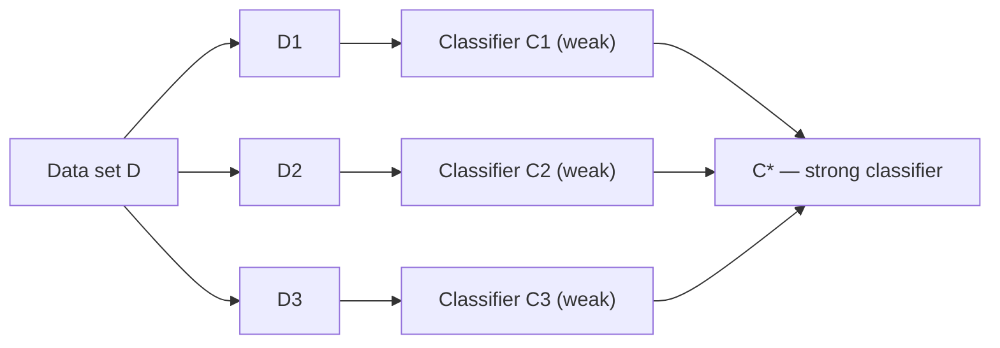

The ensemble makes a wrong prediction only if the majority of the classifiers make a wrong prediction.

## Ensembles: Bagging, Random Forests, Boosting & Stacking
<!-- pages: 14-16 -->

### Prediction Error vs Model Complexity

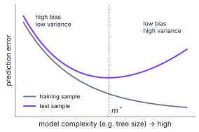

Left of the optimum $m^*$: **high bias, low variance**. Right of it: **low bias, high variance** — the test error rises again.

### Bagging (Bootstrap Aggregation)

- Bagging averages a given procedure over many samples to **reduce its variance**.
- We use **sampling with replacement**. *Example:*

| | | | | | | | | | | |
| --- | --- | --- | --- | --- | --- | --- | --- | --- | --- | --- |
| Original data | 1 | 2 | 3 | 4 | 5 | 6 | 7 | 8 | 9 | 10 |
| Bagging (round 1) | 7 | 8 | 10 | 8 | 2 | 5 | 10 | 10 | 5 | 9 |
| Bagging (round 2) | 1 | 4 | 9 | 1 | 2 | 3 | 2 | 7 | 3 | 2 |
| Bagging (round 3) | 1 | 8 | 5 | 10 | 5 | 5 | 9 | 6 | 3 | … |

- For each set, the probability that a given example appears in it is
$$\Pr(x \in D_i) = 1 - \left(1 - \frac{1}{n}\right)^n \approx 63\%,$$
  i.e. fewer than $\frac{2}{3}$ of the examples appear in one bootstrap sample.

### Random Forest Classifiers

- An extension of bagging which uses **de-correlated trees**.
- We construct a decision tree on each bootstrapped sample by taking about $\sqrt{p}$ features, and then take the **majority vote**.

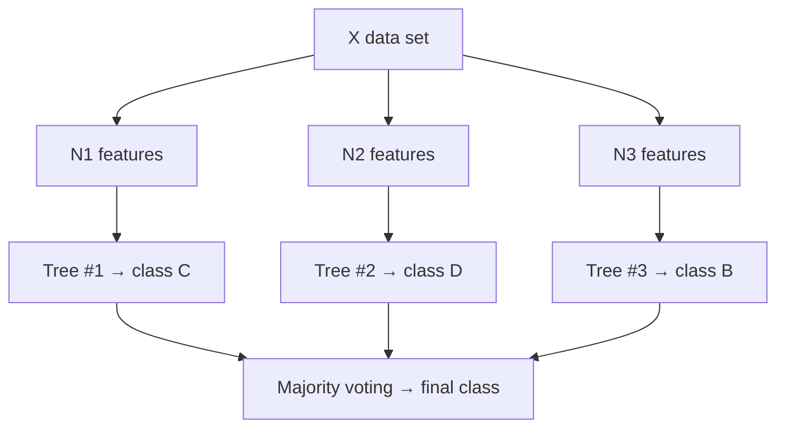

### Boosting

- Also works by manipulating the training set, but the classifiers are **trained sequentially**.
- Each classifier is trained given knowledge of the performance of the previously trained classifiers — it **focuses on hard examples**.
- **Final classifier:** a weighted sum of the component classifiers.
- In a random forest the training examples are not given weights, but in boosting weights are provided.
- Boosting **makes a weak learner stronger**.
- Suppose we have a binary classification problem $\{x_i, y_i\}$ with $y_i \in \{+1, -1\}$, and we have to make a "dream team" of classifiers $k_i(x_i) \in \{-1, +1\}$. With 11 classifiers,
$$C(x_i) = \alpha_1 k_1(x_i) + \alpha_2 k_2(x_i) + \dots + \alpha_{11} k_{11}(x_i), \qquad \hat y_i = \operatorname{sign}\big(C(x_i)\big).$$
- *Example:* **AdaBoost (Adaptive Boosting)** gives more importance to the classifiers that handle the misclassified points. Initially all data points have equal weights, and after each iteration the weight of each data point is changed.

**Boosting has 3 parts:** ① scouting, ② drafting, ③ weight update.

1. **Scouting.** If a classifier is successful, assign cost $e^{-\beta}$ ($\beta > 0$); if it fails, assign cost $e^{\beta}$. With $L$ classifiers, the scouting matrix (rows $x_1 \dots x_N$, columns $1 \dots L$) holds 0 for a success and 1 for a failure, and is updated each time.
2. **Drafting.** At iteration $m-1$: $C_{m-1}(x_i) = \alpha_1 k_1(x_i) + \alpha_2 k_2(x_i) + \dots + \alpha_{m-1} k_{m-1}(x_i)$; at iteration $m$: $C_m(x_i) = C_{m-1}(x_i) + \alpha_m k_m(x_i)$. The **exponential loss** of the total classifier is
$$E = \sum_{i=1}^{N} e^{-y_i\, C_m(x_i)}, \qquad y_i \in \{-1, +1\}.$$
3. **Weighting.** Determine the proper weight $\alpha_m$ by minimising $E$ as a function of $\alpha_m$, i.e. $\dfrac{dE}{d\alpha_m} = 0$.

### Stacking

Learn a function that combines the predictions of the individual classifiers: the predictions of $C_1, C_2, \dots, C_n$ become the **feature vector for a meta-classifier** (which may be a decision tree).

| Attributes | $C_1$ | $C_2$ | … | $C_n$ | Class |
| --- | --- | --- | --- | --- | --- |
| $x_{11}, x_{12}, \dots, x_{1m}$ | t | t | … | | t |
| $x_{21}, \dots$ | f | t | … | | t |

## Dimensionality Reduction & PCA
<!-- pages: 16-17 -->

### Principal Component Analysis (PCA)

- Given a large number of features $d$, we want to end up with a smaller number of features $p$, $p \ll d$.
- The reduced set of features should keep as much information as possible from the original set of features.
- If the features are correlated, we should extract a set of **uncorrelated features**. The 1st principal component points along the direction of greatest spread of the data; the 2nd principal component is orthogonal to it.

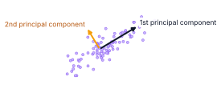

### Derivation of PCA

Let the centre of mass be $m = \frac{1}{n}\sum_{k=1}^{n} x_k$, and define a squared loss function $J_0(x_0) = \sum_{k=1}^{n} \|x_0 - x_k\|^2$.

Represent each point by its projection on a line through $m$ with unit direction $e$: $\hat{x}_k = m + \alpha_k e$. The **projection error** for a single point $x_k$,
$$d = \|x_k - \hat{x}_k\|_2^2 = \|(m + \alpha_k e) - x_k\|_2^2,$$
should be minimised.

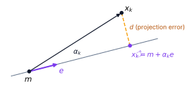

For a set of multivariate points:
$$\begin{aligned}
J_1(\alpha_1, \dots, \alpha_n, e) &= \sum_{k=1}^{n} \|m + \alpha_k e - x_k\|^2 = \sum_{k=1}^{n} \|\alpha_k e - (x_k - m)\|^2 \\
&= \sum_{k=1}^{n} \alpha_k^2 \|e\|^2 - 2\sum_{k=1}^{n} \alpha_k e^T (x_k - m) + \sum_{k=1}^{n} \|x_k - m\|^2 .
\end{aligned}$$

Now let $\|e\| = 1$. Differentiating with respect to $\alpha_k$ and setting it to zero gives
$$\boxed{\alpha_k = e^T (x_k - m)}.$$

Define the **scatter matrix** $S = \sum_{k=1}^{n} (x_k - m)(x_k - m)^T$. Then
$$\begin{aligned}
J_1(e) &= \sum_k \alpha_k^2 - 2\sum_k \alpha_k^2 + \sum_k \|x_k - m\|^2 = -\sum_{k=1}^{n} \big(e^T (x_k - m)\big)^2 + \sum_{k=1}^{n} \|x_k - m\|^2 \\
&= -\sum_{k=1}^{n} e^T (x_k - m)(x_k - m)^T e + \sum_{k=1}^{n} \|x_k - m\|^2 = -e^T S e + \text{const (w.r.t. } e \text{ and } \alpha).
\end{aligned}$$

So minimising $J_1(e)$ means **maximising $e^T S e$ such that $\|e\| = 1$** ($e^T e = 1$). With a Lagrange multiplier:
$$u = e^T S e - \lambda(e^T e - 1), \qquad \frac{\partial u}{\partial e} = 0 \;\Rightarrow\; S e = \lambda e,$$
$$e^T S e = e^T \lambda e = \lambda\, e^T e = \lambda \quad (\text{so maximising } e^T S e \text{ is the same as maximising } \lambda).$$

- So we **project along the eigenvector corresponding to the largest eigenvalue** of the matrix $S$.
- The scatter matrix is $S = XX^T$ ($X$ = the centred data-set matrix): find its eigenvalues and eigenvectors to get the principal components.

### Practical Notes on PCA

- Image pixels are the lowest-level features. A $100 \times 100$ image has 10,000 dimensions → slow and lots of storage → **dimensionality reduction**.
- $XX^T$ and $X^TX$ have the **same eigenvalues**. *Proof:* $XX^T y = \lambda y \Rightarrow X^T(XX^T y) = \lambda X^T y \Rightarrow (X^TX)(X^T y) = \lambda (X^T y)$, where $X^T y$ is a vector. So instead of calculating $XX^T$, we calculate $X^TX$ (the smaller matrix).
- Preserving variance (minimising MSE) does not necessarily lead to a qualitatively good reconstruction.
- The direction of maximum variance is not always good for classification → a more discriminative subspace: **FLD (Fisher Linear Discriminant)** — "Fisherfaces".

## Fisher Linear Discriminant (FLD)
<!-- pages: 18-20 -->

- Fisher Linear Discriminants → "Fisherfaces".
- **PCA preserves maximum variance** and **FLD preserves discrimination**.
- FLD finds the projection that **maximises the scatter between classes** and **minimises the scatter within classes**.
- PCA finds the most accurate *data representation* in a lower-dimensional space and projects the data in the directions of maximum variance. However, the directions of maximum variance may be useless for classification: two classes that are separable in 2-D can overlap completely after the PCA projection (non-separable).

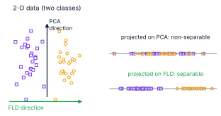
- FLD projects the data to a line which preserves the direction useful for data classification.

### Projection onto a Line

Consider projection on a line whose direction is given by a unit vector $v$. The scalar $v^T x_i$ is the distance of the projection of $x_i$ from the origin; thus $v^T x_i$ is the projection of $x_i$ into a 1-D subspace.

Let $\tilde\mu_1, \tilde\mu_2$ be the means of the projections of classes 1 and 2, and $\mu_1, \mu_2$ the means of classes 1 and 2. The separation between the projections of the different classes is
$$|\tilde\mu_1 - \tilde\mu_2| = \left|\frac{1}{n_1}\sum_{x_i \in C_1} v^T x_i - \frac{1}{n_2}\sum_{x_i \in C_2} v^T x_i\right| = \lvert v^T\mu_1 - v^T\mu_2\rvert.$$

The problem with $|\tilde\mu_1 - \tilde\mu_2|$ is that it does **not consider the variance of the classes**.

### Normalising by the Scatter
<!-- pages: 21 -->

So we need to normalise $|\tilde\mu_1 - \tilde\mu_2|$ by a factor which is proportional to the variance.

- **Scatter:** $s = \sum_{i=1}^{n} (z_i - \mu_z)^2$. Scatter is just the sample variance multiplied by $n$: it measures the same thing as variance (the spread of data around the mean), only on a different scale.
- Let $y_i = v^T x_i$ (the projections). Then
$$\tilde s_1^2 = \sum_{y_i \in C_1} (y_i - \tilde\mu_1)^2, \qquad \tilde s_2^2 = \sum_{y_i \in C_2} (y_i - \tilde\mu_2)^2.$$
- After normalisation, maximise
$$J(v) = \frac{(\tilde\mu_1 - \tilde\mu_2)^2}{\tilde s_1^2 + \tilde s_2^2} \qquad \text{(numerator maximised, denominator minimised).}$$

**Within-class scatter matrix:**
$$S_W = S_1 + S_2 = \underbrace{\sum_{x_i \in C_1} (x_i - \mu_1)(x_i - \mu_1)^T}_{S_1} + \underbrace{\sum_{x_i \in C_2} (x_i - \mu_2)(x_i - \mu_2)^T}_{S_2}.$$
Then $\tilde s_1^2 = \sum_{y_i \in C_1} (v^T x_i - v^T \mu_1)^2 = v^T S_1 v$ and $\tilde s_2^2 = v^T S_2 v$, so
$$\boxed{\tilde s_1^2 + \tilde s_2^2 = v^T (S_1 + S_2) v = v^T S_W v}.$$

**Between-class scatter matrix:** $S_B = (\mu_1 - \mu_2)(\mu_1 - \mu_2)^T$, and
$$(\tilde\mu_1 - \tilde\mu_2)^2 = (v^T\mu_1 - v^T\mu_2)^2 = v^T(\mu_1 - \mu_2)(\mu_1 - \mu_2)^T v \;\Rightarrow\; \boxed{(\tilde\mu_1 - \tilde\mu_2)^2 = v^T S_B v}.$$

So
$$J(v) = \frac{v^T S_B v}{v^T S_W v}, \qquad \frac{d}{dv} J(v) = 0 \;\Rightarrow\; \underbrace{S_B v = \lambda S_W v}_{\text{generalised eigenvalue problem}}, \qquad \lambda = \frac{v^T S_B v}{v^T S_W v}.$$
$$\boxed{S_W^{-1} S_B v = \lambda v} \quad (S_W^{-1} \text{ must exist, i.e. } S_W \text{ is full rank}); \qquad J(v) = 0 \text{ if } \mu_1 = \mu_2.$$

- Useful fact: $\operatorname{rank}(AB) \le \min\big(\operatorname{rank}(A), \operatorname{rank}(B)\big)$.

## Clustering: Distance Measures, Hierarchical & K-Means
<!-- pages: 21-22 -->

- Clustering is a big unsolved problem.
- The objective is to detect meaningful groups (insights) in data: **intra-cluster distances should be minimised** and **inter-cluster distances maximised**.

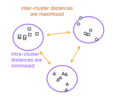

### Distance Measures

| Measure | Definition |
| --- | --- |
| Euclidean distance (dissimilarity) — $L_2$ norm | $\|x - y\|_2$ |
| $L_1$ norm (Manhattan distance) | $\|x - y\|_1$ |
| $p$-norm ($p$ can be a fraction) | $\left(\sum_{d=1}^{D} \lvert x_d - y_d\rvert^p\right)^{1/p}$ |
| Cosine similarity | $d_{\cos}(x, y) = \dfrac{x^T y}{\|x\|\,\|y\|}$ — $\cos\theta$ increases as similarity increases |

### Types of Clustering

1. **Partitional algorithms.**
2. **Hierarchical algorithms** — e.g. the **dendrogram** (a tree-like structure). There is no need to specify the number of clusters, and it can also be used for outlier detection (a single isolated branch). The similarity between 2 objects in a dendrogram is represented as the height of the lowest internal node they share.

   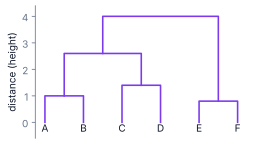
   - **Top-down (divisive):** start with all data in a single cluster, consider every possible way to divide the cluster into two, choose the best division and recurse.
   - **Bottom-up (agglomerative):** start with each item in its own cluster, find the best pair to merge into a new cluster, and repeat until all clusters are fused together.

**Distance between 2 clusters:**

1. **Single linkage (nearest neighbour)** — the distance of the 2 closest objects in different clusters.
2. **Complete linkage (furthest neighbour)** — the greatest distance between 2 objects.
3. **Group-average linkage** — the average distance between all pairs of objects in the 2 different clusters.

### Partitioning Clustering and K-Means

- Each instance is placed in exactly one of $K$ non-overlapping clusters; the number of clusters is specified in advance.
- **K-means clustering** is a partitioning problem, and it can be solved by **Lloyd's heuristic**.
- Hierarchical clustering algorithms typically have local objectives; partitional algorithms typically have global objectives.
- **Cluster membership matrix** $U$: $u_{qj} = 1$ if point $x_j$ is in cluster $c_q$, else 0 (e.g. rows $c_1, c_2, c_3$; columns $x_1, x_2, \dots$). $U^T U$ gives the cardinality of the clusters.
- **Objective function** (to minimise, with $Z$ the set of centroids):
$$J_{k\text{-means}}(Z, U) = \sum_{q=1}^{K} \sum_{j=1}^{n} u_{qj}\, \|x_j - z_q\|_2^2, \qquad z_q = \frac{1}{n_q}\sum_{x_i \in c_q} x_i \;\;\left(\text{from } \frac{\partial J}{\partial z} = 0\right).$$
- It needs a local-minimisation heuristic (Lloyd's heuristic):

**Algorithm (Lloyd):**

1. Start with random cluster centroids.
2. Assign each $x_i$ to the cluster whose centroid is nearest.
3. Recompute the cluster centroids $z_q = \frac{1}{n_q}\sum x_i$.
4. Repeat from step 2 until $\|Z^{(t+1)} - Z^{(t)}\| < \epsilon$ (tolerance).

### More on K-Means
<!-- pages: 23 -->

- Dividing the data points into regions around the centroids gives the **Voronoi regions** (e.g. 3 regions for 3 clusters).
- In the K-means clustering algorithm the objective function is **non-convex**, with multiple local minima.
- **Fuzzy C-means** is the soft extension of K-means: it allows overlapping (soft) cluster membership, with $0 \le u_{ij} \le 1$:
$$\min J_{FCM} = \sum_{j=1}^{c}\sum_{i=1}^{n} u_{ij}^{\,m}\, \|x_i - v_j\|_2^2 \quad \text{s.t.} \quad \sum_{j=1}^{c} u_{ij} = 1 \;\; \forall i,$$
  where $m$ is the **fuzzifier** (user-defined).

## Linear Regression, Feature Scaling & Probability
<!-- pages: 23 -->

### Linear Regression Analysis

$$\hat y = a + b_1 x_1 + b_2 x_2 + \dots + b_k x_k + \varepsilon$$

- **Baseline estimate:** $\bar y = \frac{\sum y}{n}$.
- The best-fit line is the **regression line**. For simple linear regression, $\hat y = a + bx$ ($a$ = intercept, $b$ = regression coefficient), and minimising $\sum (y - \hat y)^2$ gives
$$b = \frac{\sum (x - \bar x)(y - \bar y)}{\sum (x - \bar x)^2}, \qquad a = \bar y - b \bar x.$$
- **Coefficient of determination:** $R^2 = 1 - \dfrac{RSE}{TSE}$ (residual sum of errors over total sum of errors).
  If $R^2 = 75\%$, then 75 % of the estimation error is explained (eliminated) by the regression model; only 25 % of the error remains, due to other predictors or random variance / chance.
- For simple linear regression, $r = \sqrt{R^2}$ (the **Pearson correlation coefficient**).
- **Cost function:** $J(\theta) = \dfrac{1}{2n}\sum_{i=1}^{n} \big(h_\theta(x^{(i)}) - y^{(i)}\big)^2$, and we compute $\min_\theta J(\theta)$ using gradient descent, with $h_\theta(x) = \theta^T x = \theta_0 x_0 + \theta_1 x_1 + \dots$
- If the learning rate is too small, gradient descent is slow; if it is too large, it can overshoot the minimum.

### Improving Learning: Feature Scaling

- **Feature scaling** gives features the same scale, so the cost contours become round and gradient descent converges faster. It matters for PCA, regularisation and gradient descent.

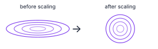
- **Feature standardisation** rescales features to zero mean and unit variance — the z-score $z = \dfrac{x - \mu}{\sigma}$.
- **Feature normalisation:** $x' = \dfrac{x - x_{\min}}{x_{\max} - x_{\min}}$.

### Regularisation

- **Underfit** = high bias; **overfit** = high variance.
- $J(\theta) = RSE + \lambda\|\theta\|_2^2$ with $\lambda > 0$ (regularisation; $\theta_0$ is not penalised).
- In regularisation we shrink $\theta_1, \theta_2, \dots$ and can address overfitting by (effectively) eliminating features. **L2 regularisation pulls the coefficients towards zero.**

### Variance and Covariance

- $\operatorname{Var}[f] = \mathbb{E}\big[(f(x) - \mathbb{E}[f(x)])^2\big] = \mathbb{E}[f^2] - \mathbb{E}[f]^2$.
- The **covariance** of 2 random variables $X$ and $Y$ measures the extent to which they vary together.

## Gaussian Distribution, Covariance & Maximum Likelihood
<!-- pages: 24 -->

### Covariance and Correlation

- $\operatorname{Cov}(X, Y) = \mathbb{E}\big[(X - \mathbb{E}(X))(Y - \mathbb{E}(Y))\big]$.
- **Variance** measures how much $X$ varies around its expected value; **covariance** measures the strength of the linear relationship between $X$ and $Y$.
- Covariance becomes more positive for each pair of values which differ from their means in the same direction, and similarly more negative for values that differ in opposite directions. If $X$ and $Y$ are independent then $\operatorname{Cov}(X, Y) = 0$.
- **Correlation** is a dimensionless measure of linear dependence, from −1 to +1: $\rho_{ij} = \dfrac{\sigma_{ij}}{\sigma_i \sigma_j}$.
- In the contour picture of a 2-D Gaussian: circular contours → $\operatorname{Cov} = 0$; ellipses tilted up to the right → $\operatorname{Cov} > 0$; ellipses tilted down → $\operatorname{Cov} < 0$.

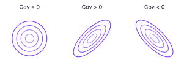

### The Gaussian Distribution

- Univariate: $\mathcal{N}(x \mid \mu, \sigma^2) = \dfrac{1}{\sqrt{2\pi}\,\sigma}\, e^{-(x - \mu)^2 / 2\sigma^2}$ (a bell curve centred at $\mu$).

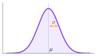
- Gaussian distributions are widely used in ML due to:
  - the **Central Limit Theorem**;
  - being computationally convenient;
  - mixtures of Gaussians being sufficient to approximate a wide range of distributions;
  - being closely related to the squared loss.
- **Multivariate:**
$$p(x) = \frac{1}{(2\pi)^{d/2}\,|\Sigma|^{1/2}} \exp\left\{-\frac{1}{2}\underbrace{(x - \mu)^T \Sigma^{-1} (x - \mu)}_{\text{Mahalanobis distance (quadratic form)}}\right\}, \qquad
\Sigma = \begin{bmatrix} \sigma_1^2 & \sigma_{12} & \cdots & \sigma_{1d} \\ \sigma_{21} & \sigma_2^2 & \cdots & \vdots \\ \vdots & & \ddots & \\ & & & \sigma_d^2 \end{bmatrix}.$$
- If $X \sim \mathcal{N}_d(\mu, \Sigma)$ — $\mu$ a $d$-dimensional mean vector and $\Sigma$ a $d \times d$ covariance matrix — then each dimension of $x$ is univariate normal, but the converse is not true.

### Mahalanobis Distance

$$\|x - y\|^2_{\Sigma^{-1}} = (x - y)^T \Sigma^{-1} (x - y).$$

When $\Sigma = I$ it becomes the Euclidean distance. An ellipse consists of the points that are equidistant from the centre with respect to the Mahalanobis distance.

### Independence

- **Independent random variables:** $P(X, Y) = P(X)\,P(Y)$, equivalently $P(X \mid Y) = P(X)$.
- **Conditionally independent:** $P(X, Y \mid Z) = P(X \mid Z)\,P(Y \mid Z)$.

### Principle of Maximum Likelihood (ML)

- Suppose we know the distribution $p(x; \theta)$ or $p(y \mid x; \theta)$; we want to determine the parameters $\theta$.
- *Bernoulli distribution:* $P(X = 1; \mu) = \mu$ and $P(X = 0; \mu) = 1 - \mu$. Choose the value of $\mu$ that maximises the likelihood given the observed data:
$$L(\mu) = \prod_{i=1}^{n} p(x_i; \mu) = \prod_{i=1}^{n} \mu^{x_i}(1 - \mu)^{1 - x_i}, \qquad \ell(\mu) = \log L(\mu) \;\to\; \text{maximise} \;\Rightarrow\; \hat\mu_{ML} = \frac{1}{n}\sum x.$$
- *Gaussian distribution:*
$$\hat\theta_{MLE} = \arg\max_\theta \underbrace{\left(\frac{1}{2\pi\sigma^2}\right)^{n/2} e^{-\sum_{i=1}^{n}(x_i - \mu)^2 / 2\sigma^2}}_{L(\theta)}, \qquad \ell(\theta) = \log L(\theta),$$
$$\hat\mu_{MLE} = \frac{1}{n}\sum x, \qquad \hat\sigma^2_{MLE} = \frac{1}{n}\sum (x_i - \hat\mu)^2 \;\;(\text{biased}), \qquad \hat\sigma^2_{\text{unbiased}} = \frac{1}{n-1}\sum (x_i - \hat\mu)^2.$$
- An estimator is **unbiased** if $\mathbb{E}[\hat\theta] = \theta$.
- The average is a way to approximate the expectation.
- $\operatorname{Var}(aX + b) = a^2 \operatorname{Var}(X)$.

## Logistic Regression, Naïve Bayes & Neural Networks
<!-- pages: 25 -->

### Logistic Regression (Classifier)

$$\hat y^{(i)} = \sigma(\theta^T x^{(i)}) = \frac{1}{1 + e^{-\theta^T x^{(i)}}}, \qquad \sigma(z) = \frac{1}{1 + e^{-z}} \;\;\text{(sigmoid function, an S-curve from 0 to 1)}.$$

With the squared loss $C(\theta) = \dfrac{1}{2n}\sum_{i=1}^{n} \big(\sigma(\theta^T x^{(i)}) - y^{(i)}\big)^2$, the gradient is (chain rule, $z = \theta^T x^{(i)}$)
$$\frac{\partial C(\theta)}{\partial \theta_j} = \frac{\partial C(\theta)}{\partial \sigma(z)} \cdot \underbrace{\frac{\partial \sigma(z)}{\partial z}}_{\sigma(z)(1 - \sigma(z))} \cdot \frac{\partial z}{\partial \theta_j} = \big(\sigma(\theta^T x^{(i)}) - y^{(i)}\big)\,\sigma'(z)\, x_j .$$

For large $z$, $\sigma'(z)$ can become very small, and we get a very slow weight update using gradient descent. To resolve it, use the loss whose derivative cancels $\sigma'(z)$:
$$\frac{\partial C(\theta)}{\partial \sigma(z)} = \frac{-y}{\sigma(z)} + \frac{1 - y}{1 - \sigma(z)} \;\Rightarrow\; \boxed{C(\theta) = -\big[y \log \sigma(z) + (1 - y)\log(1 - \sigma(z))\big]} \;\;\text{— the binary cross-entropy loss.}$$

We can build a simple **neural network** from stacked logistic-regression classifiers:

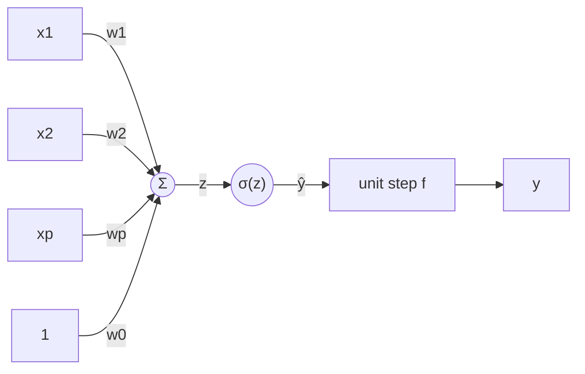

### Naïve Bayes Classification

$$\underbrace{P(C \mid A)}_{\text{posterior}} = \frac{\overbrace{P(A \mid C)}^{\text{likelihood}}\;\overbrace{P(C)}^{\text{prior}}}{P(A)}, \qquad P(c_j \mid d) = \frac{P(d \mid c_j)\,P(c_j)}{P(d)} .$$

- $P(A)$ (the evidence) is ignored — it is the same for all classes.
- **Assumption:** the features are independent: $P(d \mid c_j) = P(d_1 \mid c_j)\,P(d_2 \mid c_j)\cdots$
- Naïve Bayes is **not sensitive to irrelevant features**.
- **Laplace smoothing:** $P(A_i \mid c) = \dfrac{N_{ic} + 1}{N_c + c}$.

### Introduction to Neural Networks

- Neural networks are **inspired by biology**: dendrites receive signals, the nucleus integrates them and the axon carries the impulse onwards.
- Activation functions are highly non-linear.
- After each weight update the decision boundary gets changed.
- **Forward pass:** inputs $x_1, x_2, \dots, x_N$ with weights $w_1, w_2, \dots, w_N$ feed a unit with activation $f$ that produces the output $y$.
- **MLP (multi-layer perceptron)** — a fully connected network. *Example:* 3 inputs → 4 hidden → 3 outputs has $4 + 3 = 7$ units (perceptrons / neurons) and $(3 \times 4 + 4 \times 3)$ weights $+ (4 + 3)$ biases $= 31$ learnable parameters.

  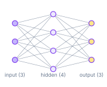
- Performance usually tops out at 2–3 layers for deep networks, except CNNs.
- The **loss function** defines what is meant to be *close* to the true solution.

| Loss | Formula |
| --- | --- |
| Squared ($L_2$) loss | $(\hat y - y)^2$ |
| $L_1$ loss | $\lvert \hat y - y\rvert$ |
| Zero–one loss | $\mathbb{1}[\hat y \ne y]$ |
| Hinge loss (in SVM) | $\max(0,\, 1 - y\hat y)$ |

- **Perceptron update:** $w = w - \nabla w = w + (y_n - \hat y)\,x_i$.
  *Proof:* $L = \frac{1}{2}(y - \hat y)^2$ with $\hat y = wx$, so $\dfrac{dL}{dw} = \dfrac{d}{dw}\left\{\frac{1}{2}(y - \hat y)^2\right\} = -(y - \hat y)\dfrac{d\hat y}{dw} = -(y - \hat y)\,x = \nabla w$.
- We use the **chain rule in backpropagation**, e.g. with $a = \sum wx + b$ and $f$ = activation function:
$$\frac{\partial L}{\partial w_2} = \frac{\partial L}{\partial f_3}\,\frac{\partial f_3}{\partial a_3}\,\frac{\partial a_3}{\partial f_2}\,\frac{\partial f_2}{\partial a_2}\,\frac{\partial a_2}{\partial w_2}.$$
- **Problems with neural networks:** vanishing gradients and overfitting.
- In the **XOR problem**, a single decision boundary can't separate the data, so we have to use 2 layers.

## Optimisers & Learning-Rate Schedules
<!-- pages: 26-27 -->

### A Layer as a Matrix Operation

A layer computes $\sigma(Wx + b)$. *Example:* inputs $x = (1, -1)$ with weights $\begin{bmatrix} 1 & -2 \\ -1 & 1 \end{bmatrix}$ and biases $b = (1, 0)$:
$$\begin{bmatrix} 1 & -2 \\ -1 & 1 \end{bmatrix}\begin{bmatrix} 1 \\ -1 \end{bmatrix} + \begin{bmatrix} 1 \\ 0 \end{bmatrix} = Wx + b \;\to\; \sigma(Wx + b) \to \cdots$$

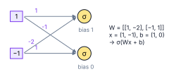

### Softmax

For multi-class outputs, each score $z_i$ is exponentiated and normalised into a probability:
$$y_i = \frac{e^{z_i}}{\sum_j e^{z_j}}.$$

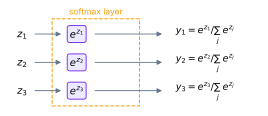

### Momentum

- **SGD** is a special case of mini-batch gradient descent with batch size 1 (generally sampling without replacement).
- A ball rolling down the loss surface can get stuck at a saddle point or local minimum, where $\nabla C(\theta) = 0$ — momentum carries it through.

  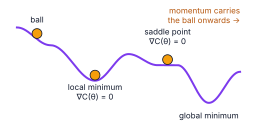
- **Movement = negative of gradient + momentum:**
$$v^0 = 0, \qquad v^1 = \lambda v^0 - \mu \nabla C(\theta^0), \qquad v^2 = \lambda v^1 - \mu \nabla C(\theta^1), \;\dots$$
  where $\mu$ is the learning rate.
- **Nesterov momentum update:** $v = \mu v - \eta\, dx$, $\;x \mathrel{+}= v$ ($\eta$ = learning rate).

### Learning Rate

- Reduce the learning rate by some factor every few epochs. At the beginning we are far from a minimum, so we use a larger learning rate; after several epochs we are close to a minimum, so we reduce the learning rate.
- *Example — $1/t$ decay:* $\eta^t = \dfrac{\eta}{t + 1}$.
- A large gradient calls for a smaller learning rate.

### Adaptive Optimisers

Here $g^t$ is the partial derivative (gradient) at step $t$.

| Method | Update |
| --- | --- |
| **RProp** | $w^{t+1} \leftarrow w^t - \dfrac{\eta}{\lvert g^t \rvert}\, g^t$ |
| **RMSProp** (root mean square) | $w^{t+1} \leftarrow w^t - \dfrac{\eta}{\sigma^t}\, g^t$, where $\sigma^t = \sqrt{\alpha(\sigma^{t-1})^2 + (1 - \alpha)(g^t)^2}$ |
| **Adagrad** | $w^{t+1} \leftarrow w^t - \dfrac{\eta}{\sigma^t}\, g^t$, where $\sigma^t = \sqrt{\dfrac{1}{t + 1}\sum_{i=0}^{t} (g^i)^2}$ is the average gradient of parameter $w$ |

- In Adagrad, if $w$ has a small average gradient $\sigma$ it gets a larger learning rate; if it has a large average gradient, a smaller learning rate.
- RMSProp is similar to Adagrad. **Adadelta** is also a way.

## Convolutional Neural Networks, ReLU & Dropout
<!-- pages: 28 -->

### Why CNNs

- A single-layer neural network can't solve the XOR problem; a 2-layer network can solve XOR but can't solve the problem of separating more complex regions — for that we need a 3-layer network.
- CNNs are used in image processing and signal processing.
- **CNN over MLP (multilayer perceptron):** improved accuracy and some degree of **invariance to distortion** in input images. In an MLP, if the image is shifted then the feature values (pixel values) change and the prediction can be different.
- A **CNN** is a neural network with some convolutional layers and some other layers. A convolutional layer has a number of filters that perform the convolution operation.
- A **filter** (a set of kernels) can be used, for example, as a beak detector — convolution is **scale and shift invariant**.
- A convolutional layer uses a small, (generally) odd-sized filter which is dragged over the entire image; at every position (pixel) a component-by-component product happens and the response is recorded.

### Convolution

$$f * g(x) = \int_{\alpha = -\infty}^{\infty} f(\alpha)\, g(x - \alpha)\, d\alpha = \sum_{\alpha=0}^{N-1} f(\alpha)\, g(x - \alpha) \qquad \text{[1-D feature map]}$$
$$f * g(x, y) = \int_{\alpha=-\infty}^{\infty}\int_{\beta=-\infty}^{\infty} f(\alpha, \beta)\, g(x - \alpha, y - \beta)\, d\alpha\, d\beta \qquad \text{[2-D feature map]}$$

- A $3 \times 3$ **mask** (filter) slides over a $6 \times 6$ image. Its convolutional mask coefficients are network parameters to be learned. It detects high-level and abstract features.

  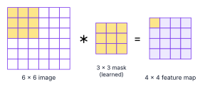
- If an image has 3 channels (R, G, B), each filter has 3 kernels.
- **Stride** means shift: with stride 2 the filter shifts 2 units at a time.
- After convolving the image with a filter (mask) we get a **feature map**, which contains high-level information.
- A $6 \times 6$ image with a $3 \times 3$ filter, stride 1 and no padding gives a $4 \times 4$ feature map; with 2 filters we get a $2 \times 4 \times 4$ feature map. With **zero padding** we get a $6 \times 6$ feature map (same size as the input).

### Pooling

- **Max pooling** is used for **subsampling**, and it removes redundant information: divide the $4 \times 4$ feature map into $2 \times 2$ blocks, keep the maximum element and remove the rest.
- **Why pooling?** Subsampling the pixels will not change the object, so the inference will not change — and there are fewer parameters to characterise the image.

### The Whole CNN

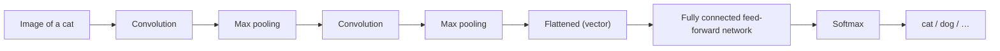

### ReLU and Maxout
<!-- pages: 29 -->

- $\operatorname{ReLU}(z) = \max(0, z)$ → fast to compute and resistant to the vanishing-gradient problem.
- **Problem with ReLU:** if $z$ is negative the gradient becomes zero, and those neurons will be eliminated ("dead" neurons).
- ReLU is a special case of **Maxout** (a learnable activation function), which takes the maximum of a group.

### Dropout

- A heuristic technique to save a neural network from **overfitting** (the high-variance problem).
- At training time, randomly delete $p\,\%$ of the neurons, so the network has fewer parameters. At testing there is no dropout: if the dropout rate at training is $p\,\%$, all the weights are rescaled by $(100 - p)\,\%$ to compensate for the neurons deleted at training time.
- Dropout is a kind of **ensemble**.

### Channels, Kernels and Filters

- In deep learning, convolution is element-wise multiplication and addition: the filter slides through the input channels and feature maps in the same way.
- **"Channels"** usually describes the structure of a *layer*. Similarly, a **"kernel"** refers to a 2-D array of weights, while the term **"filter"** is for the 3-D structure of multiple kernels stacked together.

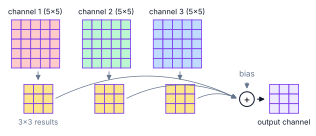

- Here the input layer is a $5 \times 5 \times 3$ tensor with 3 channels, and the filter is a $3 \times 3 \times 3$ matrix. First, each of the kernels in the filter is applied to the 3 channels of the input layer separately: 3 convolutions are performed, which result in 3 channels of size $3 \times 3$.
- Each of the per-channel processed versions is then **summed together** to form one channel, producing the final output channel.
- Finally there is a **bias** term: each output filter has one bias term, and the bias gets added to the output channel.

## Activation Functions, Normalisation & Batch Norm
<!-- pages: 30-31 -->

### Pooling Layers

In neural networks, pooling layers provide **invariance to small translations** of the input. The most common kind of pooling is **max pooling**, which consists of splitting the input into (usually non-overlapping) patches and outputting the maximum value of each patch. Other kinds of pooling exist, e.g. mean or average pooling, which all share the same idea of aggregating the input locally by applying a non-linearity to the content of some patches.

### Activation Functions

A neuron receives inputs $x_i$ through synapses with weights $w_i$ (axon from a neuron → synapse $w_0 x_0$ → dendrite), sums them in the cell body ($\sum w x + b$) and applies an activation function $f(wx + b)$ to produce the output on its axon.

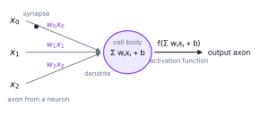

| Activation | Formula | Notes |
| --- | --- | --- |
| Sigmoid | $\sigma(x) = \dfrac{1}{1 + e^{-x}}$ | squashes numbers into $[0, 1]$ |
| tanh | $\tanh(x)$ | squashes numbers into $[-1, 1]$; zero-centred |
| ReLU | $\max(0, x)$ | nowadays people prefer it |
| Leaky ReLU | $\max(0.1x, x)$ | used to save from the dead-neuron problem |
| Maxout | $\max(w_1^T x + b_1,\; w_2^T x + b_2)$ | |
| ELU (exponential linear unit) | $x$ if $x \ge 0$; $\;\alpha(e^x - 1)$ if $x < 0$ | |
| Parametric ReLU (PReLU) | $\max(\alpha x, x)$ | |

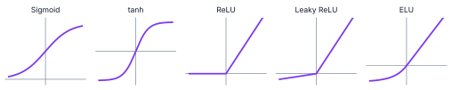

- **Sigmoid problems:** saturated neurons "kill" the gradients (also with tanh); it is not zero-centred; and $e^{-x}$ is expensive to compute.
- **tanh** is zero-centred, but still has the vanishing-gradient problem.
- **ReLU** does not saturate (in the +ve region), is computationally efficient and converges much faster than sigmoid / tanh in practice — but it is not zero-centred.

### Decorrelation, Whitening and Scaling

- **Decorrelated data** has a diagonal covariance matrix; **whitened data** has a covariance matrix which is the identity matrix.
- In general, gradient descent converges much faster with feature scaling than without it. Normalisation $x_{\text{new}} = \dfrac{x - \mu}{\sigma}$ is the whitening process.
- **Scaling data (whitening in neural networks):** standardisation $x_{\text{new}} = \dfrac{x - \mu}{\sigma}$; normalisation $x_{\text{new}} = \dfrac{x - x_{\min}}{x_{\max} - x_{\min}}$.

### Batch Normalisation (BN)

- Batch normalisation **reduces the problem of covariate shift**. It performs whitening on the intermediate layers of the network.
- **Covariate shift** is the change in the distribution of the activations of a component. By using BN, each neuron's activation becomes (more or less) a Gaussian distribution — usually not active, sometimes a bit active, rarely very active.
- Covariate shift is undesirable because the later layers have to keep adapting to the change of the type of distribution (instead of just to new distribution parameters, e.g. a new mean and variance for a Gaussian distribution).

### Batch Normalisation (continued)
<!-- pages: 32-33 -->

- BN **reduces the effects of exploding and vanishing gradients**, because the input to every layer becomes roughly normally distributed. Without BN, low activations of one layer can lead to lower activations in the next layer, and then even lower ones in the next layer, and so on.
- Normally, large learning rates may increase the scale of layer parameters, which then amplify the gradient during backpropagation and lead to model explosion. With BN, backpropagation through a layer is unaffected by the scale of its parameters — **BN stabilises the parameter growth**.
- For each activation $x^{(k)}$ we introduce a pair of parameters $\gamma^{(k)}, \beta^{(k)}$ (scaling and shifting parameters) which scale and shift the normalised value:
$$y^{(k)} = \gamma^{(k)}\,\hat x^{(k)} + \beta^{(k)}.$$
- **Usual BN sequence:** FC → BN → tanh → FC → BN → tanh, i.e. **BAD**: **B**N → **A**ctivation → **D**ropout (FC = fully connected layer, or a convolution layer).

## Generative Adversarial Networks (GANs)
<!-- pages: 32-33 -->

- **Generative deep inferencing models** generate a new object that closely matches those in a limited training set, by closely approximating the underlying (but unknown) probability distribution of the set of objects.
- A GAN has 2 neural networks: a **generator** and a **discriminator**.

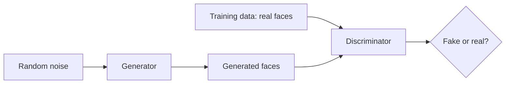

- The generator's training depends on the discriminator, and the discriminator's training depends on the generator.
- **Discriminator training:** given a set of +ve examples (good images from the training set) and a randomly generated set of −ve examples (bad images), in each iteration learn a discriminator function $D$ that discriminates the +ve and −ve examples.
- **Generator network:** tries to fool the discriminator by generating real-looking images. **Discriminator network:** tries to distinguish between real and fake images.
- They train jointly in a **minimax game**: the discriminator wants to maximise the objective function to discriminate the +ve and −ve data, and the generator wants to minimise the objective function to fool the discriminator.
- Use cross-entropy, or any loss like the hinge loss.
- Use the **KL divergence**, which measures how one probability distribution $p$ diverges from a second, expected probability distribution $q$:
$$D_{KL}(P \,\|\, Q) = \int_x p(x) \log \frac{p(x)}{q(x)}\, dx.$$

## Data-Science Essentials: Divergence, Feature Selection & Bias
<!-- pages: 34 -->

### Divergences

- $D_{KL}(p \,\|\, q) = \int_x p(x) \log \dfrac{p(x)}{q(x)}\, dx$. $D_{KL}$ achieves its minimum, zero, when $p(x) = q(x)$ everywhere.
- **Jensen–Shannon divergence** is another measure of similarity between 2 probability distributions, bounded by $[0, 1]$. It is symmetric and more smooth:
$$D_{JS}(p \,\|\, q) = \frac{1}{2} D_{KL}\!\left(p \,\Big\|\, \frac{p + q}{2}\right) + \frac{1}{2} D_{KL}\!\left(q \,\Big\|\, \frac{p + q}{2}\right).$$
- KL divergence is **asymmetric**. Divergences are like distance measures.

### Avoiding Overfitting

Overfitting can be avoided by taking a simpler model with fewer variables, removing noise in the training data, using cross-validation techniques such as **k-fold CV**, and using regularisation techniques such as **LASSO** that penalise certain model parameters if they are likely to cause overfitting.

### Feature Selection Methods

- **Filter methods:** LDA, ANOVA, chi-square.
- **Wrapper methods:** forward / backward selection, recursive feature elimination.

### Maintenance of a Deployed Model

1. **Monitor** — constant monitoring of all models to determine the performance accuracy of the models.
2. **Evaluate** — evaluation metrics of the current model are calculated to determine if a new algorithm is needed.
3. **Compare** — the new models are compared with each other to find the best one.
4. **Rebuild** — the best model is rebuilt on the current state of the data.

### Quick Facts

- **Recommender systems:** ① collaborative filtering, ② content-based filtering.
- The **elbow method** is used to select $k$ in K-means: plot the **within sum of squares (WSS)** — the sum of squared distances between each member of a cluster and its centroid — against $k$ (the number of clusters) and pick the "elbow".

  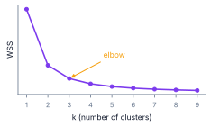
- **p-values:**
  - $p \le 0.05$ indicates strong evidence against the null hypothesis, so reject the null hypothesis;
  - $p > 0.05$ indicates weak evidence against the null hypothesis, so fail to reject it;
  - $p = 0.05$ is considered marginal (could go either way).
- **Random forest** is less affected by outliers, and it is also used for dimensionality reduction.
- **Exploding gradients** is a problem where large error gradients accumulate and result in very large updates of the weights during training.

### More Quick Facts
<!-- pages: 35 -->

- **Selection bias** occurs when the sample obtained is not representative of the population intended to be analysed. It is a bias introduced by the selection of individuals, groups or data for analysis in such a way that proper randomisation is not achieved.
- In **random-forest regression**, instead of a majority vote we take the mean / average.
- A **Box–Cox transform** is a way to transform non-normal dependent variables into a normal shape.
- **Regularisation** is the process of adding a tuning parameter to a model to induce smoothness in order to prevent overfitting.
- **Data wrangling** is the process of gathering, selecting and transforming data. Steps:
  1. data profiling (find the shape and description of the data);
  2. data visualisation (use histograms / box plots and scatter plots);
  3. standardisation / normalisation;
  4. handling missing values, removing duplicates / irrelevant features.
- **L2 (ridge) regularisation** is less robust but has a stable solution and always one solution. **L1** is more robust but has an unstable solution and can possibly have multiple solutions.
- **MSE** (mean squared error) gives a relatively high weight to large errors — therefore MSE tends to put too much emphasis on large deviations. A more robust alternative is **MAE** (mean absolute deviation).
- Random forests don't need cross-validation (they have the out-of-bag estimate).
- **Power** $= P(\text{reject null hypothesis} \mid \text{alternative hypothesis is true})$.
- **Mean imputation** is generally a bad practice because it doesn't take feature correlation into account. Also, mean imputation reduces the variance of the data and increases bias in our data. This leads to a less accurate model and a narrower confidence interval due to the smaller variance.
- If the data follows a normal distribution, we can find outliers using the **z-score**.
- An **inlier** is a data observation that lies within the rest of the data set and is unusual or an error; it is harder to identify since it is in the data.
- **Randomisation controls bias.**
- A **confounding variable** is a variable that influences both the dependent and independent variables, causing a spurious association where the variables are not causally related.
- **Lift** is a measure of the performance of a target model against a random-choice model.
