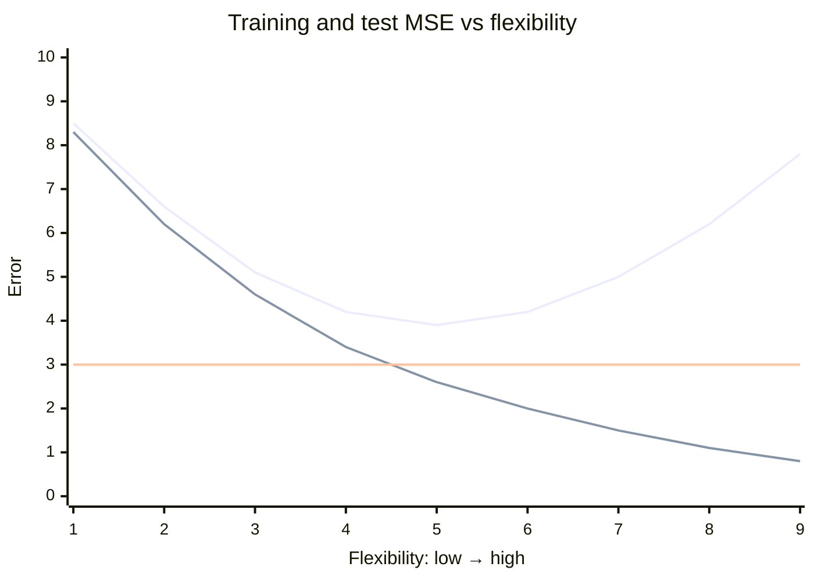

# Statistical Learning

## Statistical Learning & Assessing Model Accuracy
<!-- pages: 36-37 -->

*Notes from* An Introduction to Statistical Learning *(ISLP).*

### What Is Statistical Learning?

- Suppose we are statistical consultants hired by a client to investigate the association between advertising budgets and sales of a product: sales $= f(\text{TV})$, sales $= f(\text{radio})$ or sales $= f(\text{newspaper})$, found by fitting the best-fit line.
- The client can control the advertising expenditure. Our goal is to develop an accurate model that can be used to predict sales on the basis of these 3 media budgets.
- **Predictors / independent variables / features / variables** = inputs; the **response / dependent variable** = output.
- Suppose $Y$ is a quantitative response and the predictors are $X = (X_1, X_2, \dots, X_p)$. Then the relationship can be written as
$$Y = f(X) + \varepsilon,$$
  where $f$ is a fixed but unknown function and $\varepsilon$ is a random error term, independent of $X$, with mean zero.
- *Another example:* income $= f(\text{years of education, experience})$.
- **Statistical learning** refers to a set of approaches for estimating $f$.

### Why Estimate $f$: Prediction and Inference

There are 2 reasons for estimating $f$: **prediction** and **inference** (which predictors are important / related).

- $\hat Y = \hat f(X)$, where $\hat f$ is the estimate of $f$.
- *Example:* $X_1, X_2, \dots, X_p$ are characteristics of a patient's blood sample, and $Y$ is a variable encoding the patient's risk of a severe adverse reaction to a drug.
- $\hat f$ will not be a perfect estimate of $f$; this inaccuracy introduces the **reducible error**.
- Since $Y = f(X) + \varepsilon$, the variability associated with $\varepsilon$ also affects the prediction. It is called the **irreducible error**. *Example:* the risk of an adverse reaction depends on manufacturing variation in the drug or on the patient's general feeling that day.
- $n$ different data points (the **training data**) are used to train / teach our method to estimate $f$.

### Parametric and Non-parametric Methods

- **Parametric methods** make an assumption about the functional form, or shape, of $f$ (e.g. a linear model); we then only estimate the coefficients $\beta_0, \beta_1, \dots$
  - If the chosen model is too far from the true $f$, our estimate will be poor. We can use flexible models that can fit many different possible functional forms for $f$, but in general fitting a more flexible model requires estimating a greater number of parameters, and more complex models can lead to **overfitting**.
- **Non-parametric methods** do not make explicit assumptions about the functional form of $f$. They have the potential to fit a wider range of possible shapes for $f$.
- **Less flexible = more restrictive**, because such methods can produce only a small range of shapes to estimate $f$ — e.g. linear regression.

### Flexibility vs Interpretability

If we are mainly interested in inference, restrictive models are much more interpretable.

| | Low flexibility ← | | → High flexibility |
| --- | --- | --- | --- |
| **High interpretability** | Subset selection, lasso | Least squares | |
| | | Generalised additive models (GAM), trees | |
| **Low interpretability** | | | Bagging, boosting, SVM, deep learning |

- The **lasso** relies on a linear model but uses an alternative fitting procedure that makes a number of coefficients exactly zero. So the lasso is less flexible than linear regression, and more interpretable than it.
- Trees, bagging, boosting, SVMs and neural networks are fully non-linear models.

### Assessing Model Accuracy

$$\text{MSE} = \frac{1}{n}\sum_{i=1}^{n} \big(y_i - \hat f(x_i)\big)^2$$

- We are interested in the accuracy of the predictions that we obtain when we apply our method to previously **unseen data**. We want to choose the method that gives the lowest **test MSE**, not the lowest training MSE.
- The **degrees of freedom** is a quantity that summarises the flexibility of a curve. A more restricted and hence smoother curve has fewer degrees of freedom than a wiggly curve.
- **Training MSE declines monotonically as flexibility increases.** Test MSE initially declines as the level of flexibility increases; however, at some point the test MSE levels off and then starts to increase again.

- The **U-shaped test MSE** is a fundamental property of statistical learning that holds regardless of the particular data set or method.
- **Overfitting** happens because the statistical-learning procedure is working too hard to find patterns in the training data that may be caused by random chance rather than by true properties of the unknown function $f$. When we overfit the training data, the test MSE will be very large because the supposed patterns that the method found in the training data simply don't exist in the test data.
- We always expect the training MSE to be smaller than the test MSE.
- Using **cross-validation (CV)**, we estimate the test MSE using the training data.

### The Bias–Variance Trade-off

The U-shaped test MSE is the result of the bias–variance trade-off:
$$\text{Test MSE} = \underbrace{\operatorname{Var}(\hat f)}_{+\text{ve}} + \text{Bias}^2 + \underbrace{\operatorname{Var}(\varepsilon)}_{+\text{ve, irreducible error}}$$
So we need **low bias and low variance**.

- **Variance** refers to the amount by which $\hat f$ would change if we estimated it using a different training data set. Ideally the estimate for $f$ should not vary too much between training sets. If a method has high variance, then small changes in the training data result in large changes in $\hat f$. More flexible methods have higher variance.
- **Bias** refers to the error introduced by approximating a real-life problem, which may be complicated, by a simpler model (e.g. a real problem modelled with a linear model).

### Flexibility, Bias and Variance
<!-- pages: 38 -->

- As we use more flexible methods, the variance will increase and the bias will decrease. The relative rate of change of these 2 quantities determines whether the test MSE increases or decreases.
- As flexibility increases, the bias initially decreases faster than the variance increases, and consequently the test MSE declines. However, at some point increasing flexibility has little impact on the bias but starts to significantly increase the variance. When this happens, the test MSE increases.

### The Bayes Classifier and KNN

- Theoretically, the **Bayes classifier** produces the lowest possible test error rate, called the **Bayes error rate** (analogous to the irreducible error).
- But for real data we don't know the conditional distribution of $Y$ given $X$, so computing the Bayes classifier is impossible.
- **KNN** estimates the conditional distribution of $Y$ given $X$, and then classifies a given observation to the class with the highest estimated probability. The KNN decision boundary is very close to that of the Bayes classifier.
- When $K = 1$ the decision boundary is overly flexible. As $K$ grows, the method becomes less flexible and produces an approximately linear decision boundary.
- Choosing the correct level of flexibility is critical to the success of any ML method.

## Linear Regression: Estimates, Inference & R²
<!-- pages: 38-39 -->

### Simple Linear Regression

$$Y \approx \beta_0 + \beta_1 X \qquad (Y \text{ quantitative; "we are regressing } Y \text{ on } X\text{"}),$$
where $\beta_0$ is the intercept and $\beta_1$ the slope of the linear model — together the **model coefficients (parameters)**. ($\hat Y$ is the projection of $Y$ onto the column space of $X$.)

- From the training data we estimate $\hat\beta_0$ and $\hat\beta_1$, and predict using $\hat y = \hat\beta_0 + \hat\beta_1 x$.
- There are many ways of measuring *closeness*, but by far the most common approach involves minimising the **least-squares** criterion.
- With residuals $e_i = y_i - \hat y_i$, the **residual sum of squares** is $RSS = e_1^2 + e_2^2 + \dots + e_n^2$. Using least squares we minimise
$$RSS = (y_1 - \hat\beta_0 - \hat\beta_1 x_1)^2 + (y_2 - \hat\beta_0 - \hat\beta_1 x_2)^2 + \dots$$
  and, using calculus, we get
$$\hat\beta_1 = \frac{\sum (x_i - \bar x)(y_i - \bar y)}{\sum (x_i - \bar x)^2}, \qquad \hat\beta_0 = \bar y - \hat\beta_1 \bar x.$$
- $\beta_1$ = slope $= \dfrac{\Delta y}{\Delta x}$ = the average increase in $Y$ for a one-unit increase in $X$.
- If $f$ is to be approximated by a linear function, $Y = \beta_0 + \beta_1 X + \varepsilon$ is the **population regression line**. We typically assume the error terms are independent of $X$.

### Unbiased Estimators and Standard Errors

- The sample mean and the population mean are different, but the sample mean will provide a good estimate of the population mean. If $\mathbb{E}(\hat\mu) = \mu$, then $\hat\mu$ is an **unbiased estimator**: on one data set $\hat\mu$ and $\mu$ might differ, but the average over a huge number of observations gives $\mu$.
- Hence an unbiased estimator does not *systematically* over- or under-estimate the true parameter.
- How far off will a single estimate $\hat\mu$ be from $\mu$? The answer is given by the **standard error** $SE(\hat\mu)$:
$$\operatorname{Var}(\hat\mu) = SE(\hat\mu)^2 = \frac{\sigma^2}{n},$$
  where $\sigma$ is the standard deviation of each of the realisations $y_i$ of $Y$. This formula holds provided that the $n$ observations are uncorrelated.
- Roughly speaking, the standard error tells us the average amount that this estimate $\hat\mu$ differs from the actual value of $\mu$.
- How close are $\hat\beta_0$ and $\hat\beta_1$ to the true values $\beta_0$ and $\beta_1$? With $\sigma^2 = \operatorname{Var}(\varepsilon)$:
$$SE(\hat\beta_0)^2 = \sigma^2\left[\frac{1}{n} + \frac{\bar x^2}{\sum (x_i - \bar x)^2}\right], \qquad SE(\hat\beta_1)^2 = \frac{\sigma^2}{\sum (x_i - \bar x)^2}.$$
  These formulas hold when the errors $\varepsilon_i$ of each observation have a common variance $\sigma^2$ and are uncorrelated.
- The estimate of $\sigma$ is known as the **RSE (residual standard error)**: $RSE = \sqrt{RSS/(n - 2)}$.

### Confidence Intervals and Hypothesis Tests

- The SE can be used to compute **confidence intervals (CI)**. A 95 % CI is defined as a range of values such that, with 95 % probability, the range will contain the true unknown value of the parameter. For $\beta_1$: 95 % CI $= \hat\beta_1 \pm 2\,SE(\hat\beta_1)$; similarly for $\beta_0$. It is based on the assumption that the errors are Gaussian.
- SEs can also be used to perform **hypothesis tests** on the coefficients. *Example:* $H_0$: there is no relationship between $X$ and $Y$, i.e. $\beta_1 = 0$; $H_a$: $\beta_1 \ne 0$.
- **t-statistic:** $t = \dfrac{\hat\beta_1 - 0}{SE(\hat\beta_1)}$ (the t-distribution has a bell shape — approximately normal — when $n > 30$).
- Compute the probability of observing any number equal to $|t|$ or larger in absolute value, assuming $\beta_1 = 0$. We call this probability the **p-value**.
- A small p-value ⇒ reject the null hypothesis (typical p-value cut-offs are 5 % or 1 %).

### Assessing Accuracy (Measures of Fit)

1. **RSE** — measured in units of $Y$.
2. **$R^2$ statistic:**
$$R^2 = \frac{TSS - RSS}{TSS}, \qquad TSS = \sum (y_i - \bar y)^2 \;\;\text{(total sum of squares)}.$$
   - TSS measures the total variance in the response $Y$ (the amount of variability in the response before performing the regression).
   - $TSS - RSS$ measures the amount of variability explained (removed) by the regression.
   - $R^2$ lies between 0 and 1; $R^2 \approx 1$ means a larger proportion of the variability in the response is explained.

- If $R^2 \approx 0$, either the model is wrong or the error variance $\sigma^2$ is high, or both. What counts as a good $R^2$ value depends on the application.
- $R^2$ is also a measure of the linear relationship between $X$ and $Y$, as is $\operatorname{Cor}(X, Y)$. For simple linear regression, with $r = \operatorname{Cor}(X, Y)$, we have $R^2 = r^2$.

## Multiple Regression & Potential Problems
<!-- pages: 40-42 -->

### Multiple Linear Regression

$$Y = \beta_0 + \beta_1 X_1 + \beta_2 X_2 + \dots + \beta_p X_p + \varepsilon$$

- $\beta_j$ is the average effect on $Y$ of a one-unit increase in $X_j$, **holding all other predictors fixed**.
- **Null hypothesis** $H_0$: $\beta_1 = \beta_2 = \dots = \beta_p = 0$; $H_a$: at least one $\beta_j$ is non-zero.
- **F-statistic:**
$$F = \frac{(TSS - RSS)/p}{RSS/(n - p - 1)}.$$
  If there is no relationship, $F \approx 1$; otherwise $F > 1$ (a relationship exists).
- When $p > n$, forward selection can be used.

### Variable Selection

1. **All subsets:** $2^p$ models (all subsets can be selected), and we can use various statistics like Mallow's $C_p$, AIC, BIC and adjusted $R^2$ to judge the quality of a model. If $p$ is large, then $2^p$ is very big.
2. **Forward selection (greedy):** begin with the null model, fit $p$ simple linear regressions and add to the null model the variable that gives the lowest RSS; then fit the 2-variable combinations of that variable with each of the remaining $p - 1$ variables and add the variable with the lowest RSS. Repeat until some stopping rule is satisfied.
3. **Backward selection:** start with all variables in the model, remove the variable with the largest p-value (the least significant variable), and repeat.
4. **Mixed selection:** a combination of forward and backward selection (generally used).

### Notes on Fit and Prediction

- $R^2$ will always increase when more variables are added — even those that are only weakly associated with the response — because of the decrease in RSS on the training data.
- To measure how much $Y$ varies from $\hat Y$ we use **prediction intervals**: they incorporate both the reducible and the irreducible error, and are wider than confidence intervals.
- A **qualitative predictor** (a *factor*) has levels → create dummy variables, e.g. $x_i = 1$ or $0$ (**one-hot encoding**).

### Additivity, Linearity and Interactions

- The **additive assumption** of the linear model means that the association between a predictor $X_j$ and the response $Y$ does not depend on the values of the other predictors. The **linearity assumption** states that the change in the response $Y$ associated with a one-unit change in $X_j$ is constant.
- **Removing the additive assumption** — add an **interaction term**:
$$Y = \beta_0 + \beta_1 X_1 + \beta_2 X_2 + \beta_3 X_1 X_2 + \varepsilon.$$
- The **hierarchical principle** states that if we include an interaction in a model, we should also include the main effects, even if the p-values associated with their coefficients are not significant. $X_1 X_2$ is typically correlated with $X_1$ and $X_2$, so leaving them out tends to alter the meaning of the interaction.
- **Non-linear relationships**, e.g. $\text{mpg} = \beta_0 + \beta_1 \times \underbrace{\text{horsepower}}_{X_1} + \beta_2 \times \underbrace{\text{horsepower}^2}_{X_2} + \varepsilon$ — but it is still a linear model.

### Potential Problems

1. **Non-linearity of the data.** Residual plots (residuals vs fitted values $\hat y_i$) can identify non-linearity: check whether there is a pattern in the residual plot or not.
2. **Correlation of error terms.** $\varepsilon_i$ should give no information about $\varepsilon_{i+1}$. If there is correlation among the error terms, the estimated SEs will tend to underestimate the true SEs; as a result, confidence and prediction intervals will be narrower than they should be.
   *Example:* if we double the data (a $2n$ sample size by duplicating it), the estimated parameters would be the same but the CIs would be narrower by a factor of $\sqrt{2}$.
   Correlation among error terms occurs in time-series data (plot the residuals as a function of time and check for a pattern).
3. **Non-constant variance of the error terms** ($\operatorname{Var}(\varepsilon_i) = \sigma^2$ is assumed). The SEs, CIs and hypothesis tests rely upon this assumption. We can check **heteroscedasticity** (non-constant variance of the errors) using a **funnel shape** in the residual plot; transforming $Y$ to $\log Y$ or $\sqrt{Y}$ (a concave transformation) gives residuals with roughly constant spread.
4. **Outliers** — a point for which $y_i$ is far from the predicted value $\hat y_i$. They can occur from incorrect recording of an observation. Identify them using residual plots and **studentised residuals** (residual ÷ its standard error); values greater than 3 indicate outliers.
5. **High-leverage points** have an unusual value for $x_i$ (not in the normal range). The **leverage statistic**
$$h_i = \frac{1}{n} + \frac{(x_i - \bar x)^2}{\sum_{i'} (x_{i'} - \bar x)^2}, \qquad \frac{1}{n} \le h_i \le 1, \qquad \operatorname{avg}(h_i) = \frac{p + 1}{n};$$
   if $h_i \gg \frac{p+1}{n}$, the point is a high-leverage point.
6. **Collinearity** — 2 or more variables are closely related. Problem: it can be difficult to separate out their individual effects on the response, it reduces the accuracy of $\hat\beta_0, \hat\beta_1, \dots$ and the SEs grow. Identify it using the correlation matrix. It is possible for collinearity to exist between 3 or more variables even if no 2 variables have a high correlation (**multicollinearity**) — use the **VIF (variance inflation factor)**.

### Variance Inflation Factor (VIF)
<!-- pages: 43 -->

- The **VIF** is the ratio of the variance of $\hat\beta_j$ when fitting the full model, divided by the variance of $\hat\beta_j$ if it is fit on its own:
$$\operatorname{VIF}(\hat\beta_j) = \frac{1}{1 - R^2_{X_j \mid X_{-j}}},$$
  where $R^2_{X_j \mid X_{-j}}$ is the $R^2$ from a regression of $X_j$ onto all of the other predictors.
- $\operatorname{VIF} = 1$ means a complete absence of collinearity; $\operatorname{VIF} > 5$ or $> 10$ indicates a problematic amount.
- **Solutions for collinearity:** ① drop one of the problematic variables; ② combine the collinear variables together into a single predictor.

### KNN Regression and the Curse of Dimensionality

- In **KNN regression**, we take the mean of the responses of the $K$ nearest neighbouring points.
- The value of $K$ depends on the bias–variance trade-off.
- KNN performance may decrease when the dimension (the number of predictors) increases, because a given observation has no nearby neighbours in higher dimensions — the **curse of dimensionality** → very poor predictions.
- Parametric methods will tend to outperform non-parametric approaches when there is a small number of observations per predictor.

## Classification: Logistic Regression, LDA, QDA & ROC
<!-- pages: 43-45 -->

- In classification the response variable $Y$ is **qualitative (categorical)**, e.g. eye colour.
- **Classifiers:** logistic regression, LDA, QDA, naïve Bayes and KNN.
- **Why not linear regression?** If the coding for $Y$ changed, linear regression would produce different models. A 1, 2, 3 coding (mild, moderate, severe) would be reasonable only if the gap between mild and moderate were similar to the gap between moderate and severe. Linear regression can also give predictions outside the $[0, 1]$ interval.
- There are 2 reasons not to perform classification using a regression model:
  - (a) a regression method can't accommodate a qualitative response with more than 2 classes;
  - (b) a regression method will not provide meaningful estimates of $\Pr(Y \mid X)$.

### Logistic Regression

- We use the **logistic function**
$$p(X) = \frac{e^{\beta_0 + \beta_1 X}}{1 + e^{\beta_0 + \beta_1 X}},$$
  and for fitting we use **maximum likelihood**.
- $\dfrac{p(X)}{1 - p(X)}$ = the **odds** (0 to ∞), and the **log-odds (logit)** is linear in $X$:
$$\log\left(\frac{p(X)}{1 - p(X)}\right) = \beta_0 + \beta_1 X.$$
- We could also use non-linear least squares to fit the model, but we use the likelihood. The **likelihood function**
$$\ell(\beta_0, \beta_1) = \prod_{i : y_i = 1} p(x_i) \prod_{i' : y_{i'} = 0} \big(1 - p(x_{i'})\big);$$
  the estimates $\hat\beta_0$ and $\hat\beta_1$ are chosen to maximise this likelihood function.
- The **z-statistic** plays the same role as the t-statistic in the linear-regression output.
- **Multiple logistic regression:** $\log\left(\dfrac{p(X)}{1 - p(X)}\right) = \beta_0 + \beta_1 X_1 + \dots + \beta_p X_p$.
- As in linear regression, the results obtained using one predictor may be quite different from those obtained using multiple predictors, especially when there is correlation among the predictors. This phenomenon is known as **confounding**.
- In **multinomial logistic regression**, the treatment of the $K$th class as the baseline is unimportant, and we use **softmax** coding.

### Generative Models for Classification

By **Bayes' theorem**, with prior $\pi_k$ and likelihood $f_k(x) = \Pr(X = x \mid Y = k)$, the posterior probability is
$$\Pr(Y = k \mid X = x) = \frac{\pi_k f_k(x)}{\sum_{l=1}^{K} \pi_l f_l(x)}.$$
Estimating the density function $f_k(x)$ is much more challenging.

### Linear Discriminant Analysis (LDA)

- **For $p = 1$:** we assume $f_k(x)$ is normal,
$$f_k(x) = \frac{1}{\sqrt{2\pi}\,\sigma_k} \exp\left(-\frac{1}{2\sigma_k^2}(x - \mu_k)^2\right),$$
  where $\mu_k$ and $\sigma_k^2$ are the mean and variance of the $k$th class.
- **Assumption:** a shared variance, $\sigma_1^2 = \dots = \sigma_K^2$.
- **Discriminant function** — linear in $x$:
$$\delta_k(x) = x\,\frac{\mu_k}{\sigma^2} - \frac{\mu_k^2}{2\sigma^2} + \log(\pi_k).$$
- **For $p > 1$:** $X = (X_1, X_2, \dots)$ is drawn from a multivariate Gaussian (assume each predictor follows a normal distribution) with a class-specific mean vector and a common covariance matrix. A $p$-dimensional random variable $X$ has a multivariate Gaussian distribution with $\mathbb{E}(X) = \mu$ (a vector) and $\operatorname{Cov}(X) = \Sigma$ (a $p \times p$ matrix); we write $X \sim N(\mu, \Sigma)$, where
$$f(x) = \frac{1}{(2\pi)^{p/2}|\Sigma|^{1/2}} \exp\left(-\frac{1}{2}(x - \mu)^T \Sigma^{-1} (x - \mu)\right),$$
  and assign $x$ to the class for which
$$\delta_k(x) = x^T \Sigma^{-1}\mu_k - \frac{1}{2}\mu_k^T \Sigma^{-1}\mu_k + \log \pi_k$$
  is largest.
- The Bayes classifier uses a threshold of 0.5.

### ROC Curve and Confusion Matrix

- The **ROC curve** is a graphic tool for simultaneously displaying the 2 types of errors for all possible thresholds. ROC (receiver operating characteristic) comes from communication theory.
- **AUC** = area under the ROC curve. An ideal ROC curve hugs the top-left corner and has a larger AUC — a better classifier. We expect a classifier that performs no better than chance to have AUC = 0.5.

| | Predicted positive ($P^*$) | Predicted negative ($N^*$) |
| --- | --- | --- |
| **Actual positive ($P$)** | TP | FN |
| **Actual negative ($N$)** | FP | TN |

$$\text{Precision} = \frac{TP}{TP + FP} = \frac{TP}{P^*}, \qquad \text{Recall} = \frac{TP}{P} = TPR, \qquad FPR = \frac{FP}{N}.$$

- The ROC curve plots **TPR** (sensitivity, recall, power, $1 -$ Type-II error) against **FPR** ($1 -$ specificity, the Type-I error).

### QDA, Naïve Bayes and Other Notes

- **QDA** assumes each class has its own covariance matrix → high variance, because there are $Kp(p+1)/2$ parameters.
- In the naïve Bayes classifier we don't have to find the joint PDF.
- **Non-parametric estimates** of $f_{kj}$ use a histogram or a **KDE (kernel density estimator)** — a smooth form of histogram.
- LDA and naïve Bayes are special cases of each other; QDA and naïve Bayes are not special cases of each other.

### Poisson Regression and GLMs

- **Poisson regression** is used when $Y$ is neither qualitative nor quantitative — it is used to model **counts**:
$$\log\big(\lambda(X_1, X_2, \dots, X_p)\big) = \beta_0 + \beta_1 X_1 + \dots + \beta_p X_p.$$
- **GLM (generalised linear model):** for linear regression the response is Gaussian; for logistic regression it is binomial (and for Poisson regression it is Poisson).

The three models differ in the link between the mean response and the predictors:

| Regression | Mean response |
| --- | --- |
| Linear | $\mathbb{E}(Y \mid X_1, \dots, X_p) = \beta_0 + \beta_1 X_1 + \dots + \beta_p X_p$ |
| Logistic | $\mathbb{E}(Y \mid X_1, \dots, X_p) = \dfrac{e^{\beta_0 + \beta_1 X_1 + \dots}}{1 + e^{\beta_0 + \beta_1 X_1 + \dots}}$ |
| Poisson | $\mathbb{E}(Y \mid X_1, \dots, X_p) = e^{\beta_0 + \beta_1 X_1 + \dots + \beta_p X_p}$ |

Each applies a **link function**, and all belong to the **exponential family** of distributions; others are the Gamma distribution and the negative binomial.

## Resampling Methods & Linear Model Selection
<!-- pages: 46 -->

### Resampling Methods

- Resampling is computationally expensive because it involves fitting the same statistical method multiple times using different subsets of the training data.
- **Cross-validation (CV)** can be used to estimate the test error.
  - Evaluating a model's performance = **model assessment**; selecting the proper level of flexibility = **model selection**.
- The **bootstrap** is used to provide a measure of the accuracy of a parameter estimate.

### Cross-Validation Methods

1. **Validation-set approach** — randomly divide the set of observations into 2 parts, a training set and a validation set (hold-out set). It overestimates the test error.
2. **LOOCV (leave-one-out CV)** — a single observation is the validation set and the rest is the training set; repeat the procedure $n$ times:
$$CV_{(n)} = \frac{1}{n}\sum_{i=1}^{n} MSE_i.$$
   Less bias, and it does not overestimate the test error.
3. **K-fold CV** — randomly divide the observations into $k$ groups (folds). The first fold is the validation set and the remaining $k - 1$ folds are used for fitting:
$$CV_{(k)} = \frac{1}{k}\sum_{i=1}^{k} MSE_i.$$
   When $k = n$ it is LOOCV. Usually $k = 5$ or $10$ (a computational advantage, and a good bias–variance trade-off: less bias and variance).

### The Bootstrap

The bootstrap is used to quantify uncertainty; it can also be used to estimate the standard errors of the coefficients from linear regression. *Example:* draw $B$ data sets $Z^{*1}, Z^{*2}, \dots$ by sampling the observations **with replacement**, compute the estimate $\hat\alpha^{*r}$ on each, and then
$$SE_B(\hat\alpha) = \sqrt{\frac{1}{B - 1}\sum_{r=1}^{B}\left(\hat\alpha^{*r} - \frac{1}{B}\sum_{r'=1}^{B}\hat\alpha^{*r'}\right)^2}.$$

### Linear Model Selection and Regularisation

- If $n \gg p$, the least-squares estimates have low variance. Otherwise there can be a lot of variability in the least-squares fit, resulting in overfitting; and (when $p > n$) there is no longer a unique least-squares coefficient estimate — there are infinitely many solutions.

**Subset selection**

1. **Best subset selection:** we fit a separate least-squares regression for each possible combination of the $p$ predictors — $\binom{p}{1} + \binom{p}{2} + \binom{p}{3} + \dots = 2^p$ models. We use $C_p$, AIC, BIC or adjusted $R^2$ to select the best model among $M_0, M_1, \dots, M_p$.
   - A low RSS or high $R^2$ indicates a low *training* error, but we want a low *test* error — so we use $C_p$, AIC, BIC, etc.
   - In logistic regression we use the **deviance** instead of RSS: the smaller the deviance, the better the fit.

2. **Stepwise selection.** Best subset selection may also suffer from statistical problems when $p$ is large; stepwise selection is a guided search over the model space.
   - **Forward** stepwise fits $1 + p(p+1)/2$ models; **backward** likewise; **mixed** fits more than that.

**Criteria for choosing among models**

- **Mallow's $C_p$** (equivalent to AIC here):
$$C_p = \frac{1}{n}\left(RSS + 2d\hat\sigma^2\right),$$
  where $2d\hat\sigma^2$ is a penalty on the training RSS (because the training error tends to underestimate the test error) and $\hat\sigma^2$ is an unbiased estimate of $\sigma^2 = \operatorname{Var}(\varepsilon)$. The penalty increases as the number of predictors in the model increases, and $C_p$ is an unbiased estimate of the test MSE.
- **BIC:** $\dfrac{1}{n}\left(RSS + \log(n)\, d\hat\sigma^2\right)$ — it places a heavier penalty on models with many variables, and hence results in the selection of smaller models than $C_p$.
- **Adjusted $R^2$:** $1 - \dfrac{RSS/(n - d - 1)}{TSS/(n - 1)}$ — a large adjusted $R^2$ is wanted.

## Shrinkage Methods: Ridge & Lasso
<!-- pages: 47 -->

**Shrinkage methods:** we fit a model containing all $p$ predictors using a technique that constrains or regularises the coefficient estimates, i.e. shrinks the coefficient estimates towards zero. Shrinking the coefficient estimates can significantly reduce their variance.

### Ridge Regression

Ridge regression is similar to least squares, except that the coefficients are estimated by minimising a slightly different quantity:
$$RSS + \underbrace{\lambda \sum_{j=1}^{p} \beta_j^2}_{\text{shrinkage penalty (L2 norm)}}, \qquad \lambda \ge 0 \text{ (no penalty on } \beta_0\text{)}.$$

- $\lambda$ is a **tuning parameter** that controls the relative impact of these 2 terms on the regression coefficient estimates; the shrinkage penalty shrinks the estimates of $\beta_j$ towards zero.
- As $\lambda \to \infty$ the impact of the shrinkage penalty grows, and the ridge-regression coefficient estimates approach zero.
- Unlike least squares, which generates only one set of coefficient estimates, ridge regression produces a different set of coefficient estimates $\hat\beta^R_\lambda$ for each value of $\lambda$.
- We don't shrink $\beta_0$, because it is the mean value of the response when $x_{i1} = x_{i2} = \dots = x_{ip} = 0$.
- Ridge coefficient estimates are **not scale equivariant**: they change when a given predictor is multiplied by a constant (they depend on $\lambda$ too, because of $\lambda \cdot X_j \hat\beta^R_j$). So **standardise the predictors** to put them on the same scale.
- As $\lambda$ increases, the flexibility of the fit decreases → variance ↓, bias ↑.

### The Lasso (Least Absolute Shrinkage and Selection Operator)

- Ridge regression includes all $p$ predictors in the final model, because its coefficients are not exactly zero. So it creates a problem for model interpretation.
- The lasso minimises
$$RSS + \lambda \sum_{j=1}^{p} |\beta_j| \qquad \text{(L1 norm)}.$$
  The L1 penalty has the effect of forcing some of the coefficient estimates to be exactly zero when $\lambda$ is large, so the lasso **performs variable selection**.
- Geometrically, the lasso constraint region is a diamond ($|\beta_1| + |\beta_2| \le s$), whose corners lie on the axes, while the ridge constraint region is a circle ($\beta_1^2 + \beta_2^2 \le s$). The RSS contours therefore often touch the lasso region at a corner, giving a coefficient of exactly zero.

- **Cross-validation** is used to find $\lambda$ from a grid of values.

## Dimension Reduction & Non-linear Models
<!-- pages: 48 -->

### Dimension-Reduction Methods

Transform the predictors into $M < p$ linear combinations $Z_m = \sum_{j=1}^{p} \phi_{jm} X_j$.

- The **1st principal component (PC)** direction of the data is the one along which the observations vary the most. Projecting a point onto a line simply involves finding the location on the line which is closest to the point.
- The 1st PC vector defines the line that is as close as possible to the data.
- The **2nd PC** $Z_2$ is a linear combination of the variables that is uncorrelated with $Z_1$ and has the largest variance subject to this constraint. The zero-correlation condition of $Z_1$ with $Z_2$ is equivalent to the condition that the direction must be perpendicular / orthogonal to the 1st PC.
- **Principal component regression (PCR)** uses $Z_1, Z_2, \dots, Z_M$ for regression; $M$ is chosen by CV.
- PCA is a **feature-extraction** method, not a feature-selection method.
- PCR and ridge regression are closely related.
- For PCR (PCA) we standardise the variables; otherwise high-variance variables will play a larger role.
- **Partial least squares (PLS)** is a supervised alternative to PCR, but it is not more useful in practice.

### High-Dimensional Data

- When $p \gg n$ the data is **high-dimensional**, and approaches such as least-squares linear regression are not appropriate in this setting because of high variance (overfitting) — with as many parameters as points, the line passes through every point exactly.
- Ridge regression, the lasso and PCR are useful in high-dimensional settings.
- In general, adding additional signal features that are truly associated with the response will improve the fitted model, while adding noise features will not.
- In the high-dimensional setting, the multicollinearity problem is extreme.

### Moving Beyond Linearity

- **Polynomial regression** — add $x, x^2, x^3$ as predictors.
- **Step functions** — cut the range of a variable into $K$ distinct regions and fit a piecewise-constant function.
- **Regression splines** — divide the range of $X$ into $K$ distinct regions, and within each region fit a polynomial function to the data, where the pieces join smoothly. Knots are placed, e.g., at the 25 %, 50 % and 75 % quantiles (more knots where the function changes rapidly).
- **Smoothing splines** — minimise the RSS with a smoothness penalty.
- **Basis functions:** $y_i = \beta_0 + \beta_1 b_1(x_i) + \beta_2 b_2(x_i) + \dots + \varepsilon_i$.
- **Knots** are the points where the coefficients change. A cubic spline with $K$ knots has $K + 4$ degrees of freedom.
- **Natural spline** = a spline with boundary constraints.

## Tree-Based Methods & Bagging
<!-- pages: 49 -->

### Decision Trees

- Tree-based methods are simple and useful for interpretation.
- Combining a large number of trees can often result in dramatic improvements in prediction accuracy, at the expense of some loss in interpretation.
- Decision trees (DTs) can be applied to both regression and classification.
- **Pruning:** our goal is to select a subtree that leads to the lowest test error rate. **Cost-complexity pruning** (weakest-link pruning) gives us a way to select a small set of subtrees: minimise
$$\sum_{m=1}^{|T|}\;\sum_{i:\, x_i \in R_m} (y_i - \hat y_{R_m})^2 + \alpha |T|,$$
  where $|T|$ is the number of terminal nodes of the tree.
  - $\alpha$ controls a trade-off between the subtree's complexity and its fit to the training data.
  - If we increase $\alpha$ from zero, branches get pruned; we find the best subtree.
- The **classification error rate** is simply the fraction of the training observations in a region that do not belong to the most common class.
- The **Gini index** is a measure of total variance across the $K$ classes. The Gini index and entropy are quite similar numerically.
- Trees can be very **non-robust**: in other words, a small change in the data can cause a large change in the final estimated tree.
- Trees can easily handle qualitative predictors without the need to create dummy variables.
- By aggregating many decision trees, using methods like **bagging, random forests (RF) and boosting**, the predictive performance of trees can be improved.

### Ensembles and Bagging

- An **ensemble** is an approach that combines many simple "building-block" models (weak learners) in order to obtain a single and more powerful model.
- DTs suffer from high variance. **Bootstrap aggregation (bagging)** reduces the variance of an ML method.
- Given a set of $n$ independent observations $Z_1, Z_2, \dots, Z_n$, each with variance $\sigma^2$, the variance of the mean $\bar Z$ of the observations is given by $\sigma^2 / n$. In other words, **averaging a set of observations reduces variance**. So we can bootstrap — take repeated samples from the single training data set, train and predict on each, and take the average.
- The number of trees $B$ is not a critical parameter with bagging: using a very large value of $B$ will not lead to overfitting.
- One can show that, on average, each bagged tree makes use of about $\tfrac{2}{3}$ of the observations. The remaining $\tfrac{1}{3}$ of the observations not used to fit a given bagged tree are referred to as the **out-of-bag (OOB)** observations.

## Random Forests, Boosting & Support Vector Machines
<!-- pages: 50-51 -->

### Random Forests (RF)

- Random forests provide an improvement over bagged trees by a small tweak that **decorrelates the trees**.
- As in bagging, we build a number of DTs on bootstrapped samples, but while building the DTs, each time a split in a tree is considered, **a random sample of $m$ predictors** is chosen as split candidates from the full set of $p$ predictors. A fresh sample of $m$ predictors is taken at each split, and typically we take $m \approx \sqrt{p}$.
- If we take the same predictors for each DT, then it creates correlation: the bagged trees will be highly correlated, and averaging many highly correlated quantities doesn't lead to as large a reduction in variance as averaging many uncorrelated quantities. RF overcomes this.
- As with bagging, RF will not overfit if we increase $B$, so in practice we use a value of $B$ sufficiently large for the error rate to settle down.

### Boosting

- Trees are grown **sequentially**: each tree is grown using information from previously grown trees. Boosting does not involve bootstrap sampling; instead each tree is fit on a modified version of the original data set.
- **Boosting learns slowly.** Given the current model, we fit a DT to the residuals from the model — i.e. we fit a tree using the current residuals, rather than the outcome $Y$, as the response. We then add this new DT into the fitted function and update the residuals.
- By fitting small trees to the residuals, we slowly improve $\hat f$ in areas where it does not perform well. In general, statistical-learning approaches that *learn slowly* tend to perform well.
- Boosting has **3 tuning parameters**: the number of trees $B$ (it can overfit if $B$ is too large), the shrinkage parameter $\lambda$, and the number of splits $d$.
- It uses a **weighted sum of trees**.

### Support Vector Machines (SVM)

- Developed in the 1990s by **V. Vapnik**.
- A generalisation of the **maximum-margin classifier** (where the classes are separated by a linear boundary). The SVM is an extension of the **SVC (support vector classifier)** that accommodates non-linear class boundaries.
- A **hyperplane** is a flat affine subspace (a subspace that need not pass through the origin) of dimension $p - 1$. For example, in 2-D a hyperplane is a flat 1-D subspace — a line: points with $1 + 2X_1 + 3X_2 > 0$ lie on one side, and points with $1 + 2X_1 + 3X_2 < 0$ on the other.

<!-- pages: 52 -->

- In 2-D, a hyperplane is defined by $\beta_0 + \beta_1 X_1 + \beta_2 X_2 = 0$.
- The **maximum-margin hyperplane** is the separating hyperplane that is farthest from the training observations. We can compute the (perpendicular) distance from each training observation to a given separating hyperplane; the smallest such distance is the minimal distance from the observations to the hyperplane, and is known as the **margin**. The maximal-margin hyperplane has the farthest minimum distance to the training observations.
- When $p$ is large, the maximal-margin classifier can lead to **overfitting**.
- **Support vectors** "support" the maximal-margin hyperplane in the sense that if these points were moved slightly, the maximal-margin hyperplane would move as well.
- **SVC = soft-margin classifier** (it allows some observations on the incorrect side of the margin).
- $C$ (a hyperparameter) small ⇒ narrow margins ⇒ low bias and high variance.
- The SVC solves
$$\min_{\beta_0, \beta_1, \dots, \beta_p} \left\{ \sum_{i=1}^{n} \max\big[0,\, 1 - y_i f(x_i)\big] + \lambda \sum_{j=1}^{p} \beta_j^2 \right\}.$$
  $\lambda$ high ⇒ $\beta_1, \beta_2, \dots$ small ⇒ more violations of the margin are tolerated ⇒ low variance, high bias.
- The **hinge loss:**
$$L(X, y, \beta) = \sum_{i=1}^{n} \max\big[0,\, 1 - y_i(\beta_0 + \beta_1 x_{i1} + \dots + \beta_p x_{ip})\big].$$

## Hypothesis Testing
<!-- pages: 52 -->

- **Hypothesis testing** is a statistical framework for inference — it answers yes / no questions about the data. **p-values** are used to quantify the results of hypothesis tests.
- *Examples:* is there a linear relationship, $\beta = 0$? Is the mean of one group equal to the mean of the other group?

### Procedure

1. Define the **null and alternative hypotheses**.
2. Construct a **test statistic** that summarises the strength of the evidence against the null hypothesis.
3. Compute a **p-value** that quantifies the probability of having obtained a comparable or more extreme value of the test statistic under the null hypothesis.
4. Finally, based on the p-value, **decide** whether to reject $H_0$ or not.

### Key Ideas

- About the world: $H_0$ = the default state of belief about the world; $H_a$ = something different / unexpected.
- If we fail to reject $H_0$, it may be because of a small sample size, or because $H_0$ really holds.
- The **test statistic** $T$ summarises the extent to which our data are consistent with $H_0$. For the means of groups 1 and 2:
$$T = \frac{\hat\mu_1 - \hat\mu_2}{s\sqrt{\frac{1}{n_1} + \frac{1}{n_2}}}.$$
- The **p-value** is defined as the probability of observing a test statistic equal to or more extreme than the observed statistic, under the assumption that $H_0$ is true. A small p-value provides evidence against $H_0$.
- The distribution of the test statistic under $H_0$ is the **null distribution**. Generally we use the $\chi^2$-distribution, F-distribution, t-distribution, etc.; a **2-sided p-value** is recommended.

| Decision ↓ / Truth → | $H_0$ true | $H_a$ true |
| --- | --- | --- |
| **Reject $H_0$** | Type-I error | Correct (power) |
| **Don't reject $H_0$** | Correct | Type-II error |

### Side Notes

- Deep learning took off around **2010**.
- **ResNet-50** is a CNN classifier that was trained using the ImageNet data set (millions of images, about 2,000 classes).
- *CNN example:* recognising a tiger — the network goes from low-level features to high-level features; e.g. 2 filters for vertical and horizontal stripe identification.
