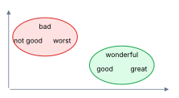
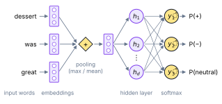
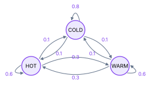
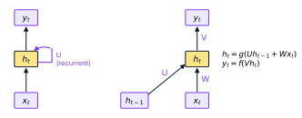
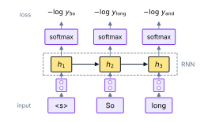
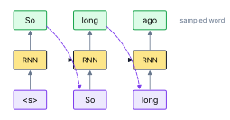
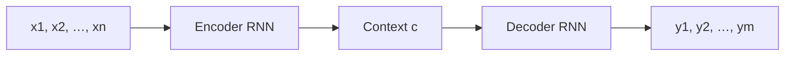
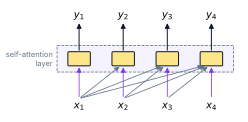

# Natural Language Processing

## Text Normalisation, BPE & Minimum Edit Distance
<!-- pages: 53 -->

### Words and Text Normalisation

- **ELIZA** was an early NLP system that could have a limited conversation with a user, using pattern matching.
- "New York" and "rock 'n' roll" are single words, but they are separated by spaces. Japanese and Chinese don't have spaces between words.
- **Normalising text** means converting it to a convenient, standard form.
- **Lemmatisation** is part of it: it determines that two words have the same root, e.g. *sang*, *sung* and *sings* → *sing* (the **lemma**). A lemmatiser maps all of them to *sing*.
- **Stemming** refers to a simpler version of lemmatisation in which we strip suffixes from the end of the word.
- Text normalisation also includes **sentence segmentation**.
- Comparing words / strings, e.g. for grammar correction, uses the **edit distance** (insertion, deletion, substitution).

### Regular Expressions

Regular expressions (RegEx) are used for text search / pattern matching.

| Pattern | Meaning |
| --- | --- |
| `/[wW]oodchuck/` | *woodchuck* or *Woodchuck* |
| `/[abc]/` | disjunction of the characters *a*, *b* and *c* to match |
| `/[^A-Z]/` | not an upper-case letter |
| `/woodchucks?/` | *woodchuck* or *woodchucks* |
| `/beg.n/` | any character between *beg* and *n* (wildcard) |
| `/[0-9]*/`, `/[0-9]+/` | **Kleene star** (zero or more) / Kleene plus (one or more) digits |
| `^`, `$` | anchors: start and end of line |
| `/\bthe\b/` | word boundary; `/\B…\B/` is a non-word boundary |
| `/cat\|dog/` | *cat* or *dog* |
| `/grep(y\|ies)/` | *grepy* or *grepies* |
| `/a.{24}z/` | matches *a* followed by 24 dots (any characters) followed by *z* |
| `/{n,m}/` | from $n$ to $m$ occurrences of the previous character / expression |
| `/{n,}/` | at least $n$ occurrences of the previous expression |
| `s/([0-9]+)/<\1>/` | `\1` in the 2nd pattern refers to the 1st captured expression |

### Corpora and Vocabulary

- "uh" and "um" are **fillers**, and are considered words in speech-transcription systems, because they may signal that the speaker is restarting the clause / idea, and they are helpful in predicting the upcoming word.
- **Types** = the number of distinct words in a corpus. If the set of words in the vocabulary is $V$, then the number of types is the vocabulary size $|V|$.
- **Herdan's / Heaps' law:** $|V| = kN^\beta$ ($N$ = number of tokens), with $0 < \beta < 1$ depending on the corpus size and genre; for large corpora $\beta$ ranges from 0.67 to 0.75.

### Text Normalisation Steps

1. Tokenising (segmenting) words.
2. Normalising word formats.
3. Segmenting sentences.

- The standard method for tokenisation is to use deterministic algorithms based on regular expressions (compiled into finite-state automata).
- In Chinese, words are composed of **hanzi** (characters), and each character represents a single unit of meaning (called a **morpheme**).

### Byte-Pair Encoding (BPE) for Tokenisation

- BPE deals with **unknown words** in the test data — e.g. *low*, *new* and *newer* in training, and *lower* in test.
- It has a **token learner** and a **token segmenter**. (Other algorithms: unigram language modelling and WordPiece.)

<!-- pages: 54 -->

- The **BPE token learner** chooses the two symbols that are most frequently adjacent ('A', 'B'), adds a new merged symbol to the vocabulary, and replaces every adjacent 'A' 'B' in the corpus with the new 'AB'. It continues to count and merge, creating new longer and longer character strings, until $k$ merges have been done, creating $k$ novel tokens ($k$ is a parameter of the algorithm).

*Example corpus* (`_` marks the end of a word):

| Count | Corpus |
| ---: | --- |
| 5 | l o w _ |
| 2 | l o w e s t _ |
| 6 | n e w e r _ |
| 3 | w i d e r _ |
| 2 | n e w _ |

Vocabulary: `_, d, e, i, l, n, o, r, s, t, w`, then `er`, `er_`, `ne`, … as merges are added.

- Once we've learned our vocabulary, the **token segmenter** is used to tokenise a test sentence: first segment each test-sentence word into characters, and then apply the same merge rules.
- **Case folding** is another kind of normalisation (it maps everything to lower case), e.g. *US* and *us* — for some tasks, case folding will not be done.
- **Porter stemmer** and **Snowball** algorithms are for stemming. The Porter stemmer is based on a series of rules, e.g. `ATIONAL → ATE`, `ING → ε`, `SSES → SS`.
- Periods are more ambiguous, e.g. "Mr." vs a sentence completion (use a dictionary or model training).

### Minimum Edit Distance

- The **minimum edit distance** between 2 strings is defined as the minimum number of editing operations (insertion, deletion and substitution) needed to transform one string into another. If we assign weights to these operations, it is the **Levenshtein distance**.
- Edit distance is computed with a shortest-path algorithm using **dynamic programming (DP)**; the Viterbi algorithm (a DP algorithm) and the CKY algorithm are related DP algorithms.

## N-gram Language Models
<!-- pages: 54 -->

- An N-gram model assigns a probability to each possible next word. The same models also serve to assign a probability to an entire sentence. This is useful for spelling correction or grammatical error correction, e.g. in "Their are two midterms", the phrase "There are" is more probable than "Their are".
- Models that assign probabilities to sequences of words are called **language models (LMs)**.
- Here we consider the simplest model that assigns probabilities to sentences and sequences of words — the **n-gram model**. *Example bigrams:* "please turn", "turn your", etc.
- We use n-gram models to estimate the probability of the last word of an n-gram given the previous words.
- *Example:* $P(\text{the} \mid \text{its water is so transparent that})$. One way to estimate the probability is from relative-frequency counts, but even the web is not big enough to give good estimates.

<!-- pages: 55 -->

- **Chain rule:** $P(w_{1:n}) = P(w_1)\,P(w_2 \mid w_1)\,P(w_3 \mid w_{1:2}) \cdots P(w_n \mid w_{1:n-1})$.
- We can **approximate** the history by just the last few words. For a **bigram** model, $P(w_n \mid w_{1:n-1}) \approx P(w_n \mid w_{n-1})$.
- We can estimate bigram / n-gram probabilities using **MLE (maximum likelihood estimation)**:
$$P(w_n \mid w_{n-1}) = \frac{C(w_{n-1} w_n)}{\sum_w C(w_{n-1} w)}.$$
  In practice, it's more common to use **trigram** models, which condition on the previous 2 words.

### Evaluating Language Models

- We can measure the performance of language models using **extrinsic evaluation** (measuring performance in an application). **Intrinsic evaluation** measures the quality of a model independent of any application.
- In practice, we divide the data into 80 % training, 10 % development (dev set) and 10 % test.
- **Perplexity:**
$$PP(W) = P(w_1 w_2 \dots w_N)^{-1/N} = 2^{H(W)} \;\;(H = \text{entropy}),$$
  which should be lower for a better model. It can be used to compare different n-gram models.
- To build a language model for translating legal documents we need a training corpus of legal documents; to build a language model for a question-answering system we need a training corpus of questions.

### Unknown Words and Smoothing

- For **OOV (out-of-vocabulary)** words, we can add a pseudo-word `<UNK>`: in the training set we replace by `<UNK>` all words that occur fewer than $n$ times, or select a vocabulary of size $V$ in advance (the top $V$ words by frequency), replace the rest by `<UNK>`, and do the model training.
- **Smoothing:**
  1. **Laplace smoothing** — add 1 to all n-gram counts, i.e. $\dfrac{c_i + 1}{N + V}$, or for bigrams
$$P_{\text{Laplace}}(w_n \mid w_{n-1}) = \frac{C(w_{n-1} w_n) + 1}{C(w_{n-1}) + V}.$$
  2. **Add-k smoothing** — $\dfrac{C(w_{n-1} w_n) + k}{C(w_{n-1}) + kV}$.
- **Backoff and interpolation** — less context is sometimes useful: $P(w_n \mid w_{n-2} w_{n-1}) \approx P(w_n \mid w_{n-1})$. Linear interpolation takes a weighted average:
$$\hat P(w_n \mid w_{n-2} w_{n-1}) = \lambda_1 P(w_n) + \lambda_2 P(w_n \mid w_{n-1}) + \lambda_3 P(w_n \mid w_{n-2} w_{n-1}), \qquad \sum_i \lambda_i = 1,$$
  with the $\lambda$s learned from a (held-out) corpus.
- (Kneser–Ney idea) We hypothesise that words that have appeared in more contexts in the past are more likely to appear in some new context as well.

## Smoothing, Naïve Bayes & Sentiment Classification
<!-- pages: 55-56 -->

- **Sentiment analysis** is part of text categorisation; spam detection is another application.
- **Period disambiguation** = deciding if a period is the end of a sentence or part of a word.
- Language modelling can be viewed as classification: each word can be thought of as a class, and so predicting the next word is classifying the context-so-far into a class for each next word. A **POS tagger** classifies each occurrence of a word in a sentence as, e.g., a noun or a verb.

### Generative vs Discriminative Classifiers
<!-- pages: 56 -->

- **Generative classifiers** like naïve Bayes build a model of how a class could generate some input data. Given an observation, they return the class most likely to have generated the observation.
- **Discriminative classifiers** like logistic regression instead learn what features from the input are most useful to discriminate between the different possible classes. Discriminative systems are often more accurate, and hence more commonly used.

### Naïve Bayes Classifiers

A naïve Bayes classifier is a (probabilistic) Bayesian classifier that makes a simplifying (naïve) assumption about how features interact. Assumptions:

1. **Bag-of-words (BoW) assumption** — the position of words is ignored, and we use the frequency of each word.
2. **Naïve Bayes assumption** — conditional independence: $P(f_i \mid c)$ are independent given the class.

$$\hat c = \arg\max_{c \in C} P(c \mid d) = \arg\max_{c \in C} \frac{P(d \mid c)\,P(c)}{P(d)} = \arg\max_{c \in C} \underbrace{P(d \mid c)}_{\text{likelihood}}\;\underbrace{P(c)}_{\text{prior}} = \arg\max_{c \in C} P(f_1, f_2, \dots, f_n \mid c)\,P(c),$$
where $P(d)$ is ignored because it is the same for all classes.

- Naïve Bayes calculations, like language modelling, are done in **log space** to avoid underflow and increase speed:
$$c_{NB} = \arg\max_{c \in C} \log P(c) + \sum_{i \in \text{positions}} \log P(w_i \mid c).$$
  Like logistic regression, it is a **linear classifier** (in log space).
- With Laplace (add-1) smoothing:
$$\hat P(w_i \mid c) = \frac{\operatorname{count}(w_i, c) + 1}{\sum_{w \in V} \operatorname{count}(w, c) + |V|}.$$
  *Example:* $P(\text{"predictable"} \mid -) = \dfrac{1 + 1}{14 + 20}$, where 1 is the count of "predictable" in the −ve class, 14 is the total number of words belonging to the −ve class and 20 is $|V|$. Then compare $P(-)P(s \mid -)$ and $P(+)P(s \mid +)$ for a sentence $s$.
- **Stop words** are very frequent words like *the* and *a*, so ignore them. This can be done by sorting the vocabulary by frequency in the training set, or by using an online stop-word list.
- **Dealing with negation:** prepend the prefix `NOT_` to every word after a token of logical negation, until the next punctuation mark. *Example:* "didn't like this movie, but I" → "didn't NOT_like NOT_this NOT_movie, but I".

### Evaluation: Precision, Recall and F-measure

$$P = \frac{tp}{tp + fp}, \qquad R = \frac{tp}{tp + fn}, \qquad F_\beta = \frac{(\beta^2 + 1)\,PR}{\beta^2 P + R}.$$

- The $\beta$ parameter differentially weights the importance of recall and precision, based on the needs of an application: $\beta > 1$ favours recall and $\beta < 1$ favours precision. For $\beta = 1$, precision and recall are equally balanced — this is $F_1$ (the most used metric).
- For sentiment analysis we may have 3 classes: +ve, −ve and neutral.
- **Macroaveraging:** compute the performance for each class, and then average over the classes. It better reflects the statistics of the smaller classes, and is more appropriate when the classes are balanced.
- **Microaveraging:** collect the decisions for all classes into a single confusion matrix, and then compute precision and recall. It is dominated by the most frequent class.

*Example* (system output vs gold labels; rows = predicted, columns = actual):

| | Class 1: urgent | Class 2: normal | Class 3: spam | Pooled |
| --- | --- | --- | --- | --- |
| Predicted yes — actual yes / no | 8 / 11 | 60 / 55 | 200 / 33 | 268 / 99 |
| Predicted no — actual yes / no | 8 / 340 | 40 / 212 | 51 / 83 | 99 / 635 |
| Precision | 8 / 19 = 0.42 | 60 / 115 = 0.52 | 200 / 233 = 0.86 | 268 / 367 = 0.73 |

$$\text{Microaverage precision} = \frac{268}{268 + 99} = 0.73, \qquad \text{Macroaverage precision} = \frac{0.42 + 0.52 + 0.86}{3} = 0.60.$$

## Statistical Significance & Logistic Regression for NLP
<!-- pages: 57-58 -->

### Statistical Significance Testing

- How do we compare the performance of 2 systems, classifiers A and B, on a metric $M$ ($F_1$ / accuracy)? Perhaps we want to know if our logistic-regression sentiment classifier A gets a higher $F_1$ score than our naïve-Bayes sentiment classifier B on a particular test set $x$.
- Let $M(A, x)$ be the score that system A gets on test set $x$, and $\delta(x) = M(A, x) - M(B, x)$ the performance difference between A and B. We want to know if $\delta(x) > 0$; $\delta(x)$ is the **effect size**.
- Here $H_0: \delta(x) \le 0$ and $H_1: \delta(x) > 0$. We create a random variable $X$ ranging over all test sets. Now we ask how likely it is, if the null hypothesis $H_0$ were correct, that among these test sets we would encounter the value of $\delta(x)$ that we found. We formalise this likelihood as the **p-value**:
$$\text{p-value} = P\big(\delta(X) \ge \delta(x) \mid H_0 \text{ is true}\big).$$
- If $\delta(x)$ is huge, we might be surprised, since it would be extremely unlikely to occur if $H_0$ were in fact true, and so the p-value would be low. But if $\delta(x)$ is very small, it might be less surprising even if $H_0$ were true and A is not really better than B, and so the p-value is higher.
- So a small p-value (5 %, 1 %) ⇒ reject $H_0$ ⇒ the result is **statistically significant**.
- In NLP we generally don't use simple parametric tests like the t-test or ANOVA, because they make assumptions about the distribution of the test statistic. In NLP we use **non-parametric tests** based on sampling: ① the approximate randomisation test, ② the **bootstrap test**.
- The **paired bootstrap test** can be applied to any metric, like precision, recall, $F_1$, BLEU (machine translation), etc. A and B are classifiers for documents; "AB" = A and B both right, "A̶B" = A is wrong and B is right, and so on.

*Example:* create virtual test sets $x^{(1)}, x^{(2)}, \dots$ by sampling the original test set with replacement:

| Test set | 1 | 2 | 3 | 4 | 5 | 6 | … | A % | B % | $\delta()$ |
| --- | --- | --- | --- | --- | --- | --- | --- | ---: | ---: | ---: |
| $x$ | AB | A̶B | AB | A̶B | AB̶ | A̶B | … | 0.70 | 0.50 | 0.20 |
| $x^{(1)}$ | AB | … | | | | | | 0.60 | 0.60 | 0.0 |
| $x^{(2)}$ | … | | | | | | | 0.60 | 0.70 | −0.1 |

### Logistic Regression for NLP

- In NLP, logistic regression is the baseline supervised ML algorithm for classification, and it has a close relationship with neural networks: a neural network can be viewed as a series of logistic-regression classifiers stacked on top of each other.
- **Multinomial logistic regression** is used for multi-class classification.
- Logistic regression is a **discriminative** classifier, while naïve Bayes is a **generative** classifier. These are 2 very different frameworks for how to build an ML model.
  *Example:* imagine we're trying to distinguish dog images from cat images. A generative model would have the goal of understanding what dogs look like and what cats look like. A discriminative model is only trying to learn to distinguish the classes — so if all the dogs in the training data are wearing collars and the cats are not, and that feature neatly separates the classes, the model is satisfied.

<!-- pages: 59 -->

- In naïve Bayes, $\hat c = \arg\max_{c \in C} \underbrace{P(d \mid c)}_{\text{likelihood}}\underbrace{P(c)}_{\text{prior}}$. A generative model like naïve Bayes makes use of the likelihood term, which expresses how to generate the features of a document if we know it was of class $c$. A discriminative model attempts to directly compute $P(c \mid d)$, and it learns to assign a high weight to document features that improve its ability to discriminate between the possible classes.
- The **weights** represent how important the input features are for various tasks.
- The **sigmoid** (it looks like an S) is used for the probability: $P(y = 1) = \sigma(w \cdot x + b)$ and $P(y = 0) = 1 - P(y = 1)$, using $\sigma(-x) = 1 - \sigma(x)$.
- **Features** can be, e.g., $x_1$ = the count of positive-lexicon words, $x_2$ = the count of negative-lexicon words, $x_3 = 1$ if "no" ∈ doc and 0 otherwise, …
- **Period disambiguation** = deciding if a period is the end of a sentence or part of a word, by classifying each period into one of 2 classes: EOS (end of sentence) and not-EOS.
- **Representation learning** = ways to learn features automatically, in an unsupervised way, from the input (deep learning uses it).
- We **standardise** input values by centring them to result in a zero mean and a standard deviation of one (this transformation is the z-score). **Normalisation** (features between 0 and 1): $\dfrac{x_i - \min(x_i)}{\max(x_i) - \min(x_i)}$.
- Data scaling is important in large neural networks, to speed up gradient descent.
- **Using matrices:** with $X = \begin{bmatrix} x_1^{(1)} & x_2^{(1)} & \cdots & x_f^{(1)} \\ x_1^{(2)} & x_2^{(2)} & \cdots & x_f^{(2)} \\ \vdots & & & \vdots \end{bmatrix}$, we compute $\underbrace{y}_{m \times 1} = \underbrace{X}_{m \times f}\,\underbrace{w}_{f \times 1} + b$.

### Logistic Regression vs Naïve Bayes; Cross-Entropy Loss

- Logistic regression is much more **robust to correlated features**. If 2 features $f_1$ and $f_2$ are perfectly correlated, regression will simply assign part of the weight to $w_1$ and part to $w_2$. So logistic regression works better for correlated features than naïve Bayes.
- **Naïve Bayes works better on very small data sets**, and is easy to implement and fast to learn (no optimisation step).
- **Cross-entropy loss** is commonly used for logistic regression and neural networks. The distance between the system output and the gold output is the loss function / cost function:
$$L_{CE}(\hat y, y) = -\log p(y \mid x) = -\big[y \log \hat y + (1 - y)\log(1 - \hat y)\big],$$
  where $p(y \mid x) = \hat y^{\,y}(1 - \hat y)^{1 - y}$; it is the cross-entropy between the true probability distribution $y$ and the estimated distribution $\hat y$.
- The goal of gradient descent is to find the optimal weights by minimising the loss function.
- A good model should **generalise well** on the test set. In regularisation we penalise large weights. **L2 regularisation** is easier to optimise because of its simple derivative ($\theta^2 \to 2\theta$), while **L1 regularisation** is more complex (its derivative is non-continuous at zero).

## Vector Semantics: TF-IDF, PMI & Cosine Similarity
<!-- pages: 59 -->

- Words that occur in **similar contexts** tend to have similar meanings.
- **BERT** gives contextualised embeddings. A model of word meaning should allow us to draw inferences to address meaning-related tasks like question answering or dialogue.

<!-- pages: 60 -->

### Lemmas, Senses and Relations

- The form *mouse* is the **lemma**, or citation form; *mouse* is also the lemma for the word *mice*. Similarly, *sing* is the lemma for *sing*, *sang*, *sung*.
- Each lemma can have multiple meanings: the lemma *mouse* can refer to the rodent or the cursor. So lemmas can be **polysemous** (have multiple senses), which can make interpretation difficult.
- **Word-sense disambiguation** = the task of determining which sense of a word is being used in a particular context.
- **Synonymy** = a relationship between word senses.
- *Cat* and *dog* are not synonyms, but they are **similar** words. *Coffee* is not similar to *cup* (they don't share any features), but they are **related** words.
- One common kind of relatedness between words is if they belong to the same **semantic field**. A semantic field is a set of words which cover a particular semantic domain and bear structured relations with each other.
- Semantic fields are also related to **topic models** like **LDA (Latent Dirichlet Allocation)**, which apply unsupervised learning to large sets of texts to induce sets of associated words from text.
- The word **connotation** has different meanings in different fields. Three important dimensions of affective meaning:
  - **valence** — the pleasantness of the stimulus;
  - **arousal** — the intensity of emotion provoked by the stimulus;
  - **dominance** — the degree of control exerted by the stimulus.
  *Happy / satisfied* have high valence; *excited* has high arousal; *controlling* has high dominance. So we can represent every word with a 3-dimensional vector of the above, with some numbers.

### Vector Semantics and Embeddings

- **Vector semantics** is the standard way to represent word meaning in NLP. The idea is that two words that occur in very similar distributions (whose neighbouring words are similar) have similar meanings.
- Represent a word as a point in a multidimensional semantic space. Vectors for representing words are called **embeddings** (a mapping from one space or structure to another). Words with similar meanings are nearby in space — e.g. *good*, *wonderful* cluster together, away from *not good*, *bad*, *worst*.

  

- **TF-IDF (baseline):** the meaning of a word is defined by a simple function of the counts of nearby words.
- Vectors, or distributional models of meaning, are generally based on a **co-occurrence matrix** — a way of representing how often words co-occur.
- **Term–document matrix:** each row is a vocabulary word and each column a document. 2 documents that are similar will tend to have similar words, and so their column vectors will tend to be similar. The same principle applies to words: similar words have similar vectors because they tend to occur in similar documents.
- **Term–term matrix** (word–word matrix) / **term–context matrix:** both rows and columns are words (dimension $|V| \times |V|$), and each entry is the number of times the row (target) word and the column (context) word co-occur in the same context.

### Cosine Similarity
<!-- pages: 61-62 -->

$$\cos\theta = \frac{a \cdot b}{|a|\,|b|} \in [-1, 1] \qquad (1 = \text{same direction},\; 0 = \text{orthogonal},\; -1 = \text{opposite direction}).$$

- To measure the similarity between 2 target words $v$ and $w$, we need a metric that takes 2 vectors (of words or documents dimension) and gives a measure of their similarity. The most common similarity metric is the **cosine of the angle** between the vectors.
- The **dot product / inner product** acts as a similarity metric: $v \cdot w = \sum_{i=1}^{n} v_i w_i$. When it is zero ⇒ strong dissimilarity.
- More frequent words have longer vectors, since they tend to co-occur with more words and have higher co-occurrence values with each of them. The raw dot product will therefore be higher for frequent words. So we modify the dot product to **normalise for vector length** by dividing by the lengths — which gives the cosine.

### TF-IDF: Weighting Terms in the Vector

- Raw frequency is not the best measure of association between words. TF-IDF is defined when the dimensions are documents; when the dimensions are words, we use the **PPMI** algorithm.
- $\text{TF-IDF} = \text{TF} \times \text{IDF}$, where **TF** is the frequency of word $t$ in document $d$: $tf_{t,d} = \operatorname{count}(t, d)$.
- To squash the raw frequency we use $\log_{10}$, because if a word appears 100 times in a document, that doesn't make the word 100 times more likely to be relevant to the document's meaning. So
$$tf_{t,d} = \log_{10}\big(\operatorname{count}(t, d) + 1\big).$$
- **IDF** is used to give a higher weight to words that occur only in a few documents. Terms that are limited to a few documents are useful for discriminating those documents from the rest of the collection; terms that occur frequently across the entire collection are not as helpful.
- The **document frequency** $df_t$ of a term $t$ is the number of documents it occurs in; with $N$ documents,
$$idf_t = \log_{10}\left(\frac{N}{df_t}\right), \qquad w_{t,d} = tf_{t,d} \times idf_t.$$
- TF-IDF is a weighted value $w_{t,d}$ for word $t$ in document $d$.

### Pointwise Mutual Information (PMI)

- An alternative weighting function to tf-idf: **PPMI (positive PMI)** is used for term–term matrices.
- The best way to weight the association between 2 words is to ask how much *more* the two words co-occur in our corpus than we would have a priori expected them to appear by chance.
- **Mutual information:** $I(X, Y) = \sum_x \sum_y P(x, y) \log_2 \dfrac{P(x, y)}{P(x)P(y)}$.
- **PMI** ($c$ = context word):
$$PMI(w, c) = \log_2 \frac{P(w, c)}{P(w)P(c)}$$
  — the ratio gives an estimate of how much more the 2 words co-occur than we would expect by chance.
- $PPMI(w, c) = \max\left(\log_2 \dfrac{P(w, c)}{P(w)P(c)},\; 0\right)$.
- PMI has the problem of being **biased toward infrequent events**: very rare words tend to have very high PMI values. *Solution:*
$$PPMI_\alpha(w, c) = \max\left(\log_2 \frac{P(w, c)}{P(w)P_\alpha(c)},\; 0\right), \qquad P_\alpha(c) = \frac{\operatorname{count}(c)^\alpha}{\sum_c \operatorname{count}(c)^\alpha}.$$

## Word2Vec & Neural Language Models
<!-- pages: 63 -->

### Word2Vec

- A more powerful word representation: **embeddings** — short, dense vectors (dimension $d$ ranging from 50 to 1000), rather than vectors of the much larger vocabulary size $|V|$ or number of documents $D$.
- Dense vectors work better in every NLP task than sparse vectors. Representing words as 300-dimensional dense vectors requires our classifiers to learn far fewer weights than if we represented words as 50,000-dimensional vectors, and so it avoids overfitting.
- **Skip-gram with negative sampling (SGNS)** — the skip-gram algorithm is one of two algorithms in a software package called **word2vec**, and sometimes the algorithm is loosely referred to as word2vec.
- word2vec embeddings are **static embeddings** (a fixed embedding for each word in the vocabulary). **Dynamic contextual embeddings** include BERT, in which the vector for each word is different in different contexts.
- Here we take the learned classifier weights as the word embeddings.
- **Intuition:** we can just use running text as implicitly supervised training data for such a classifier: a word $c$ that occurs near the target word acts as the gold "correct answer" to the question. This method, often called **self-supervision**, avoids the need for any sort of hand-labelled supervision signal.

### Intuition of Skip-gram

1. Treat the target word and a neighbouring context word as **positive examples**.
2. Randomly sample other words in the lexicon to get **negative examples**.
3. Use logistic regression to train a classifier to distinguish these 2 cases.
4. Use the learned weights as the embeddings.

*Example* (window $= \pm 2$ context words; $w$ = target word):

> … lemon, a [tablespoon$_{c_1}$ of$_{c_2}$ **apricot**$_{w}$ jam$_{c_3}$, a$_{c_4}$] pinch …

- We need to find $P(+ \mid w, c)$ — the probability that $c$ is a real context word for $w$ — and $P(- \mid w, c) = 1 - P(+ \mid w, c)$ ($c$ is not a real context word for $w$).
- $\text{Similarity}(w, c) \approx c \cdot w$, so
$$P(+ \mid w, c) = \sigma(c \cdot w) = \frac{1}{1 + \exp(-c \cdot w)}.$$
- Skip-gram makes the assumption that all context words are independent, so
$$P(+ \mid w, c_{1:L}) = \prod_{i=1}^{L} \sigma(c_i \cdot w).$$
- Skip-gram actually stores **2 embeddings for each word**: one for the word as a target and one for the word as context. And it uses more negative examples than positive ones.
- **Loss function:**
$$L_{CE} = -\log\left[P(+ \mid w, c_{\text{pos}}) \prod_{i=1}^{k} P(- \mid w, c_{\text{neg}_i})\right].$$
  That is, we want to maximise the dot product of the word with the actual context words, and minimise the dot products of the word with the $k$ negative-sampled non-neighbour words.
- The skip-gram model learns 2 separate embeddings for each word $i$: the target embedding $w_i$ and the context embedding $c_i$; we then add $w_i + c_i$ to represent word $i$.

### Other Static Embeddings and Analogies
<!-- pages: 64 -->

- **fastText** is also a static embedding like word2vec, and so is **GloVe (Global Vectors)**. GloVe is based on ratios of probabilities from the word–word co-occurrence matrix, combining the intuitions of count-based models like PPMI while also capturing the linear structures used by methods like word2vec.
- **Visualising embeddings:** project the 100 dimensions of a word down to 2 dimensions using **t-SNE**.
- **Parallelogram model:** if $a$ is to $b$, then $a^*$ is to what? e.g. apple : tree :: grape : ? (vine).
  - *Example:* $\vec{\text{king}} - \vec{\text{man}} + \vec{\text{woman}}$ is a vector close to $\vec{\text{queen}}$; similarly $\vec{\text{Paris}} - \vec{\text{France}} + \vec{\text{Italy}}$ is close to $\vec{\text{Rome}}$.
  - For $a : b :: a^* : b^*$, $\;\hat b^* = \arg\min_x \operatorname{distance}(x,\; b - a + a^*)$.

### Neural Networks and Neural Language Models

- Neural networks are a fundamental computational tool for language processing, and they are called *neural* because their origins lie in the **McCulloch–Pitts neuron**.
- **Feed-forward network:** the computation proceeds iteratively from one layer to the next ("deep" = many layers).
- The **tanh** function has the nice properties of being smoothly differentiable and of mapping outlier values toward the mean.
- The **rectifier** (ReLU) function has the nice property that its result is close to linear.
- In tanh and sigmoid, zero derivatives for large $z$ cause problems for learning, because we train networks by propagating an error signal backwards, multiplying gradients (partial derivatives) from each layer, which causes the error signal to get smaller and smaller until it is too small to be used for training — the **vanishing-gradient problem**. ReLU doesn't have this problem.
- **XOR** is not a linearly separable function; the solution is to use 3 ReLU units in 2 layers.
- In multinomial classification, like POS tagging, the output value is the probability of each POS (and they sum to 1).
- One of the reasons we use a **non-linear activation function** for each layer in a neural network is that if we did not, the resulting network would be exactly equivalent to a single-layer network. Without non-linear activation functions, a multilayer network is just a notational variant of a single-layer network, because
$$z^{[1]} = W^{[1]}x + b^{[1]}, \quad z^{[2]} = W^{[2]}z^{[1]} + b^{[2]} = W^{[2]}W^{[1]}x + W^{[2]}b^{[1]} + b^{[2]} = W'x + b'.$$
- We use deep learning's ability to learn features from data by representing words as embeddings, like word2vec / GloVe embeddings, instead of hand-built features.

*Example — sentiment classification with pooled embeddings:*

- Using already-learned weights (an embedding representation from word2vec / GloVe) for the input words is called **pretraining**.
- Using pretrained embedding representations, whether simple static word embeddings or powerful contextual embeddings, is one of the central ideas of deep learning.
- Neural networks can be used for **language modelling** (predicting words from the prior word context), e.g. the input to the language model is $P(w_t = i \mid w_{t-3}, w_{t-2}, w_{t-1})$.
- Neural networks are less interpretable than n-gram models.
- *Example:* if the training data has "cat feeds food" and we then see "dog feeds", *food* is predicted here too, because *cat* and *dog* have similar embeddings.
- **Loss function:** cross-entropy loss.
- **Backpropagation** = backward differentiation (it depends on computational graphs). *Example:* $L(a, b, c) = c(a + 2b)$ with $d = 2b$, $e = a + d$, $L = c \cdot e$; then, e.g., $\dfrac{\partial L}{\partial d} = \dfrac{\partial L}{\partial e}\,\dfrac{\partial e}{\partial d}$.

- **Hyperparameters** in neural networks: learning rate, mini-batch size, number of layers, units per layer, choice of activation function.

## Sequence Labelling, HMMs, RNNs & LSTMs
<!-- pages: 65-66 -->

### Sequence Labelling for POS and NER

- **POS** (parts of speech) are generally assigned to individual words or morphemes.
- A proper name is often an entire multiword phrase, like "Marie Curie", a location or an organisation; **named entity recognition (NER)** finds what is referred to by a proper name.
- **Sequence-labelling algorithms:** the **Hidden Markov Model (HMM)** — a generative algorithm — or **Conditional Random Fields (CRF)** — a discriminative algorithm.
- In POS tagging, the input is a sequence $x_1, x_2, \dots, x_n$ of tokenised words, and the output is a sequence $y_1, y_2, \dots, y_n$ of tags, one for each word.
- A **sequence labeller** (HMM, CRF, RNN, Transformer, etc.) is trained to label each token in a text with a tag.
- An **HMM** is a probabilistic sequence model: given a sequence of units (words, letters, morphemes, sentences, etc.), it computes a probability distribution over possible sequences of labels, and chooses the best label sequence.

### Markov Chains

- The HMM is based on augmenting the **Markov chain**. A Markov chain is a model that tells us something about the probabilities of sequences of random variables — *states* — each of which can take on values from some set. These sets can be words, or tags, or symbols representing anything, for example the weather.
- A Markov chain makes a very strong assumption: if we want to predict the future in the sequence, all that matters is the current state. All the states before the current state have no impact on the future except via the current state. *Example:* to predict tomorrow's weather, only today's weather matters, not yesterday's.

- **Start distribution** $\pi = [0.1, 0.7, 0.2]$ — e.g. we most likely start with state 2.
- **Markov assumption:** the past does not matter, only the present matters:
$$P(q_i = a \mid q_1 \dots q_{i-1}) = P(q_i = a \mid q_{i-1}) \qquad \text{(like a bigram language model).}$$
- Formally, a Markov chain is specified by the following components:
  1. $Q = q_1 q_2 \dots q_N$ — a set of $N$ states;
  2. $A = a_{11} a_{12} \dots a_{NN}$ — the transition-probability matrix;
  3. $\pi = \pi_1, \pi_2, \dots, \pi_N$ — the initial probability distribution, $\sum_i \pi_i = 1$.

### The Hidden Markov Model (HMM)

In many cases, the events we are interested in are **hidden** (here, the tags are hidden). **Components:**

1. $Q = q_1 \dots q_N$ — a set of $N$ states;
2. $A = a_{11} \dots a_{NN}$ — the transition-probability matrix;
3. $O = o_1 o_2 \dots o_T$ — a sequence of $T$ observations;
4. $B = b_i(o_t)$ — the **emission probabilities** (observation likelihoods), each expressing the probability of an observation $o_t$ being generated from a state $q_i$;
5. $\pi = \pi_1, \pi_2, \dots$ — the initial probability distribution, $\sum \pi_i = 1$.

**Assumptions:**

1. **Markov assumption:** $P(q_i \mid q_1 \dots q_{i-1}) = P(q_i \mid q_{i-1})$.
2. **Output independence:** $P(o_i \mid q_1 \dots q_T, o_1 \dots o_T) = P(o_i \mid q_i)$ — the probability of an output observation $o_i$ depends only on the state that produced it, not on other states.

**Estimating the matrices (maximum-likelihood estimates):**

- $A$ — the transition-probability matrix: $P(t_i \mid t_{i-1}) = \dfrac{C(t_{i-1}, t_i)}{C(t_{i-1})}$.
- $B$ — the emission-probability matrix: $P(w_i \mid t_i) = \dfrac{C(t_i, w_i)}{C(t_i)}$.

**Decoding** = determining the hidden variables:
$$\hat t_{1:n} = \arg\max_{t_1 \dots t_n} P(t_1 \dots t_n \mid w_1 \dots w_n) = \arg\max_{t_1 \dots t_n} \frac{P(w_1 \dots w_n \mid t_1 \dots t_n)\,P(t_1 \dots t_n)}{P(w_1 \dots w_n)} = \arg\max_{t_1 \dots t_n} P(w_1 \dots w_n \mid t_1 \dots t_n)\,P(t_1 \dots t_n).$$
Now, with the assumptions $P(w_1 \dots w_n \mid t_1 \dots t_n) \approx \prod_{i=1}^{n} P(w_i \mid t_i)$ and $P(t_1 \dots t_n) \approx \prod_{i=1}^{n} P(t_i \mid t_{i-1})$ (the bigram assumption):
$$\hat t_{1:n} \approx \arg\max_{t_1 \dots t_n} \prod_{i=1}^{n} \underbrace{P(w_i \mid t_i)}_{\text{emission prob.}}\;\underbrace{P(t_i \mid t_{i-1})}_{\text{transition prob.}}.$$
The **Viterbi algorithm** is the decoding algorithm, based on dynamic programming.

### Recurrent Neural Networks (RNNs)
<!-- pages: 67 -->

Language is a **temporal phenomenon**: we comprehend and produce both spoken and written language as a continuous input stream.

- An **RNN** is any network that contains a cycle within its network connections, meaning that the value of some unit is directly or indirectly dependent on its own earlier outputs as inputs.
- The hidden layer from the previous time step provides a form of memory, or context, that encodes earlier processing and informs the decisions to be made at later points in time.

- Adding the temporal dimension makes RNNs appear to be more complex than non-recurrent architectures, but in reality they are not all that different: we are still performing the standard feed-forward calculation:
$$h_t = g(U h_{t-1} + W x_t), \qquad y_t = f(V h_t), \quad \text{and so on for } x_1 \dots x_n.$$
- In **RNN language models:**
$$e_t = E x_t, \qquad h_t = g(U h_{t-1} + W e_t), \qquad y_t = \operatorname{softmax}(V h_t).$$
  Replacing $V$ with $E^T$ is called **weight tying**.
- Always giving the model the correct history sequence to predict the next word (rather than its own prediction) is called **teacher forcing**. During training, the loss at each step is $-\log y_{\text{correct word}}$ (e.g. $-\log y_{\text{long}}$, then $-\log y_{\text{and}}$, …).

  

- Today, the approach of using a language model to incrementally generate words by repeatedly sampling the next word, conditioned on the previous choices, is called **autoregressive generation** or **causal LM generation**.
- An **autoregressive model** is a model that predicts a value at time $t$ based on a linear function of the previous values at times $t-1$, $t-2$, and so on. Although language models are not linear (because they have many layers of non-linearities), we refer to this as autoregressive generation.
- Autoregressive generation with RNNs (starting from `<s>`, each sampled word is fed back as the next input) is useful in machine translation, summarisation, question answering, etc.

  

- **Stacked RNN** = the output from one RNN is the input sequence to another RNN. Stacked RNNs generally outperform single-layer networks; the optimal number of stacked RNNs depends on the application and the training set.
- **Bidirectional RNN** = both a left-to-right and a right-to-left RNN, with their outputs concatenated.

### LSTM (Long Short-Term Memory)

- Captures **distant information**: it forgets information which is not needed, and remembers information required for decisions still to come.
- The LSTM removes information that is no longer needed from the context, and adds information that is likely to be needed for later decision making.
- **Gates** are neural networks. The choice of the sigmoid activation function arises from its tendency to push its output to either 0 or 1.

1. **Forget gate:** $f_t = \sigma(U_f h_{t-1} + W_f x_t)$ and $k_t = c_{t-1} \odot f_t$ (for masking).
2. **Add gate:** $g_t = \tanh(U_g h_{t-1} + W_g x_t)$, $\;i_t = \sigma(U_i h_{t-1} + W_i x_t)$, $\;j_t = g_t \odot i_t$, and then $c_t = j_t + k_t$.
3. **Output gate:** $o_t = \sigma(U_o h_{t-1} + W_o x_t)$ and $h_t = o_t \odot \tanh(c_t)$.

### Encoder–Decoder Models (Seq2Seq Networks)

- The input and output have **different lengths** (e.g. machine translation).
- The **context vector** $c$ is a function of $h_1^n$; it conveys the essence of the input to the decoder (and can be passed to each layer of the decoder).

## Transformers & Self-Attention
<!-- pages: 68-69 -->

- A transformer maps sequences of input vectors to sequences of output vectors of the same length. It is a **self-attention model** (causal, or masked, self-attention), and the processing happens **in parallel**.

- **Comparison:** $\operatorname{score}(x_i, x_j) = x_i \cdot x_j$.
- $\alpha_{ij} = \operatorname{softmax}\big(\operatorname{score}(x_i, x_j)\big) \quad \forall j \le i$.
- $y_i = \sum_{j \le i} \alpha_{ij}\, x_j$.
- **Self-attention:**
$$\operatorname{SelfAttention}(Q, K, V) = \operatorname{softmax}\!\left(\frac{QK^T}{\sqrt{d_k}}\right) V.$$
