# LLM University: Transformers & Attention

*Source: LLM University by Cohere.*

## Word & Sentence Embeddings
<!-- pages: 70-72 -->

### What Are Word and Sentence Embeddings?

- Sentence and word embeddings are the **bread and butter of language models**.
- The main task of NLP is to understand human language. However, there is a big disconnection there: humans speak in words and sentences, but computers only understand and process numbers. How can we turn words and sentences into numbers in a coherent way? An assignment of words to numbers is called a **word embedding**. We can think of a word embedding as an assignment of scores to the words, with some nice properties.

### What Is a Word Embedding?

- Words that are **similar** should correspond to points that are close by (or equivalently, to scores that are similar).
- Words that are **different** should correspond to points that are far away (or equivalently, to scores that are significantly different).

### Word Embeddings Capture Features of the Word

- Word embeddings not only capture word similarity, but they also capture other properties of the language.
- In language, words can be combined to get more complicated concepts. In mathematics, numbers can be added or subtracted to get other numbers. Could we build a word embedding that captures relations between words, as relations between numbers?


- Here *puppy*, *dog*, *calf* and *cow* make a **rectangle**: puppy : dog :: calf : cow.
  - The path from the word *puppy* to the word *dog* is the same as the path from the word *calf* to the word *cow*.
  - The analogy "a dog is to a cow like a puppy is to a calf" is also captured in this rectangle.
- The main property of word embeddings that is in effect here is that **the two axes (vertical and horizontal) represent different things**. If you look carefully, moving towards the right turns the puppy into a dog and the calf into a cow, which is an increase in **age**. Likewise, moving upwards turns a puppy into a calf and a dog into a cow, which is an increase in the **size** of the animal.
- It seems that this embedding understands that the words in it have 2 main properties, or features: age and size. Furthermore, it seems that the embedding locates age on the horizontal axis and size on the vertical axis. In that case, where would you imagine the word "whale" goes? Probably somewhere above the word "cow". And if there was a word for "really old dog"? That word would go somewhere to the right of the word "dog".
- A good word embedding would be able to capture not only age and size, but also many more features of the words. Since each feature is one new axis, or coordinate, a good embedding must have many more than two coordinates assigned to every word. One of the Cohere embeddings, for example, has **1024 coordinates** associated with each word. These rows of 1024 (or however many) coordinates are called **vectors**, so we often talk about the vector corresponding to a word, and about each of the numbers inside a vector as a coordinate.
- Some of these coordinates may represent important properties of the word, such as age, gender or size. Some may represent combinations of properties. But some others may represent obscure properties that a human may not be able to understand.

<!-- pages: 73-75 -->

- But all in all, a word embedding can be seen as a good way to translate human language (words) into computer language (numbers), so that we can start training ML models with these numbers.

### Sentence Embeddings

- So word embeddings seem to be pretty useful, but in reality human language is much more complicated than simply a bunch of words put together. How would one be able to represent a sentence? How about the sum of the scores of all the words?
- For example, say we have a word embedding that assigns the following scores to these words:

| Word | Embedding |
| --- | --- |
| No | [1, 0, 0, 0] |
| I | [0, 2, 0, 0] |
| Am | [−1, 0, 1, 0] |
| Good | [0, 0, 1, 3] |

- Then the sentence "No, I am good!" corresponds to the vector [0, 2, 2, 3]. However, the sentence "I am no good" will also correspond to the vector [0, 2, 2, 3]. This is not a good thing, since the computer understands these 2 sentences in the exact same way, yet they are quite different, almost opposite sentences. Therefore, we need better embeddings that take into account the **order of words**, the semantics of the language and the actual meaning of the sentence.
- A **sentence embedding** is just like a word embedding, except it associates every sentence with a vector full of numbers, in a coherent way. By coherent, I mean that it satisfies similar properties to a word embedding: for instance, similar sentences are assigned to similar vectors, different sentences are assigned to different vectors, and most importantly, each of the coordinates of the vector identifies some property of the sentence.

| Sentence | Numbers | | | |
| --- | ---: | ---: | :---: | ---: |
| Hello, how are you? | 0.419 | 1.28 | … | −0.06 |
| I'm going to school today | −0.74 | 1.02 | … | 1.35 |
| … | … | … | … | … |
| Once upon a time | −0.82 | −1.32 | … | 0.32 |

- The **Cohere embedding** does just this. Using transformers, attention mechanisms and other cutting-edge algorithms, this embedding sends every sentence to a vector formed by **4096 numbers**, and this embedding works really well.

### How to Use These Embeddings

- Use the **Cohere dashboard** → the *Embed* tab, and type sentences.
- The results come out as vectors with 4096 entries for each sentence. These are obviously hard to visualise, but there is a way to bring them down to 2 entries per sentence in order to be easily visualised.

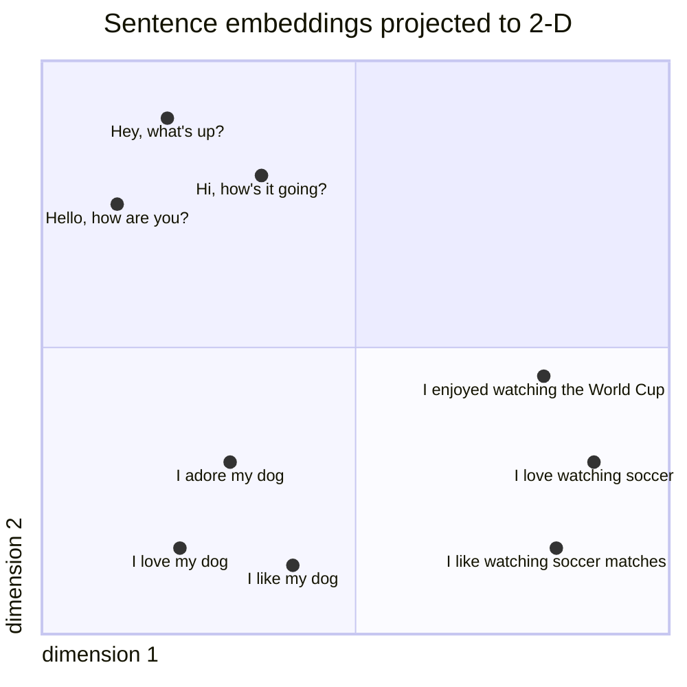

- Notice that the embedding seems to capture the essence of the sentences, and there are **3 clear clusters** of sentences (greetings, dogs, soccer).

## Similarity Between Words & Sentences
<!-- pages: 76-78 -->

### What Is Similarity Between Sentences?

- For LLMs, it is crucial to know when 2 words or 2 sentences are similar or different. This can be a hard problem, but luckily word and sentence embeddings are very helpful for this task.
- In a nutshell, a word embedding is an assignment of a list of numbers (a vector) to every word, in a way that semantic properties of the word translate into mathematical properties of the numbers. What do we mean by this? For example, 2 similar words will have similar vectors, and 2 different words will have different vectors. But most importantly, each entry in the vector corresponding to a word keeps track of some property of the word. Some of these properties can be understandable to humans, such as age, size, gender, etc., but some others could potentially only be understood by the computer.
- **Sentence embeddings** are even more powerful, as they assign a vector of numbers to each sentence, in a way that these numbers also carry important properties of the sentence. One of the Cohere embeddings assigns a vector of length 4096 (a list of 4096 numbers) to each sentence.

### Dot Product and Cosine Similarity

- There are 2 types of similarities: **dot-product similarity** and **cosine similarity**. Both are very similar, and very useful to determine if 2 words (or sentences) are similar.
  - In the dot product, we multiply the vectors element-wise and then add.
  - In cosine similarity, we look at the angle between 2 sentences.
- **Euclidean distance** is a good measure for similarity (very far movies are less similar) — but it does the opposite: it grows as similarity falls. Now, in order to tweak this metric, let's look at the angle between the rays from the origin to each sentence. Notice that this angle is small if the points are close to each other, and large if the points are far away from each other. Now we need the help of another function, the cosine. The cosine of angles close to zero is close to 1, and as the angle grows, the cosine decreases. This is exactly what we need. Therefore, we define the **cosine distance** as the cosine of the angle formed by the 2 rays going from the origin to the 2 sentences.

| Angle between the rays | Cosine | Similarity |
| --- | --- | --- |
| Right angle ($\alpha = 90°$) | $\cos\alpha = 0$ | 0 |
| Small angle | $\cos\alpha = 0.98$ | 0.98 |

### Real-Life Example

```python
import numpy as np
import seaborn as sns
import altair as alt
from sklearn.metrics.pairwise import cosine_similarity
import cohere

co = cohere.Client("COHERE_API_KEY")  # your Cohere API key

# Consider the following 3 sentences
texts = ["I like to be in my house",
         "I enjoy staying home",
         "the isotope 238u decays to 206pb"]
```

- One would expect the first 2 sentences to have a high similarity score when compared to each other, and the 3rd one to have a very low similarity score when compared to the other two.
- To get the corresponding sentence embeddings, we call the **Embed endpoint** with `co.embed()`. We supply 3 parameters:
  - `texts` — our list of sentences;
  - `model` — we use `embed-english-v3.0`, Cohere's latest English-only embeddings model, to generate the embeddings;
  - `input_type` — we use `search_document` to indicate that we intend to use the embeddings for search use cases.

<!-- pages: 79-80 -->

```python
response = co.embed(
    texts=texts,
    model="embed-english-v3.0",
    input_type="search_document",
)
```

- The embeddings are stored in the `embeddings` value of the response. After getting the embeddings, we separate them by sentence and print the values:

```python
embeddings = response.embeddings
[sentence1, sentence2, sentence3] = embeddings
print("Embedding for sentence 1", np.array(sentence1))
print("Embedding for sentence 2", np.array(sentence2))
print("Embedding for sentence 3", np.array(sentence3))
```

- Note that the embeddings are vectors (lists) of 1024 numbers, so they are truncated here.

**Dot-product similarity:**

```python
print("Similarity between sentences 1 and 2:", np.dot(sentence1, sentence2))
print("Similarity between sentences 1 and 3:", np.dot(sentence1, sentence3))
print("Similarity between sentences 2 and 3:", np.dot(sentence2, sentence3))
```

**Cosine similarity:**

```python
print("Cosine similarity between sentences 1 and 2:",
      cosine_similarity([sentence1], [sentence2])[0][0])
# … and the same for the other pairs
```

- The dot product and cosine distance give nearly identical values. The reason for this is that the embedding is **normalised** (each vector has norm equal to 1). When the embedding is not normalised, the dot product and cosine distance would give different values.

## What Is Attention in Language Models?
<!-- pages: 80-82 -->

- A huge roadblock for language models is when a word can be used in **two different contexts**. When this problem is encountered, the model needs to use the context of the sentence in order to decipher which meaning of the word to use. This is precisely what **self-attention** models do.
- Word embeddings have a huge Achilles heel: words that have more than one definition. If a word embedding assigns a vector to, say, the word "bank", it assigns the same vector to all the definitions of "bank". What if you want to use this word in different contexts? Here is where attention comes into play.
- **Attention** is a very clever way to tell words apart when they are used in different contexts (which turns word embeddings into **contextualised word embeddings**).

### One Word, Multiple Meanings

In order to understand attention, let's look at 2 sentences:

- Sentence 1: *The **bank** of the river.*
- Sentence 2: *Money in the **bank**.*

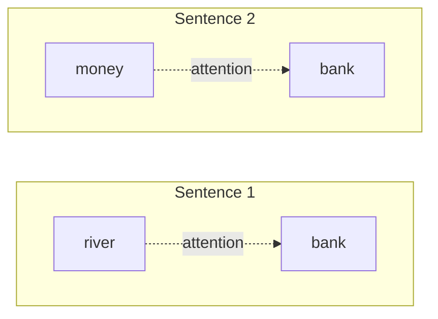

- How would a computer know that the word "bank" in the 1st sentence refers to a setting in nature, and in the 2nd sentence to a financial setting?
- Well, let's ask a simpler question: how would a human know this? How did you figure out these 2 settings? The way you and I did it was probably to look at the **neighbouring words**. In the 1st sentence, the word "river" was the one that hinted at the nature setting, and in the 2nd sentence, the word "money" was key to the financial setting. So, in short, **we need a way to use the other words in the sentence to understand what context of the word "bank" we want to use.**

<!-- pages: 83-85 -->

- Here is where **word embeddings** come into play. Word embeddings are a way to assign vectors (lists of numbers) to each word. I like to imagine them geometrically. Imagine that the words "bank", "river" and "money" are all attached on a **cork board**. Furthermore, this cork board contains all the existing words, in such a way that 2 words that are similar (such as "apple" and "pear") are close by. Now, in this cork board, "bank", "river" and "money" are not exactly close by. However, what you do is take the word "bank" and move it slightly towards the word "river"; call this word **"bank1"**. Now, take another copy of the word "bank" and move it slightly towards the word "money"; call this one **"bank2"**. Now, consider the following 2 modified sentences:
  - Modified sentence 1: *The **bank1** of the river.*
  - Modified sentence 2: *Money in the **bank2**.*

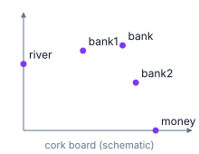

- In these 2 sentences, the computer now knows a little more about the context of the word "bank", as the word has been split into 2 distinct ones: one whose definition is closer to "river", and another one whose definition is closer to "money". That, in short, is how **attention mechanisms** work. However, there may be many questions lingering in your head. For example:
  - What do you mean by "moving a word closer to another one"?
  - Why did you ignore the other words in the sentence? How did you know the words "river" and "money" were the ones dictating the context, instead of the words "the", "in" or "of"? As humans, we know which words provide context, but a computer would not have a clue.
  - As computers only handle numbers, how do we attach numbers to all these methods?
- All these (and hopefully more) questions will be answered next.

### Moving Words on the Cork Board

- First, let me tell you what I mean by "moving a word closer to another one". The way I like to imagine this is to **average two words**. For example, let's say that I want to move the word "bank" 10 % closer to the word "river". I now think of the word "0.9 × bank + 0.1 × river". That is, "bank1" is 90 % "bank" and 10 % "river". Also, let's say that "bank2" is 80 % "bank" and 20 % "money". So, let's say these are the modified words:
$$\text{bank1} = 0.9 \times \text{bank} + 0.1 \times \text{river}, \qquad \text{bank2} = 0.8 \times \text{bank} + 0.2 \times \text{money}.$$
- How did I come up with the numbers 0.9, 0.1, 0.8 and 0.2? That comes later (OK, I have to spoil it: the answer is **similarity**). For now, you may be wondering what I mean by 0.9 × bank + 0.1 × river. Well, in the embeddings chapter we learned that a word embedding consists of assigning a vector (list) of numbers to each word. The Cohere embedding associates each word with a vector of length 4096 (that is, a list of 4096 numbers per word).

<!-- pages: 86-88 -->

For simplicity, let's imagine an embedding that associates a vector of 2 numbers to each word:

| Word | Embedding |
| --- | --- |
| River | [0, 5] |
| Money | [8, 0] |
| Bank | [6, 6] |

These 2 numbers can be interpreted as coordinates in the plane, where the 1st number is the horizontal coordinate and the 2nd number the vertical coordinate.

$$\begin{aligned}
\text{bank1} &= 0.9 \times \text{bank} + 0.1 \times \text{river} = 0.9 \times [6, 6] + 0.1 \times [0, 5] = [5.4, 5.4] + [0, 0.5] = [5.4, 5.9], \\
\text{bank2} &= 0.8 \times \text{bank} + 0.2 \times \text{money} = 0.8 \times [6, 6] + 0.2 \times [8, 0] = [4.8, 4.8] + [1.6, 0] = [6.4, 4.8].
\end{aligned}$$

- As you can see, "bank1" is closer to "river" and "bank2" is closer to "money". As a matter of fact, "bank1" is on the line between "bank" and "river", 10 % along the way. Similarly, "bank2" is on the line between "bank" and "money", 20 % along the way.
- Thus the attention mechanism managed to **split the word "bank" into 2 words**, and use each one in the corresponding sentence.

### How to Decide Which Words Determine Context?

- In other words, why did I pick the words "river" and "money" instead of "the", "of" and "in" in order to determine the context of "bank"? Obviously the answer is "because I'm human and I know the language". But what can the computer do? It can rely on two mechanisms: one of them is a metric such as **similarity**; the second one is **multi-head attention**.
- Let's first discuss the similarity mechanism. What the computer is going to do is to consider all the words in the sentence as context, including irrelevant words such as "the", "of" and "in". However, it's going to consider them a certain amount, and that amount is precisely the **similarity between the word and "bank"**. We trust that in a good embedding, the similarity between "bank" and a word such as "the" is almost zero, as they are unrelated. Therefore, the model will know to ignore these words and focus on those that may have a higher similarity with the word "bank".
- Imagine that we calculate similarities for the words in each sentence, and we get the following:

*The bank of the river:*

| | the | bank | of | river |
| --- | ---: | ---: | ---: | ---: |
| **the** | 1 | 0 | 0 | 0 |
| **bank** | 0 | 1 | 0 | 0.11 |
| **of** | 0 | 0 | 1 | 0 |
| **river** | 0 | 0.11 | 0 | 1 |

*Money in the bank:*

| | money | in | the | bank |
| --- | ---: | ---: | ---: | ---: |
| **money** | 1 | 0 | 0 | 0.25 |
| **in** | 0 | 1 | 0 | 0 |
| **the** | 0 | 0 | 1 | 0 |
| **bank** | 0.25 | 0 | 0 | 1 |

- Why is the similarity between "bank" and "money" higher than the similarity between "bank" and "river"? We can imagine that "bank" gets used more often in the same context as "money" than as "river", and that explains the difference. We are simplifying this model quite a bit: it could be that the similarity between "the" and "of" is not zero, but 0.001.
- Now, on to the next step. We are going to use the similarities to transform each of the words of this sentence. We'll call these new words "the1", "bank1", "of1", "river1" for the first sentence, and "money2", "in2", "the2", "bank2" for the second sentence. Beware, we'll be doing some maths with words, but it won't be very different from the one we did before.

<!-- pages: 89-91 -->

- Let's look at the first sentence, "The bank of the river", and the word "the". The similarities with the other words are as follows — similarities with "the": the 1, bank 0, of 0, river 0. Therefore, we turn the word "the" into the new word "the1", which corresponds to the sum
$$1 \times \text{"the"} + 0 \times \text{"bank"} + 0 \times \text{"of"} + 0 \times \text{"river"}.$$
  This is equal to the word "the". That means the word "the" does not change, and it is equal to "the1".
- Now let's follow the same procedure with the word "bank" and see what we get. The similarities of the word "bank" with the other words of the sentence "The bank of the river" are: the 0, bank 1, of 0, river 0.11.
- Therefore, the word "bank" turns into the word "bank1", given by the equation $1 \times \text{"bank"} + 0.11 \times \text{"river"}$. We are almost done: we want the coefficients of the words to add to 1, so we can divide everything by their sum, which is 1.11. When we do that, we get that the word "bank" gets transformed into the word
$$\text{bank1} = 0.9 \times \text{"bank"} + 0.1 \times \text{"river"}.$$
- Let's do one more for consistency. The word "money" in the 2nd sentence turns into "money2", given by the equation $1 \times \text{"money"} + 0.25 \times \text{"bank"}$. When we normalise, we divide everything by 1.25, to get the equation
$$\text{money2} = 0.8 \times \text{"money"} + 0.2 \times \text{"bank"}.$$
- This is the way we obtained the modified words that we used in the attention mechanism above. The modified sentences then become the following:

| Original sentence | Modified sentence |
| --- | --- |
| The **bank** of the **river** | the (0.9 bank + 0.1 river) of the (0.1 bank + 0.9 river) |
| **Money** in the **bank** | (0.8 money + 0.2 bank) in the (0.2 money + 0.8 bank) |

### Is There More to Attention?

- What you learned in this chapter is **simple self-attention**. However, we can do much better than that. There is a method called **multi-head attention**, in which one does not only consider one embedding, but several different ones. These are all obtained from the original by transforming it in different ways. Multi-head attention has been very successful at the task of adding context to text. *[Check the 2 videos.]*
- LLMs make great use of attention mechanisms in order to understand text.
- Attention helps the LLM understand the **whole context of the text**, as opposed to just a few words at a time.
- So attention does a few mathematical operations that can be seen **geometrically**. Embeddings are a bridge between human and computer, because humans understand text and computers understand numbers. **The better the embedding, the better the models are**, because if you have really good numbers for each word or each piece of text, then the problem becomes much easier.

## Multi-Head Attention & Building Better Embeddings
<!-- pages: 92-95 -->

**Attention** comes in two forms: **self-attention** and **multi-head attention**.

- Attention uses the **context of the sentence** in order to help the embedding resolve this type of ambiguity.
- Attention can be explained using the formulas below, with matrices such as **Query, Key and Values**:
$$\operatorname{Attention}(Q, K, V) = \operatorname{softmax}\!\left(\frac{QK^T}{\sqrt{d_k}}\right) V,$$
$$\operatorname{MultiHead}(Q, K, V) = \operatorname{Concat}(\text{head}_1, \dots, \text{head}_h)\, W^O, \qquad \text{where } \text{head}_i = \operatorname{Attention}(QW_i^Q,\; KW_i^K,\; VW_i^V).$$

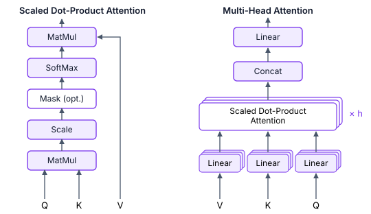

### Example: Attention Moves Words Toward Their Context

1. *Please buy an **apple** (fruit) and an **orange**.* — "apple" is pulled towards "orange".
2. ***Apple** (brand) unveiled the new **phone**.* — "apple" is pulled towards "phone".

- Say initially *orange* has coordinates (11, 11), *phone* has (1, 2) and *apple* has (6, 7).
- Now, for the modified sentences, *apple* has coordinates (8, 8.5) in the 1st sentence, and (4, 5) in the 2nd sentence.
- If we use these new numbers (vectors) as the embeddings in the sentence, then the model is going to have an easier time. This process is done many times in ML, so the word ends up nearer to the relevant region.
- At the end of the day, we don't use the sentence, we use the **context**.
- Words pull each other, like **gravity**.

### Multi-Head Attention

- Attention works better, but multi-head attention works even better.
- **Is one embedding good enough?** No, we can do much better. We can ideally have lots and lots of embeddings: we just use 10, 20 or 100 embeddings and combine those results. That is **multi-head attention**.
- *Example:* an embedding that puts *orange* and *phone* far apart (on different axes) is a **good embedding**; one that puts *phone* and *orange* next to each other is the **worst embedding**.
- We build embeddings by modifying existing embeddings with the use of **linear transformations** — rotation, stretching (horizontal / vertical) and shear — and we can combine these transformations.

### Example: New Embeddings from Existing Ones
<!-- pages: 96 -->

Three embeddings of the words *phone*, *orange* and *apple*, produced by transforming the original one:

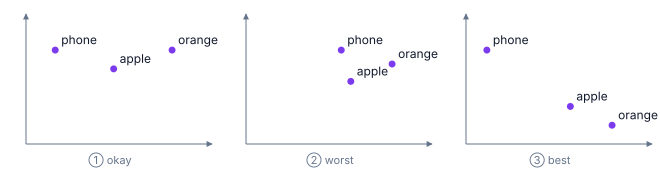

| Embedding | Layout | Verdict | Score |
| --- | --- | --- | ---: |
| ① | phone, orange and apple spread over the plane | okay | 1 |
| ② | squashed — phone and orange end up close together | worst: it doesn't separate phone and orange well | 0.1 |
| ③ | stretched — phone and orange far apart | best: it separates phone and orange very well | 4 |

*(The scores are illustrative numbers.)*

- We get these scores when we train the neural network: we train these embeddings, and we train these scores. And so the **key, query and value** matrices come in.
- The **K and Q matrices** are going to help us build a bunch of transformations (embeddings), and **V** is going to help us *visualise* (score and combine) them.

## The Maths Behind Attention: Similarity, Softmax, Keys, Queries & Values
<!-- pages: 97-98 -->

Consider a 2-D embedding with axes **Tech** and **Fruitiness**:


| Word | Tech | Fruitiness |
| --- | ---: | ---: |
| Cherry | 1 | 4 |
| Orange | 0 | 3 |
| Phone | 3 | 0 |

### Measure 1: Dot Product (Can Be Negative)

- $\text{similarity}(\text{cherry}, \text{orange}) = 1 \times 0 + 4 \times 3 = 12$.
- $\text{similarity}(\text{cherry}, \text{phone}) = 1 \times 3 + 4 \times 0 = 3$.
- $\text{similarity}(\text{orange}, \text{phone}) = 0 \times 3 + 3 \times 0 = 0$ — orange and phone are **perpendicular** with respect to the origin.

### Measure 2: Cosine Similarity (Between −1 and 1)

1 means very similar; −1 means very different.

- $\text{similarity}(\text{cherry}, \text{orange}) = \cos 14° = 0.97$.
- $\text{similarity}(\text{cherry}, \text{phone}) = \cos 76° = 0.24$.
- $\text{similarity}(\text{orange}, \text{phone}) = \cos 90° = 0$.
- If all vectors have norm 1, then **dot product = cosine similarity**.

### Measure 3: Scaled Dot Product

The dot product divided by the square root of the length of the vector (its number of coordinates). **It is used in attention.**

$$\text{similarity}(\text{cherry}, \text{orange}) = \frac{1 \times 0 + 4 \times 3}{\sqrt{2}} = \frac{12}{\sqrt 2} = 8.49,$$
where we divide by $\sqrt 2$ because the vector has 2 coordinates, so its length is 2.
$$\text{similarity}(\text{cherry}, \text{phone}) = \frac{1 \times 3 + 4 \times 0}{\sqrt 2} = 2.12, \qquad \text{similarity}(\text{orange}, \text{phone}) = \frac{0}{\sqrt 2} = 0.$$

- We divide by the square root of the length of the vector because if we have very long vectors (say 1000 coordinates), then we get a very, very large dot product, which we don't want — we want to manage it. So we divide by, say, $\sqrt{1000}$.

### Example: Attention with Cosine Similarity
<!-- pages: 99-101 -->

- Sentence 1: *an **apple** and an **orange***.
- Sentence 2: *an **apple** phone*.

We have 3 coordinates for each word:

| Word | Tech | Fruitiness | Other |
| --- | ---: | ---: | ---: |
| Orange | 0 | 3 | 0 |
| Phone | 4 | 0 | 0 |
| Apple | 2 | 2 | 0 |
| And | 0 | 0 | 2 |
| An | 0 | 0 | 3 |

Now, the **cosine-similarity matrix**:

| | Orange | Phone | Apple | And | An |
| --- | ---: | ---: | ---: | ---: | ---: |
| **Orange** | 1 | 0 | 0.71 | 0 | 0 |
| **Phone** | 0 | 1 | 0.71 | 0 | 0 |
| **Apple** | 0.71 | 0.71 | 1 | 0 | 0 |
| **And** | 0 | 0 | 0 | 1 | 1 |
| **An** | 0 | 0 | 0 | 1 | 1 |

Now see the same table for **sentence 1** — each row gives a **linear combination**:

| | Orange | Apple | And | An | New word |
| --- | ---: | ---: | ---: | ---: | --- |
| **Orange** | 1 | 0.71 | 0 | 0 | 1 × orange + 0.71 × apple |
| **Apple** | 0.71 | 1 | 0 | 0 | 0.71 × orange + 1 × apple |
| **And** | 0 | 0 | 1 | 1 | 1 × and + 1 × an |
| **An** | 0 | 0 | 1 | 1 | 1 × and + 1 × an |

For **sentence 2**:

| | Phone | Apple | An | New word |
| --- | ---: | ---: | ---: | --- |
| **Phone** | 1 | 0.71 | 0 | 1 × phone + 0.71 × apple |
| **Apple** | 0.71 | 1 | 0 | 0.71 × phone + 1 × apple |
| **An** | 0 | 0 | 1 | 1 × an |

**Normalisation** (sentence 1):
$$\text{orange} = \frac{1 \times \text{orange} + 0.71 \times \text{apple}}{1 + 0.71} = 0.58 \times \text{orange} + 0.42 \times \text{apple}.$$

**But there is a problem.** If we have $\text{orange} = \dfrac{1 \times \text{orange} - 1 \times \text{motorcycle}}{1 - 1}$, the denominator is $0$! So we need the coefficients to be **positive**. *Solution:* replace each coefficient by $e^{\text{coefficient}}$:
$$\text{orange (sentence 1)} = \frac{e^{1}\,\text{orange} + e^{0.71}\,\text{apple}}{e^{1} + e^{0.71}} = 0.57 \times \text{orange} + 0.43 \times \text{apple},$$
$$\text{orange (new sentence)} = \frac{e^{1}\,\text{orange} + e^{-1}\,\text{motorcycle}}{e^{1} + e^{-1}} = 0.88 \times \text{orange} + 0.12 \times \text{motorcycle}.$$

This step is called **softmax**. So for the 1st sentence, the row for *orange* (1, 0.71, 0, 0 over orange, apple, and, an) becomes $e^1, e^{0.71}, e^0, e^0$:
$$\text{orange} = \frac{e^{1}\,\text{orange} + e^{0.71}\,\text{apple} + e^{0}\,\text{and} + e^{0}\,\text{an}}{e^{1} + e^{0.71} + e^{0} + e^{0}} = 0.4 \times \text{orange} + 0.3 \times \text{apple} + 0.15 \times \text{and} + 0.15 \times \text{an}.$$

### The Key and Query Matrices
<!-- pages: 102-103 -->

- These matrices help us to find **really good embeddings**, where we can do attention and get good information (the *okay*, *good* and *bad* embeddings from the previous example).
- **How to do it?** With the key matrix $M_1$ and the query matrix $M_2$, the similarity between *orange* (vector $v_1$) and *phone* (vector $v_2$) becomes
$$\text{similarity}(\text{orange}, \text{phone}) = v_1\, M_1\, M_2^T\, v_2^T \qquad \text{instead of} \qquad v_1\, v_2^T.$$
  $M_1 M_2^T$ is a **linear transformation**: it converts one embedding into another (the transformation from the *Transformer*).
- So the keys and queries matrices work together to create a linear transformation that will improve our embedding to be able to do attention. We are modifying the similarity in one embedding into a similarity in a different embedding, and we make sure that this is the best one.


### The Values Matrix

- The keys and queries matrices actually turn the embedding into one that is **best for calculating similarities**. Using these similarities, the **values matrix** moves the words into an embedding that is **best for finding the next word**.


<!-- pages: 104 -->

**What does the value matrix do?** It takes the embedding on the left and multiplies every vector to get the embedding on the right — it acts as another transformation.

- The **left embedding** knows the *features* of the words (both low- and high-level): colour, size, fruitiness, technology.
- The **right embedding** knows when 2 words could appear in the **same context**: e.g. "I want to buy a ___" → car, apple, phone.

*Example* — "an apple and an orange". After softmax, the attention weights are:

| | orange | apple | and | an |
| --- | ---: | ---: | ---: | ---: |
| **orange** | 0.4 | 0.3 | 0.15 | 0.15 |
| **apple** | 0.3 | 0.4 | 0.15 | 0.15 |
| **and** | 0.15 | 0.15 | 0.5 | 0.5 |
| **an** | 0.15 | 0.15 | 0.5 | 0.5 |

so $\text{apple} = 0.3\,\text{orange} + 0.4\,\text{apple} + 0.15\,\text{and} + 0.15\,\text{an}$. The value matrix (which can be a square or a rectangular matrix) gives

| | orange | apple | and | an |
| --- | --- | --- | --- | --- |
| **orange** | $v_{11}$ | $v_{12}$ | $v_{13}$ | $v_{14}$ |
| **apple** | $v_{21}$ | $v_{22}$ | $v_{23}$ | $v_{24}$ |
| **and** | $v_{31}$ | $v_{32}$ | $v_{33}$ | $v_{34}$ |
| **an** | $v_{41}$ | $v_{42}$ | $v_{43}$ | $v_{44}$ |

and so $\text{apple} \to v_{21}\cdot\text{orange} + v_{22}\cdot\text{apple} + v_{23}\cdot\text{and} + v_{24}\cdot\text{an}$.

### Multi-Head Attention in Practice
<!-- pages: 105 -->

- In multi-head attention we use **many key, query and value matrices** — the more we use, the more likely we are to find better ones.
- We don't know which transformation is good and which is bad, so we **concatenate** them first (e.g. a concatenation of two 2-column matrices gives a 4-column matrix — a high-dimensional embedding).
- Then the **linear step** scales up the better embeddings and scales down the bad embeddings by some amount.
- Finding the key (K), query (Q) and value (V) matrices is not easy: they are **trained with the transformer**, multiple times.

## What Are Transformer Models and How Do They Work?
<!-- pages: 105-107 -->

- Transformer models are one of the most exciting new developments in machine learning. They were introduced in the paper **"Attention Is All You Need"**. Transformers can be used to write stories, essays and poems, answer questions, translate between languages and chat with humans, and they can even pass exams that are hard for humans.
- But what are they? You'll be happy to know that the architecture of transformer models is not that complex: it simply is a **concatenation of some very useful components**, each of which has its own function.

### In a Nutshell, What Does a Transformer Do?

- Imagine that you're writing a text message on your phone. After each word, you may get 3 words suggested to you. For example, if you type "Hello, how are", the phone may suggest words such as "you" or "your" as the next word. Of course, if you continue selecting the suggested word in your phone, you'll quickly find that the message formed by these words makes no sense. If you look at each set of 3 or 4 consecutive words, it may make sense, but these words don't concatenate to anything with a meaning. This is because the model used in the phone does not carry the overall context of the message; it simply predicts which word is more likely to come up after the last few. **Transformers, on the other hand, keep track of the context of what is being written**, and this is why the text that they write makes sense.

| Phone message box | Suggestions |
| --- | --- |
| "Hello, how are …" | you · your · things |
| "Hello, how are you feeling this week and your kind wishes for a wonderful weekend with your kindness and happiness for your family love you & your kindness love …" | and · for |

*The phone can suggest the next word to use in a text message, but does not have the power to generate coherent text.*

- I have to be honest with you: the first time I found out that **transformers build text one word at a time**, I could not believe it. First of all, this is not how humans form sentences and thoughts — we first form a basic thought, and then start refining it and adding words to it. This is also not how ML models do other things; for example, images are not built this way. Most neural-network-based graphical models form a rough version of the image and slowly refine it or add detail until it is perfect. So why would a transformer model build text word by word? One answer is: because that works really well. A more satisfying one is that because transformers are so incredibly good at **keeping track of the context**, the next word they pick is exactly what it needs to keep going with an idea.

<!-- pages: 108-110 -->

- And how are transformers trained? With a lot of data — all the data on the internet, in fact. So, when you input the sentence "Hello, how are" into the transformer, it simply knows that, based on all the text on the internet, the best next word is "you". If you were to give it a more complicated command, say, "Write a story", it may figure out that a good next word to use is "Once". Then it adds this word to the command, and figures out that a good next word is "upon", and so on. And word by word, it will continue until it writes a story.

| Command | Response |
| --- | --- |
| Write a story. | Once |
| Write a story. Once | upon |
| Write a story. Once upon | a |
| Write a story. Once upon a | time |
| Write a story. Once upon a time | there |
| … | … |

### The Architecture of a Transformer

Now that we know what transformers do, let's get to their architecture. If you've seen the architecture of a transformer model, you may have jumped in awe like I did the first time I saw it — it looks quite complicated. However, when you break it down into its most important parts, it's not so bad. The transformer has 4 main parts (plus the final softmax):

1. **Tokenisation**
2. **Embedding**
3. **Positional encoding**
4. **Transformer block** (several of these)
5. **Softmax**

The 4th one, the transformer block, is the most complex of all. Many of these can be concatenated, and each one contains 2 main parts: the **attention** and the **feed-forward** components.

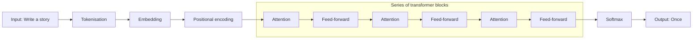

*The architecture of a transformer model.*

### Tokenisation

Tokenisation is the most basic step. It consists of a large dataset of tokens, including all the words, punctuation signs, etc. The tokenisation step takes every word, prefix, suffix and punctuation sign, and sends them to a known token from the library.

<!-- pages: 112-113 -->

*Tokenisation (turning words into tokens):* "Write a story." → `Write` · `a` · `story` · `.`

### Embedding

- Once the input has been tokenised, it's time to turn words into numbers. For this, we use an **embedding**. If two pieces of text are similar, then the numbers in their corresponding vectors are similar to each other (component-wise, meaning each pair of numbers in the same position is similar). Otherwise, if two pieces of text are different, then the numbers in their corresponding vectors are different.
- For example, if the sentence we are considering is "Write a story." and the tokens are `<Write>`, `<a>`, `<story>` and `<.>`, then each one of these will be sent to a long vector, and we'll have 4 vectors:

| Token | Embedding vector |
| --- | --- |
| Write | [2.13, −0.42, …, −1.03] |
| a | [0.91, 0.56, …, 0.23] |
| story | [−1.56, 1.34, …, 0.14] |
| . | [1.42, −1.32, …, −2.41] |

- In general, embeddings send every word (token) to a long list of numbers.

### Positional Encoding

- Once we have the vectors corresponding to each of the tokens in the sentence, the next step is to turn all these into one vector to process. The most common way to turn a bunch of vectors into one vector is to **add them, component-wise** — that means we add each coordinate separately. For example, if the vectors (of length 2) are [1, 2] and [3, 4], their corresponding sum is [1 + 3, 2 + 4] = [4, 6].
- This can work, but there's a small caveat: **addition is commutative**. In that case, the sentence "I'm not sad, I'm happy" and the sentence "I'm not happy, I'm sad" will result in the same vector, given that they have the same words, except in a different order. This is not good. Therefore, we must come up with some method that will give us a different vector for the 2 sentences. Several methods work, and we'll go with one of them: **positional encoding**.
- Positional encoding consists of **adding a sequence of predefined vectors to the embedding vectors of the words**. This ensures we get a unique vector for every sentence, and sentences with the same words in a different order will be assigned different vectors.

<!-- pages: 114-117 -->

- In the example below, the vectors corresponding to the words "Write", "a", "story" and "." become the modified vectors that carry information about their position, labelled "Write (1)", "a (2)", "story (3)" and ". (4)".

| Token | Embedding | | Position vector | | Result |
| --- | --- | :---: | --- | :---: | --- |
| Write | [2.13, −0.42, …, −1.03] | + | position 1 | → | Write (1) |
| a | [0.91, 0.56, …, 0.23] | + | position 2 | → | a (2) |
| story | [−1.56, 1.34, …, 0.14] | + | position 3 | → | story (3) |
| . | [1.42, −1.32, …, −2.41] | + | position 4 | → | . (4) |

*Positional encoding adds a position vector to each word, in order to keep track of the positions of the words.*

- Now that we know we have a unique vector corresponding to the sentence, and that this vector carries the information on all the words in the sentence and their order, we can move to the next step.

### Transformer Block

- Let's recap what we have so far. The words come in and get turned into tokens (tokenisation), the tokenised words are turned into numbers (embeddings), then order gets taken into account (positional encoding). This gives us a vector for every token that we input to the model. Now, the next step is to **predict the next word** in this sentence. This is done with a really, really large neural network, which is trained precisely with that goal: to predict the next word in a sentence.
- We can train such a large network, but we can vastly improve it by adding a key step: the **attention component**. Introduced in the seminal paper "Attention Is All You Need", it is one of the key ingredients in transformer models, and one of the reasons they work so well. Imagine attention as a way to **add context to each word in the text**.
- The attention component is added at every block of the feed-forward network. Therefore, if you imagine a large feed-forward neural network whose goal is to predict the next word, formed by several blocks of smaller neural networks, an attention component is added to each one of these blocks. Each component of the transformer, called a **transformer block**, is then formed by 2 main components:
  - the **attention** component;
  - the **feed-forward** component.

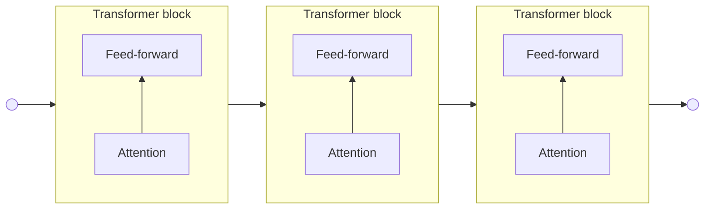

*The transformer is a concatenation of many transformer blocks. Each one of these is composed of an attention component followed by a feed-forward component (a neural network).*

### Attention

- The next step is attention. It deals with a very important problem: **the problem of context**. Sometimes, as you know, the same word can be used with different meanings. This tends to confuse language models, since an embedding simply sends words to vectors, without knowing which definition of the word they are using.
- Attention is a very powerful and useful technique that helps language models understand the context.

<!-- pages: 118-120 -->

- In order to understand how attention works, consider the following 2 sentences:
  - Sentence 1: *The **bank** of the river.*
  - Sentence 2: *Money in the **bank**.*
- As you can see, the word "bank" appears in both, but with different definitions. In sentence 1, we are referring to the land at the side of the river, and in the 2nd one, to the institution that holds money. The computer has no idea of this, so we need to somehow inject that knowledge into it. What can help us? Well, it seems that the other words in the sentence can come to our rescue. For the 1st sentence, the words "the" and "of" do us no good. But the word "river" is the one that is letting us know that we're talking about the land at the side of the river. Similarly, in sentence 2, the word "money" is the one that is helping us understand that the word "bank" is now referring to the institution that holds money.
- **In short, what attention does is move the words in a sentence (or piece of text) closer in the word embedding.** In that way, the word "bank" in the sentence "Money in the bank" will be moved closer to the word "money". Equivalently, in the sentence "The bank of the river", the word "bank" will be moved closer to the word "river". That way, the modified word "bank" in each of the 2 sentences will carry some of the information of the neighbouring words, adding context to it.
- The attention step used in transformer models is actually much more powerful, and it's called **multi-head attention**. In multi-head attention, several different embeddings are used to modify the vectors and add context to them. Multi-head attention has helped language models reach much higher levels of efficacy when processing and generating text.

### The Softmax Layer

- Now that you know that a transformer is formed by many layers of transformer blocks, each containing attention and a feed-forward layer, you can think of it as a large neural network that predicts the next word in a sentence. The transformer outputs **scores for all the words**, where the highest scores are given to the words that are most likely to be next in the sentence.
- The last step of a transformer is a **softmax layer**, which turns these scores into probabilities (that add to 1), where the highest scores correspond to the highest probabilities. Then we can **sample** out of these probabilities for the next word.
- In the example below, the transformer gives the highest probability of 0.5 to "Once", and probabilities of 0.3 and 0.2 to "Somewhere" and "There". Once we sample, the word "Once" is selected, and that's the output of the transformer.

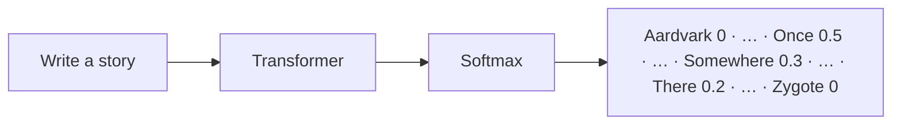

| Word | Probability |
| --- | ---: |
| Aardvark | 0 |
| … | … |
| **Once** | **0.5** |
| … | … |
| Somewhere | 0.3 |
| … | … |
| There | 0.2 |
| … | … |
| Zygote | 0 |

- Now what? Well, we repeat the step: we now input the text "Write a story. Once" into the model, and most likely the output will be "upon". Repeating this step again and again, the transformer will end up writing a story, such as "Once upon a time, there was a …".

### Post-Training

- Now that you know how transformers work, we still have a bit of work to do. Imagine the following: you ask the transformer "What is the capital of Algeria?" We would love for it to answer "Algiers" and move on. However, the transformer is trained on the entire internet.

<!-- pages: 121-122 -->

- The internet is a big place, and it's not necessarily the best question/answer repository. Many pages, for example, would have long lists of questions without answers. In this case, the next sentence after "What is the capital of Algeria?" could be another question, such as "What is the capital of Burkina Faso?" or "What is the population of Algeria?". The transformer is not a human who thinks about their responses; it simply mimics what it sees on the internet (or any dataset that has been provided). So, how do we get the transformer to answer questions?
- The answer is **post-training**. In the same way that you would teach a person to do certain tasks, you can get a transformer to perform tasks. Once a transformer is trained on the entire internet, it is trained again on a large dataset which corresponds to lots of questions and their respective answers. **Transformers (like humans) have a bias towards the last things they have learned**, so post-training has proven a very useful step to help transformers succeed at the tasks they are asked to do.
- Post-training also helps with many other tasks. For example, one can post-train a transformer with large datasets of conversations, in order to help it perform well as a chatbot, or to help us write stories, poems or even code.

## The Illustrated Transformer: Encoders & Decoders
<!-- pages: 122-123 -->

- **Attention** is a concept that helped improve the performance of neural machine-translation applications.
- The transformer outperforms the Google Neural Machine Translation model in specific tasks. The biggest benefit, however, comes from how the transformer **lends itself to parallelisation**. It is in fact Google Cloud's recommendation to use the Transformer as a reference model to use their **Cloud TPU** offering.
- A TensorFlow implementation of the Transformer is available as a part of the **Tensor2Tensor** package.
- Let's begin by looking at the model as a single black box. In a machine-translation application, it would take a sentence in one language and output its translation in another.

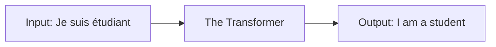

Opening the box, we see an **encoding component**, a **decoding component** and connections between them:

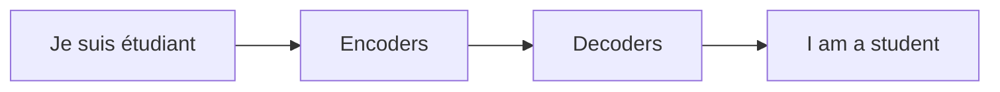

- The encoding component is a **stack of encoders** (the paper stacks **6** of them on top of each other — there's nothing magical about the number 6; one can definitely experiment with other arrangements). The decoding component is a stack of decoders of the same number.

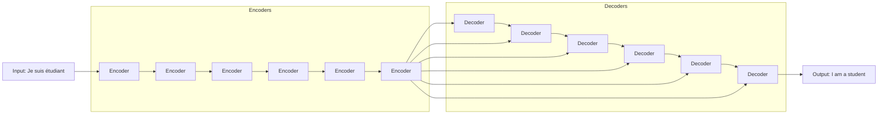

*The output of the top encoder is fed to every decoder in the stack.*

<!-- pages: 124-126 -->

- The encoders are all **identical in structure** (yet they do not share weights). Each one is broken down into **2 sub-layers**:

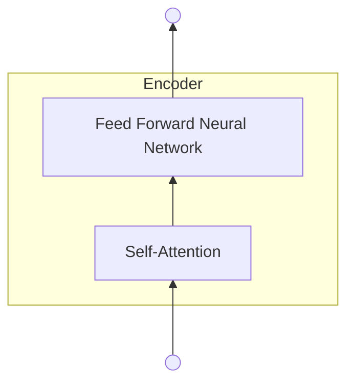

- The encoder's inputs first flow through a **self-attention layer** — a layer that helps the encoder look at other words in the input sentence as it encodes a specific word.
- The outputs of the self-attention layer are fed to a **feed-forward neural network**. The exact same feed-forward network is independently applied to each position.
- The **decoder** has both those layers, but between them is an **attention layer** that helps the decoder focus on relevant parts of the input sentence (similar to what attention does in seq2seq models).

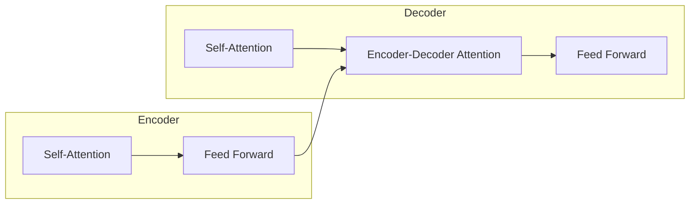

### Bringing the Tensors into the Picture

- Now that we've seen the major components of the model, let's start to look at the various vectors/tensors and how they flow between these components to turn the input of a trained model into an output.
- As is the case in NLP applications in general, we begin by turning each input word into a vector using an **embedding algorithm**: $x_1$ = *Je*, $x_2$ = *suis*, $x_3$ = *étudiant*. Each word is embedded into a **vector of size 512**. We'll represent those vectors with simple boxes.
- The embedding only happens in the **bottom-most encoder**. The abstraction that is common to all the encoders is that they receive a list of vectors, each of size 512 — in the bottom encoder that would be the word embeddings, but in other encoders it would be the output of the encoder that's directly below. The size of this list is a hyperparameter we can set — basically it would be the length of the longest sentence in our training dataset.
- After embedding the words in our input sequence, each of them flows through each of the 2 layers of the encoder.

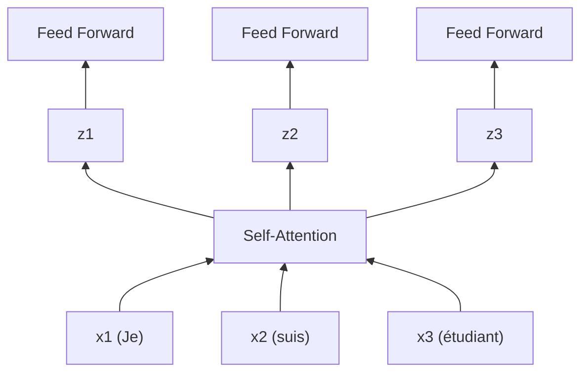

<!-- pages: 127-129 -->

- Here we begin to see one key property of the Transformer, which is that **the word in each position flows through its own path in the encoder**. There are dependencies between these paths in the self-attention layer. The feed-forward layer does not have those dependencies, however, and thus the various paths can be **executed in parallel** while flowing through the feed-forward layer.
- Next, we'll switch up the example to a shorter sentence, and we'll look at what happens in each sub-layer of the encoder.

### Now We're Encoding!

As we've mentioned already, an encoder receives a list of vectors as input. It processes this list by passing these vectors into a "self-attention" layer, then into a feed-forward neural network, then sends out the output upwards to the next encoder.

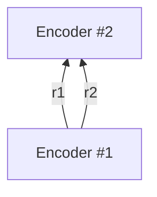

## Self-Attention in Detail & in Matrix Form
<!-- pages: 128-129 -->

### Self-Attention at a High Level

- Let's see how self-attention works. Say the following sentence is an input sentence we want to translate:

> "The animal didn't cross the street because **it** was too tired."

- What does "it" in this sentence refer to? Is it referring to the street or to the animal? It's a simple question to a human, but not as simple to an algorithm.
- When the model is processing the word "it", self-attention allows it to associate "it" with "animal".
- As the model processes each word (each position in the input sequence), self-attention allows it to look at other positions in the input sequence for clues that can help lead to a better encoding for this word.
- If you are familiar with RNNs, think of how maintaining a hidden state allows an RNN to incorporate its representation of previous words/vectors it has processed with the current one it's processing. **Self-attention is the method the Transformer uses to bake the "understanding" of other relevant words into the one we're currently processing.**

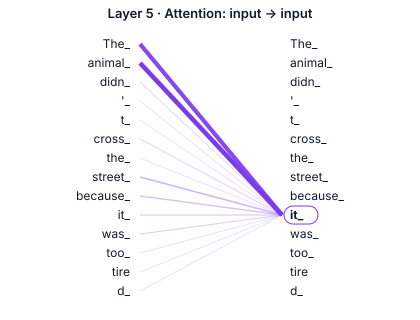

*[Check the Tensor2Tensor notebook for the visualisation.]*

### Self-Attention in Detail
<!-- pages: 130-132 -->

Let's first look at how to calculate self-attention using vectors, then proceed to look at how it's actually implemented using matrices.

**Step 1 — create query, key and value vectors.** The first step in calculating self-attention is to create 3 vectors from each of the encoder's input vectors (in this case, the embedding of each word). So for each word, we create a **Query vector**, a **Key vector** and a **Value vector**. These vectors are created by multiplying the embedding by 3 matrices ($W^Q$, $W^K$, $W^V$) that we trained during the training process.

- Notice that these new vectors are **smaller in dimension** than the embedding vector. Their dimensionality is **64**, while the embedding and encoder input/output vectors have dimensionality of **512**. They don't *have* to be smaller; this is an architecture choice to make the computation of multi-headed attention (mostly) constant.

| Input | Thinking | Machines | Weight matrix |
| --- | --- | --- | --- |
| Embedding | $x_1$ | $x_2$ | |
| Queries | $q_1 = x_1 W^Q$ | $q_2 = x_2 W^Q$ | $W^Q$ |
| Keys | $k_1 = x_1 W^K$ | $k_2 = x_2 W^K$ | $W^K$ |
| Values | $v_1 = x_1 W^V$ | $v_2 = x_2 W^V$ | $W^V$ |

**What are the "query", "key" and "value" vectors?** They are abstractions that are useful for calculating and thinking about attention. Once you proceed with reading how attention is calculated below, you'll know pretty much all you need to know about the role each of these vectors plays.

**Step 2 — calculate a score.** Say we are calculating the self-attention for the first word in this example, "Thinking". We need to score each word of the input sentence against this word. The score determines how much focus to place on other parts of the input sentence as we encode a word at a certain position.

- The score is calculated by taking the **dot product of the query vector with the key vector** of the respective word we're scoring. So, if we're processing the self-attention for the word in position #1, the first score would be the dot product of $q_1$ and $k_1$. The second score would be the dot product of $q_1$ and $k_2$.

| | Thinking | Machines |
| --- | --- | --- |
| Score | $q_1 \cdot k_1 = 112$ | $q_1 \cdot k_2 = 96$ |

**Steps 3 and 4 — scale and softmax.** Divide the scores by **8** (the square root of the dimension of the key vectors used in the paper, $\sqrt{64}$). This leads to having more stable gradients. There could be other possible values here, but this is the default. Then pass the result through a **softmax** operation. Softmax normalises the scores so they are all positive and add up to 1.
<!-- pages: 133-135 -->

- This **softmax score** determines how much each word will be expressed at this position. Clearly the word at this position will have the highest softmax score, but sometimes it's useful to attend to another word that is relevant to the current word.

**Step 5 — weight the values.** Multiply each value vector by the softmax score (in preparation to sum them up). The intuition here is to keep intact the values of the word(s) we want to focus on, and drown out irrelevant words (by multiplying them by tiny numbers like 0.001, for example).

**Step 6 — sum.** Sum up the weighted value vectors. This produces the output of the self-attention layer at this position (for the first word).

| Input | Thinking | Machines |
| --- | --- | --- |
| Embedding | $x_1$ | $x_2$ |
| Queries | $q_1$ | $q_2$ |
| Keys | $k_1$ | $k_2$ |
| Values | $v_1$ | $v_2$ |
| Score | $q_1 \cdot k_1 = 112$ | $q_1 \cdot k_2 = 96$ |
| Divide by 8 ($\sqrt{d_k}$) | 14 | 12 |
| Softmax | 0.88 | 0.12 |
| Softmax × Value | $0.88\, v_1$ | $0.12\, v_2$ |
| Sum | $z_1 = 0.88\, v_1 + 0.12\, v_2$ | |

<!-- pages: 136-137 -->

That concludes the self-attention calculation. The resulting vector is one we can send along to the feed-forward neural network. In the actual implementation, however, this calculation is done in **matrix form** for faster processing. So let's look at that, now that we've seen the intuition of the calculation on the word level.

### Matrix Calculation of Self-Attention

- **The first step** is to calculate the Query, Key and Value matrices. We do that by packing our embeddings into a matrix $X$, and multiplying it by the weight matrices we've trained ($W^Q$, $W^K$, $W^V$):
$$Q = X W^Q, \qquad K = X W^K, \qquad V = X W^V.$$
- Every row in the $X$ matrix corresponds to a word in the input sentence. We again see the difference in size of the embedding vector (512, or 4 boxes in the figure) and the q/k/v vectors (64, or 3 boxes in the figure).
- **Finally**, since we're dealing with matrices, we can condense steps two through six in one formula to calculate the outputs of the self-attention layer:
$$Z = \operatorname{softmax}\!\left(\frac{Q K^T}{\sqrt{d_k}}\right) V \qquad \text{(the self-attention calculation in matrix form).}$$

## Multi-Head Attention: The Beast with Many Heads
<!-- pages: 137-139 -->

The paper further refined the self-attention layer by adding a mechanism called **"multi-headed" attention**. This improves the performance of the attention layer in two ways:

1. **It expands the model's ability to focus on different positions.** Yes, in the example above, $z_1$ contains a little bit of every other encoding, but it could be dominated by the actual word itself. If we're translating a sentence like "The animal didn't cross the street because it was too tired", it would be useful to know which word "it" refers to.
2. **It gives the attention layer multiple "representation subspaces".** As we'll see next, with multi-headed attention we have not only one, but multiple sets of Query/Key/Value weight matrices (the Transformer uses **8 attention heads**, so we end up with 8 sets for each encoder/decoder). Each of these sets is randomly initialised. Then, after training, each set is used to project the input embeddings (or vectors from lower encoders/decoders) into a different representation subspace.

| | Attention head #0 | Attention head #1 | … |
| --- | --- | --- | --- |
| Input $X$ ("Thinking Machines") | $X$ | $X$ | |
| Queries | $Q_0 = X W_0^Q$ | $Q_1 = X W_1^Q$ | |
| Keys | $K_0 = X W_0^K$ | $K_1 = X W_1^K$ | |
| Values | $V_0 = X W_0^V$ | $V_1 = X W_1^V$ | |

<!-- pages: 140-142 -->

- If we do the same self-attention calculation we outlined above, just **8 different times with different weight matrices**, we end up with **8 different Z matrices**: calculating attention separately in 8 different attention heads gives $Z_0, Z_1, \dots, Z_7$.
- This leaves us with a bit of a challenge. The feed-forward layer is not expecting 8 matrices — it's expecting a single matrix (a vector for each word). So we need a way to condense these 8 down into a single matrix.
- How do we do that? We **concatenate the matrices, then multiply them by an additional weights matrix $W^O$**:
  1. Concatenate all the attention heads: $[Z_0 \;|\; Z_1 \;|\; Z_2 \;|\; \dots \;|\; Z_7]$.
  2. Multiply with a weight matrix $W^O$ that was trained jointly with the model.
  3. The result would be the $Z$ matrix that captures information from all the attention heads. We can send this forward to the FFNN:
$$Z = \operatorname{Concat}(Z_0, Z_1, \dots, Z_7)\, W^O.$$
- That's pretty much all there is to multi-headed self-attention. It's quite a handful of matrices, I realise. Let me try to put them all in one visual so we can look at them in one place.

### Multi-Head Self-Attention in One Picture
<!-- pages: 143-144 -->

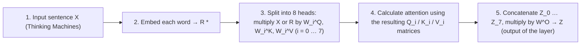

\* In all encoders other than #0, we don't need the embedding: we start directly with the output of the encoder right below this one.

- With multiple attention heads, as we encode the word "it", **one attention head is focusing most on "the animal", while another is focusing on "tired"** — in a sense, the model's representation of the word "it" bakes in some of the representation of both "animal" and "tired".

## Positional Encoding & Residual Connections
<!-- pages: 145 -->

### Representing the Order of the Sequence Using Positional Encoding

- One thing that's missing from the model as we have described it so far is a way to account for the **order of words** in the input sequence. To address this, the transformer **adds a vector to each input embedding**. These vectors follow a specific pattern that the model learns, which helps it determine the position of each word, or the distance between different words in the sequence. The intuition here is that adding these values to the embeddings provides meaningful distances between the embedding vectors once they're projected into Q/K/V vectors and during dot-product attention.

| Input | Je | suis | étudiant |
| --- | --- | --- | --- |
| Embeddings | $x_1$ | $x_2$ | $x_3$ |
| Positional encoding | $+\; t_1$ | $+\; t_2$ | $+\; t_3$ |
| Embedding with time signal | $= x_1 + t_1$ | $= x_2 + t_2$ | $= x_3 + t_3$ |

*The embeddings with time signal flow into Encoder #0, then Encoder #1, …; each encoder also feeds the corresponding decoder.*

<!-- pages: 146-147 -->

If we assumed the embedding has a dimensionality of 4, the actual positional encodings would look like this:

| Input | Je | suis | étudiant |
| --- | --- | --- | --- |
| Embedding | $x_1$ | $x_2$ | $x_3$ |
| + Positional encoding | [0, 0, 1, 1] | [0.84, 0.0001, 0.54, 1] | [0.91, 0.0002, −0.42, 1] |

*A real example of positional encoding with a toy embedding size of 4.*

### The Residuals

One detail in the architecture of the encoder that we need to mention before moving on is that **each sub-layer (self-attention, FFNN — feed-forward neural network) in each encoder has a residual connection around it, and is followed by a layer-normalisation step.**

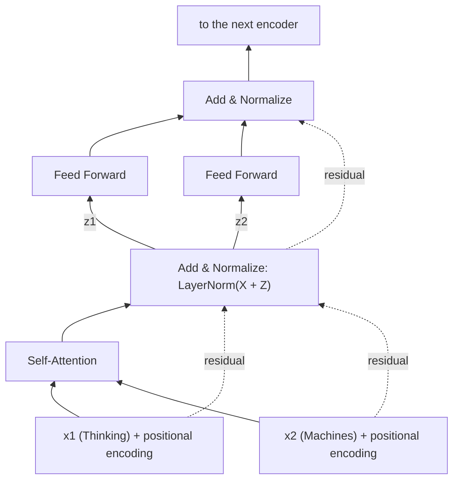

If we're to visualise the vectors and the layer-norm operation associated with the self-attention, it would look like the figure above: the self-attention outputs $z_1, z_2$ are added to the inputs $X$ and normalised, $\operatorname{LayerNorm}(X + Z)$, before the feed-forward layers; the same holds for the feed-forward sub-layer. This goes for the sub-layers of the decoder as well: a decoder has **Self-Attention → Add & Normalize → Encoder–Decoder Attention → Add & Normalize → Feed Forward → Add & Normalize**, and the top decoder is followed by a **Linear** layer and a **Softmax**.

## The Decoder, Final Linear & Softmax Layer
<!-- pages: 148 -->

### The Decoder Side

- The encoder starts by processing the input sequence. The output of the top encoder is then transformed into a set of attention vectors **K and V**. These are to be used by each decoder in its **"encoder–decoder attention" layer**, which helps the decoder focus on appropriate places in the input sequence.

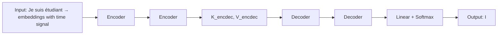

*Decoding time step 1.*

- After finishing the encoding phase, we begin the decoding phase. Each step in the decoding phase outputs an element from the output sequence (the English translation sentence in this case).

<!-- pages: 149-151 -->

- The following steps repeat the process until a **special symbol** is reached, indicating the transformer decoder has completed its output. The output of each step is fed to the bottom decoder in the next time step, and the decoders bubble up their decoding results just like the encoders did. And just like we did with the encoder inputs, we embed and add positional encoding to those decoder inputs to indicate the position of each word.

| Decoding time step | Previous outputs fed to the decoders | Output so far |
| --- | --- | --- |
| 1 | — | I |
| 2 | I | I am |
| 3 | I am | I am a |
| 4 | I am a | I am a student |
| 5 | I am a student | I am a student `<end of sequence>` |

- The self-attention layers in the decoder operate in a slightly different way than the one in the encoder: **in the decoder, the self-attention layer is only allowed to attend to earlier positions in the output sequence.** This is done by **masking future positions** (setting them to $-\infty$) before the softmax step in the self-attention calculation.
- The **"Encoder–Decoder Attention"** layer works just like multi-headed self-attention, except it creates its **Queries matrix from the layer below it**, and takes the **Keys and Values matrices from the output of the encoder stack**.

### The Final Linear and Softmax Layer

- The decoder stack outputs a vector of floats. How do we turn that into a word? That's the job of the **final Linear layer**, which is followed by a **Softmax layer**.
- The Linear layer is a simple fully connected neural network that projects the vector produced by the stack of decoders into a much, much larger vector called a **logits vector**.
- Let's assume that our model knows **10,000 unique English words** (our model's "output vocabulary") that it's learned from its training dataset. This would make the logits vector 10,000 cells wide — each cell corresponding to the score of a unique word. That is how we interpret the output of the model followed by the Linear layer.
- The softmax layer then turns those scores into probabilities (all positive, all add up to 1.0). The cell with the highest probability is chosen, and the word associated with it is produced as the output for this time step.

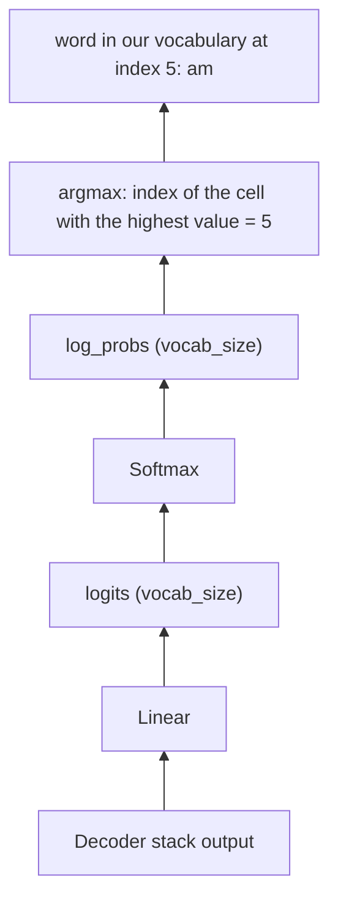

## Training: Loss Function & Decoding
<!-- pages: 151-156 -->

### Recap of Training

Now that we've covered the entire forward-pass process through a trained Transformer, it would be useful to glance at the intuition of training the model. During training, an untrained model would go through the exact same forward pass. But since we are training it on a labelled training dataset, we can compare its output with the actual correct output.
