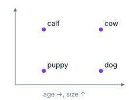
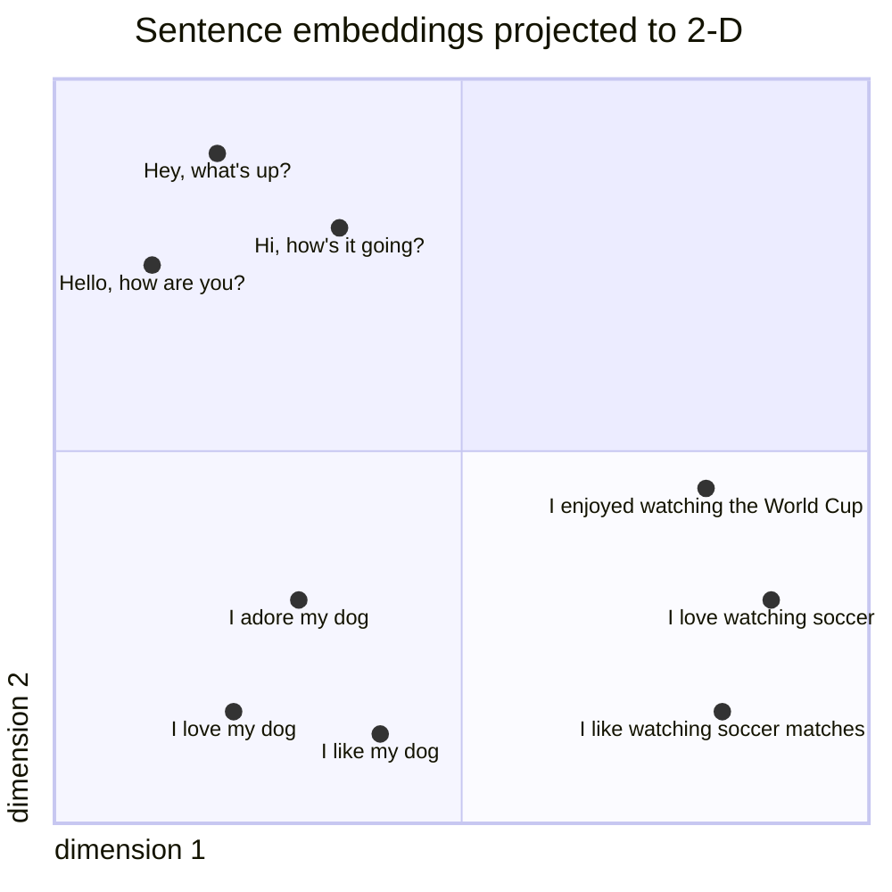
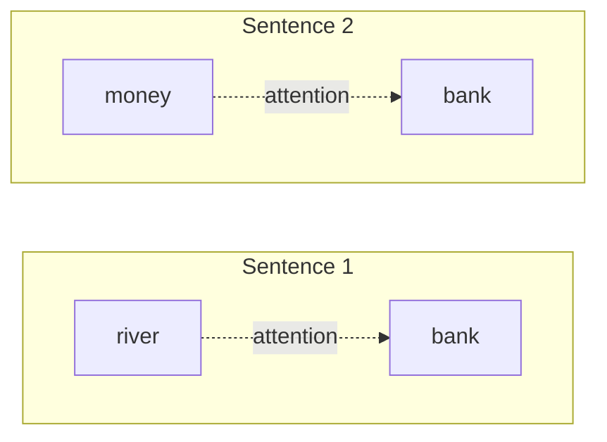
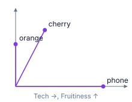
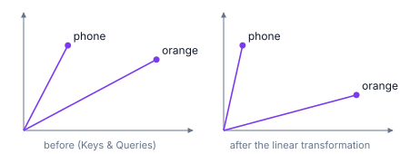
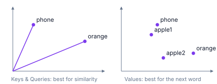

# LLM University: Transformers & Attention

*Source: LLM University by Cohere.*

## Word & Sentence Embeddings
<!-- pages: 70-72 -->

### What Are Word and Sentence Embeddings?

- Sentence and word embeddings are the **bread and butter of language models**.
- The main task of NLP is to understand human language. However, there is a big disconnection there: humans speak in words and sentences, but computers only understand and process numbers. How can we turn words and sentences into numbers in a coherent way? An assignment of words to numbers is called a **word embedding**. We can think of a word embedding as an assignment of scores to the words, with some nice properties.

### What Is a Word Embedding?

- Words that are **similar** should correspond to points that are close by (or equivalently, to scores that are similar).
- Words that are **different** should correspond to points that are far away (or equivalently, to scores that are significantly different).

### Word Embeddings Capture Features of the Word

- Word embeddings not only capture word similarity, but they also capture other properties of the language.
- In language, words can be combined to get more complicated concepts. In mathematics, numbers can be added or subtracted to get other numbers. Could we build a word embedding that captures relations between words, as relations between numbers?



- Here *puppy*, *dog*, *calf* and *cow* make a **rectangle**: puppy : dog :: calf : cow.
  - The path from the word *puppy* to the word *dog* is the same as the path from the word *calf* to the word *cow*.
  - The analogy "a dog is to a cow like a puppy is to a calf" is also captured in this rectangle.
- The main property of word embeddings that is in effect here is that **the two axes (vertical and horizontal) represent different things**. If you look carefully, moving towards the right turns the puppy into a dog and the calf into a cow, which is an increase in **age**. Likewise, moving upwards turns a puppy into a calf and a dog into a cow, which is an increase in the **size** of the animal.
- It seems that this embedding understands that the words in it have 2 main properties, or features: age and size. Furthermore, it seems that the embedding locates age on the horizontal axis and size on the vertical axis. In that case, where would you imagine the word "whale" goes? Probably somewhere above the word "cow". And if there was a word for "really old dog"? That word would go somewhere to the right of the word "dog".
- A good word embedding would be able to capture not only age and size, but also many more features of the words. Since each feature is one new axis, or coordinate, a good embedding must have many more than two coordinates assigned to every word. One of the Cohere embeddings, for example, has **1024 coordinates** associated with each word. These rows of 1024 (or however many) coordinates are called **vectors**, so we often talk about the vector corresponding to a word, and about each of the numbers inside a vector as a coordinate.
- Some of these coordinates may represent important properties of the word, such as age, gender or size. Some may represent combinations of properties. But some others may represent obscure properties that a human may not be able to understand.

<!-- pages: 73-75 -->

- But all in all, a word embedding can be seen as a good way to translate human language (words) into computer language (numbers), so that we can start training ML models with these numbers.

### Sentence Embeddings

- So word embeddings seem to be pretty useful, but in reality human language is much more complicated than simply a bunch of words put together. How would one be able to represent a sentence? How about the sum of the scores of all the words?
- For example, say we have a word embedding that assigns the following scores to these words:

| Word | Embedding |
| --- | --- |
| No | [1, 0, 0, 0] |
| I | [0, 2, 0, 0] |
| Am | [−1, 0, 1, 0] |
| Good | [0, 0, 1, 3] |

- Then the sentence "No, I am good!" corresponds to the vector [0, 2, 2, 3]. However, the sentence "I am no good" will also correspond to the vector [0, 2, 2, 3]. This is not a good thing, since the computer understands these 2 sentences in the exact same way, yet they are quite different, almost opposite sentences. Therefore, we need better embeddings that take into account the **order of words**, the semantics of the language and the actual meaning of the sentence.
- A **sentence embedding** is just like a word embedding, except it associates every sentence with a vector full of numbers, in a coherent way. By coherent, I mean that it satisfies similar properties to a word embedding: for instance, similar sentences are assigned to similar vectors, different sentences are assigned to different vectors, and most importantly, each of the coordinates of the vector identifies some property of the sentence.

| Sentence | Numbers | | | |
| --- | ---: | ---: | :---: | ---: |
| Hello, how are you? | 0.419 | 1.28 | … | −0.06 |
| I'm going to school today | −0.74 | 1.02 | … | 1.35 |
| … | … | … | … | … |
| Once upon a time | −0.82 | −1.32 | … | 0.32 |

- The **Cohere embedding** does just this. Using transformers, attention mechanisms and other cutting-edge algorithms, this embedding sends every sentence to a vector formed by **4096 numbers**, and this embedding works really well.

### How to Use These Embeddings

- Use the **Cohere dashboard** → the *Embed* tab, and type sentences.
- The results come out as vectors with 4096 entries for each sentence. These are obviously hard to visualise, but there is a way to bring them down to 2 entries per sentence in order to be easily visualised.



- Notice that the embedding seems to capture the essence of the sentences, and there are **3 clear clusters** of sentences (greetings, dogs, soccer).

## Similarity Between Words & Sentences
<!-- pages: 76-78 -->

### What Is Similarity Between Sentences?

- For LLMs, it is crucial to know when 2 words or 2 sentences are similar or different. This can be a hard problem, but luckily word and sentence embeddings are very helpful for this task.
- In a nutshell, a word embedding is an assignment of a list of numbers (a vector) to every word, in a way that semantic properties of the word translate into mathematical properties of the numbers. What do we mean by this? For example, 2 similar words will have similar vectors, and 2 different words will have different vectors. But most importantly, each entry in the vector corresponding to a word keeps track of some property of the word. Some of these properties can be understandable to humans, such as age, size, gender, etc., but some others could potentially only be understood by the computer.
- **Sentence embeddings** are even more powerful, as they assign a vector of numbers to each sentence, in a way that these numbers also carry important properties of the sentence. One of the Cohere embeddings assigns a vector of length 4096 (a list of 4096 numbers) to each sentence.

### Dot Product and Cosine Similarity

- There are 2 types of similarities: **dot-product similarity** and **cosine similarity**. Both are very similar, and very useful to determine if 2 words (or sentences) are similar.
  - In the dot product, we multiply the vectors element-wise and then add.
  - In cosine similarity, we look at the angle between 2 sentences.
- **Euclidean distance** is a good measure for similarity (very far movies are less similar) — but it does the opposite: it grows as similarity falls. Now, in order to tweak this metric, let's look at the angle between the rays from the origin to each sentence. Notice that this angle is small if the points are close to each other, and large if the points are far away from each other. Now we need the help of another function, the cosine. The cosine of angles close to zero is close to 1, and as the angle grows, the cosine decreases. This is exactly what we need. Therefore, we define the **cosine distance** as the cosine of the angle formed by the 2 rays going from the origin to the 2 sentences.

| Angle between the rays | Cosine | Similarity |
| --- | --- | --- |
| Right angle ($\alpha = 90°$) | $\cos\alpha = 0$ | 0 |
| Small angle | $\cos\alpha = 0.98$ | 0.98 |

### Real-Life Example

```python
import numpy as np
import seaborn as sns
import altair as alt
from sklearn.metrics.pairwise import cosine_similarity
import cohere

co = cohere.Client("COHERE_API_KEY")  # your Cohere API key

# Consider the following 3 sentences
texts = ["I like to be in my house",
         "I enjoy staying home",
         "the isotope 238u decays to 206pb"]
```

- One would expect the first 2 sentences to have a high similarity score when compared to each other, and the 3rd one to have a very low similarity score when compared to the other two.
- To get the corresponding sentence embeddings, we call the **Embed endpoint** with `co.embed()`. We supply 3 parameters:
  - `texts` — our list of sentences;
  - `model` — we use `embed-english-v3.0`, Cohere's latest English-only embeddings model, to generate the embeddings;
  - `input_type` — we use `search_document` to indicate that we intend to use the embeddings for search use cases.

<!-- pages: 79-80 -->

```python
response = co.embed(
    texts=texts,
    model="embed-english-v3.0",
    input_type="search_document",
)
```

- The embeddings are stored in the `embeddings` value of the response. After getting the embeddings, we separate them by sentence and print the values:

```python
embeddings = response.embeddings
[sentence1, sentence2, sentence3] = embeddings
print("Embedding for sentence 1", np.array(sentence1))
print("Embedding for sentence 2", np.array(sentence2))
print("Embedding for sentence 3", np.array(sentence3))
```

- Note that the embeddings are vectors (lists) of 1024 numbers, so they are truncated here.

**Dot-product similarity:**

```python
print("Similarity between sentences 1 and 2:", np.dot(sentence1, sentence2))
print("Similarity between sentences 1 and 3:", np.dot(sentence1, sentence3))
print("Similarity between sentences 2 and 3:", np.dot(sentence2, sentence3))
```

**Cosine similarity:**

```python
print("Cosine similarity between sentences 1 and 2:",
      cosine_similarity([sentence1], [sentence2])[0][0])
# … and the same for the other pairs
```

- The dot product and cosine distance give nearly identical values. The reason for this is that the embedding is **normalised** (each vector has norm equal to 1). When the embedding is not normalised, the dot product and cosine distance would give different values.

## What Is Attention in Language Models?
<!-- pages: 80-82 -->

- A huge roadblock for language models is when a word can be used in **two different contexts**. When this problem is encountered, the model needs to use the context of the sentence in order to decipher which meaning of the word to use. This is precisely what **self-attention** models do.
- Word embeddings have a huge Achilles heel: words that have more than one definition. If a word embedding assigns a vector to, say, the word "bank", it assigns the same vector to all the definitions of "bank". What if you want to use this word in different contexts? Here is where attention comes into play.
- **Attention** is a very clever way to tell words apart when they are used in different contexts (which turns word embeddings into **contextualised word embeddings**).

### One Word, Multiple Meanings

In order to understand attention, let's look at 2 sentences:

- Sentence 1: *The **bank** of the river.*
- Sentence 2: *Money in the **bank**.*



- How would a computer know that the word "bank" in the 1st sentence refers to a setting in nature, and in the 2nd sentence to a financial setting?
- Well, let's ask a simpler question: how would a human know this? How did you figure out these 2 settings? The way you and I did it was probably to look at the **neighbouring words**. In the 1st sentence, the word "river" was the one that hinted at the nature setting, and in the 2nd sentence, the word "money" was key to the financial setting. So, in short, **we need a way to use the other words in the sentence to understand what context of the word "bank" we want to use.**

<!-- pages: 83-85 -->

- Here is where **word embeddings** come into play. Word embeddings are a way to assign vectors (lists of numbers) to each word. I like to imagine them geometrically. Imagine that the words "bank", "river" and "money" are all attached on a **cork board**. Furthermore, this cork board contains all the existing words, in such a way that 2 words that are similar (such as "apple" and "pear") are close by. Now, in this cork board, "bank", "river" and "money" are not exactly close by. However, what you do is take the word "bank" and move it slightly towards the word "river"; call this word **"bank1"**. Now, take another copy of the word "bank" and move it slightly towards the word "money"; call this one **"bank2"**. Now, consider the following 2 modified sentences:
  - Modified sentence 1: *The **bank1** of the river.*
  - Modified sentence 2: *Money in the **bank2**.*


- In these 2 sentences, the computer now knows a little more about the context of the word "bank", as the word has been split into 2 distinct ones: one whose definition is closer to "river", and another one whose definition is closer to "money". That, in short, is how **attention mechanisms** work. However, there may be many questions lingering in your head. For example:
  - What do you mean by "moving a word closer to another one"?
  - Why did you ignore the other words in the sentence? How did you know the words "river" and "money" were the ones dictating the context, instead of the words "the", "in" or "of"? As humans, we know which words provide context, but a computer would not have a clue.
  - As computers only handle numbers, how do we attach numbers to all these methods?
- All these (and hopefully more) questions will be answered next.

### Moving Words on the Cork Board

- First, let me tell you what I mean by "moving a word closer to another one". The way I like to imagine this is to **average two words**. For example, let's say that I want to move the word "bank" 10 % closer to the word "river". I now think of the word "0.9 × bank + 0.1 × river". That is, "bank1" is 90 % "bank" and 10 % "river". Also, let's say that "bank2" is 80 % "bank" and 20 % "money". So, let's say these are the modified words:
$$\text{bank1} = 0.9 \times \text{bank} + 0.1 \times \text{river}, \qquad \text{bank2} = 0.8 \times \text{bank} + 0.2 \times \text{money}.$$
- How did I come up with the numbers 0.9, 0.1, 0.8 and 0.2? That comes later (OK, I have to spoil it: the answer is **similarity**). For now, you may be wondering what I mean by 0.9 × bank + 0.1 × river. Well, in the embeddings chapter we learned that a word embedding consists of assigning a vector (list) of numbers to each word. The Cohere embedding associates each word with a vector of length 4096 (that is, a list of 4096 numbers per word).

<!-- pages: 86-88 -->

For simplicity, let's imagine an embedding that associates a vector of 2 numbers to each word:

| Word | Embedding |
| --- | --- |
| River | [0, 5] |
| Money | [8, 0] |
| Bank | [6, 6] |

These 2 numbers can be interpreted as coordinates in the plane, where the 1st number is the horizontal coordinate and the 2nd number the vertical coordinate.

$$\begin{aligned}
\text{bank1} &= 0.9 \times \text{bank} + 0.1 \times \text{river} = 0.9 \times [6, 6] + 0.1 \times [0, 5] = [5.4, 5.4] + [0, 0.5] = [5.4, 5.9], \\
\text{bank2} &= 0.8 \times \text{bank} + 0.2 \times \text{money} = 0.8 \times [6, 6] + 0.2 \times [8, 0] = [4.8, 4.8] + [1.6, 0] = [6.4, 4.8].
\end{aligned}$$

- As you can see, "bank1" is closer to "river" and "bank2" is closer to "money". As a matter of fact, "bank1" is on the line between "bank" and "river", 10 % along the way. Similarly, "bank2" is on the line between "bank" and "money", 20 % along the way.
- Thus the attention mechanism managed to **split the word "bank" into 2 words**, and use each one in the corresponding sentence.

### How to Decide Which Words Determine Context?

- In other words, why did I pick the words "river" and "money" instead of "the", "of" and "in" in order to determine the context of "bank"? Obviously the answer is "because I'm human and I know the language". But what can the computer do? It can rely on two mechanisms: one of them is a metric such as **similarity**; the second one is **multi-head attention**.
- Let's first discuss the similarity mechanism. What the computer is going to do is to consider all the words in the sentence as context, including irrelevant words such as "the", "of" and "in". However, it's going to consider them a certain amount, and that amount is precisely the **similarity between the word and "bank"**. We trust that in a good embedding, the similarity between "bank" and a word such as "the" is almost zero, as they are unrelated. Therefore, the model will know to ignore these words and focus on those that may have a higher similarity with the word "bank".
- Imagine that we calculate similarities for the words in each sentence, and we get the following:

*The bank of the river:*

| | the | bank | of | river |
| --- | ---: | ---: | ---: | ---: |
| **the** | 1 | 0 | 0 | 0 |
| **bank** | 0 | 1 | 0 | 0.11 |
| **of** | 0 | 0 | 1 | 0 |
| **river** | 0 | 0.11 | 0 | 1 |

*Money in the bank:*

| | money | in | the | bank |
| --- | ---: | ---: | ---: | ---: |
| **money** | 1 | 0 | 0 | 0.25 |
| **in** | 0 | 1 | 0 | 0 |
| **the** | 0 | 0 | 1 | 0 |
| **bank** | 0.25 | 0 | 0 | 1 |

- Why is the similarity between "bank" and "money" higher than the similarity between "bank" and "river"? We can imagine that "bank" gets used more often in the same context as "money" than as "river", and that explains the difference. We are simplifying this model quite a bit: it could be that the similarity between "the" and "of" is not zero, but 0.001.
- Now, on to the next step. We are going to use the similarities to transform each of the words of this sentence. We'll call these new words "the1", "bank1", "of1", "river1" for the first sentence, and "money2", "in2", "the2", "bank2" for the second sentence. Beware, we'll be doing some maths with words, but it won't be very different from the one we did before.

<!-- pages: 89-91 -->

- Let's look at the first sentence, "The bank of the river", and the word "the". The similarities with the other words are as follows — similarities with "the": the 1, bank 0, of 0, river 0. Therefore, we turn the word "the" into the new word "the1", which corresponds to the sum
$$1 \times \text{"the"} + 0 \times \text{"bank"} + 0 \times \text{"of"} + 0 \times \text{"river"}.$$
  This is equal to the word "the". That means the word "the" does not change, and it is equal to "the1".
- Now let's follow the same procedure with the word "bank" and see what we get. The similarities of the word "bank" with the other words of the sentence "The bank of the river" are: the 0, bank 1, of 0, river 0.11.
- Therefore, the word "bank" turns into the word "bank1", given by the equation $1 \times \text{"bank"} + 0.11 \times \text{"river"}$. We are almost done: we want the coefficients of the words to add to 1, so we can divide everything by their sum, which is 1.11. When we do that, we get that the word "bank" gets transformed into the word
$$\text{bank1} = 0.9 \times \text{"bank"} + 0.1 \times \text{"river"}.$$
- Let's do one more for consistency. The word "money" in the 2nd sentence turns into "money2", given by the equation $1 \times \text{"money"} + 0.25 \times \text{"bank"}$. When we normalise, we divide everything by 1.25, to get the equation
$$\text{money2} = 0.8 \times \text{"money"} + 0.2 \times \text{"bank"}.$$
- This is the way we obtained the modified words that we used in the attention mechanism above. The modified sentences then become the following:

| Original sentence | Modified sentence |
| --- | --- |
| The **bank** of the **river** | the (0.9 bank + 0.1 river) of the (0.1 bank + 0.9 river) |
| **Money** in the **bank** | (0.8 money + 0.2 bank) in the (0.2 money + 0.8 bank) |

### Is There More to Attention?

- What you learned in this chapter is **simple self-attention**. However, we can do much better than that. There is a method called **multi-head attention**, in which one does not only consider one embedding, but several different ones. These are all obtained from the original by transforming it in different ways. Multi-head attention has been very successful at the task of adding context to text. *[Check the 2 videos.]*
- LLMs make great use of attention mechanisms in order to understand text.
- Attention helps the LLM understand the **whole context of the text**, as opposed to just a few words at a time.
- So attention does a few mathematical operations that can be seen **geometrically**. Embeddings are a bridge between human and computer, because humans understand text and computers understand numbers. **The better the embedding, the better the models are**, because if you have really good numbers for each word or each piece of text, then the problem becomes much easier.

## Multi-Head Attention & Building Better Embeddings
<!-- pages: 92-95 -->

**Attention** comes in two forms: **self-attention** and **multi-head attention**.

- Attention uses the **context of the sentence** in order to help the embedding resolve this type of ambiguity.
- Attention can be explained using the formulas below, with matrices such as **Query, Key and Values**:
$$\operatorname{Attention}(Q, K, V) = \operatorname{softmax}\!\left(\frac{QK^T}{\sqrt{d_k}}\right) V,$$
$$\operatorname{MultiHead}(Q, K, V) = \operatorname{Concat}(\text{head}_1, \dots, \text{head}_h)\, W^O, \qquad \text{where } \text{head}_i = \operatorname{Attention}(QW_i^Q,\; KW_i^K,\; VW_i^V).$$


### Example: Attention Moves Words Toward Their Context

1. *Please buy an **apple** (fruit) and an **orange**.* — "apple" is pulled towards "orange".
2. ***Apple** (brand) unveiled the new **phone**.* — "apple" is pulled towards "phone".

- Say initially *orange* has coordinates (11, 11), *phone* has (1, 2) and *apple* has (6, 7).
- Now, for the modified sentences, *apple* has coordinates (8, 8.5) in the 1st sentence, and (4, 5) in the 2nd sentence.
- If we use these new numbers (vectors) as the embeddings in the sentence, then the model is going to have an easier time. This process is done many times in ML, so the word ends up nearer to the relevant region.
- At the end of the day, we don't use the sentence, we use the **context**.
- Words pull each other, like **gravity**.

### Multi-Head Attention

- Attention works better, but multi-head attention works even better.
- **Is one embedding good enough?** No, we can do much better. We can ideally have lots and lots of embeddings: we just use 10, 20 or 100 embeddings and combine those results. That is **multi-head attention**.
- *Example:* an embedding that puts *orange* and *phone* far apart (on different axes) is a **good embedding**; one that puts *phone* and *orange* next to each other is the **worst embedding**.
- We build embeddings by modifying existing embeddings with the use of **linear transformations** — rotation, stretching (horizontal / vertical) and shear — and we can combine these transformations.

### Example: New Embeddings from Existing Ones
<!-- pages: 96 -->

Three embeddings of the words *phone*, *orange* and *apple*, produced by transforming the original one:


| Embedding | Layout | Verdict | Score |
| --- | --- | --- | ---: |
| ① | phone, orange and apple spread over the plane | okay | 1 |
| ② | squashed — phone and orange end up close together | worst: it doesn't separate phone and orange well | 0.1 |
| ③ | stretched — phone and orange far apart | best: it separates phone and orange very well | 4 |

*(The scores are illustrative numbers.)*

- We get these scores when we train the neural network: we train these embeddings, and we train these scores. And so the **key, query and value** matrices come in.
- The **K and Q matrices** are going to help us build a bunch of transformations (embeddings), and **V** is going to help us *visualise* (score and combine) them.

## The Maths Behind Attention: Similarity, Softmax, Keys, Queries & Values
<!-- pages: 97-98 -->

Consider a 2-D embedding with axes **Tech** and **Fruitiness**:



| Word | Tech | Fruitiness |
| --- | ---: | ---: |
| Cherry | 1 | 4 |
| Orange | 0 | 3 |
| Phone | 3 | 0 |

### Measure 1: Dot Product (Can Be Negative)

- $\text{similarity}(\text{cherry}, \text{orange}) = 1 \times 0 + 4 \times 3 = 12$.
- $\text{similarity}(\text{cherry}, \text{phone}) = 1 \times 3 + 4 \times 0 = 3$.
- $\text{similarity}(\text{orange}, \text{phone}) = 0 \times 3 + 3 \times 0 = 0$ — orange and phone are **perpendicular** with respect to the origin.

### Measure 2: Cosine Similarity (Between −1 and 1)

1 means very similar; −1 means very different.

- $\text{similarity}(\text{cherry}, \text{orange}) = \cos 14° = 0.97$.
- $\text{similarity}(\text{cherry}, \text{phone}) = \cos 76° = 0.24$.
- $\text{similarity}(\text{orange}, \text{phone}) = \cos 90° = 0$.
- If all vectors have norm 1, then **dot product = cosine similarity**.

### Measure 3: Scaled Dot Product

The dot product divided by the square root of the length of the vector (its number of coordinates). **It is used in attention.**

$$\text{similarity}(\text{cherry}, \text{orange}) = \frac{1 \times 0 + 4 \times 3}{\sqrt{2}} = \frac{12}{\sqrt 2} = 8.49,$$
where we divide by $\sqrt 2$ because the vector has 2 coordinates, so its length is 2.
$$\text{similarity}(\text{cherry}, \text{phone}) = \frac{1 \times 3 + 4 \times 0}{\sqrt 2} = 2.12, \qquad \text{similarity}(\text{orange}, \text{phone}) = \frac{0}{\sqrt 2} = 0.$$

- We divide by the square root of the length of the vector because if we have very long vectors (say 1000 coordinates), then we get a very, very large dot product, which we don't want — we want to manage it. So we divide by, say, $\sqrt{1000}$.

### Example: Attention with Cosine Similarity
<!-- pages: 99-101 -->

- Sentence 1: *an **apple** and an **orange***.
- Sentence 2: *an **apple** phone*.

We have 3 coordinates for each word:

| Word | Tech | Fruitiness | Other |
| --- | ---: | ---: | ---: |
| Orange | 0 | 3 | 0 |
| Phone | 4 | 0 | 0 |
| Apple | 2 | 2 | 0 |
| And | 0 | 0 | 2 |
| An | 0 | 0 | 3 |

Now, the **cosine-similarity matrix**:

| | Orange | Phone | Apple | And | An |
| --- | ---: | ---: | ---: | ---: | ---: |
| **Orange** | 1 | 0 | 0.71 | 0 | 0 |
| **Phone** | 0 | 1 | 0.71 | 0 | 0 |
| **Apple** | 0.71 | 0.71 | 1 | 0 | 0 |
| **And** | 0 | 0 | 0 | 1 | 1 |
| **An** | 0 | 0 | 0 | 1 | 1 |

Now see the same table for **sentence 1** — each row gives a **linear combination**:

| | Orange | Apple | And | An | New word |
| --- | ---: | ---: | ---: | ---: | --- |
| **Orange** | 1 | 0.71 | 0 | 0 | 1 × orange + 0.71 × apple |
| **Apple** | 0.71 | 1 | 0 | 0 | 0.71 × orange + 1 × apple |
| **And** | 0 | 0 | 1 | 1 | 1 × and + 1 × an |
| **An** | 0 | 0 | 1 | 1 | 1 × and + 1 × an |

For **sentence 2**:

| | Phone | Apple | An | New word |
| --- | ---: | ---: | ---: | --- |
| **Phone** | 1 | 0.71 | 0 | 1 × phone + 0.71 × apple |
| **Apple** | 0.71 | 1 | 0 | 0.71 × phone + 1 × apple |
| **An** | 0 | 0 | 1 | 1 × an |

**Normalisation** (sentence 1):
$$\text{orange} = \frac{1 \times \text{orange} + 0.71 \times \text{apple}}{1 + 0.71} = 0.58 \times \text{orange} + 0.42 \times \text{apple}.$$

**But there is a problem.** If we have $\text{orange} = \dfrac{1 \times \text{orange} - 1 \times \text{motorcycle}}{1 - 1}$, the denominator is $0$! So we need the coefficients to be **positive**. *Solution:* replace each coefficient by $e^{\text{coefficient}}$:
$$\text{orange (sentence 1)} = \frac{e^{1}\,\text{orange} + e^{0.71}\,\text{apple}}{e^{1} + e^{0.71}} = 0.57 \times \text{orange} + 0.43 \times \text{apple},$$
$$\text{orange (new sentence)} = \frac{e^{1}\,\text{orange} + e^{-1}\,\text{motorcycle}}{e^{1} + e^{-1}} = 0.88 \times \text{orange} + 0.12 \times \text{motorcycle}.$$

This step is called **softmax**. So for the 1st sentence, the row for *orange* (1, 0.71, 0, 0 over orange, apple, and, an) becomes $e^1, e^{0.71}, e^0, e^0$:
$$\text{orange} = \frac{e^{1}\,\text{orange} + e^{0.71}\,\text{apple} + e^{0}\,\text{and} + e^{0}\,\text{an}}{e^{1} + e^{0.71} + e^{0} + e^{0}} = 0.4 \times \text{orange} + 0.3 \times \text{apple} + 0.15 \times \text{and} + 0.15 \times \text{an}.$$

### The Key and Query Matrices
<!-- pages: 102-103 -->

- These matrices help us to find **really good embeddings**, where we can do attention and get good information (the *okay*, *good* and *bad* embeddings from the previous example).
- **How to do it?** With the key matrix $M_1$ and the query matrix $M_2$, the similarity between *orange* (vector $v_1$) and *phone* (vector $v_2$) becomes
$$\text{similarity}(\text{orange}, \text{phone}) = v_1\, M_1\, M_2^T\, v_2^T \qquad \text{instead of} \qquad v_1\, v_2^T.$$
  $M_1 M_2^T$ is a **linear transformation**: it converts one embedding into another (the transformation from the *Transformer*).
- So the keys and queries matrices work together to create a linear transformation that will improve our embedding to be able to do attention. We are modifying the similarity in one embedding into a similarity in a different embedding, and we make sure that this is the best one.



### The Values Matrix

- The keys and queries matrices actually turn the embedding into one that is **best for calculating similarities**. Using these similarities, the **values matrix** moves the words into an embedding that is **best for finding the next word**.


<!-- pages: 104 -->

**What does the value matrix do?** It takes the embedding on the left and multiplies every vector to get the embedding on the right — it acts as another transformation.

- The **left embedding** knows the *features* of the words (both low- and high-level): colour, size, fruitiness, technology.
- The **right embedding** knows when 2 words could appear in the **same context**: e.g. "I want to buy a ___" → car, apple, phone.

*Example* — "an apple and an orange". After softmax, the attention weights are:

| | orange | apple | and | an |
| --- | ---: | ---: | ---: | ---: |
| **orange** | 0.4 | 0.3 | 0.15 | 0.15 |
| **apple** | 0.3 | 0.4 | 0.15 | 0.15 |
| **and** | 0.15 | 0.15 | 0.5 | 0.5 |
| **an** | 0.15 | 0.15 | 0.5 | 0.5 |

so $\text{apple} = 0.3\,\text{orange} + 0.4\,\text{apple} + 0.15\,\text{and} + 0.15\,\text{an}$. The value matrix (which can be a square or a rectangular matrix) gives

| | orange | apple | and | an |
| --- | --- | --- | --- | --- |
| **orange** | $v_{11}$ | $v_{12}$ | $v_{13}$ | $v_{14}$ |
| **apple** | $v_{21}$ | $v_{22}$ | $v_{23}$ | $v_{24}$ |
| **and** | $v_{31}$ | $v_{32}$ | $v_{33}$ | $v_{34}$ |
| **an** | $v_{41}$ | $v_{42}$ | $v_{43}$ | $v_{44}$ |

and so $\text{apple} \to v_{21}\cdot\text{orange} + v_{22}\cdot\text{apple} + v_{23}\cdot\text{and} + v_{24}\cdot\text{an}$.
