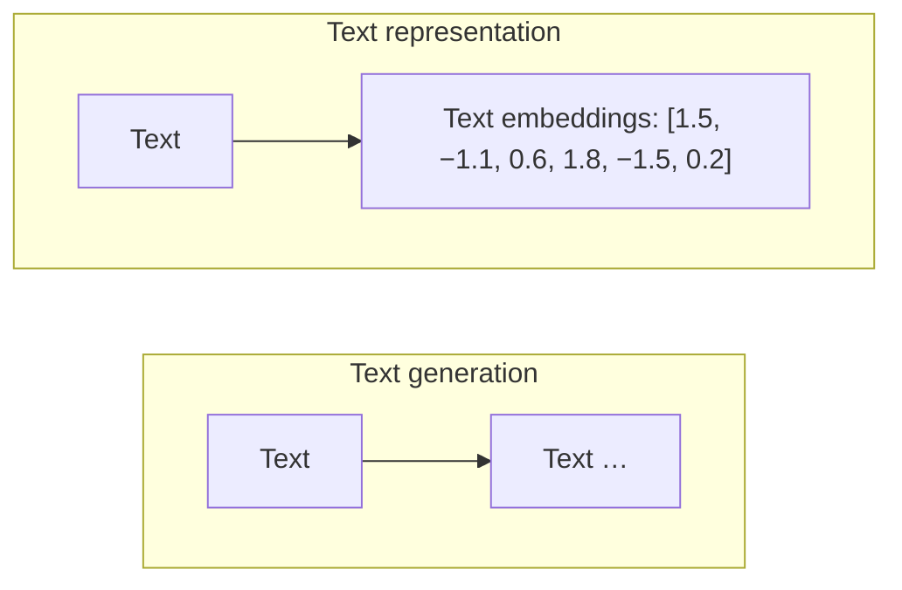

# LLM University: Text Representation

*Module 2 of LLM University (Cohere).*

## Text Embeddings & Visualising Them
<!-- pages: 186-190 -->

- When you hear about LLMs, probably the first thing that comes to mind is the **text-generation** capability, such as writing an essay or creating marketing copy.
- Another thing you can get is **text representation**: a set of numbers that represent what the text means and capture the semantics of the text. These numbers are called **text embeddings**.

- Text generation outputs text, while text representation outputs embeddings.
- Text embeddings give you the ability to turn **unstructured text data into a structured form**. With embeddings, you can compare 2 or more pieces of text, be it single words, sentences, paragraphs or even longer documents. And since these are sets of numbers, the ways you can process and extract insights from them are limited only by your imagination.
- What does this bring? It opens up many possible use cases that apply in the real world today. Embeddings power applications we interact with on a daily basis, such as modern search engines, e-commerce product recommendations, social-media content moderation, email spam filtering, customer-support conversational agents and many more.
- Check the notebook (`.ipynb`) file. We'll work with a subset of the **Airline Travel Information System (ATIS)** intent-classification dataset.

### Step 1 — Prepare the Dataset

Output (sample inquiries):

- which airlines fly from boston to washington dc
- show me the airlines that fly between toronto and denver
- …

### Step 2 — Turn Text into Embeddings

Next, we embed each inquiry by calling Cohere's **Embed endpoint** with `co.embed()`. It takes in texts as input and returns embeddings as output. We supply 3 parameters:

- `texts` — the list of texts you want to embed;
- `model` — the model to use to generate the embedding;
