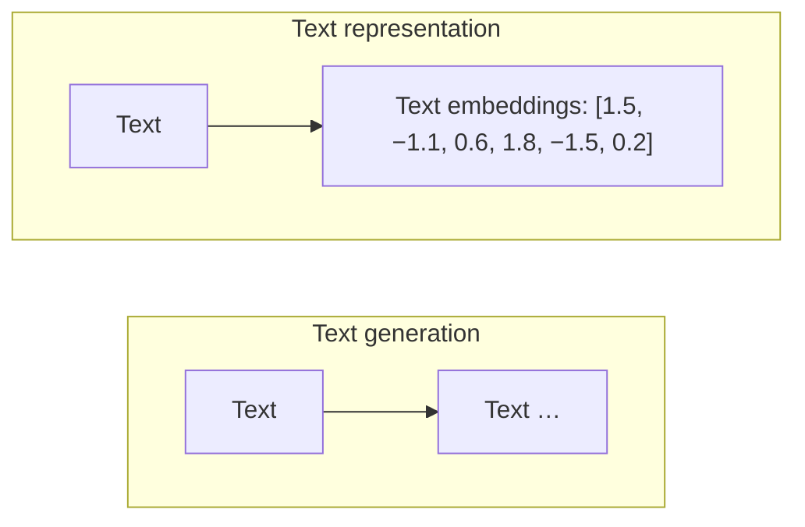
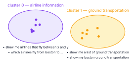
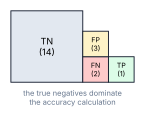
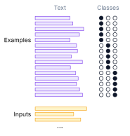

# LLM University: Text Representation

*Module 2 of LLM University (Cohere).*

## Text Embeddings & Visualising Them
<!-- pages: 186-190 -->

- When you hear about LLMs, probably the first thing that comes to mind is the **text-generation** capability, such as writing an essay or creating marketing copy.
- Another thing you can get is **text representation**: a set of numbers that represent what the text means and capture the semantics of the text. These numbers are called **text embeddings**.



- Text generation outputs text, while text representation outputs embeddings.
- Text embeddings give you the ability to turn **unstructured text data into a structured form**. With embeddings, you can compare 2 or more pieces of text, be it single words, sentences, paragraphs or even longer documents. And since these are sets of numbers, the ways you can process and extract insights from them are limited only by your imagination.
- What does this bring? It opens up many possible use cases that apply in the real world today. Embeddings power applications we interact with on a daily basis, such as modern search engines, e-commerce product recommendations, social-media content moderation, email spam filtering, customer-support conversational agents and many more.
- Check the notebook (`.ipynb`) file. We'll work with a subset of the **Airline Travel Information System (ATIS)** intent-classification dataset.

### Step 1 — Prepare the Dataset

Output (sample inquiries):

- which airlines fly from boston to washington dc
- show me the airlines that fly between toronto and denver
- …

### Step 2 — Turn Text into Embeddings

Next, we embed each inquiry by calling Cohere's **Embed endpoint** with `co.embed()`. It takes in texts as input and returns embeddings as output. We supply 3 parameters:

- `texts` — the list of texts you want to embed;
- `model` — the model to use to generate the embedding;
  Until now, there are 4 models available:
  - `embed-english-v3.0` (English);
  - `embed-english-light-v3.0` (English);
  - `embed-multilingual-v3.0` (multilingual: 100+ languages);
  - `embed-multilingual-light-v3.0` (multilingual: 100+ languages).
- `input_type` — specifies the type of document to be embedded. At the time of writing, there are 4 options:
  - `search_document` — for documents against which search is performed;
  - `search_query` — for query documents;
  - `classification` — for when the embeddings will be used as an input to a text classifier;
  - `clustering` — for when you want to cluster the embeddings.
- For every piece of text passed to the Embed endpoint, a sequence of **1024 numbers** will be generated. Each number represents a piece of information about the meaning contained in that piece of text.

### Step 3 — Visualise Embeddings with a Heatmap

- For some visual intuition, compress the dimension to a much lower number, say 10.
- Say we have taken 3 examples. They are all inquiries about ground transportation in Boston, and by visual inspection we can see that their embedding patterns are very similar.
- Here the model was able to capture the context and meaning of each piece of text, and then represent them as embeddings. **Each dimension of an embedding, called a feature, represents a certain universal characteristic of text** according to how the model understands it.
- How is this possible? An LLM has been pre-trained with a vast amount of text data, where the training objective is set up in such a way as to encourage the model to extract contextual information about a piece of text and store it as embeddings.

### Step 4 — Visualise Embeddings on a 2-D Plot

- We can investigate this further by compressing the embeddings to 2 dimensions and plotting them on a scatter plot. What we would expect is that texts of similar meaning would be closer to each other, and vice versa.
- Do note that as we compress the embeddings to lower dimensions, the information retained becomes less. However, humans can only visualise in 2-D or 3-D, and it turns out this is still a good-enough approximation to help us gain intuition about the data.
- By visual inspection, we can see that texts of similar meaning are indeed located close together. We see inquiries about **tickets on the left**, inquiries about **airlines somewhere around the middle**, and inquiries about **ground transportation on the top right**.
- These kinds of insights enable various downstream analyses and applications, such as **topic modelling** by clustering documents into groups. In other words, text embeddings allow us to take a huge corpus of unstructured text and turn it into a structured form, making it possible to objectively compare, dissect and derive insights from all that text.
- Text embeddings make possible a wide array of downstream applications, such as **semantic search, clustering and classification**.

## Semantic Search with Embeddings
<!-- pages: 191-194 -->

- Here, you'll learn how to use text embeddings to search for the answer to a given query among the sentences in a dataset. Since the embeddings take semantics into account, this process is called **semantic search**.
- We deal with unstructured text data on a regular basis, and one of the common needs is to search for information from a vast repository. A common approach is **keyword matching**, but the problem with this is that the results are limited to the exact query entered.
- This is where we can utilise text embeddings: an embedding can **capture the meaning of a piece of text beyond keyword matching**.

<!-- pages: 192-194 -->

### Step-by-Step Guide

Let's use the same 9 data points and pretend that they make up a list of **Frequently Asked Questions (FAQ)**. Whenever a new query comes in, we want to match that query to the closest FAQ, so we can provide the most relevant answer. Here is the list again:

- which airlines fly from boston to washington dc via other cities
- show me the airlines that fly between toronto and denver
- show me round trip first class tickets from new york to miami
- i'd like the lowest fare from denver to pittsburgh
- show me a list of ground transportation at boston airport
- show me boston ground transportation
- of all airlines which airline has the most arrivals in atlanta
- what ground transportation is available in boston
- i would like your rates between atlanta and boston on september third
- which airlines fly between boston and pittsburgh

Let's say a person enters the query **"How can I find a taxi or a bus when the plane lands?"**. Note that the "taxi" and "bus" keywords don't exist anywhere in our FAQ, so let's see what results we get with semantic search.

- Implementation-wise, there are many ways we can approach this. In our case, we use **cosine similarity** to compare the embeddings of the search query with those from the FAQ and find the most similar ones.

**Step 1 — Embed the documents.** The first step is to turn the documents into embeddings. We embed each inquiry by calling Cohere's Embed endpoint with `co.embed()`. It takes in texts as input and returns embeddings as output (see the previous pages).

**Step 2 — Embed the search query.** Next, we embed the query using the same `get_embeddings()` function, but now we set `search_query` as the `input_type`, because we're now embedding the search query:

```python
# Define new query
new_query = "How can I find a taxi or a bus when the plane lands?"

# Get embeddings of the new query
new_query_embeds = get_embeddings([new_query], input_type="search_query")[0]
```

**Step 3 — Perform search.** Next, we create a function `get_similarity()` that uses cosine similarity to determine how similar each of the documents is to the query.

- Below are the results, showing the FAQs with their similarity score (ranging from 0 to 1; higher scores are better). The top-3 ranked FAQs we get are inquiries about **ground transportation**, which are very relevant considering the other options. Notice that they don't contain the keywords "taxi" or "bus", and the search query doesn't contain the keywords "ground transportation". But they are the most similar in meaning compared to the rest, and their embeddings capture this.

*Query:* "How can I find a taxi or a bus when the plane lands?" — **most similar documents:**

| Similarity | Document |
| ---: | --- |
| 0.37 | show me a list of ground transportation at boston airport |
| 0.36 | what ground transportation is available in boston |
| 0.33 | show me boston ground transportation |

**Step 4 — Visualise the results in a 2-D plot.** We can also plot this new query on a 2-D plot as we did earlier: the query about "a taxi or a bus" is located **closest to the documents about ground transportation**.

## Text Clustering
<!-- pages: 195-196 -->

- Here, you'll leverage embeddings and **K-means clustering** to split a text dataset into different clusters with semantically similar sentences.
- As the amount of unstructured text data increases, organisations will want to be able to derive an understanding of its contents. One example would be to discover underlying topics in a collection of documents, so we can explore trends and insights. Another could be for businesses to segment customers based on preferences and activity.
- These kinds of tasks fall under a category called **clustering**. In ML, clustering is a process of grouping similar documents into clusters. It is used to organise a large number of documents into a small number of groups, and it lets us discover emerging patterns in a collection of documents without us having to specify much information beyond supplying the data.

### Step-by-Step Guide

Consider the same 9 data points as before ("which airlines fly …", …).

**Step 1 — Embed the text for clustering.** We embed the documents using the same `get_embeddings()` function as before, but now we set `input_type="clustering"`, because we'll use the embeddings for clustering.

**Step 2 — Cluster the embeddings.** Implementation-wise, we use the **K-means algorithm** to cluster these data points. Other than providing the embeddings, the only other key information we need to provide for the algorithm is **the number of clusters** we want to find. This is normally larger in actual applications, but since our dataset is small, we'll set the number of clusters to 2.

```python
# Pick the number of clusters
n_clusters = 2

# Cluster the embeddings
kmeans_model = KMeans(n_clusters=n_clusters, random_state=0)
classes = kmeans_model.fit_predict(embeds).tolist()

# Store the cluster assignments
df_clust = df_pc2.copy()
df_clust['cluster'] = (list(map(str, classes)))
```

**Step 3 — Visualise the results in a 2-D plot.** The plot shows the clusters that the algorithm returned. It looks to be spot on: we have **one cluster related to airline information** and **one cluster related to ground-service information**. Each cluster corresponds to a particular topic.

| Cluster 0 — airline information | Cluster 1 — ground transportation |
| --- | --- |
| show me airlines that fly between x and y | show me a list of ground transportation … |
| which airlines fly from boston to … | show me boston ground transportation |



## Text Classification & Evaluation Metrics
<!-- pages: 197-203 -->

- Previously we saw how to use embeddings to enable use cases such as semantic search, clustering and topic modelling. All of these are **"unsupervised learning" algorithms**, where we don't know the number of groups and what they are.
- But what if we already know the groups (or classes) that we want to group our documents into? Here you'll learn about **classification**, which is a **"supervised learning" algorithm**, where we know the specific classes we want to use.
- Like all ML models, classification models need to be evaluated in order to improve and measure their performance. Here you'll learn 4 different ways to evaluate classification models.

### Types of Text Classification

A classification task falls under one of these 2 categories:

- **Binary classification** → number of classes = 2. *Examples:*
  - a **spam classifier** could assign emails one of the two classes: "Spam" or "Not spam";
  - an online forum could use a **toxicity classifier** to assist with **content moderation** by classifying posts as "Neutral" or "Toxic".
- **Multi-class classification** → number of classes > 2.
  *Examples:*
  - a restaurant could use a **sentiment classifier** to categorise customer reviews as "Positive", "Neutral" or "Negative";
  - for businesses that deal with a large volume of inbound communication, a **topic classifier** could assign the message to the relevant department (one of "Customer service", "Returns" or "Shipping") for resolution. We could assign just one label to each message, or permit multiple labels: a classifier that allows multiple labels is a **multi-label classifier**;
  - a company could build a **chatbot intent classifier** to detect the intent behind a user's message (one of "Greeting", "Shipping and handling policy", "Start return or exchange", "Track order" or "Bye"). Intent classifiers are broader than topic classifiers, as they include intents like "Greeting" or "Bye" that enable them to respond appropriately when a user says "hi" or "bye", for example.

**Examples of binary and multi-class classifications** (● = the label chosen for an example input; ▣ = several labels allowed):

| Classifier | Labels |
| --- | --- |
| Sentiment classifier | ○ Positive · ● Neutral · ○ Negative |
| Spam classifier | ○ Spam · ● Not spam |
| Toxicity classifier | ● Neutral · ○ Toxic |
| Topic classifier | ○ Customer service · ● Returns · ○ Shipping |
| Topic multi-label classifier | ▣ Customer service · ▣ Returns · ▣ Shipping |
| Chatbot intent classifier | ○ Greeting · ○ Shipping and handling policy · ● Start return or exchange · ○ Track order · ○ Bye |

### Evaluation Metrics

The 4 most important ways: **accuracy, precision, recall and F1**.

$$\text{Accuracy} = \frac{\text{number of correct predictions}}{\text{total number of predictions}}.$$

- Accuracy is **not a good metric for imbalanced data** — a scenario where certain classes contain way more data points than the others. If the classifier had not been learning anything and was simply classifying all the outputs to be 0 (not spam), we would get 17 out of 20 correct classifications, which translates to a very high accuracy of 85 %! Clearly, something is not right.
- If you have not noticed yet, our dataset is indeed imbalanced: we have way more emails that are not spam than emails that are spam.
- Accuracy can sometimes hide the nuance of imbalanced datasets. The reason is that in these kinds of datasets the **true-negative category dominates**, diluting the effect of the rest. So even if the classifier were to perform poorly in the other 3 categories, its accuracy will still look good, masking its deficiencies.

| | Predicted negative | Predicted positive |
| --- | ---: | ---: |
| **Actual negative** | TN = 14 | FP = 3 |
| **Actual positive** | FN = 2 | TP = 1 |



- **Precision, recall and F1** can provide a more balanced view of a classifier's performance, because they don't focus on true negatives (TN) in the calculation.
- Between precision and recall, though, there is a **trade-off**. It is hard to optimise for both simultaneously, as optimising for the FP (thereby improving precision) comes at the expense of the FN (false negatives — thereby deteriorating recall), and vice versa.
- Which then brings the question: which metric should you prioritise — precision or recall?

<!-- pages: 201-203 -->

- The answer is that **it depends on the nature of your task**. Let's see why.
  - Suppose the spam classifier achieved **high precision and low recall (scenario A)**. This would result in fewer non-spam emails flagged as spam (FP), but it would also mean more of the actual spam emails went undetected (FN).
  - Conversely, if the classifier achieved **high recall and low precision (scenario B)**, there would be fewer undetected spam emails (FN), but it comes at the expense of more non-spam emails being flagged as spam (FP).
  - For a spam-classification task, it's probably more desirable to avoid important emails being moved into the spam folder than to have the occasional spam email going into the inbox. So for this task, we will want to **prioritise precision over recall**.
- If both precision and recall are important to you and you need the classifier to do well in both, then use the **F1 score**: F1 provides the balance between precision and recall.

### Multi-Class Classification

- Let's say we have the task of classifying a list of e-commerce customer emails into one of 3 classes: **Shipping, Returns and Tracking**. We'll represent each class with the integer values 0, 1 and 2 respectively.
- The dataset contains 15 email titles. We put each data point through a multi-class classifier to get the predicted class, and then compare it with its actual class.
- **First, accuracy.** The calculation is the same as we did with binary classification — the number of correct predictions divided by the total number of predictions. For our dataset there are 10 correct predictions and 5 incorrect predictions, which gives us an **accuracy of 67 %**.
- Now, to compute precision, recall and F1, we'll build the **confusion matrix**. Since we have 3 classes, the matrix now becomes a $3 \times 3$ matrix, each column representing one class. Applied to our dataset, we get the following matrix:

| Actual ↓ / Prediction → | 0 Shipping | 1 Returns | 2 Tracking |
| --- | ---: | ---: | ---: |
| **0 Shipping** | **TRUE 3** | FALSE 0 | FALSE 2 |
| **1 Returns** | FALSE 1 | **TRUE 4** | FALSE 0 |
| **2 Tracking** | FALSE 0 | FALSE 2 | **TRUE 3** |

- Precision and recall are calculated in the same way as we did with binary classification. The only difference now is that **each class will have its own set of precision and recall values**.
- Let's take class 0 (Shipping) as an example. Here we use *positive* to refer to the Shipping class and *negative* to refer to all the other classes (not Shipping). So, for class 0 (Shipping):
$$\text{Precision} = \frac{TP}{TP + FP} = \frac{3}{3 + 1 + 0} = 75\%, \qquad \text{Recall} = \frac{TP}{TP + FN} = 60\%, \qquad F_1 = \frac{2 \times \text{Precision} \times \text{Recall}}{\text{Precision} + \text{Recall}} = 67\%.$$
- Going through all classes in our dataset, this is what precision, recall and F1 look like:

| Class | Precision | Recall | F1 |
| --- | ---: | ---: | ---: |
| 0 — Shipping | 75 % | 60 % | 67 % |
| 1 — Returns | 67 % | 80 % | 73 % |
| 2 — Tracking | 60 % | 60 % | 60 % |

> **Note.** The notebook lists F1 = 79 % for Returns and 53 % for Tracking; from the precision and recall above, $F_1 = \frac{2 \times 0.67 \times 0.8}{0.67 + 0.8} \approx 73\%$ and $\frac{2 \times 0.6 \times 0.6}{1.2} = 60\%$. The averages below use the notebook's values.

- Now, what if the number of classes started to get really big? This table would become huge, and it would be harder to get a snapshot of the performance. So we may want to still have a single value for each of these metrics.
- There are a few approaches we can take, and one common option is to take the **average of all the classes**. This is also called the **macro-average**, and we apply it to each of precision, recall and F1 as follows:
$$\text{Macro-precision} = \frac{75\% + 67\% + 60\%}{3} = 67\%, \qquad \text{Macro-recall} = \frac{60\% + 80\% + 60\%}{3} = 67\%, \qquad \text{Macro-}F_1 = \frac{67\% + 79\% + 53\%}{3} = 66\%.$$

## Few-Shot Classification
<!-- pages: 204-208 -->

- Here you'll learn how to classify a small dataset of sentences by their sentiment (positive, negative or neutral), using Cohere's **Classify endpoint**.
- In the text-classification space, a trend is emerging where developers and teams are leveraging LLMs when building an AI-based classifier system. This is opposed to building a system from scratch on their own, which first requires the team to have the know-how in ML and engineering, and second requires a huge amount of labelled training data to build a working solution.
- With LLMs, instead of having to prepare thousands of training data points, you can get up and running with just a handful of examples per class, called **few-shot classification**. Think about the sudden drop in the associated costs, time and effort to collect and build a training dataset. This means that more teams can now think about deploying their own text-classification systems, whereas they would not have considered it before.
- Let's see how to do this with an example. We'll classify the sentiment of text into a number of classes, say positive, negative or neutral. This is useful for applications like analysing social-media content or categorising product feedback.
- For example, a human can easily tell you that "Hello, World! What a beautiful day" conveys a positive sentiment, but let's see if our models can do that too. And while we're at it, let's try classifying other phrases that you might find on social media. Here, you'll learn to classify text based on sentiment using Cohere's Classify endpoint.

### Step-by-Step Guide

```python
import cohere
from cohere import ClassifyExample

# Create a Cohere client
co = cohere.Client("COHERE_API_KEY")
```

**Step 1 — Prepare examples and input.** A typical ML model requires many training examples to perform text classification, but with the Classify endpoint you can get started with as few as **two examples per class**. You need to prepare the following:

- **Examples**
  - These are the training examples we give the model to show the output we want it to generate.
  - Each example contains the text itself and the corresponding label, or class.
  - The minimum number of examples required is two per class.
  - You can have as many classes as possible. If you are classifying text into 2 classes, that means you need a minimum of 4 examples, and so on.
- **Inputs**
  - These are the list of text pieces you'd like to classify.



Our sentiment-analysis classifier has **3 classes with 5 examples each**: "Positive" for a positive sentiment, "Negative" for a negative sentiment and "Neutral" for a neutral sentiment. The code looks as follows:

```python
examples = [ClassifyExample(text="I'm so proud of you", label="positive"),
            ClassifyExample(text="What a great time to be alive", label="positive"),
            ClassifyExample(text="That's awesome work", label="positive"),
            ClassifyExample(text="The service was amazing", label="positive"),
            ClassifyExample(text="They don't care about me", label="negative"),
            # … (5 examples per class: positive, negative and neutral)
            ]
```
<!-- pages: 207-209 -->

The inputs (we have 12 in this example):

```python
inputs = ["Hello, world! What a beautiful day",
          "It was a great time with great people",
          # …
          ]
```

**Step 2 — Generate predictions.** With the Classify endpoint, setting up the model is quite straightforward. The main thing to do is to define the model type. For the Classify endpoint we need to use an embedding model, and we'll use `embed-english-v3.0`. Putting everything together with the Classify endpoint looks like this:

```python
def classify_text(inputs, examples):
    """
    Classifies a list of input texts given the examples.
    Arguments:
        model (str): identifier of the model
        inputs (list[str]): a list of input texts to be classified
        examples (list[Example]): a list of example texts and class labels
    Returns:
        classifications (list): each result contains the text, labels and conf values
    """
    # Classify text by calling the Classify endpoint
    response = co.classify(
        model='embed-english-v3.0',
        inputs=inputs,
        examples=examples)
    classifications = response.classifications
    return classifications

# Classify the inputs
predictions = classify_text(inputs, examples)
```

- Together with the predicted class, the endpoint also returns the **confidence value** of the prediction (between 0 and 1). These confidence values are split among the classes — in this case 3 — in which the values add up to a total of 1. The classifier then selects the class with the highest confidence value as the "predicted class". A high confidence value for the predicted class therefore indicates that the model is very confident of its prediction, and vice versa.
- Here's a sample output returned:

| Input | Prediction | Confidence |
| --- | --- | ---: |
| Hello, world! What a beautiful day | positive | 0.84 |
| It was a great time with great people | positive | 0.99 |
| Maybe this is why | neutral | 0.70 |
| Let's start again | neutral | 0.83 |
| This is the worst thing | negative | 0.93 |

## Fine-Tuning for Classification
<!-- pages: 209-215 -->

- Here you'll learn how to **fine-tune the Classify endpoint model** on custom datasets, enhancing its performance on specific tasks.
- In the previous chapter, you used few-shot classification for a sentiment-analysis task and got decent results with a small dataset.
- Let's say you actually have a decent amount of training data at your disposal. Then you can leverage these additional data points to build a potentially better-performing classifier through a process known as **fine-tuning**.
- Fine-tuning is a powerful concept, and here's the reason: with fine-tuning, **you can actually alter the model itself** and customise it according to your task.

<!-- pages: 210-212 -->

- This means that what you get is a **custom model** that is fine-tuned to excel at a specific task, and potentially can outperform the few-shot approach from the previous chapter.
- Here, you'll learn how to fine-tune a model for classification.

### Step-by-Step Guide

To set up, we first import several tools:

```python
import os
import json
import numpy as np
import pandas as pd
from cohere import ClassifyExample
from sklearn.model_selection import train_test_split
from sklearn.metrics import accuracy_score, f1_score
```

We also import the Cohere module and create a client:

```python
import cohere
co = cohere.Client("COHERE_API_KEY")
```

**Step 1 — Prepare the dataset.** We'll use the **Airline Travel Information System (ATIS)** intent-classification dataset. For demonstration purposes, we'll take just a small portion of the dataset: **1000 data points** in total.

```python
# Load the dataset to a dataframe
df = pd.read_csv('https://raw.githubusercontent.com/cohere-ai/notebooks/main/notebooks/data/atis_subset.csv',
                 names=['query', 'intent'])
```

- The first thing we need is to create a **training dataset**, to be used for building the classifier, and a **test dataset**, to be used for testing the classifier performance. We will use **800 and 200** data points for these datasets, respectively.

```python
df_train, df_test = train_test_split(df, test_size=200, random_state=21)
```

- Our goal is to train the classifier so it can predict the class of a new customer inquiry out of **8 classes**, as follows:

```python
['atis_flight', 'atis_airfare', 'atis_ground_service', 'atis_flight_time',
 'atis_airline', 'atis_quantity', 'atis_abbreviation', 'atis_aircraft']
```

- We transform the data to **JSONL format** to match the style expected by the Classification endpoint:

```python
def create_classification_data(text, label):
    formatted_data = {
        "text": text,
        "label": label
    }
    return formatted_data

if not os.path.isfile("data.jsonl"):
    print("Creating jsonl file ...")
    with open("data.jsonl", 'w+') as file:
        for row in df_train.itertuples():
            formatted_data = create_classification_data(row.query, row.intent)
            file.write(json.dumps(formatted_data) + '\n')
        file.close()
        print("Done")
else:
    print("data.jsonl file already exists")
```

- The JSONL file has a row for each example. Each example has `"text"` and `"label"` fields:

```json
{"text": "what flights go from new york to boston after 5 pm", "label": "atis_flight"}
```

<!-- pages: 213-215 -->

**Step 2 — Fine-tune the model.** We kick off a fine-tuning job by navigating to the fine-tuning tab of the Cohere dashboard. Under "Classify", click on **"Create a Classify model"**.

- Next, upload the `.jsonl` file you just created as the training set by clicking on the "Training set" button. When ready, click on **"Review data"** to proceed to the next step.
- Then you'll see a preview of how the model will ingest your data. If anything is wrong with the data, the page will also provide suggested changes to fix the training file. Otherwise, if everything looks good, you can proceed to the next step.
- Finally, you'll see a page where you'll provide a nickname for your model. We used **`atis-classify-ft`** as the nickname for our model. Under "BASE MODEL", ensure "english" is selected.
- Then click on **"Start training"** to kick off the fine-tuning process. This will navigate you to a page where you can monitor the status of the model. A model that has finished fine-tuning will show the status as **"READY"**.

**Step 3 — Use / evaluate the fine-tuned model.** Once the model has finished fine-tuning, it's time to evaluate its performance. Navigate to the API tab of the fine-tuned model. There, you'll see the **model ID** that you should use when calling `co.classify()`. We fill in the model ID to generate test predictions:

```python
def classify_text_finetune(texts):
    classifications = co.classify(
        model='b2c94ac3-79…',   # the fine-tuned model ID
        inputs=texts,
        examples=None
    ).classifications
    return [c.predictions[0] for c in classifications]

# Create batches of texts and classify them
BATCH_SIZE = 90  # The API accepts a maximum of 96 inputs
y_pred = []
for i in range(0, len(df_test), BATCH_SIZE):
    batch_texts = df_test["query"][i:i+BATCH_SIZE].tolist()
    y_pred.extend(classify_text_finetune(batch_texts))
```

Next, we calculate the model's test accuracy and F1 score:

```python
accuracy = accuracy_score(df_test["intent"], y_pred)
f1 = f1_score(df_test["intent"], y_pred, average='weighted')
print(accuracy, f1)
```

- Now you saw that **fine-tuning is an alternative to few-shot classification** that allows you to have more control over the model's training. It is generally preferred if you have a larger dataset and need superior performance.

## Multilingual Sentiment Analysis App
<!-- pages: 216-225 -->

- Here you will build a **sentiment-analysis application** that can classify sentiments in text from multiple languages.
- Emotional expression is subjective. It's shaped by cultural background, emotional intelligence, individual personality traits and characteristics, and more. While we can communicate emotions clearly in verbal communication due to nuances of tone and inflection, it's harder to determine how a person feels and what emotions they're expressing through words alone.
- Fortunately, we can use **sentiment analysis** to determine the tone — and, by extension, the emotion — that text conveys.
- Here, we are creating an app that uses sentiment analysis to determine what emotions a person is experiencing, based on the text input.

<!-- pages: 217-219 -->

The steps for building the sentiment-analysis application are:

1. Gather emotion data.
2. Train the emotion classifier.
3. Get user input.
4. Embed the input.
5. Classify sentiment.
6. Display results.
7. Put it all together.

### Step-by-Step Guide

We'll use the **`embed-multilingual-v3.0`** model via the Cohere API — specifically the Embed endpoint — to generate embeddings for user-provided text in real time. The `embed-multilingual-v3.0` model generates embeddings for text data in **over 100 languages**. Then we'll use these embeddings to train a classifier to predict the emotions the user expressed.

**Step 1 — Gather emotion data.** We'll use the **XED dataset**, consisting of **8 emotion categories**, to train the emotion classifier. For this app, the embeddings for this dataset have already been created and stored as `xed_with_embeddings.json`, along with the labels for each data point.

**Step 2 — Train the emotion classifier.** The bulk of the code that drives this application is stored in the `train_and_save_sentiment.py` file. Let's open it and examine the `train_and_save` function line by line.

- First, the function reads `xed_with_embeddings.json` into a data frame. In this data frame, column `df.embeddings` contains the embeddings for each sample, and column `df.labels_text` contains the emotion label for each sample. The function transforms the embeddings for each sample into a list, forming the data matrix $X$.
- The function uses **`MultiLabelBinarizer`** from scikit-learn to one-hot encode `df.labels_text` and form $y$, which is a one-hot encoded label matrix.
- Next, the function executes the train–test split, with the test-set size configured at 1 % of the total set. Afterwards, it instantiates a **chain of classifiers** with logistic regression as the base classifier.
- A **classifier chain** is a technique for multi-label classification that involves training a chain of binary classifiers, one for each label. The output of each classifier serves as the input to the next classifier in the chain. Consequently, the final output is a vector of binary labels indicating the presence or absence of each emotion.
- This demo uses a chain of classifiers instantiated with logistic regression as the base classifier, via `ClassifierChain` and `LogisticRegression` from scikit-learn. This allows us to predict the probability of each emotion class for each sample with `chain_model.predict_proba` in step 5.
- Subsequently, the `train_and_save` function fits the classifier on the train set and evaluates it with `chain.score`. This calculates the mean accuracy relative to the test set. In the last line, the function saves the trained classifier for determining emotion in a pickle file, `emotion_chain.pkl`.
- A **pickle file** is a way of serialising and saving Python objects such as trained ML models. By saving a trained model as a pickle file, we can reuse the model later without retraining it from scratch.
- Then we save the trained classifier for determining emotion into a pickle file named `emotion_chain.pkl`. To load the saved model later, we can simply use the `pickle.load` function in Python.

```python
def train_and_save():
    full_df = pd.read_json("./data/xed_with_embeddings.json", orient="index")
    df = full_df
    mlb = MultiLabelBinarizer()
    X = np.array(df.embeddings.tolist())
    y = mlb.fit_transform(df.labels_text)
    classes = mlb.classes_
    classes_mapping = {index: emotion for index, emotion in enumerate(mlb.classes_)}
    X_train, X_test, y_train, y_test = train_test_split(X, y, test_size=0.01, random_state=42)
```

<!-- pages: 220-222 -->

```python
    # (continued)
    base_lr = LogisticRegression(solver='lbfgs', random_state=0)
    chain = ClassifierChain(base_lr, order='random', random_state=0)
    chain.fit(X_train, y_train)
    print(chain.score(X_test, y_test))
    pickle.dump(chain, open("./data/models/emotion_chain.pkl", 'wb'))
```

**Step 3 — Get user input.** Streamlit functions facilitate user input. Calling `st.text_input` creates a page object that asks the user "How are you feeling?" and captures the user's text responses. It then presents the user a slider via `st.slider`, which they use to select the number of top emotions they'd like to be presented ($k$).

```python
feeling_text = st.text_input("How are you feeling?", "")
top_k = st.slider("Top Emotions", min_value=1, max_value=len(classes_mapping), value=1, step=1)
```

**Step 4 — Embed the input.** The beginning of the function `score_sentence` embeds the user input text into embeddings and converts it into a torch-based tensor:

```python
embeddings = torch.as_tensor(get_embeddings(co=co, model_name=model_name, texts=[text]),
                             dtype=torch.float32)
```

The function imports `get_embeddings` from the `utils.py` file. Then the `get_embeddings` function calculates the embeddings by calling the `embed-multilingual-v3.0` model:

```python
def get_embeddings(co: cohere.Client,
                   texts: List[str],
                   model_name: str = 'embed-multilingual-v3.0',
                   input_type="search_document",
                   truncate: str = 'RIGHT',
                   batch_size: int = 2048) -> List[float]:

    @limiter.ratelimit("blobheart", delay=True)
    def get_embeddings_api(texts_batch: List[str]):
        for i in range(N_MAX_RETRIES):
            try:
                output = co.embed(model=model_name, input_type=input_type,
                                  texts=texts_batch, truncate=truncate)
                break
            except Exception as e:
                if i == (N_MAX_RETRIES - 1):
                    print(f"Exceeded max retries with error {e}")
                    raise f"Error {e}"
        return output.embeddings

    embeddings = []
    st_pbar = tqdm(range(0, len(texts), batch_size))
    for index in st_pbar:
        texts_batch = texts[index:index + batch_size]
        embeddings_batch = get_embeddings_api(texts_batch)
        # list(pool.imap(get_embeddings_api, [texts_batch]))
        embeddings.append(embeddings_batch)
    return np.concatenate(embeddings, axis=0).tolist()
```

> **Note.** The notebook writes the rate-limiter line only as `"blobheart", delay=True`; it is shown above as the decorator it belongs to.

**Step 5 — Classify sentiment.** In the function `setup` within the `sentiment.py` file, you can access the trained classifier model from `emotion_chain.pkl`, where we saved it in step 2:

```python
def setup():
    ...
    chain_model = pickle.load(open(model_path, 'rb'))
```

- With the model stored as `chain_model`, we access it in `score_sentence` after acquiring the embeddings. The function then executes the model on the float tensor of embeddings to predict the probabilities of the emotion class(es), determined for each sample with `chain_model.predict_proba`.
- Then `torch.sort` sorts the probability outputs for the emotion(s) associated with the user text input in ascending order.

<!-- pages: 223-225 -->

- In the last step, we convert the tensor of probabilities and the tensor of associated indices from GPU-based to CPU-based, allowing each tensor to be configured into a NumPy array. This then reverses both NumPy arrays such that the emotion with the highest probability is first. This sets up the loop we'll run to display the images associated with the determined top-$k$ emotions experienced by the user.

```python
outputs = torch.as_tensor(chain_model.predict_proba(embeddings), dtype=torch.float32)
probas, indices = torch.sort(outputs)
probas = probas.cpu().numpy()[0][::-1]
indices = indices.cpu().numpy()[0][::-1]
```

**Step 6 — Display results.** Let's first head back to the `setup` function we discussed in step 5. The first part of this function initiates `emotions2image_mapping` as a dictionary, and each of the 8 emotion labels is mapped with file paths corresponding to the respective emotion GIFs. Then `emotions2image_mapping` is iteratively filled with the emotion GIFs themselves, utilising the file paths:

```python
emotions2image_mapping = {
    'Anger': './data/emotions/anger.gif',
    'Anticipation': './data/emotions/anticipation.gif',
    'Disgust': './data/emotions/disgust.gif',
    'Fear': './data/emotions/fear.gif',
    'Joy': './data/emotions/joy.gif',
    'Sadness': './data/emotions/sadness.gif',
    'Surprise': './data/emotions/surprise.gif',
    'Trust': './data/emotions/trust.gif',
}
for key, value in emotions2image_mapping.items():
    with open(value, "rb") as f:
        emotions2image_mapping[key] = f.read()
```

- Now, circling back to the `score_sentence` function: the call returns `emotions2image_mapping` to `setup`, and it is afterwards accessed in the loop inside `score_sentence` to display the top-$k$ emotions to the user as GIFs.
- The loop iterates through each of the top-$k$ emotions, with the index and probability associated with each emotion extracted as a tuple `(index, p)` at each iteration of the loop. Before the start of the loop, we use Streamlit to create $k$ columns that will display the top-$k$ emotion(s) to the user.
