# LLM University: Text Generation

## Introduction to Text Generation & the Command Model
<!-- pages: 226-229 -->

- Here, you'll learn about **Cohere's Command model** and how an LLM chatbot works, and get an introduction to Cohere's **Chat endpoint**.
- **Chatbots brought LLMs into the mainstream.** LLMs have been around for a few years, but their adoption was largely limited to the AI community. The launch of AI-powered consumer chatbots has made LLMs accessible to the everyday user, and now they're a hot topic in tech and enterprise circles alike.
- This text-generation module teaches you how to build LLM chatbots using Cohere's Chat endpoint.

### The Command Model

- **Command** is Cohere's flagship LLM. It generates a response given a prompt or message from a user. It is trained to follow user commands and to be instantly useful in practical business applications like **summarisation, copywriting, extraction and question answering**.
- Command has been trained with a large volume of **multi-turn conversations** to ensure that it excels at the various nuances associated with conversational language. It ranks at the top of the **Holistic Evaluation of Language Models (HELM)** benchmark, an evaluation leaderboard comparing LLMs on a wide number of tasks.

### Command R and Command R+ Models

**Command R** and **Command R+** are designed to be the market-leading family of models in the "scalable" category that balance high efficiency with strong accuracy, to enable enterprises to move from proof of concept into production-grade AI. Here are some key features of Command R:

- **High-performance RAG:** retrieval-augmented generation (RAG) enables enterprises to give the model access to private knowledge that it otherwise would not have.
- **Access to tools:** tool use enables enterprise developers to turn Command R into an engine for powering the automation of tasks and workflows that require using internal infrastructure like databases and software tools, as well as external tools like CRMs, search engines and more. Command R+ supports **multi-step tool use**, which allows the model to combine multiple tools over multiple steps to accomplish difficult tasks.
- **Low latency and high throughput:** Command R targets the "scalable" category of models that balance high performance with strong accuracy, enabling companies to move beyond proof of concept and into production.
- **128K context length and lower pricing:** Command R features a longer context length, supporting up to 128K tokens in its initial release.
- **Strong capabilities across 10 key languages:** the model excels at 10 major languages for global business: English, French, Spanish, Italian, German, Portuguese, Japanese, Korean, Arabic and Chinese.
- **Model weights available for research and evaluation:** Cohere For AI is releasing the weights for this version of Command R publicly, so that it can be used for research purposes.

## How an LLM Chatbot Works
<!-- pages: 229-237 -->

- To understand how LLM chatbots work, it's important to develop an understanding of their building blocks. This section focuses on how to build the generative part of a chatbot, by looking at how to use a foundational model and add layers of context to generate answers in a conversational style.

### The Foundation of an LLM Chatbot

- The foundation of an LLM chatbot is an LLM that has been **fine-tuned to follow instructions**. It can generate a response given a prompt or message from a user.

<!-- pages: 230-233 -->

- This type of model is tuned to follow instructions and questions, such as "Write a headline for my homemade jewellery product" or "What is the capital of Canada?".

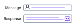

- However, **the LLM's context is limited to only the last message it receives**, and it does not consider any previous messages and responses.
- Yet chatbots are characterised by their ability to maintain a conversation with a user, which takes place over multiple interactions.

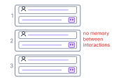

- The goal of a chatbot is to solve this problem by **linking a sequence of interactions into a single instance**, allowing the chatbot to hold an ongoing conversation. In doing so, the model's response can keep a memory of all the previous interactions instead of having to start from scratch every time.

### How to Build a Chatbot's Memory

- Working off the baseline generation model above, we can **layer together multiple interactions into a single prompt** and create a memory of the entire conversation.
- First, we add a system-level prompt called a **preamble**. A preamble contains instructions to help steer a chatbot's response toward specific characteristics, such as a persona, style or format. For example, if we want the chatbot to adopt a formal style, the preamble can be used to encourage the generation of more business-like and professional responses. The preamble could be something like: *"You are a helpful chatbot, trained to assist human users by providing responses in a formal and professional tone."*
- Then we append the current user message to the preamble, which becomes the prompt for the chatbot's response. Next, we append the chatbot response and the following user message to the prompt.

<!-- pages: 234-236 -->

- We can repeat this step for any number of interactions until we reach the model's **maximum context length**. Context length is the total number of tokens taken up by the prompt and response, and each model has a maximum context length that it can support.
- This **multi-turn framework** is what gives chatbots the ability to hold the full context of a conversation from start to finish.


*Multi-turn conversations can happen when the full context is available.*

- However, **building on top of a baseline LLM alone is not sufficient**. Chatbots need to perform well in a wide range of scenarios. To create a robust chatbot that consistently generates high-quality and reliable output, the baseline LLM needs to be adapted specifically to conversations. This means taking the baseline model and **fine-tuning it further with a large volume of conversational data**. This is what forms the foundation of Cohere's Chat endpoint.

### Cohere's Chat Endpoint

- Improving LLM chatbot performance starts with how the baseline LLM is trained. The model powering the Chat endpoint is Cohere's Command model, trained with a large volume of multi-turn conversations. This ensures that the model will excel at the various nuances associated with conversational language and perform well across different use cases.
- Beyond training, fine-tuning a baseline LLM for chat conversations requires adding a **standardised interface** on top of the prompt-formatting system. The Chat endpoint provides a consistent, simplified and structured way of handling the prompt formatting that defines how the prompt inputs should be organised, making it easier for developers to build chatbot applications. This added layer includes a fixed abstraction and schema, providing more stability to scale and build applications on top of the foundation model.
- The Chat endpoint includes all the elements required for an LLM chatbot (as discussed in the previous sections), exposing a simple interface for developers. It consists of the following key components:

<!-- pages: 237-239 -->

- **Preamble management:** developers can opt to use the endpoint's default preamble or override it with their own preambles.
- **Multi-turn conversations:** the Chat endpoint builds upon the Command model by enabling multi-turn conversations.
- **State management:** state management preserves the conversation memory. Developers can either leverage the endpoint's conversation-history persistence feature or manage the conversation history themselves.
- **Fully-managed conversation:** the abstraction layer of the Chat endpoint means there's only one item to send to the API: the user message. Everything else is managed automatically. At the same time, developers who want greater control over a chatbot's configuration can still do so.

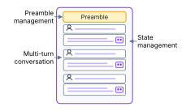

- Cohere's Command model and Chat endpoint offer powerful tools for developers looking to harness the potential of LLMs in their applications. Command's capabilities, coupled with the Chat endpoint's developer-friendly interface, allow developers to build text-generation applications across diverse business applications.

## Building a Chatbot: Chat Endpoint, Streaming & History
<!-- pages: 238-247 -->

- Here you'll learn how to build a simple chatbot from scratch using the Chat endpoint, and you'll explore features like **defining preambles, streaming and state management**.
- We build a simple chatbot that can respond to user messages and maintain the context of the conversation.

### Step-by-Step Guide

**Step 1 — Quickstart.** To set up, we first import the Cohere module and create a client:

```python
import cohere
co = cohere.Client("COHERE_API_KEY")
```

- At its most basic, we only need to pass to the Chat endpoint the user message using the `message` parameter — the only required parameter for the endpoint.


- Here's an example. We call the endpoint with "Hello" as the user message. In our case, we also use the `model` parameter to specify the underlying chat model we want to use. For this, we pick **Command R+**, Cohere's newest LLM.
- Right now, we're interested in the main content of the response, which is stored in the `text` value of the response:

```python
response = co.chat(message="Hello", model="command-r-plus")
print(response.text)
```

Output:

```text
# Response
Hello! How can I help you today?
```

<!-- pages: 240-242 -->

**Step 2 — Defining a preamble.** A conversation starts with a system message, or a **preamble**, to help steer a chatbot's response toward certain characteristics. For example, if we want the chatbot to adopt a formal style, the preamble can be used to encourage the generation of more business-like and professional responses.

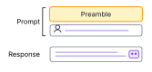

- In the quickstart example, we didn't have to define a preamble because a default one was used. We can, however, define our own preamble using the `preamble` parameter.
- Here's an example. We added a preamble telling the chatbot to assume the persona of an expert public-speaking coach. As a result, we get a response that adopts that persona:

```python
response = co.chat(message="Hello",
                   model="command-r-plus",
                   preamble="You are an expert public speaking coach. Don't use any greetings.")
print(response.text)
```

Output:

```text
# Response
How can I help you with your public speaking today?
```

**Step 3 — Streaming the chatbot response.** Our examples so far generate responses in a **non-streamed** manner. This means that the endpoint would return a response object only after the model has generated the text in full. The longer the text is, the longer it takes to get back the response. If you are building an application, this directly impacts the user's perception of the application's latency.

- The Chat endpoint solves this problem by supporting **streamed responses**. In a streamed response, the endpoint would return a response object for each token as it is being generated. This means you can display the text incrementally without having to wait for the full completion.
- To activate it, use `co.chat_stream()` instead of `co.chat()`.
- In streaming mode, the endpoint will generate a series of objects. To get the actual text contents, we take objects whose `event_type` is `text-generation`.
- If you have not already, make your own copy of the Google Colab notebook and run the code in this section to see the same example with streamed responses activated.

```python
stream = co.chat_stream(message="Hello. I'd like to learn about techniques for effective audience engagement",
                        model="command-r-plus",
                        preamble="You are an expert public speaking coach")

for event in stream:
    if event.event_type == "text-generation":
        print(event.text, end='')
```

Output:

```text
# Response (streamed)
Sure! Here are some techniques for effective audience engagement:
- **Make eye contact:** Look at …
- **Use gestures:** …
```

<!-- pages: 243-245 -->

**Step 4 — Building the chat history.** At the core of a conversation is a multi-turn dialogue between the user and the chatbot. This requires the chatbot to have a "memory" of all the previous turns to maintain the state of the conversation.

**Option 1 — Using the conversation-history persistence feature.** The Chat endpoint supports state management by persisting the conversation history. As a conversation progresses, the endpoint continuously updates the conversation history. This means developers don't have to deal with the complexity and inconvenience of managing conversation history in their application.

- To use this feature, use the `conversation_id` parameter, which is a unique string you assign to a conversation. We'll use the `uuid` library to do this.
- Putting everything together, let's now build a simple chat interface that takes in a user message, generates the chatbot response, automatically updates the conversation history, and repeats these steps until the user quits the conversation.
- As described before, in streaming mode the Chat endpoint generates a series of objects. To get the conversation history, we take the object with `event_type` of `"stream-end"` and save it as a new variable, `chat_history`.

```python
# Create a conversation ID
conversation_id = str(uuid.uuid4())

# Define the preamble
preamble = "You are an expert public speaking coach"

print('Starting the chat. Type "quit" to end.\n')

while True:
    # User message
    message = input("User: ")

    # Typing "quit" ends the conversation
    if message.lower() == 'quit':
        print("Ending chat.")
        break

    # Chatbot response
    stream = co.chat_stream(message=message,
                            model="command-r-plus",
                            preamble=preamble,
                            conversation_id=conversation_id)

    print("Chatbot: ", end='')

    for event in stream:
        if event.event_type == "text-generation":
            print(event.text, end='')
        if event.event_type == "stream-end":
            chat_history = event.response.chat_history

    print(f"\n{'-'*100}\n")
```

Output (response streamed):

```text
Starting the chat. Type "quit" to end.
User: Hello
Chatbot: Hello! How can I help you today?
----------------------------------------
User: …
Chatbot: …
----------------------------------------
User: quit
Ending chat.
```

Next, we print the full conversation history:

```python
for chat in chat_history:
    print(chat)
```

Output:

```text
role='USER' message='Hello' generation_id='…'
role='CHATBOT' message='Hello! How can I help you today?' …
```

**Option 2 — Managing the conversation history yourself.** If you opt not to use the endpoint's conversation-history persistence feature, you can use the `chat_history` parameter to manage the conversation history yourself.

<!-- pages: 246-248 -->

- The chat history is a list of multiple turns of messages from the user and the chatbot. Each item is a `cohere.ChatMessage` object containing the `role`, which can be either `"USER"` or `"CHATBOT"`, and the `message` containing the message string. The following is an example of a chat history:

```python
from cohere import ChatMessage

chat_history = [
    ChatMessage(role="USER", message="What is 2 + 2"),
    ChatMessage(role="CHATBOT", message="The answer is 4"),
    # …
]
```

- The following modifies the previous implementation by using `chat_history` instead of `conversation_id` for managing the conversation history:

```python
# Initialize the chat history
chat_history = []

# Define the preamble
preamble = "You are an expert public speaking coach"

print('Starting the chat. Type "quit" to end.\n')

while True:
    # User message
    message = input("User: ")

    # Typing "quit" ends the conversation
    if message.lower() == 'quit':
        print("Ending chat.")
        break

    # Chatbot response
    stream = co.chat_stream(message=message,
                            model="command-r-plus",
                            preamble=preamble,
                            chat_history=chat_history)

    chatbot_response = ""
    print("Chatbot: ", end='')

    for event in stream:
        if event.event_type == "text-generation":
            print(event.text, end='')
            chatbot_response += event.text
    print("\n")

    # Add to chat history
    chat_history.extend(
        [ChatMessage(role="USER", message=message),
         ChatMessage(role="CHATBOT", message=chatbot_response)]
    )
```

Output (response streamed):

```text
Starting the chat. Type "quit" to end.
User: Hello
…
```

## Parameters for Controlling Outputs: Model & Temperature
<!-- pages: 248-254 -->

- Here you'll learn about the parameters that you can leverage to control the Chat endpoint's outputs.
- The Chat endpoint is a versatile tool that empowers developers with an extensive array of options and parameters.
- The Command model has many variations to select from, where each has been carefully crafted to suit different needs. Additionally, you will see how to use parameters to control the creativity of model responses.

**Setup:**

```python
import cohere
co = cohere.Client("COHERE_API_KEY")
```

### Model Type

With the Chat endpoint, you can choose from several variations of the Command model. Different models may produce different output profiles, so you may want to experiment with different models to get the best output for your use case. Some of the models are as follows:

- **`command`** — the default model used in a Chat endpoint call. If you don't define the `model` parameter, this model will be used.
- **`command-light`** — a smaller, faster version of Command. Almost as capable, but a lot faster.

<!-- pages: 249-252 -->

- **`command-r`** — performs language tasks at a higher quality, more reliably and with a longer context than previous models.
- **`command-nightly`** and **`command-light-nightly`** — the latest, most experimental and (possibly) unstable versions of their default counterparts. Not recommended for production use.

Use the `model` parameter to select a variation that suits your requirements. In the code cell, we select Command R (the notebook's code uses `command-r-plus`):

```python
response = co.chat(message="Hello",
                   model="command-r-plus")
print(response.text)
```

Output:

```text
# Response
Hello! How can I help you today?
```

### Randomness

Often you'll need to control the **level of randomness** of the model. There are a number of factors to keep in mind when tuning model randomness, including:

- **Task type:** you'll likely want to decrease the randomness of the model when performing structured tasks that have a correct answer, like question answering or summarisation, or generating technical text. In these cases, we want the model to yield a safe and predictable response. On the other hand, if you are generating poetry or brainstorming ideas, you might want to increase the randomness to produce more diverse and creative responses.
- **Model behaviour:** we likely need to increase the randomness of the model if it gets stuck in a loop and starts repeating itself, or if it is producing overly generic phrases. Increasing the randomness will expand the set of words that the model can use when generating responses.
- **Controlling style and tone:** if generating text that needs to have a specific tone or style, like for a company blog post or customer-support responses, a low level of randomness might be desirable, to keep the model from generating unusual words.

Modifying the **`temperature`** parameter changes the extent to which the model considers incorporating unlikely tokens (which can be words, parts of words or punctuation) in its response, which can make the output more random and creative.

To understand this, we'll look at an example. The model would likely predict that the token *cookies* has a much higher likelihood than *chairs* for appearing after the phrase "I like to bake ___".

| "I like to bake ___" | Likelihood |
| --- | --- |
| cookies — 3.5 | high |
| … | … |
| chairs — 14 | low |

*The model assigns a likelihood number to each of all possible next tokens.*

Before these likelihoods can be used to select the next token, they first need to be converted to probabilities. **The temperature parameter controls how this conversion is done:**

- At **low temperature**, low-likelihood tokens are assigned very low probabilities, and high-likelihood tokens are assigned high probabilities.
- At **high temperature**, the probabilities will look roughly similar for each token, with high-likelihood tokens assigned only slightly higher probability.

<!-- pages: 253-255 -->

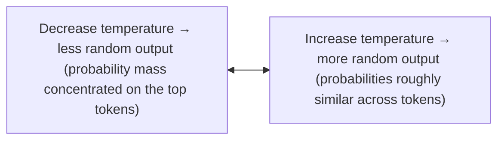

*Adjusting the temperature setting.*

Building off the example above:

- At **low temperature**, there's a probability that *chairs* is selected, but the probability is much lower than *cookies*.
- At **high temperature**, the probability that *chairs* is selected is only slightly lower than *cookies*.

> **Note.** The notebook writes "slightly lower" in both bullets; per the rule just above, at low temperature the low-likelihood token gets a *very low* probability.

- The temperature parameter is a value between 0 and 1. As you increase the temperature, the model gets more creative and random. Temperature can be tuned for different problems, and most people will find that the **default temperature of 0.3** is a good starting point.
- Let's look at a code example, where we suggest that the model generate alternative names for a blog post. Prompting the endpoint 5 times when the temperature is set to 0 yields the same output each time:

```python
message = """Suggest a more exciting title for a blog post titled: Intro to Retrieval-Augmented Generation. \
Respond in a single line."""

for _ in range(5):
    response = co.chat(message=message,
                       temperature=0,
                       model="command-r-plus")
    print(response.text)
```

Output:

```text
# Response
The Future of AI: Unlocking the Power of Retrieval-Augmented Generation
(the same line, 5 times)
```

- However, if we increase the temperature to the maximum value of 1, the model gives different proposals (same code with `temperature=1`):

```text
# Response
Unleashing the Power of Retrieval-Augmented Generation …
The Exciting Future of AI: …
The Magic of AI! …
The Future of AI: …
"Unleashing the Power of AI: The Rise of …"
```

## Prompt Engineering Basics
<!-- pages: 255-260 -->

- Here you'll learn the basics of prompt engineering and how to craft effective prompts to obtain desirable outputs for various tasks.
- **Prompting is at the heart of working with LLMs.** The prompt provides context for the text we want the model to generate. The prompts we create can be anything from simple instructions to more complex pieces of text, and they are used to encourage the model to produce a specific type of output.
- Coming up with a good prompt is a bit of both **science and art**.

**Setup:**

```python
import cohere
co = cohere.Client("COHERE_API_KEY")
```

<!-- pages: 256-258 -->

Let's also define a function `generate_text()` to take a user message, call the Chat endpoint and stream the response:

```python
def generate_text(message):
    stream = co.chat_stream(message=message, model="command-r-plus")
    for event in stream:
        if event.event_type == "text-generation":
            print(event.text, end='')
```

### Writing a Basic Prompt

- The best way to design prompts for a model like Command is to **give a command or an instruction**. One way to do this is by using imperative verbs — for example *generate*, *write*, *list*, *provide*, and other variations.
- For instance, let's say that we are creating the product-description copy for a wireless-earbuds product. We can write the prompt as follows:

```python
generate_text("Generate a concise product description for the product: wireless earbuds.")
```

Output:

```text
# Response
Sure! Here is a concise product description for wireless earbuds:
"Experience unparalleled sound with our wireless earbuds. Immerse yourself in rich, high-quality audio and enjoy …"
```

- That's not bad. With a simple, one-line prompt, we already have a piece of product description that can make a digital marketer proud.

### Layering Additional Instructions

- But perhaps we want to be more specific regarding what we want the output to look like. For this, we can **layer additional instructions** onto the model in the prompt.
- Let's say we want the model to write the product description in a particular format with specific information. In this case, we can append this specific instruction in the prompt:

```python
generate_text("""
    Generate a concise product description for the product: wireless earbuds.
    Use the following format: Hook, Solution, Features and Benefits, Call to Action.
    """)
```

Output:

```text
# Response
Here is a concise product description for wireless earbuds:
**Hook:** Tired of tangled cords and restricted movement?
**Solution:** Go wireless with our latest earbuds!
**Features & Benefits:**
- Sleek & ergonomic …
**Call to Action:** Experience true …
```

- The model returns an output following the format that we wanted.

### Adding Context to a Prompt

- The prompt can also be constructed as a **combination of an instruction and some context**. Let's see this in action with another example: emails. We can create a prompt to summarise an email, which is included in the prompt for context:

```python
generate_text("""
    Summarize this email in one sentence.
    Dear [Team Members],
    I am writing to thank you …
    …
    """)
```

Output:

```text
# Response
The email expresses gratitude to the team members for their hard work …
```

- This **instruction–context prompt format** is extremely useful, as it means that we can supply additional information as context to help ground the model's output. One such example is a question-answering system for, let's say, a company's knowledge base. Given a question (the instruction), the model will only be able to provide accurate answers if provided with the knowledge base (the context).

<!-- pages: 259-261 -->

### Extracting Information

Let's move to another example — an **extraction task**, which a generative model can do very well. Given context, which in this case is a description of a movie, we want the model to extract the movie title.

```python
generate_text("""Extract the movie title from the text below.
Deadpool 2 | Official HD Deadpool's "Wet on Wet" Teaser | 2018""")
```

Output:

```text
# Response
Deadpool 2
```

### Rewriting Text

- The model is also effective at tasks that involve taking a piece of text and **rewriting it into another format** that we need.
- Here's an example. We have a one-line instruction followed by the context, which in this case is a blog excerpt. The instruction is to generate a list of frequently asked questions (FAQ) based on the passage, which involves a mixture of several tasks, such as extraction and rewriting.

```python
generate_text("""Given the following text, write down a list of potential FAQs, together with the answers.
The Cohere Platform provides an API for developers and organizations to access cutting-edge LLMs
without needing machine learning know-how.
…""")
```

Output:

```text
# Response
Here is a list of potential FAQs based on the provided text:
- **Q: What does the Cohere Platform offer?**
  A: …
```

- By now, we can see how versatile our model is at performing various forms of tasks — not just free-form text generation, but also following instructions, working with contextual information, summarising long passages, extracting information, rewriting text into different formats, and more.
- This is just a taste of what kinds of prompts you can design. You can keep layering your instructions to be as specific as you want, and see the output generated by the model. And there is really **no right or wrong way to design a prompt**. It's really about applying an idea and continuing to iterate the prompt until you get the outcome you are looking for.

## Fine-Tuning for Chat
<!-- pages: 261-267 -->

- Here you will learn how to **fine-tune the Chat endpoint model** on custom datasets, enhancing its performance on specific tasks.
- Cohere's LLMs have been trained to be useful in practical business applications. Using the Chat endpoint, you can leverage a pre-trained LLM to build a chatbot that performs tasks ranging from summarisation to copywriting to question answering.
- Depending on the use case you have in mind, you might want to amend how the chatbot generates its output. For instance, if your task uses highly technical data, or you want to change the chatbot's output format, you often need to perform another round of training on additional data to ensure the best performance. This extra training is referred to as **fine-tuning**.
- Fine-tuning is also recommended when you want to **incorporate your company's unique knowledge base**. For example, if you are aiming to use a model to draft responses to customer-support inquiries, fine-tuning on old conversations with customers can improve the quality of the output.

<!-- pages: 262-264 -->

### Step-by-Step Guide

**Step 1 — Prepare and validate the dataset.** We will work with the **CoEdIT dataset** of text-editing examples. In each example, the user asks a writing assistant to rewrite text to suit a specific task (editing fluency, coherence, clarity or style) and receives a response. Below you can see some examples from the raw dataset:

```json
{
  "_id": "57241",
  "task": "coherence",
  "src": "Make the text more coherent: It lasted for 60 minutes. It featured the 3 men taking questions from a studio audience.",
  "tgt": "Lasting for 60 minutes, it featured the 3 men taking questions from a studio audience."
}
```

- We will use the `"src"` and `"tgt"` from each example, which correspond to the user's prompt and the writing assistant's response respectively. Instead of using the full dataset, we will use a subset focused on making text coherent: **927 total conversations**.
- To format the dataset for the Python SDK, we create a `.jsonl` where each JSON object is a conversation containing a series of messages:
  - a **System** message in the beginning, acting as the preamble that guides the whole conversation;
  - multiple pairs of **User** and **Chatbot** messages, representing the conversation that takes place between a human user and a chatbot.
- For more details on best practices for formatting your dataset, check the documentation. Here is a preview of the prepared dataset:

```json
{"messages": [
  {"role": "System",
   "content": "You are a writing assistant that helps the user write coherent text."},
  {"role": "User",
   "content": "Make the text more coherent: It lasted for 60 minutes. …"},
  {"role": "Chatbot",
   "content": "Lasting for 60 minutes, it featured the 3 men taking questions from a studio audience."}
]}
```

**Step 2 — Fine-tune the model.**

- We kick off a fine-tuning job by navigating to the fine-tuning tab of the Dashboard. Under "Chat", click on **"Create a Chat model"**.
- Next, upload the `.jsonl` file you just created as the training set by clicking on the **"TRAINING SET"** button. When ready, click on **"Review data"** to proceed to the next step.
- Then you'll see a preview of how the model will ingest your data. It shows the total number of conversations, the total number of turns and the average number of turns per conversation. If anything is wrong with the data, the page will also provide suggested changes to fix the data file. Otherwise, if everything looks good, you can proceed to the next step.
- Next, you'll see an estimated cost of fine-tuning, followed by a page where you'll provide a nickname for your model. We used **`coedit-coherence`** as the nickname for our model. This page also allows you to provide custom values for the hyperparameters used during training, but we'll keep them at the default values for now.
- Once you have filled in a name, click on **"Start training"** to kick off the fine-tuning process. This will navigate you to a page where you can monitor the status of the model. A model that has finished fine-tuning will show the status as **Ready**.

<!-- pages: 265-267 -->

**Step 3 — Evaluate the fine-tuned model.** Once the model has completed the fine-tuning process, it's time to evaluate its performance.

*With test data.* When you're ready to use the fine-tuned model, navigate to the API tab. There, you'll see the **model ID** that you should use when calling `co.chat()`. In the following code, we supply a message from the test dataset to both the pre-trained and the fine-tuned models for comparison:

```python
user_message = "Make the text coherent: Pimelodella kronei is a species of three-barbeled catfish endemic to Brazil. Discovered by German …"

preamble = "You are a writing assistant that helps the user write coherent text."

# Get default model response
response_pretrained = co.chat(
    message=user_message,
    preamble=preamble,
)

# Get fine-tuned model response
response_finetuned = co.chat(
    message=user_message,
    model='acb…',          # the fine-tuned model ID
    preamble=preamble,
)

print(f"Fine-tuned response: {response_finetuned.text}")
```

- In this example, both models provide reasonable answers that are an improvement over the user's original text. However, **the fine-tuned model's response better matches the style of the fine-tuning data**, because it is more succinct.

*In the chat context.* We have demonstrated that the fine-tuned model can provide good answers to individual questions. But it is also a competent participant in longer, multi-turn conversations. To see this, we will borrow from the code in the *Building a Chatbot* chapter to build a simple chat interface. The only change we need to make is to supply the model nickname when using `co.chat_stream()`, to ensure that we are chatting with the model we just fine-tuned:

```python
# Create a conversation ID
import uuid
conversation_id = str(uuid.uuid4())

print('Starting the chat. Type "quit" to end.\n')

while True:
    # User message
    message = input("User: ")

    # Typing "quit" ends the conversation
    if message.lower() == 'quit':
        print("Ending chat.")
        break

    # Chatbot response
    stream = co.chat_stream(message=message,
                            model='acb…',      # the fine-tuned model
                            preamble=preamble,
                            conversation_id=conversation_id)

    print("Chatbot: ", end='')
    for event in stream:
        if event.event_type == "text-generation":
            print(event.text, end='')

    print("\n", "-"*50)
```

We can use the above code to have a conversation with the fine-tuned model:

```text
Starting the chat. Type "quit" to end.
User: Hello
Chatbot: Hello, how can I help you today?
--------------------------------------------------
User: I'm fine. Can I ask you for help with some tasks?
Chatbot: I am happy to help you. …
```

<!-- pages: 268-271 -->

- The model also did a good job with **context switching**: it can hold a conversation when the user switches from friendly greetings, to a request for writing help, to travel planning, and finally back to writing assistance.

## Introduction to Retrieval-Augmented Generation (RAG)
<!-- pages: 268-275 -->

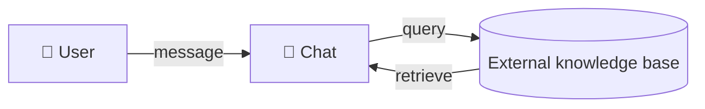

- Here you'll learn about **connecting LLMs to external knowledge sources**, enhancing the accuracy and relevance of chatbot responses.
- We have so far explored LLM chatbots that only have access to the data they have been trained on, or their internal knowledge. In many applications, particularly for enterprise use, a chatbot needs to also be able to access external knowledge for it to be useful.
- Cohere's Chat endpoint comes with a **retrieval-augmented generation (RAG)** feature that makes it possible to connect to external knowledge bases and deliver more accurate responses.

### What Is RAG?

- To understand RAG, we will work with the example of a company that wants to deploy a chatbot as an intelligent knowledge assistant. For the chatbot to be useful, it will need to be connected to the company's knowledge base.
- **Connecting the Chat endpoint with external knowledge** allows the chatbot to have the correct context when responding to requests, such as summarising a meeting transcript, extracting information from the company wiki, and assisting a customer-support agent in responding to a customer inquiry. Without access to the company's knowledge base, the chatbot will not be able to perform these types of tasks successfully.
- The company will also likely need the chatbot to respond to **time-sensitive prompts** and provide up-to-date answers. For example, suppose an employee asks the chatbot about a recent public event. A baseline LLM is trained with data that is current up to a certain cut-off time. Without accessing external data, the model relies on the most recent information it has been trained on (assuming the specific information is available in the training data). In this situation, the lack of recency in the training data would produce an inadequate answer.

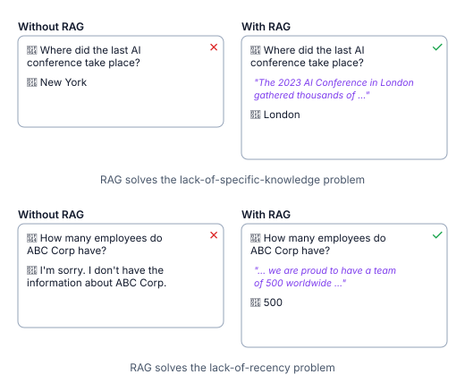

- RAG consists of **2 parts: a retrieval system and an augmented generation system**. Let's take a look at how they work.

<!-- pages: 272-274 -->

### Retrieval

The first part of RAG is to **retrieve the right information** needed to respond to a user query. Given a user message (1), the Chat endpoint queries an external knowledge base with the relevant queries (2) and finally retrieves the query results (3).

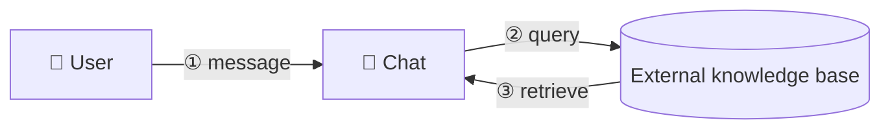

*The retrieval part of RAG: given a user message, the endpoint retrieves information from an external knowledge base.*

Retrieval applies to any system that can fetch relevant documents based on a user message. Cohere offers **2 ways to build RAG systems** with the Chat endpoint: **connectors mode** and **documents mode**.

### Connectors Mode

- As the name implies, **connectors** are ways of connecting to data sources. These data sources could be internal documents, document databases, the broader internet, or any other data source which can inform the model's replies. When the Chat endpoint is called in connectors mode, it connects to the associated data sources and automatically handles document retrieval.
- Developers can leverage pre-built connectors to various data sources, or even build their own. Also, there is a **web-search connector** managed by Cohere, which runs searches against a browser in safe mode. Developers can use it immediately without any additional configuration or deployment.
- For example, suppose we are working with a RAG system that uses Cohere's managed web-search connector, and say you input this query: *"Who was the keynote speaker at the AI conference last week?"* Given that the response requires a fact from a recent event, the chatbot triggers a retrieval of this information using the web-search API. It gets back the information it requires, such as a few website snippets containing the details about the conference.

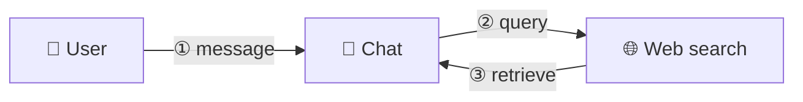

*An example of retrieving information via web search.*

- In an enterprise setting, data is distributed across multiple platforms and datastores. With connectors mode, you can use **multiple connectors** to retrieve at the same time, to get the system to synthesise information from various data sources.

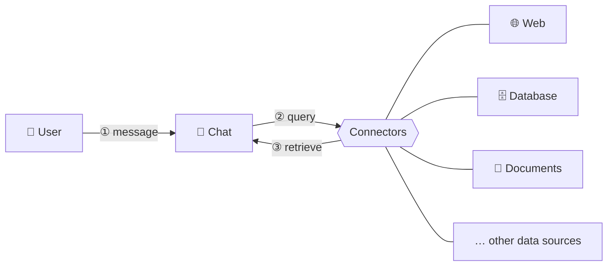

*Connectors mode allows you to use multiple connectors to connect to multiple datastores.*

### Documents Mode

With **documents mode**, a developer directly provides the model with source documents that it can use to ground its replies. In this case, these documents first need to be **ingested**. Typically, this involves chunking large documents into smaller chunks, turning these chunks into **text embeddings** (also called vectors) and storing these embeddings in a **vector store**.

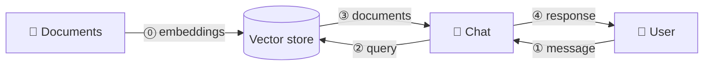

*Documents are ingested before retrieval.*

<!-- pages: 275-276 -->

- Connectors mode automatically handles document ingestion and is excellent for those who prefer a more hands-off approach. However, documents mode allows developers to customise the RAG stack's components to fit specific needs.

### Augmented Generation

- The second part of RAG is **augmented generation**. Here, the prompt is augmented with the information retrieved from the retrieval step. The prompt is now grounded with the best information to provide the user with an accurate and helpful response.
- The chatbot responds to the user query, now having the augmented prompt as its context.

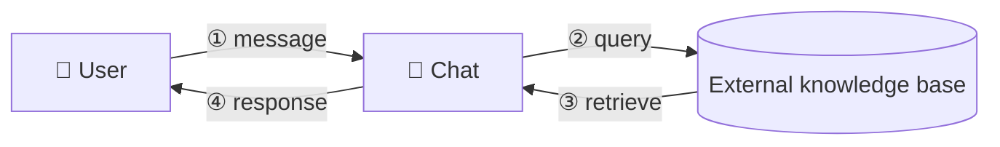

*The augmented-generation part of RAG: the Chat endpoint uses the retrieved information to provide a grounded response.*

- Cohere's Chat endpoint also provides **citations** to indicate the parts of the retrieved documents on which the response was grounded.

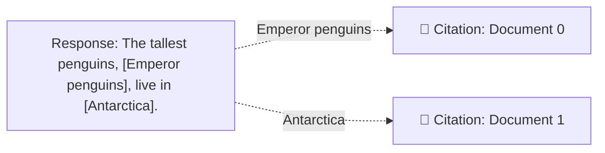

*Citations provide verifiable references for the generated content.*

- Citations provide a critical benefit by delivering the generated content with verifiable references, enhancing the credibility and trustworthiness of the presented information, and allowing users to further explore responses for a deeper understanding.
