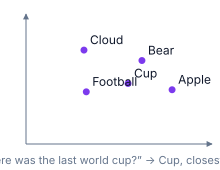
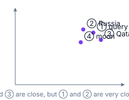
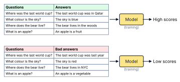
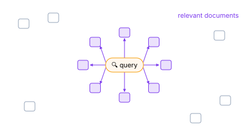
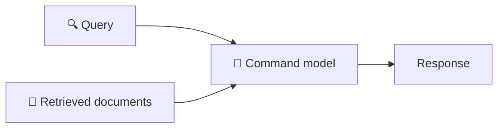

# LLM University: Search & Retrieval

## Semantic Search: Lexical Search vs Embeddings
<!-- pages: 276-280 -->


- Here you'll learn how to use embeddings and similarity in order to build a **semantic search** model.
- Semantic search is a powerful way to search in large databases using the **context of the query**.

### What Is Not Semantic Search? (Lexical Search)

**Lexical search** is word matching.

*Example* — query: *"Where was the last world cup?"* Sentences in the dataset:

| Sentences |
| --- |
| The last world cup was in Qatar |
| The sky is blue |
| The bear lives in the woods |
| An apple is a fruit |

- It is basically **word matching**. The idea is to search in the dataset for the answer, or at least the closest things to an answer. So let's say that the possible answers are: "The last world cup was in Qatar", "The sky is blue", "The bear lives in the woods", "An apple is a fruit".
- The way lexical search works is by word matching: it looks at which words from the query appear in the answer, and counts them. So:

| Sentence | Matching words | Count |
| --- | --- | ---: |
| 1st: The last world cup was in Qatar | The, last, world, cup, was | **5** |
| 2nd: The sky is blue | The | 1 |
| 3rd: The bear lives in the woods | The … the | 1 |
| 4th: An apple is a fruit | nothing is matching | 0 |

The count is highest for the first sentence, so this time it did okay and actually found the answer.

<!-- pages: 278-280 -->

### Problems in Lexical Search

*Example* — query: *"Where was the last world cup?"* Now the sentences are:

| Sentence | Matching words | Count |
| --- | --- | ---: |
| 1st: The previous world cup was in Qatar | The … world cup was | 4 |
| 2nd: The cup is where you left it | The cup … where | 3 |
| 3rd: Where in the world is my last cup of coffee? | Where … the world … last cup | **5** |
| 4th: An apple is a fruit | nothing is matching | 0 |

The 3rd sentence **wins even though it is not the answer**.

- So counting words in common is not the ideal way to search. We don't want lexical search; instead, we want **semantic search**, where instead of words, the actual meaning of the sentence is taken into account — and for that we need **embeddings**.

### How to Search Using a Text Embedding?

We are going to use **nearest neighbours**. Say each sentence is represented by:

| Sentence | Represented by |
| --- | --- |
| The last world cup was in Qatar | Football |
| The sky is blue | Cloud |
| The bear lives in the woods | Bear |
| An apple is a fruit | Apple |



- Query: *"Where was the last world cup?"* → **Cup**. "Cup" is close to "Football" because semantically the embedding knows that these 2 sentences are similar, so the winner is: *"The last world cup was in Qatar"*.
- As you can see, this way of searching actually takes into account the **meaning of the sentence** and not just the words. So it is more effective. *[Check on Cohere Playground → "Embed" tab.]*

### The Problem with Nearest Neighbours: Good but Slow

- We have to calculate lots of distances / similarities. If we have 8 sentences, then we have to find $8^2$ distances. So for $n$ sentences, $n^2$ distances.
- **Some solutions to this:**
  - **Inverted file index (IVF):** cluster, then search.
  - **Hierarchical Navigable Small Worlds (HNSW):** start with fewer points, search there; then add more and iterate.
- In IVF, we first cluster the points and then search around the close ones. Don't search on the ones that are very far, in another cluster.
- HNSW is something very similar: we start with few points, search there, and then start adding more and more points, but using the information of what you had before. It's a much more effective way of searching. It works in many, many languages, and the Cohere multilingual model is very useful for that. *[Check the Cohere playground "Embed" tab and use many similar sentences in many languages.]*

### Is Embedding + Similarity Enough?

**Potential problems:**

| # | Sentence |
| --- | --- |
| ① | Where was the last world cup? |
| ② | The previous world cup was in Russia |
| ③ | The last world cup was in Qatar |
| ④ | The world cup is in the moon |



- These are all similar sentences, because the embedding only takes care of sentences that are similar. It does not really check if the actual answer was given. [① and ③ are close, but ① and ② are also very close — and ② is not the answer.]
- So, **looking for the closest sentence doesn't necessarily give us the answer**. It gives us something similar to the question.

## Improving Search: Reranking & Positive/Negative Pairs
<!-- pages: 281-284 -->

How can we make search better?

### Technique 1 — Reranking

Query: *"Where was the last world cup?"* Say these are the similar sentences (responses) that the search returned — some of them are answers and some of them are non-answers:

- The world cup in 1986 was in Mexico.
- The world is round.
- The last world cup was in Qatar.
- The teacup ride is in Disney World.

So we have a **different model that ranks them** — a model that is actually trained to see how good a question–answer pair is — and that model selects as rank 1 the sentence *"The last world cup was in Qatar"*.

| Response | Rank |
| --- | ---: |
| The world cup in 1986 was in Mexico | 2 |
| The world is round | 3 |
| **The last world cup was in Qatar** | **1** ✓ |
| The teacup ride is in Disney World | 4 |

**So how does this work?** The reranking model is trained on good and bad question–answer pairs:



So we're going to use an **embedding + re-ranking** to be able to search better.

### Technique 2 — Positive and Negative Pairs

| Positive pairs: questions | Answers |
| --- | --- |
| Where was the last world cup? | The last world cup was in Qatar |
| What colour is the sky? | The sky is blue |
| Where does the bear live? | The bear lives in the woods |
| What is an apple? | An apple is a fruit |

| Negative pairs: questions | Bad answers |
| --- | --- |
| Where was the last world cup? | The last world cup was last year |
| What colour is the sky? | The sky is red |
| Where does the bear live? | The bear lives in NYC |
| What is an apple? | An apple is a vegetable |

*(The bad answers are close, but not exact answers.)*

- In **positive pairs**, we move the embedding of answers **close** to the embedding of questions.
- In **negative pairs**, we move the embedding of answers **far** from the embedding of questions.

### What Is *Not* Semantic Search?

- Before semantic search, the most popular way of searching was **keyword search**. Imagine that you have a list of many sentences, which are the responses. When you ask a question (query), keyword search looks for the sentence (response) with the largest number of words in common with the query. But this does not always give the correct response.
- What can we do? We can improve keyword search by removing **stop words** such as "the", "and", "is", etc. We can also use methods like **TF-IDF** in order to tell apart relevant from non-relevant words. However, there will always be cases in which, due to ambiguity of the language, synonyms and other roadblocks, keyword search will fail to find the best response. So we use **semantic search**.
<!-- pages: 284-287 -->

## Similarity, Nearest Neighbours & Multilingual Search
<!-- pages: 284-289 -->

In short, semantic search works as follows:

- it uses a **text embedding** to turn words into vectors;
- it uses **similarity** to find the vector among the responses which is the most similar to the vector corresponding to the query;
- it outputs the response corresponding to this most similar vector.

### How to Search Using Text Embeddings?

- An embedding is a way to assign to each sentence (or, more generally, to each text fragment, which can be as short as a word or as long as a full article) a **vector**, which is a list of numbers. A very important property of embeddings is that **similar pieces of text get assigned to similar lists of numbers**. For example, the sentence "Hello, how are you?" and the sentence "Hi, what's up?" will be assigned lists of similar numbers, whereas the sentence "Tomorrow is Friday" will be assigned a list of numbers that are quite different from the two previous ones.
- Each query is closest to its corresponding response. That means if we used semantic search to search for the response to each of these 4 queries, we would get the correct response.
- However, here's a caveat: **Euclidean distance is not the ideal way to compare pieces of text**. The way that is most commonly used and has given the best results is **similarity**.

### Using Similarity to Find the Best Document

- **Similarity** is a way to tell if two pieces of text are similar or different. This uses text embeddings.
- Let's say that similarity is a number assigned to each pair of documents, with the following properties:
  - the similarity between a piece of text and itself is a very high number;
  - the similarity between two very similar pieces of text is a high number;
  - the similarity between two different pieces of text is a small number.
- Here we use **cosine similarity**, which has the extra property that the values it returns are between 0 and 1.
- In order to perform semantic search, all you have to do is calculate the similarity between the query and every sentence, and return the sentence with the highest similarity.
- There is a hidden algorithm here that we did not mention, but it is very important: the **nearest-neighbours algorithm**. In short, this algorithm finds the nearest neighbour of a point in a dataset. In this case, the algorithm found the nearest neighbour of the sentence "What is an apple?", and the response was the sentence "An apple is a fruit".

### Nearest Neighbours — Pros and Cons, and How to Fix Them

- Nearest neighbours is a very simple and useful algorithm, normally used for classification. More generally, it's called **k-nearest neighbours (KNN)**, where $k$ is any number. If the task at hand is to classify a sentence as happy or sad (sentiment analysis), what 3-nearest neighbours would do is look at the 3 closest neighbours to the sentence (in some embedding) and see if their majority (2) are happy or sad. That's the label it assigns to the sentence.
- As you can see, KNN is exactly what we've been doing for semantic search here. Given a query, you look for the closest neighbour in the embedding, and that's the response to the query. In the current examples, that method has worked well.
- However, **KNN is not the fastest algorithm**. The reason for this is that in order to find the neighbours of one point, one needs to calculate the distances between that point and all the other points in the dataset, and then find the smallest one.
- When dealing with massive archives, however, we can optimise for performance by slightly adjusting the algorithm to become **approximate KNN**. In particular, in search there are several improvements that can speed up this process quite a lot. Here are 2 of them:
  - **Inverted File Index (IVF):** consists of clustering similar documents, then searching in the clusters that are closest to the query.
  - **Hierarchical Navigable Small World (HNSW):** consists of starting with a few points and searching there, then adding more points at each iteration and searching in each new space.

<!-- pages: 288-289 -->

### Multilingual Search

As you may have noticed, the performance of semantic search depends on the strength of the embedding. Therefore, any superpowers of the embedding may translate into superpowers of semantic search. In Cohere, the embedding will send any piece of text in any of these languages to a vector (with length 768). Similar pieces of text will be sent to similar vectors. Therefore, **one can search using a query in any language, and the model will search for answers in all the other languages**.

### Are Embeddings and Similarity Enough? (No)

Consider the following sentences — query: *"Where is the world cup?"* Responses:

1. The world cup is in Qatar.
2. The world cup is in the moon.
3. The previous world cup was in Russia.

- When we locate them in the embedding above, they are all close, as expected. However, the closest sentence to the query is not response 1 (the correct answer), but response 3. This response ("The previous world cup was in Russia") is a correct statement and semantically close to the question, but it's not the answer to the question. Response 2 ("The world cup is in the moon") is a completely wrong answer, but also semantically close to the query. So it is likely the bogus answers like these will be the top results using semantic search.
- How do we fix this? There are many ways to improve search performance so that the actual response the model returns is ideal, or at least close to ideal. One of them is **multiple negative ranking loss**: having positive pairs (query, response) and several other negative pairs (query, wrong response). Training the model to **reward positive pairs and punish negative pairs**.
- In the current example, we would take a positive (query, response) pair, such as this one: *(Where is the world cup?, The world cup is in Qatar)*. We would also take several negative (query, response) pairs, such as:
  - (Where is the world cup?, The world cup is in the moon)
  - (Where is the world cup?, The previous world cup was in Russia)
  - (Where is the world cup?, The world cup is in 2022)
- By training the model to respond negatively to bad (query, response) pairs, the model is more likely to give the correct answer to a query.
- Now, the question is: how do we train the model to do this? We'll see later.

## Multilingual & Cross-Lingual Embeddings and Language Bias
<!-- pages: 289-291 -->

### Multilingual Lexical Search

- English and Chinese have different tokenisers and stop words.
- One index per language.
- Tools only support a few languages.

<!-- pages: 290-292 -->

### Multilingual Embeddings

- Take the text and, through a Transformer network, we get an embedding out of it — and **we don't need to do any language identification**, and we don't need to have any stemming, stop words and so on. So everything can be set in the same pipeline.
- **Translated sentences from neural machine translation** — issue: models only work on sentence level.
- **Machine-translated (query, answer) pairs** — issue: the model doesn't learn language/country-specific properties.
- **We collected large quantities of training data** (written by people):
  - 900 M English (query, answer) pairs;
  - 450 M non-English (query, answer) pairs.

| Model | Clustering (12 languages) | Search (English) | Search, non-English (16 languages) | Cross-lingual classification (50 languages) |
| --- | ---: | ---: | ---: | ---: |
| **Cohere multilingual** | **51.0** | **55.8** | **51.4** | **64.6** |
| SBERT: paraphrase-multilingual-mpnet-v2 | 46.7 | 44.4 | 15.3 | 56.1 |
| Google: LaBSE | 41.0 | 20.9 | 13.2 | 59.2 |
| Google: Universal Sentence Encoder | 40.1 | 14.3 | 3.4 | 59.8 |

### Cross-Lingual Search

Query (in Arabic): *"What is the capital of the United States?"*

| Keyword search (Elasticsearch) | Semantic search with Cohere |
| --- | --- |
| — no results — | • Washington, D.C. […] is the capital of the United States […] <br/>• A capital city (or capital town, or just capital) is a city or town […] <br/>• The United States Capitol is the building where the United States Congress meets […] |

### Language Bias

- A preference for certain language combinations.
- Language bias impacts performance negatively on multilingual pools.
- LASER and LaBSE have a strong language bias.

**Language bias — good or bad?**

- *Side-effects with language bias:*
  - same-language results are ranked higher just because of the language;
  - there might be better hits/answers in other languages.
- *Side-effects without language bias:*
  - "wedding" vs शादी (Hindi for "wedding"): the same image represents the wedding of 2 people according to Western culture;
  - Q: "Who is the president?" → A: "Joe Biden is the current president"; Q: « Qui est le président ? » (French) → A: "Joe Biden is the current president."

## Keyword Search with a Vector Database
<!-- pages: 292-298 -->

- We compare **keyword search and dense retrieval** to query a Wikipedia dataset. We use **Rerank** to improve the results, and **Chat** to answer questions in sentence format.
- In the previous chapter, you learned about the difference between keyword search and semantic search. Here, you'll use keyword search to query a large dataset of Wikipedia articles. Later in this same module, you'll be able to improve your results with dense retrieval and rerank on the same Wikipedia dataset, and even be able to combine the search results with a generative model in order to generate answers in the form of sentences.

<!-- pages: 293-298 -->

### Using a Vector Database

- We'll set up a vector database for use in this and the next chapter. In order to store the Wikipedia dataset query, we'll use the **Weaviate vector database**, which will give us a range of benefits.
- In simple terms, a **vector database** is a place where one can store data objects and vector embeddings, and be able to access them and perform operations easily. For example, finding the nearest neighbours of a vector in a dataset is a lengthy process, which is sped up significantly by using a vector database.

This is done with the following code:

```python
import weaviate
import cohere

cohere_api_key = "COHERE_API_KEY"
co = cohere.Client(cohere_api_key)

# Connect to the Weaviate demo database containing 10M Wikipedia vectors.
# This uses a public READ-ONLY Weaviate API key.
auth_config = weaviate.auth.AuthApiKey(api_key="76320a90-53d8-42bc-b41d-678647c6672e")
client = weaviate.Client(
    url="https://cohere-demo.weaviate.network/",
    auth_client_secret=auth_config,
    additional_headers={
        "X-Cohere-Api-Key": cohere_api_key,
    }
)
```

### Querying the Wikipedia Dataset Using Keyword Matching

To use keyword matching, we'll first define the following function for keyword search. In this function, we'll tell the vector database what properties we want from each retrieved document. We'll also filter them to the English language (using `results_lang`), but feel free to explore searching in other languages as well!

```python
def keyword_search(query, results_lang='en', num_results=10):
    properties = ["text", "title", "url", "views", "lang", "_additional {distance}"]

    where_filter = {
        "path": ["lang"],
        "operator": "Equal",
        "valueString": results_lang
    }

    response = (
        client.query.get("Articles", properties)
        .with_bm25(
            query=query
        )
        .with_where(where_filter)
        .with_limit(num_results)
        .do()
    )
    result = response['data']['Get']['Articles']
    return result
```

We'll use 2 search queries of varying difficulty:

- **Simple query:** "Who discovered penicillin?"
- **Hard query:** "Who was the first person to win two Nobel prizes?"

The responses for these queries are "Alexander Fleming" and "Marie Curie". Now let's see how keyword search does. Here are the top 3 results for each query (some results are repeated, so let's look at the top 3 distinct ones).

**Query 1:** "Who discovered penicillin?" → responses: *Penicillin*, *Antibiotic*, *Alexander Fleming*.

As you can see, keyword search did quite well. All 3 articles contain the answer, and in particular, the 3rd one is the correct response: Alexander Fleming. Now let's see how it did with the more complicated query.

**Query 2:** "Who was the first person to win two Nobel prizes?" → responses: *Neutrino*, *Western culture*, *Reality television*.

- This time, keyword search was very far from finding the answer. If you explore the articles, you may notice that they contain several mentions of words such as "first", "person", "Nobel", "prizes", but none of them have any information on the first person to win two Nobel prizes. In fact, the Neutrino article mentions a scientist who won two Nobel prizes, but this was not the first person to achieve this feat.
- As we can see, **keyword search can be good for queries** like "Who discovered penicillin?", in which you'd expect the answers to have a lot of words in common with the query. More specifically, if an article contains the words "discovered" and "penicillin", it's also likely to contain the fact that Alexander Fleming discovered it.
- With **harder queries** like "Who was the first person to win two Nobel prizes?", keyword search does not do well. The reason is that the words in the query would appear in many instances without necessarily talking about something as specific as the first person who won 2 Nobel prizes. By matching words, we have not yet exploited the semantics of the sentence. A model that understands what we mean by "the first person to win 2 Nobel prizes" would be able to find the answer, which is exactly what **dense retrieval** does. The other method is **reranking**, which is able to surface the pairs of queries and documents that are the most relevant to each other. In this way, you can use keyword search to retrieve, say, hundreds of articles with matching keywords, and then use reranking to surface the best ones.

## Dense Retrieval & Chunking
<!-- pages: 299-305 -->

- In the previous chapter, you used keyword search to query Wikipedia, using two different queries:
  - Who discovered penicillin?
  - Who was the first person to win two Nobel prizes?
- Keyword search did well with the first query, but not with the second one. The reason is that the second one has very popular words, which may appear in many documents that don't necessarily contain the answer to the question. A way to obtain better results is to have the model "understand" what the question is actually asking. This is where **semantic search** comes into play.
- Semantic search is the ability to **search by meaning — not just keyword matching**. Language models enable two of the main ways of semantic search: **dense retrieval and reranking**. The concepts of dense retrieval were illustrated in a chapter earlier in this module. Here, you'll see dense retrieval in action, with the same Wikipedia dataset and the same queries that you used for keyword search.

### Querying the Dataset Using Dense Retrieval

- Dense retrieval uses a **text embedding** in order to search for documents that are similar to a query. Embeddings assign a vector (long list of numbers) to each piece of text. One of the main properties of an embedding is that similar pieces of text go to similar vectors.
- In short, dense retrieval consists of the following:
  - finding the embedding vector corresponding to the query;
  - finding the embedding vectors corresponding to each of the responses (in this case, Wikipedia articles);
  - retrieving the response vectors that are closest to the query vector in the embedding.



To use dense retrieval, we'll first define the following function, which uses the Weaviate client we defined in the previous chapter. Just like with keyword search, we'll tell the vector database what properties we want from each retrieved document, and filter them to the English language (using `results_lang`):

```python
def dense_retrieval(query, results_lang='en', num_results=10):
    nearText = {"concepts": [query]}
    properties = ["text", "title", "url", "views", "lang", "_additional {distance}"]

    # To filter by language
    where_filter = {
        "path": ["lang"],
        "operator": "Equal",
        "valueString": results_lang
    }

    response = (
        client.query
        .get("Articles", properties)
        .with_near_text(nearText)
        .with_where(where_filter)
        .with_limit(num_results)
        .do()
    )
    result = response['data']['Get']['Articles']
    return result
```

### Chunking the Articles
<!-- pages: 302-304 -->

This process of finding the closest documents to a query in an embedding will yield good results. However, articles may be very long, and this could make things complicated. In order to have more granularity, we'll **split the articles by paragraph**. This means that we'll find the embedding vector corresponding to each paragraph of each article in the Wikipedia dataset. In that way, when the model retrieves the answer, it will actually output the paragraph that it found the most similar to the query, as well as the article to which this paragraph belongs.


### Back to Querying the Dataset

Let's review the two queries we used in the previous chapter:

- **Simple query:** "Who discovered penicillin?"
- **Hard query:** "Who was the first person to win two Nobel prizes?"

Now, let's look at the 3 top results for each query using dense retrieval. Recall that the responses here are at the paragraph level, so the model may sometimes retrieve the same article several times by outputting different paragraphs from the same article.

**Query 1:** "Who discovered penicillin?" — responses:

- *Alexander Fleming:* "Sir Alexander Fleming (6 August 1881 – 11 March 1955) was a Scottish physician and microbiologist …"
- *Penicillin:* "Penicillin was discovered in 1928 by Scottish scientist Alexander Fleming …"
- *Penicillin:* "The term 'penicillin' is defined as the natural product of 'Penicillium' mould with antimicrobial activity. It was coined by Alexander Fleming …"

As you can see, dense retrieval did quite well by finding paragraphs that contain the exact answer.

**Query 2:** "Who was the first person to win two Nobel prizes?" — responses:

- *Nobel Prize in Literature:* "The Nobel Prize in Literature can be shared by two individuals …"
- *Nobel Prize:* "Although posthumous nominations are not presently permitted, …"
- *Nobel Prize:* "Few people have received two Nobel Prizes. Marie Curie received the Physics prize …"
- *Marie Curie:* "Marie Curie was the first woman to win a Nobel Prize, the first person to win two Nobel Prizes, …"

As you can see, dense retrieval did much better than keyword search here. The 2nd, 3rd and 4th results are in the correct documents (Nobel Prize and Marie Curie), and in fact the 3rd and 4th results are in a paragraph which explicitly contains the answer. The reason for this is that **the embedding captures the semantics of the text** and is able to see if two pieces of text have a similar meaning, even if they don't necessarily share many words in common.

### Searching in Other Languages

As you may have noticed, the `dense_retrieval` function has a parameter called `results_lang`. This parameter determines the language in which the search results are output.
<!-- pages: 305-306 -->
It is defaulted to English (`'en'`), but for this demo it can also be set to German (`'de'`), French (`'fr'`), Spanish (`'es'`), Italian (`'it'`), Japanese (`'ja'`), Arabic (`'ar'`), (Simplified) Chinese (`'zh'`), Korean (`'ko'`) and Hindi (`'hi'`). However, the Cohere multilingual embedding handles **over 100 languages**.

For the first example, let's search for results to the English query "Who was the first person to win two Nobel prizes?" in Arabic. The line of code is:

```python
arabic_results = dense_retrieval(hard_query, results_lang='ar')
```

As you can see in the lab, the top 3 are the following:

- Nobel Prize (جائزة نوبل)
- List of Nobel laureates (قائمة الحاصلين على جائزة نوبل)
- Women in society (امرأة)

Now let's search for the French results to a query in Spanish. The query is "¿Quién descubrió la penicilina?" ("Who discovered penicillin?"):

```python
spanish_query = "Quien descubrio la penicilina?"
french_results = dense_retrieval(spanish_query, results_lang='fr')
```

The results are the following:

- Pénicilline
- Pénicilline
- Alexander Fleming

### Conclusion

**Dense retrieval** is a search method that uses a text embedding to find the semantically closest answers to a query. In our Wikipedia example, dense retrieval did quite well in 3 queries. In the next chapter, you will learn how to improve search results even further with the **reranking** method.

## Reranking
<!-- pages: 306-309 -->

- In previous chapters, you learned keyword search and dense retrieval, and you were able to apply them by querying a large Wikipedia article dataset. You noticed that keyword search performed well with some queries, and not so well with others. Dense retrieval, on the other hand, worked well with all the queries.
- For both keyword search and dense retrieval — and, in fact, for any other search mechanism we use — there is a very powerful method called **reranking**, which can enhance it. With Cohere, you can perform reranking using the **Rerank endpoint**.
- Reranking works as follows: for each pair (query, response), it assigns a **relevance score**. As the name hints, relevance scores are high for pairs in which the response is relevant to the query, and low otherwise. In this chapter, you'll learn how to use reranking to improve the Wikipedia search results you found previously in this module.

### Using Rerank to Improve Keyword Search

Reranking is a very powerful method which can significantly boost any existing search system. In short, reranking takes a query and a response, and outputs a relevance score between them. In that way, one can use any search system to surface a number of documents that can potentially contain the answer to a query, and then sort them using the Rerank endpoint.


Remember that the results we obtained for the query "Who was the first person to win two Nobel prizes?" using the `keyword_search` function were the following — **query:** "Who was the first person to win two Nobel prizes?" **Responses:** *Neutrino*, *Western culture*, *Reality television*.
<!-- pages: 308-309 -->

These could contain the answer somewhere in the document, but they are certainly not the best documents for this query. Let's dig in a bit more and find the first 100 results. To save space, I'll only note the top 20 titles:

1. Neutrino
2. Western culture
3. Reality television
4. Peter Mullan
5. Indiana Pacers
6. William Regal
7. Nobel Prize
8. Nobel Prize
9. Nobel Prize
10. Noble gas
11. Nobel Prize in Literature
12. D.C. United
13. Nobel Prize in Literature
14. 2021–2022 Manchester United F.C. season
15. Nobel Prize
16. Nobel Prize
17. Zach LaVine
18. 2011 Formula One World Championship
19. 2021–2022 Manchester United F.C. season
20. Christians

OK, there's a high chance that the answer is there. Let's see if reranking can help us find it. The following function calls the Rerank endpoint. Its inputs are the query, the responses and the number of responses we'd like to retrieve.

```python
def rerank_responses(query, responses, num_responses=3):
    reranked_responses = co.rerank(
        query=query,
        documents=responses,
        top_n=num_responses,
        model='rerank-english-v3.0',
        return_documents=True
    )
    return reranked_responses
```

Rerank will output the result, as well as the relevance score. Let's look at the top 3 results.

**Query:** "Who was the first person to win two Nobel prizes?" — **responses:**

| Article | Paragraph | Relevance score |
| --- | --- | ---: |
| Nobel Prize | "Five people have received two Nobel Prizes. Marie Curie received the …" | 1.00 |
| Nobel Prize | "In terms of the most prestigious awards in STEM fields, only a small …" | 0.97 |
| Nobel Prize in Literature | "There are also prizes for honouring the lifetime achievement of writers …" | 0.87 |

Well, that certainly improved the keyword-search results! Even though the third result does not work, the first two retrieved the correct article that contains the answer.

## Generating Answers with Search
<!-- pages: 310-316 -->



- In this module, you've learned how to search and retrieve information from large databases in very effective ways. In this chapter, you'll learn how to **combine this with a generative model**, in order to get an answer in sentence format, instead of a list of search results.
- Large language models are very good at answering questions, but they are prone to some limitations, such as incorrect information or even **hallucinations**. A good way to fix this is to enhance an LLM with a search mechanism.
- In short, this combination is done in the following way: given a query, the search mechanism retrieves one or more documents containing the answer. These documents are given to the large language model, and it is instructed to generate an answer based on that information.
- I like to imagine this the following way. If I have a question about thermodynamics, I can pick a random friend of mine and ask them that question. They may or may not get the answer wrong.
<!-- pages: 311-313 -->

- But if I go and search a few chapters in books about thermodynamics, I give them to my friend, and then I ask them to answer the question based on that, they are much more likely to answer the question correctly.
- In this chapter, we'll compare 2 ways a large language model can answer a question. The first one is by feeding the question to the generative model and obtaining the answer. This will generate an answer that could be correct, but it may not. This is equivalent to asking your friend a thermodynamics question.


*A generative model receives a query and outputs a response. This response may be inaccurate.*

- The second one starts by using a search system to retrieve documents where the answer to the query is likely to appear. Then we feed the question and the documents to a generative model, and prompt it to answer the question using these documents. This yields a more accurate response.


*The query is first given to a search system, which retrieves documents which are likely to contain the answer. Then the query and the documents (context) are fed to the generative model, for a more accurate response.*

### Generating Answers (Without Search)

- Let's first use a generative model to answer a slightly harder question — without search. We are trying to find out how many people won more than one Nobel prize. So we ask the model the following query: **"How many people have won more than one Nobel prize?"**
- The answer to this question is **five**: Marie Curie, Linus Pauling, John Bardeen, Frederick Sanger and Karl Barry Sharpless.
- The way to ask this to the model is with the following line of code, which calls the `co.chat` endpoint:

```python
prediction_without_search = [
    co.chat(
        messages=[{"role": "user", "content": query}],
        model="command-r-plus-08-2024",
        max_tokens=50,
    ) for _ in range(5)
]
```

We call the endpoint five times to get five responses. The `max_tokens` parameter determines the length of the answer (which is why some answers appear truncated). Responses:

```text
- Marie Skłodowska-Curie, a Polish and naturalized-French physicist …
- …
```

These answers sound like they could be correct, but they're all wrong. One reason for this is that **transformers are good at talking and understanding sentiment and nuances of the language, etc., but not so good at storing information**. As a matter of fact, storing information inside the nodes of the neural network is not something that we can (or should) fully trust. Instead, let's first search for the answer using what we've learned in the previous sections of this post.
<!-- pages: 314-316 -->

### Searching Answers

In order to find the answer to this question in the Wikipedia dataset (the one we've been working with throughout this post), we can use the same `dense_retrieval` function that we used before. For simplicity, we will only use dense retrieval without Rerank, but we invite you to add it to the lab and see how the results improve!

```python
responses = dense_retrieval(query, num_results=20)
```

This retrieves the top 20 articles, with their corresponding paragraphs. Here are the top 3 (remember that the search is done by finding the most similar paragraphs to the query, so some articles may appear several times with different paragraphs):

- *Nobel Peace Prize:* "…, the Peace Prize has been …"
- *Nobel Prize:* "The strict rule …"
- *Nobel Prize:* "The prize …"

Next, we'll feed these 20 paragraphs to a generative model, and instruct it to answer the question in sentence format.

### Generating an Answer from the Search Results

In order to get the generative model to answer a question based on a certain context, we need to create a prompt. And in this prompt, we need to give it a command and a context. The context will be the concatenation of all the paragraphs retrieved in the search step, which we can obtain using this line of code:

```python
context = [r['text'] for r in responses]
```

The array `context` contains a lot of text and, given the good results we've been obtaining with search mechanisms, we are fairly confident that somewhere in this text lies the answer to our original question. Now we invoke the Chat endpoint. The prompt we'll use is the following:

```python
prompt = f"""
Use the information provided below to answer the questions at the end. If the answer to the question is not contained in the provided information, say "The answer is not in the context".
---
Context information:
{context}
---
Question: How many people have won more than one Nobel prize?
"""
```

In other words, we've prompted the model to answer the question, but only from information coming from the `context` array. And if the information is not there, we are prompting the model to state that the answer is not in the context. The following line of code will run the prompt. As before, we generate 5 answers, and `max_tokens` controls the length of each answer.

```python
prediction_with_search = [
    co.chat(
        messages=[{"role": "user", "content": prompt}],
        model="command-r-plus-08-2024",
        max_tokens=50,
    ) for _ in range(5)
]
```

The 5 responses we get are the following (just like before, they are truncated):

```text
- Five people have won multiple Nobel prizes …
- …
```

As you can see, this improved the quality of the answer. It got the right number of people who received more than one Nobel prize, which is **5**.

### Conclusion

Generative models are prone to **hallucinations**: for example, when asked a question, they may answer with an incorrect answer. In this chapter, you learned to power a generative model with search, in order to generate more accurate answers and reduce the chance of hallucinations.
