# Prompt Engineering & Applications

## Constructing Prompts: Instructions, Specifics, Context & Format
<!-- pages: 317-324 -->

- When working with large language models (LLMs), **the prompt is the key to getting the desired response**. A well-designed prompt will result in useful and accurate responses from a model, and will considerably improve your experience interacting with it.
- Prompts can be as simple as a one-liner, or they can be as complex as multiple layers of specific information. The more specific your command is, the more likely you will get exactly what you need from the model.

**Setup:**

```python
! pip install cohere
import cohere
co = cohere.ClientV2("COHERE_API_KEY")
```

Let's also define a function to take a prompt and a temperature value and then call the Chat endpoint, which is how we can access the Command model. Here, we select the model type to be Command. We set a default temperature value of 0, which nudges the response to be more predictable and less random. Throughout this article, you'll see different temperature values being used in different situations. Increasing the temperature value tells the model to generate less predictable responses and instead be more "creative". This function prints the text response generated by the model:

```python
def generate_text(prompt, temp=0):
    response = co.chat_stream(
        message=prompt,
        model="command-r-plus-08-2024",
        temperature=temp)
    for event in response:
        if event.event_type == "text-generation":
            print(event.text, end='')
```

### Instruction

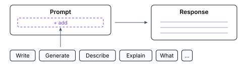

While prompts can morph into something very lengthy and complex, it does not have to be that way all the time. At its core, prompting a Command model is about **sending an instruction to a text-generation model and getting a response back**. Hence, the smallest unit of a perfectly complete prompt is a short line of instruction to the model.

Let's say we want to generate a product description for a wireless headphone. Here's an example prompt, where we create a variable for the user to input some text and merge that into the main prompt:

```python
user_input = "a wireless headphone product named the CO-1T"
prompt = f"""Write a creative product description for {user_input}"""

generate_text(prompt, temp=0.5)
```

The model returns the following sample response, which does the job we asked for:

```text
Looking for a wireless headphone …
```

### Specifics

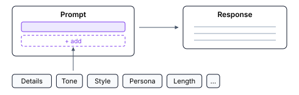
<!-- pages: 320-322 -->

A simple and short prompt can get you started, but in most cases you'll need to **add specificity** to your instructions. A generic prompt will return a generic response, and in most cases that's not what we want. In the same way that specific instructions will help humans do our job well, a model needs to be supplied with specific details to guide its response.

Going back to the previous prompt, the generated product description was great, but what if we wanted it to include specific things, such as its features, who it is designed for, and so on? We can adjust the prompt to take more inputs from the user, like so:

```python
user_input_product = "a wireless headphone product named the CO-1T"
user_input_keywords = '"bluetooth", "wireless", "fast charging"'
user_input_customer = "a software developer who works in noisy offices"
user_input_describe = "benefits of this product"

prompt = f"""Write a creative product description for {user_input_product}, \
with the keywords {user_input_keywords} for {user_input_customer}, \
and describe {user_input_describe}."""

generate_text(prompt, temp=0.5)
```

In the example above, we pack the additional details of the prompt in a single paragraph. Alternatively, we can also compose it to be more structured. And here's an example response. This time, the product description is tailored more specifically to our desired target customer, includes the key features that we specified, and sprinkles benefit statements throughout:

```text
Are you a software developer struggling to focus in the hustle and bustle …
```

There are many angles to add specificity to a prompt. Here are some examples:

- **Style:** telling the model to provide a response that follows a certain style or framework. For example, instead of asking the model to "Generate an ad copy for a wireless headphone product" in a generic sense, we ask it to follow a certain style, such as "Generate an ad copy for a wireless headphone product, following the **AIDA framework — Attention, Interest, Desire, Action**."
- **Tone:** adding a line mentioning how the tone of a piece of text should be, such as professional, inspirational, fun, serious, and so on. For example, "Tone: casual".
- **Persona:** telling the model to act like a certain persona helps to add originality and quality to the response. For example, "You are a world-class content marketer. Write a product description for …"
- **Length:** telling the model to generate text with a specific length, be it in words, paragraphs or others. This helps the model to be verbose, concise or somewhere in between. For example, "Write in 3 paragraphs the benefits of …"

### Context

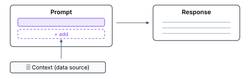

- While LLMs excel in text-generation tasks, they struggle in **context-aware scenarios**. Here's an example. If you were to ask the model for the top qualities to look for in wireless headphones, it will duly generate a solid list of points. But if you were to ask it for the top qualities of the CO-1T headphone, it will not be able to provide an accurate response, because it does not know about it.
- In real applications, being able to add context to a prompt is key, because this is what enables personalised generative AI for a team or company. It makes many use cases possible, such as intelligent assistants, customer support and productivity tools, that retrieve the right information from a wide range of sources and add it to the prompt.

Here's an example where we ask the model to list the features of the CO-1T wireless headphone without any additional context:

```python
user_input = "What are the key features of the CO-1T wireless headphone"
prompt = user_input
generate_text(prompt, temp=0)
```

This generates a response that the model makes up, since it doesn't have any information to refer to:

```text
"The CO-1T wireless headphone is a high-quality …"
```

And here's the same request to the model, this time with the product description of the product added as context:

```python
context = """Think back to the last time you were …
…"""

user_input = "What are the key features of …"
prompt = f"""{context}
Given the information above, answer this question:
{user_input}"""

generate_text(prompt, temp=0)
```
<!-- pages: 323-325 -->

Now the model accurately lists the features of the model:

```text
"The CO-1T wireless headphones have noise cancellation …"
```

### Format

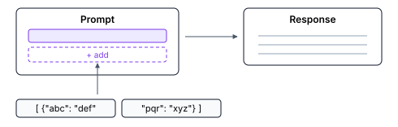

So far, we saw how to get the model to generate responses that follow certain styles or include specific information. But we can also get the model to generate responses in a **certain format**. Let's look at a couple of them: **markdown tables and JSON strings**.

Here, the task is to extract information from a list of invoices. Instead of providing the information in plain text, we can prompt the model to generate a table that contains all the information required:

```python
prompt = """Turn the following information into a table with columns Invoice Number, Merchant Name, and Account Number.
Bank Invoice: INVOICE #0521 MERCHANT ALLBIRDS ACC XXX3846
Bank Invoice: INVOICE #6781 MERCHANT SHOPPERS ACC XXX9877
Bank Invoice: INVOICE #0777 MERCHANT CN TOWER ACC XXX3846
"""
generate_text(prompt, temp=0)
```

The response will come in the form of a markdown table:

> Here is a table formatted with the columns of Invoice Number, Merchant Name and Account Number, filling in the previous information:

| Invoice Number | Merchant Name | Account Number |
| --- | --- | --- |
| INVOICE #0521 | ALLBIRDS | XXX3846 |
| INVOICE #6781 | SHOPPERS | XXX9877 |
| INVOICE #0777 | CN TOWER | XXX3846 |

> Let me know if you'd like me to make any modifications to this table …

Another useful format is **JSON**, which we can modify the prompt as follows:

```python
prompt = """Turn the following information into a JSON string:
Bank Invoice: INVOICE #0521 …
…
"""
generate_text(prompt, temp=0)
```

This returns the following response — *"Certainly, here is the JSON format of the 3 bank invoices:"*

```json
[
  {
    "invoice_number": "INVOICE #0521",
    "merchant_name": "ALLBIRDS",
    "account_number": "XXX3846"
  },
  { … },
  { … }
]
```

## Few-Shot Examples, Chain-of-Thought & Steps
<!-- pages: 325-332 -->

### Examples

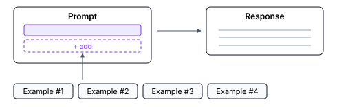

- All our prompts so far use what is called **zero-shot prompting**, which means that we are providing an instruction without any example. But in many cases it is extremely helpful to provide examples to the model to guide its response. This is called **few-shot prompting**.
- Few-shot prompting is especially useful when we want the model response to follow a certain style or format. Also, sometimes it is hard to explain what you want in an instruction, and easier to show examples.
- Let's use an example task, where a model should take a request coming from a human and rephrase it into the most accurate utterance that an AI virtual assistant should use. We'll use this example request: *"Send a message to Alison to ask if she can pick me up tonight to go to the concert together."* Given that request, we should expect the rephrased utterance to be something like: *"Can you pick me up tonight to go to the concert together?"*
<!-- pages: 326-328 -->

First, let's generate a response without giving the model an example. Here's the prompt:

```python
prompt = """Turn the following message to a virtual assistant into the correct action:
Send a message to Alison to ask if she can pick me up tonight to go to the concert together"""

generate_text(prompt, temp=0)
```

The response we get is not wrong, but it doesn't follow the style that we need, which is a simple one-line rephrasing of the original request. Instead, it generates an email:

```text
"OK, I will send a message to Alison asking if she can pick you up tonight to go to the concert together. Please provide me with details of your inquiry so I can assist you better!"
```

Now let's modify the prompt by adding a few examples of how we expect the output to be:

```python
user_input = "Send a message to Alison to ask if she can pick me up tonight to go to concert together"

prompt = f"""Turn the following message to a virtual assistant into the correct action:

Message: Ask my aunt if she can go to the JDRF Walk with me October 6th
Action: can you go to the jdrf walk with me october 6th

Message: Ask Eliza what should I bring to the wedding tomorrow
Action: what should I bring to the wedding tomorrow

Message: Send message to supervisor that I am sick and will not be in today
Action: I am sick and will not be in today

Message: {user_input}"""

generate_text(prompt, temp=0)
```

This time, the style of the response is exactly how we want it:

```text
"Can you pick me up tonight to go to the concert together?"
```

### Chain of Thought

- One specific way to provide examples in a prompt is to show responses that include a **reasoning step**. This way, we are asking the model to "think" first rather than going straight to the response. In tasks involving mathematical questions, for example, there is a huge difference between directly giving the answer and adding a reasoning step in between.
- This concept is called **"chain-of-thought" prompting**, introduced by **Wei et al.** Let's look at an example from the paper which illustrates this idea.

First, let's look at a prompt **without** a chain of thought. It contains one example of a question followed by the answer, without any intermediate calculation step. It also contains the new question we want to answer:

```python
prompt = f"""Q: Roger has 5 tennis balls. He buys 2 more cans of tennis balls. Each can has 3 tennis balls. How many tennis balls does he have now?
A: The answer is 11.
---
Q: The cafeteria had 23 apples. If they used 20 to make lunch and bought 6 more, how many apples do they have?
A: The answer is 9.
---
Q: A box has 10 balls and a half of the balls are red balls. How many red balls are in the box if 4 red balls are added?
A:"""

generate_text(prompt, temp=0)
```

We get the following response, which is an **incorrect answer (12)**. And notice that the response gives the answer first, similar to the example shown:

```text
"The answer is 12. There are 5 balls that are not red and 5 balls that are red, and adding 4 red balls would make it 9 red and 6 not red."
```
<!-- pages: 329-331 -->

Now, let's repeat that, this time **with a chain of thought**. Now the example answer contains a reasoning step, describing the calculation logic to get to the final answer, before giving the final answer:

```python
prompt = f"""Q: Roger has 5 tennis balls. He buys 2 more cans of tennis balls. Each can has 3 tennis balls. How many tennis balls does he have now?
A: Roger started with 5 balls. 2 cans of 3 tennis balls each is 6 tennis balls. 5 + 6 = 11. The answer is 11.
---
Q: The cafeteria had 23 apples. If they used 20 to make lunch and bought 6 more, how many apples do they have?
A: The cafeteria started with 23 apples. They used 20 to make lunch, so they have 23 - 20 = 3 apples. They bought 6 more apples, so they have 3 + 6 = 9 apples. The answer is 9.
---
Q: A box has 12 balls and a half of the balls are red balls. How many red balls are in the box if 4 red balls are added?
A:"""

generate_text(prompt, temp=0)
```

And we get the **correct answer this time (10)**, with the response following the style of the example given:

```text
"There are 12/2 = 6 red balls in the box. When 4 more red balls are added, the number of red balls becomes 6 + 4 = 10. The answer is 10."
```

> **Note.** The notebook's first (no chain-of-thought) version says the box has 10 balls; the chain-of-thought version uses 12 balls, which matches the response above.

### Steps

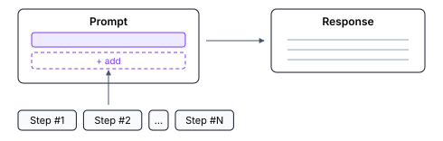

To steer the model toward generating higher-quality responses, it can be helpful to add instructions for the model to **generate intermediate steps** before generating the final output. The information generated during those steps helps enrich the model's context before it generates the final response.

There could be another scenario where we specifically need the response to contain specific information. In this case, we can specify what we need in the prompt. Let's use an example of generating startup ideas. We can get the model to directly generate an idea for a given industry, like so:

```python
user_input = "education"
prompt = f"""Generate a startup idea for this industry: {user_input}"""

generate_text(prompt, temp=0.5)
```

This generates the following response, which is reasonable, but perhaps not exactly what we are looking for:

```text
Here is a startup idea for the education industry:

"MathsMadeEasy"

Description:
"MathsMadeEasy" is an innovative K-12 ed-tech startup that aims to revolutionize the way young students learn mathematics. With a vision to eliminate math-related anxiety and foster a …

Approach & Features:
1. Gamified Learning: …
2. Personalized …: …
```

Alternatively, we can ask the model to generate information in steps, such as describing the problem to be solved and the target audience experiencing this problem.
<!-- pages: 332 -->

```python
user_input = "education"
prompt = f"""Generate a startup idea for this industry: {user_input}
First, describe the problem to be solved.
Next, describe the target audience of this startup idea.
Next, describe the startup idea and how it solves the problem for the target audience.
Next, provide a name for the given startup.

Use the following format:
Industry: <the given industry>
The Problem: <the given problem>
Audience: <the given target audience>
Startup Idea: <the given idea>
Startup Name: <the given name>"""

generate_text(prompt, temp=0.9)
```

This provides a richer description of the startup idea:

```text
Industry: Education
The Problem: Many people today struggle …
Audience: Recent …
Startup Idea: Online community …
Startup Name: "Nurture Nest"
Our platform offers a …
```

### Conclusion

A prompt can be as simple as a single line of instruction, though **the more specific the prompt is, the higher the level of quality and accuracy you can expect from the response**. Each building block added to a prompt provides a different type of lever to enhance the quality of the response.

## Multilingual Semantic Search with Cohere & LangChain
<!-- pages: 333-348 -->

- How to use **LangChain** to efficiently build semantic search applications on top of Cohere's multilingual model.
- This article looks at how we can use the Cohere Platform and LangChain to build end-to-end pipelines for multilingual semantic search. We start with a basic semantic search example where we import a list of documents, turn them into text embeddings and return the most similar document to a query. Then we build a more complex application that can answer questions about a long-form document, such as an article. *[The summary above was generated by Cohere's new Summarize Beta endpoint, with minor editing.]*

### Introduction

You have an idea for building a cool application on top of Cohere's LLMs. But as you start building, you realise there's more to building an LLM-powered application than the model alone. You begin building utilities around it, but you realise it can take a lot of time, slowing down your productivity. In fact, you have so many ideas in your head. If only there were a way for you to build and test them more efficiently. In this article, we'll look at how you can achieve that with Cohere and LangChain.

### Overview of Cohere

- The **Cohere Platform** provides an API for developers and organisations to access cutting-edge LLMs without needing ML know-how. The platform handles all the complexities of curating massive amounts of text data, model development, distributed training, model serving and more. This means that developers can focus on creating value on the applied side, rather than spending time and effort on the capability-building side.
- There are **2 key types of language-processing capabilities** that the Cohere Platform provides — **text generation and text embedding** — and each is served by a different type of model.
- With **text generation**, we enter a piece of text, or prompt, and get back a stream of text as a completion to the prompt. One example is asking the model to write a haiku (the prompt) and getting an originally written haiku in return (the completion).
- With **text embedding**, we enter a piece of text and get back a list of numbers representing its semantic meaning. This is useful for use cases that involve "measuring" what a passage of text represents — for example, in analysing its sentiment.

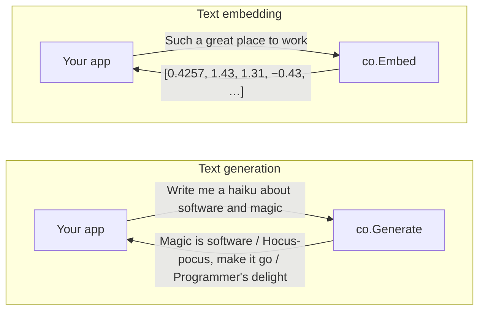

*The two key types of language-processing capabilities that the Cohere Platform provides.*
<!-- pages: 335-337 -->

### Overview of LangChain

- To create true value for end users, these models in isolation are often not enough. A truly powerful application emerges when you combine them with other sources of computation or knowledge. This is where **LangChain** comes into the picture. It is an open-source library that provides abstractions for building LLM-based applications. LangChain makes it easy and fast to assemble an end-to-end application via its wide range of modules. **Think Lego blocks for LLM applications.**
- In this article, we'll explain how to use LangChain's **Chains** and **Indexes** modules to build end-to-end pipelines with very few lines of code.

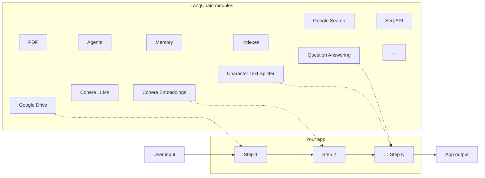

*LangChain makes it easy to put together an end-to-end LLM-powered application.*

### Overview of Multilingual Semantic Search

- **Semantic search** provides search capabilities based on the contextual meaning of a passage of text. It solves the limitation of the alternative method, which is keyword search.
- Here's an example. Let's take a query: "places to eat". A semantic search system would be able to associate this with "restaurants", because their meanings are similar. It's not possible to do that with keyword search, because the results will be limited to the keywords "places", "to" and "eat".
- **And what is multilingual search?** It is a search capability not limited to one language in the query and the results. To build such systems, traditionally you would have to build individual pipelines for each language, meaning your system will be bloated, costly and inefficient. But with Cohere's multilingual embedding model, you need just **one embedding model to handle 100+ languages**.
- When talking about multilingual models, there are two types of searches: **multilingual and cross-lingual**.
  - **Multilingual search** happens when the query and the result are of the same language. For example, an English query of "places to eat" returning an English result of "Bob's Burgers".
  - **Cross-lingual search** happens when the query and the result are of a different language. For example, a Hindi query of "खाने की जगह" ("places to eat") returning an English result of "Bob's Burgers".

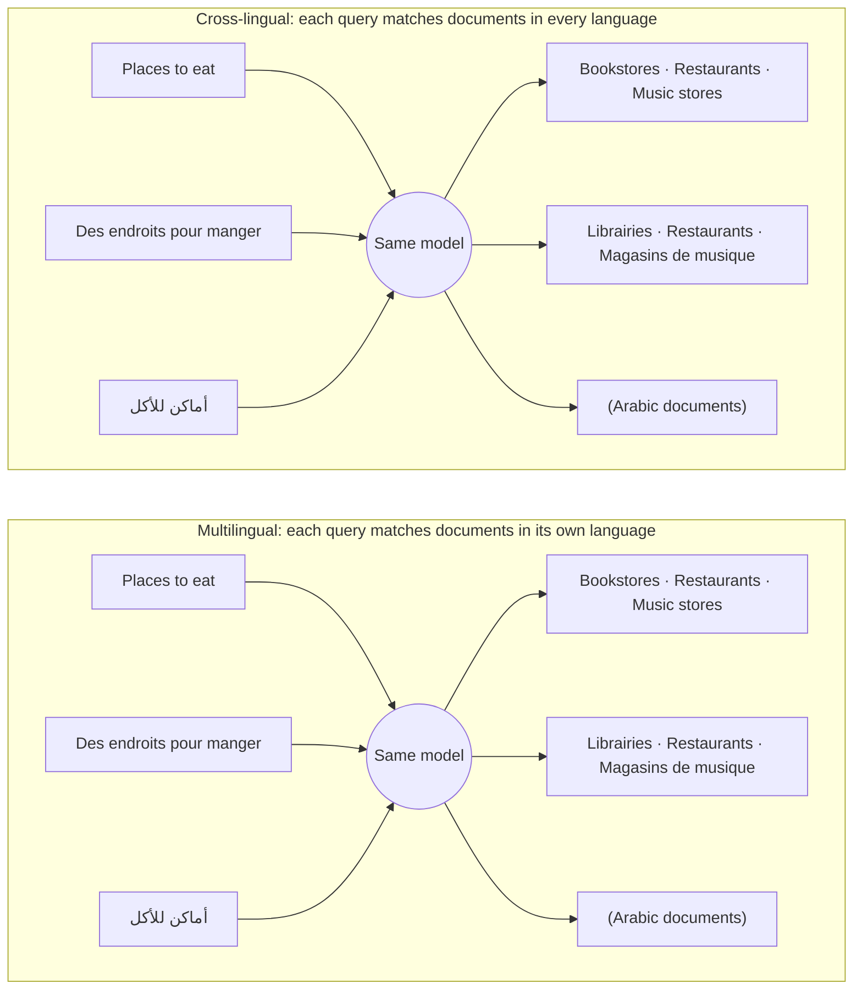

*The difference between multilingual and cross-lingual search.*

With Cohere's multilingual embedding model, we can do **both multilingual and cross-lingual searches using one single model**.

```python
! pip install cohere langchain qdrant-client tfds-nightly

from langchain.embeddings.cohere import CohereEmbeddings
from langchain.llms import Cohere
from langchain.prompts import PromptTemplate
from langchain.text_splitter import RecursiveCharacterTextSplitter
from langchain.chains.question_answering import load_qa_chain
from langchain.chains import RetrievalQA
from langchain.vectorstores import Qdrant
from langchain.document_loaders import TextLoader
import textwrap as tr
import random
import os

os.environ["COHERE_API_KEY"] = "COHERE_API_KEY"
```
<!-- pages: 338-340 -->

### Example 1 — Basic Multilingual Search

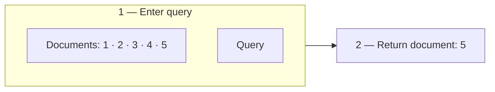

*Searching the most relevant document from a list of documents.*

- In the first example, we'll create a semantic-search pipeline for searching the most relevant document from a list of documents. An example application is a recommendation system for podcasts or articles.
- We'll compare a query with a list of documents from a questions dataset, and then return the documents that are most similar to the query. While the documents are in English, we'll see how good the model is at cross-lingual search: we'll enter queries in 5 languages and see if the results match our expectations.

**Step 1 — Import a list of documents.** First, we import a dataset containing a list of questions from the **Text REtrieval Conference (TREC) Question Classification** dataset. We can take the dataset from the publicly available TensorFlow Datasets library:

```python
import tensorflow_datasets as tfds
dataset = tfds.load('trec', split='train')
texts = [item['text'].decode('utf-8') for item in tfds.as_numpy(dataset)]
```

This dataset contains **5,452 documents**. Here are a few sample documents from the dataset, where each document is a question:

- What is the starting salary for beginning lawyers?
- Where did Bill Gates go to college?
- What task does the Bouvier breed of dog perform?
- What are the top boy names in the U.S.?
- What is a female rabbit called?

**Step 2 — Embed the documents and store them in an index.**

- Next is where the magic happens. We turn each document into a **text embedding**, which is a number representation of text that captures its context and meaning. Then we put these embeddings in a **vector database (also called an "index")**, so our system can perform the search in a scalable and efficient way.
- With LangChain, we can do that with just 2 lines of code. The first defines the embeddings model, where we initialise the `CohereEmbeddings` object with the multilingual model `multilingual-22-12`. The second turns the documents into text embeddings and indexes them in a vector database. Several vector database options are available; in our case, we use **Qdrant**, which offers an open-source vector database.
- Here, we define the location of the database, which we keep in memory, and the collection name. Also, importantly, we set the similarity-search method to be **`Dot`**, as the multilingual embedding model works best with the dot-product method.

```python
# Define the embeddings model
embeddings = CohereEmbeddings(model="multilingual-22-12")

# Embed the documents and store in index
db = Qdrant.from_texts(texts, embeddings,
                       location=":memory:",
                       collection_name="my_documents",
                       distance_func="Dot")
```

**Step 3 — Enter a query.** We enter a new search query: *"How to get in touch with Bill Gates"*. Now, looking at the documents, three items contain the term "Bill Gates":

- What is Bill Gates of Microsoft e-mail address?
- Where did Bill Gates go to college?
- How many square feet is Bill Gates' home?
<!-- pages: 341-343 -->

- None of these contains exactly the term we are looking for with the same keyword. A traditional keyword search would fail to distinguish the most relevant documents between these three.
- However, with semantic search, we should expect to get the document *"What is Bill Gates of Microsoft e-mail address?"* as the most similar query, because "get in touch" and "e-mail address" imply a similar intent.
- But let's not stop there. The multilingual model can also perform well at cross-lingual tasks. So we'll enter the same query in two other languages, **French and Indonesian**:

```python
queries = ["How to get in touch with Bill Gates",
           "Comment entrer en contact avec Bill Gates",
           "Cara menghubungi Bill Gates"]
queries_lang = ["English", "French", "Indonesian"]
```

Let's see how the model performs.

**Step 4 — Return the document most similar to the query.** Now we take the query and pass it through the `similarity_search` method to get the document most similar to the query. Here, we take the `page_content` attribute of the top-most document, hence the `[0]` index:

```python
answers = []
for query in queries:
    docs = db.similarity_search(query)
    answers.append(docs[0].page_content)
```

And below are the results for the query in the three different languages — English, French and Indonesian. **The search engine successfully finds the most semantically similar document to the query:**

| Query language | Query | Most similar existing question |
| --- | --- | --- |
| English | How to get in touch with Bill Gates | What is Bill Gates of Microsoft e-mail address? |
| French | Comment entrer en contact avec Bill Gates | What is Bill Gates of Microsoft e-mail address? |
| Indonesian | Cara menghubungi Bill Gates | What is Bill Gates of Microsoft e-mail address? |

In this example, we saw how we can leverage LangChain to build a semantic-search system with just a few lines of code — faster than if you were to build it from scratch. This theme continues in the following example.

### Example 2 — Search-Based Question Answering

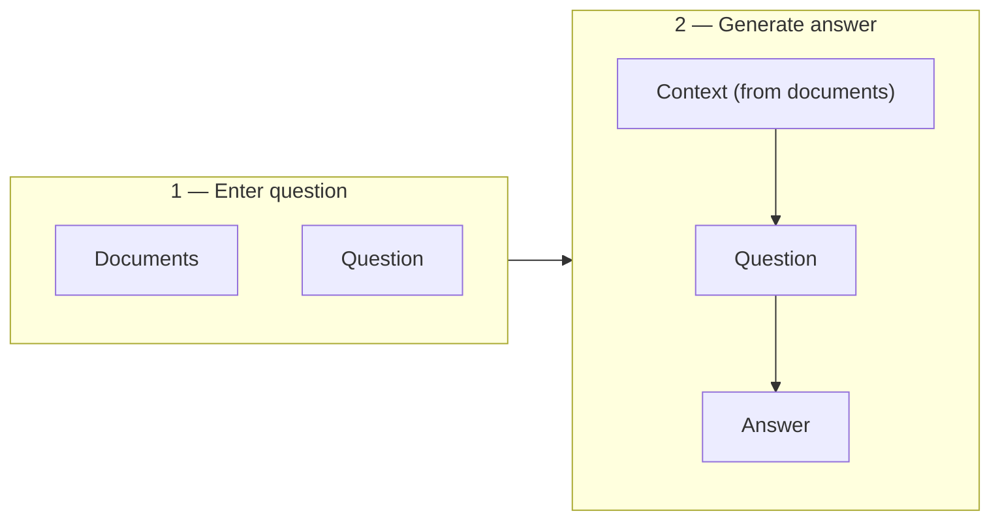

*Answering questions about a long-form document.*

- In this second example, we'll use semantic search to answer questions about a **long-form document**, such as an article. Here, we take a question from the user, search for the most relevant passages in the document, and use these to generate an answer. An example application is the search bar for a documentation website.
- This time, we'll add a **text-generation model** to the pipeline so we can perform the answer-generation part.
- And to keep it simple, we'll look at an all-English example, from the query to the text generation. Having said that, we can use the same `multilingual-22-12` model for the embedding part, since it is a multilingual model.

**Step 1 — Add an article and chunk it into smaller passages.** We'll use a single long-form article as an example, which is **Steve Jobs' Stanford University 2005 commencement address**.
<!-- pages: 344-346 -->

The first step is to **chunk the text** into smaller pieces, so we can embed each piece later. Here we can use LangChain's built-in `split_documents` method from the `RecursiveCharacterTextSplitter` module. We can define the chunk size in characters (we chose 500) and whether we want the chunks to overlap by a certain number of characters (we chose 0).

```python
!wget 'https://docs.google.com/uc?export=download&id=1f1INWOfJrHTFmbyF_0be5b4u-moz3a4f' -O steve-jobs-commencement.txt

loader = TextLoader("steve-jobs-commencement.txt")
documents = loader.load()
text_splitter = RecursiveCharacterTextSplitter(chunk_size=500, chunk_overlap=0)
texts = text_splitter.split_documents(documents)
```

> **Note.** The notebook's text says the chunk size was 300; its code uses `chunk_size=500`.

**Step 2 — Embed the passages and store them in an index.** This step is the same as in the first example, where we turn each chunk into a text embedding, using the same multilingual model, and index these embeddings in a vector database:

```python
embeddings = CohereEmbeddings(model="multilingual-22-12")
db = Qdrant.from_documents(texts, embeddings,
                           location=":memory:",
                           collection_name="my_documents",
                           distance_func="Dot")
```

**Step 3 — Enter a question.** Next, we enter a list of questions that we'd like to get answers for. Below are the five questions we'll ask. The first three are questions that require factual answers. The fourth is more of an opinion-based question with no one correct answer. Finally, the fifth question asks about factual information we know is unavailable in the context.

```python
questions = [
    "What did the author liken The Whole Earth Catalog to?",
    "What was Reed College great at?",
    "What was the author diagnosed with?",
    "What is the key lesson from this article?",
    "What did the article say about Michael Jackson?",
]
```

Let's see if we can get the answers we're expecting.

**Step 4 — Answer the question based on the most relevant passages.**

- For each question, we need to find the chunks of text most relevant to the question. Here, we want to get the **top-four most relevant chunks** (a default number you can change).
- We'll use these chunks as the context to answer the question. The bigger the context, the more information becomes available to the text-generation model, which we'll use (Command) to generate the answer.
- To generate the answer, we need to provide the following prompt to the text-generation model:
  - an instruction of what we want it to generate;
  - the context, which is the chunks of text that are the most relevant to the question;
  - the question.
- With LangChain, we can use the `load_qa_chain` method to pack the whole thing together: creating the prompt and calling the text-generation model.
- The method comes with a predefined prompt, but we can modify it using the `PromptTemplate` module. I found that modifying the prompt for this particular example returns better results, and here's what it looks like:

```python
prompt_template = """Text: {context}

Question: {question}

Answer the question based on the text provided. If the text doesn't contain the answer, reply that the answer is not available."""

PROMPT = PromptTemplate(
    template=prompt_template, input_variables=["context", "question"]
)

chain_type_kwargs = {"prompt": PROMPT}
```
<!-- pages: 347-349 -->

And here's what the code looks like:

```python
qa = RetrievalQA.from_chain_type(llm=Cohere(model="command", temperature=0),
                                 chain_type="stuff",
                                 retriever=db.as_retriever(),
                                 chain_type_kwargs=chain_type_kwargs,
                                 return_source_documents=True)

for question in questions:
    answer = qa({"query": question})
```

And below are the answers we get. **They seem to be spot on!** The first three are factual answers, which the system extracts from the text. The fourth is an open-ended question, in which the system provides a reasonable answer based on passages in the text. And the fifth question is answered correctly, where there is no information from the text to answer the question.

| Question | Answer |
| --- | --- |
| What did the author liken The Whole Earth Catalog to? | It was sort of like Google in paperback form … |
| What was Reed College great at? | Reed College was great at … |
| What was the author diagnosed with? | The author was diagnosed with cancer. |
| What is the key lesson from this article? | The key lesson from this article is that … |
| What did the article say about Michael Jackson? | The text did not provide … |

We can see these prompts by enabling the debug mode in LangChain, like so:

```python
import langchain
langchain.debug = True   # the notebook shows False, which turns the debug output off
```

### Final Thoughts

In this article, we looked at two key things:

1. **The power of using a single multilingual embedding model** to efficiently build a search application that requires multilingual support — a common need these days. There is no need to build complex interfaces and pipelines to support different languages. Instead, we can use one pipeline to cover 100+ languages.
2. **The ease and efficiency of building such applications when paired with the LangChain library.** This simplifies the building of end-to-end pipelines via its modules, such as Chains, Indexes and more.

This is quite a powerful combination. It means you can build and tinker with multilingual semantic-search applications (and beyond) with the least friction. The more efficient you are, the more experiments you can make, and the faster you get to that application that truly makes a difference.

## Use-Case Patterns for the Command Model
<!-- pages: 349-353 -->

- **Cohere's Command model** is an instruction-following text-generation model trained to follow user commands. It is trained to be instantly useful in practical applications, covering a wide range of use cases.
- LLMs like the Command model are general-purpose and can be applied in infinite ways, but if one can't recognise the patterns where they can be useful, it can feel overwhelming.
- In this chapter, we'll go through several broad use-case categories for the Command model. Though they won't cover all the possible ways that you can use the model, they are good starting points for understanding the patterns of tasks where the model works well.

We'll go through the following use cases:

| | | |
| --- | --- | --- |
| ① Writing | ② Question answering | ③ Brainstorming |
| ④ Transforming | ⑤ Summarising | ⑥ Rewriting |
| ⑦ Extracting | ⑧ Classifying | |
<!-- pages: 350-353 -->

### Setting Up

For each use case, we'll look at some ideas on how a prompt can be constructed, and the associated model settings.

```python
! pip install cohere
import cohere
co = cohere.ClientV2("COHERE_API_KEY")
```

Let's also define a function to take a prompt and a temperature value and then call the Chat endpoint, which is how we can access the Command model. We set a default temperature value of 0, which nudges the response to be more predictable and less random. This function returns the text response generated by the model:

```python
def generate_text(prompt, temp=0):
    response = co.chat_stream(
        message=prompt,
        model="command-r-plus-08-2024",
        temperature=temp,
        preamble="")

    for event in response:
        if event.event_type == "text-generation":
            print(event.text, end='')
```

Our examples will revolve around a company's activities for launching a new wireless headphone product, such as getting the word out, managing customer interactions, and so on. For this, let's define a text snippet containing the product description. We'll be utilising the snippet in several examples throughout this article:

```python
product = """The CO-1T is a wireless headphone product that uses Bluetooth to connect to your devices. \
It has a long battery life and can be quickly charged using the …"""
```

### ① Writing

- We'll start with the most general type of use case, which is **writing**.
- Here we can ask the model to write freeform text — for example, with this prompt: *"Create an email about the launch of the wireless headphone product."* But that alone might not be very useful in practical applications, because the generated text can go in very different directions. We may want to add more context and specificity to the prompt.
- Here's how we can do that. Let's say we're building an application for users to enter some bullet points and get a complete email written. We can set up the prompt in the following way: create a variable for the user to input some text, and merge that, together with the product description, into the main prompt.

```python
user_input = """
- announce product launch
- create a call to action
- mention live chat for support
"""

prompt = f"""{product}
Create an email about the product above mentioning the following:
{user_input}
"""

response = generate_text(prompt, temp=0.5)
print(response)
```

Adding this context helps to guide the model in the direction we want it to go. Here is a sample response:

```text
"We are thrilled to announce the launch of our newest …"
```

- In this example, we changed the temperature value to 0.5. Throughout this article, you'll see different temperature values being used in different situations. **Increasing the temperature value tells the model to generate less predictable responses and instead be more "creative".** And since this task does require some form of creativity (expanding brief keywords into a full passage), we increased the temperature value. There is no one right value for a use case, so this is a setting you should try and iterate on to get the best outcome for your task.
- We have looked at one example, but writing as a use case can mean many different things. So instead of beginning your prompt with "Create", you can try other ways to extract different forms of content and formats that your application needs, such as using **"Explain", "Generate", "Write", "Provide", "Design", "Describe"**, and so on.

### ② Question Answering

*(The notebook ends here, with only the heading of this section written.)*
